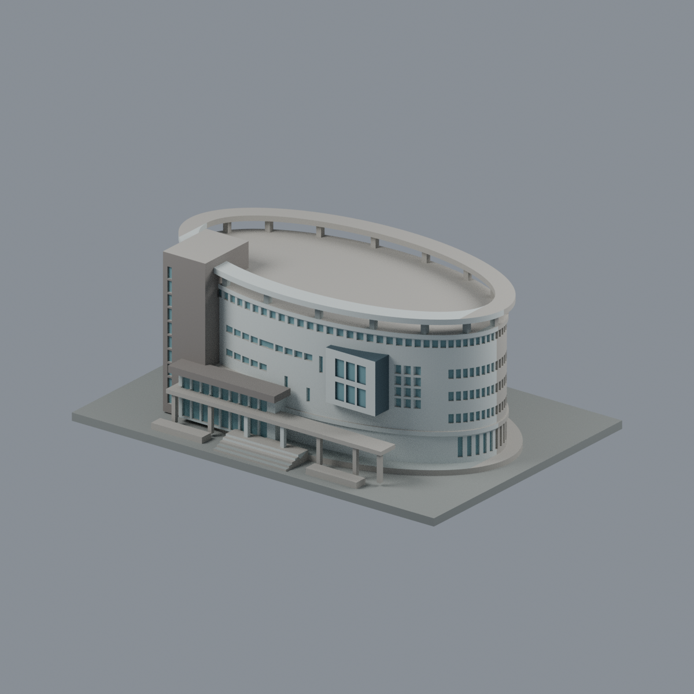
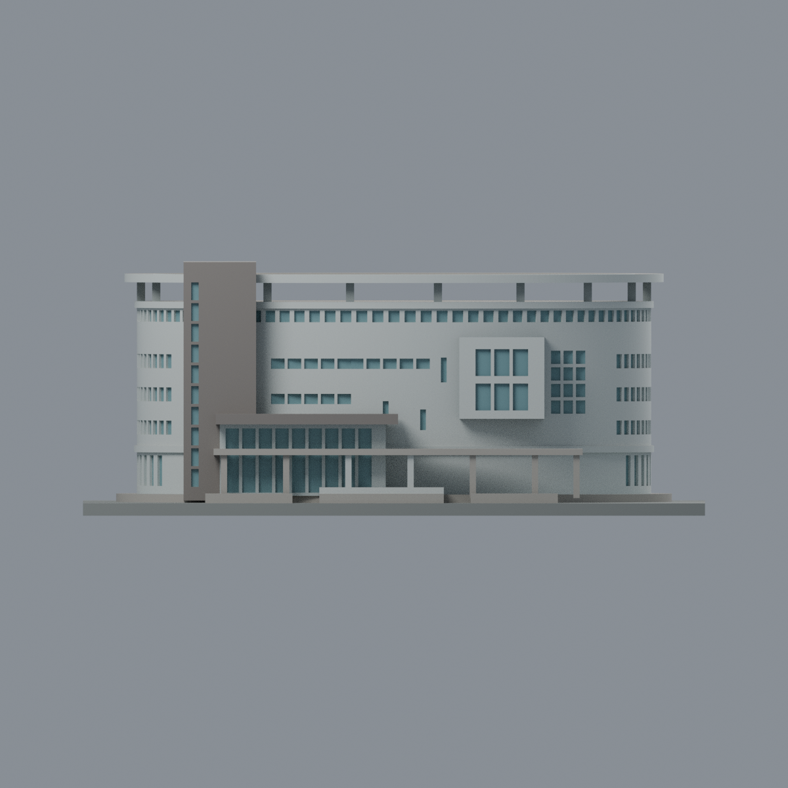
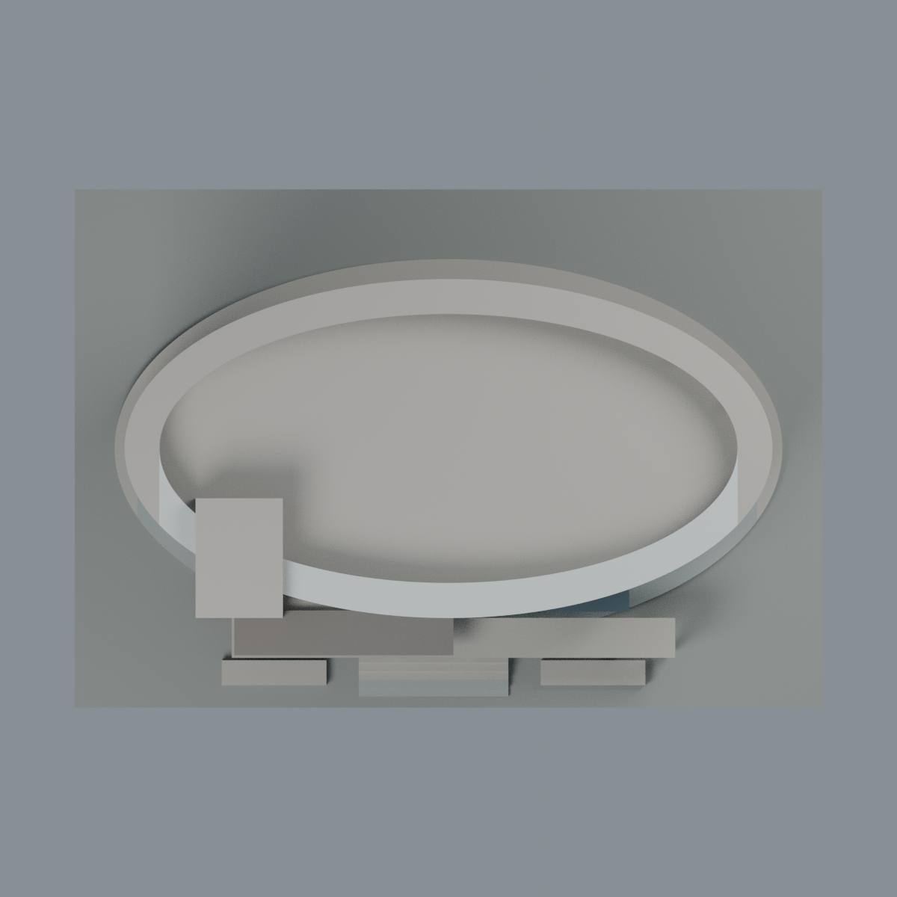

# 聯大八甲 國鼎圖書館：八材質外觀版

沿用原 **16,742 三角面／8,315 頂點**，不改原 STL 位元、座標、面序或幾何；這是既有模型外觀改版，不增加模型包數。

| 模型預覽 | 模型預覽 | 模型預覽 |
| :---: | :---: | :---: |
| 正面<br> | 背面保持中性<br> |  |
|  |  |  |

[表面色 3MF](nuulib-appearance.3mf) · [可編輯 Blender](scene.blend) · [材質色表](palette.json) · [逐面指派與依據](face-materials.json) · [原 STL](../guoding_library_150mm.stl)

## 來源與配色邊界

親自核對官方 [國鼎圖書館相簿](https://secretary.nuu.edu.tw/p/132-1003-1094.php?Lang=zh-tw) 的 [照片 5](https://secretary.nuu.edu.tw/var/file/3/1003/gallery/94/1094/gallery_1094_5717190_25479.jpg)、[照片 7](https://secretary.nuu.edu.tw/var/file/3/1003/gallery/94/1094/gallery_1094_1905808_25479.jpg)、[照片 10](https://secretary.nuu.edu.tw/var/file/3/1003/gallery/94/1094/gallery_1094_9931369_25478.jpg)。EXIF DateTimeOriginal 分別為 **2025-03-10 15:00:59／15:02:37／15:13:23**，時區與拍攝日期未獨立核實，不聲稱 2026 現況；照片不隨包散布。

- 已見前半橢圓館身與屋頂環採淺灰白磁磚代理，左塔及上層入口雨棚腰帶採灰褐色。原名牌留白，不補金色文字。
- **突出矩形的中央大片實牆保持淺色，不能整塊染黑**。只對原外側面與完整落在邊帶內的三角面配低彩度深灰；原正面部分大三角形跨越實景深框與淺牆，保守留淺色，不為配色切分原幾何。因此框線不完整，並非宣稱實景如此。
- 原正面橫窗、窄窗、塔樓小窗、入口與矩形窗凹背配低彩度灰青玻璃。只映射已存在且能登錄的窗槽；棕色細窗框、紫色窗簾與不同玻璃反射未獨立建模，不假造貼圖或追加幾何。原封實凹背不是實際透明室內。
- 原薄下層長雨棚與較高灰褐入口腰帶分開，未充分支持區中性。前環支柱與前階梯灰色；原階梯、樓層、窗數、橢圓環比例均為概略造型，非測繪。
- 背半館身、後窗及未觀察屋頂保持中性，屋頂照片中的光伏棚在原網格缺席，**不把原平屋頂染藍冒充光伏板**。現有整片屋頂也不聲稱是實景完整重建。
- 原 STL／面序／座標不變，不增加模型數；不烘焙陰影、樹木、設備或鄰棟，不宣稱物理列印成功。

[原幾何與來源限制](../README.md) · [來源覆核](qa/source-review.json)

## 重建與核驗

安裝 [依賴](source/requirements.txt)，Blender 使用 4.3.2。由本資料夾上層提供原 model.stl：

1. `python appearance/source/build_appearance.py`
2. `python appearance/source/verify_exchange.py`
3. `blender -b -t 3 --python-exit-code 1 -P appearance/source/render_appearance.py`
4. `blender -b -t 3 --python-exit-code 1 -P appearance/source/verify_scene.py`

[獨立重建 ZIP](rebuild-source.zip)含原 STL、四支程式及依賴，不含第三方照片；不取代原建模腳本。[逐檔 SHA256](SHA256SUMS)

[交換／拓撲 QA](qa/exchange-validation.json)核對原座標與面序、全部面材質、單連通、有向水密邊、頂點 link 單環、正體積與零退化／重複面；lib3mf 嚴格讀取零警告，實際編輯單材質再存讀，其他材質及面指派不變。SDK 六位小數量化誤差另列。

[Blender 存讀與編輯](qa/scene-validation.json) · [渲染記錄](qa/render-manifest.json) · [獨立重建](qa/rebuild-validation.json)

## 製造限制照舊

尺寸仍為 150 × 104 × 61.05 mm；原 STL、建模程式、場景及歷史 QA 保留。原層檢與薄特徵檢查本次未重跑，不能由材質 QA 代替。

3MF 是同一網格的表面色，不是八個封閉分色實體、切片專案、噴頭映射或 G-code。切片 GUI、多材料路徑與實體列印未測；柱頭、屋簷、窗框及薄邊仍須評估材料、支撐及拆除風險，沒有保證可印或免支撐。


## 2026-11-18 單一入口窗梃側返材族連續修訂

本次僅原 **5236、5242、5243、5247** 四個完整三角面由淺牆材 1 延續為既有銀色框材 5，其餘 16,738 面、原 8 材槽及 shader、頂點／面序、原 STL 位元完全保留，不增加材料或幾何。本頁原段落為歷史基準；本次檔案同層提供 [model.stl](model.stl)、[原生場景](scene.blend)、[3MF](nuulib-appearance.3mf)、[逐面 JSON](face-materials.json)、[新增 NPZ 表面交換檔](surface-colors.npz)。NPZ 是本次從保存場景原序新建的資料交換，不冒稱原包已有。

- 位置為入口整合細梃 **+X 側 x≈−24.6**，y[−37,−36.25]、z[5.45,20.95]，面積 11.625000715 mm²。四面沿既有邊形成完整矩形，前鄰 922／953 已為銀色，後鄰為原玻璃凹背。
- 它不是最大共面域的全部：共面棚端 5233／5238 仍為原中性，沿既有 y=−37 的自然元件原邊排除，不切三角、不中途憑色造界。其他窗梃、對側、上下揭邊、凹背及棚均未改。
- 官方照片 5 可辨細銀白金屬窗梃的前面及窄側，照片 7 提供同入口位置與整段尺度關係。原實心盒挖槽的整合條帶作既有框材的有限代理延續；**不是精確實柱編號、逐格配準、實測 0.75 mm 深度或構造鑑定**。模型九槽及橫棚與實景細梃接件不完全相同，不藉色修復形狀。
- 照片 EXIF 自報 2025-03-10，時區與日期未獨立核實，不認證 2026 現況。色碼沿既有 silver_entry_frames `#BEC9C7`，不是照片校色。原照片保留私人研究，不入公開包。[來源及有限域](MULLION-SOURCE-SCOPE.json)。
- 全場景 RNA 僅 14 差：四面各 polygon／looptriangle／material attribute 共 12，加 2 個局部 scope／表面交換 hash 屬性。原全部八材和 node trees、物件 inventory／變換、相機、世界／燈光完全保持。**無孤立材 fake_user 旗標變更**，原 original_STL_sha256／limitations 屬性保留。
- 原 3MF 只四面 p1/p2/p3 共 12 個材屬性變更；所有其他 XML 原位元、頂點字串與原 object fallback 保留。逐面 JSON 只更新四指派和四原因。新增 NPZ 與原 scene／STL／3MF 座標和面序一致。

### 重現及核驗

[鎖定輸入](baseline-inputs.json)、[重建基準 ZIP](baseline-rebuild-inputs.zip)、[變更紀錄](mullion-return-change.json)、[QA 摘要](QA-summary.json)、[逐檔 SHA](MANIFEST.json)。ZIP 含公開基準 STL／Blend／3MF／材表／逐面資料／原文碼，不含原照。

```sh
unzip baseline-rebuild-inputs.zip -d baseline
blender -b -t 2 -P rebuild_mullion_return.py -- baseline rebuilt
blender -b -t 3 -P render_mullion_views.py -- rebuilt
```

Blender 4.3.2（numpy 內建）。從 SHA 鎖定原幾何與場景基準重現局部表面修訂，不重建幾何、不替代原建模與製造 QA。原四視角 front／rear／elevation／top 均 1200×1200、Cycles 48 samples、原相機及尺度，公開 PNG 無 text metadata。私人前後對照使用同相機並另核原面射線可見性。

隔離重建驗數值檔 byte 與完整 RNA 等價；strict lib3mf 及私有改材寫回、Blender 私有頂點／面材另存重開結果見 QA。無新切片路徑或實體試印，不保證多材列印。此項本地完成，發布狀態另行確認。
