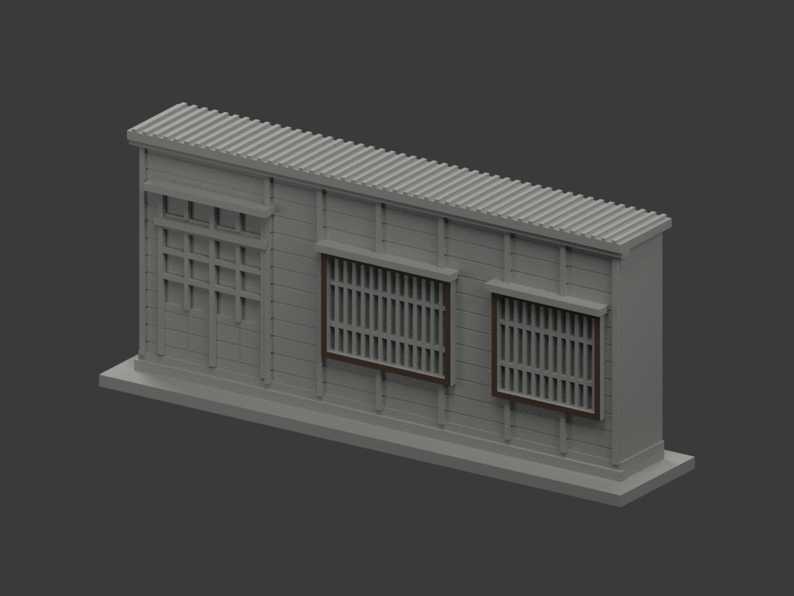
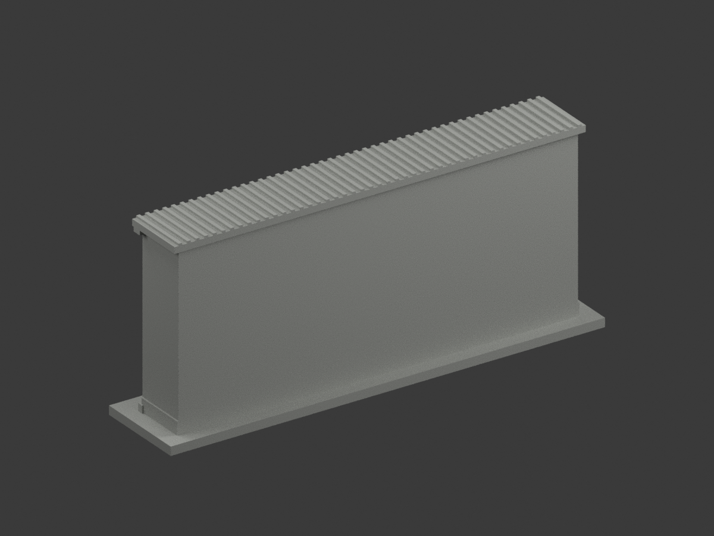
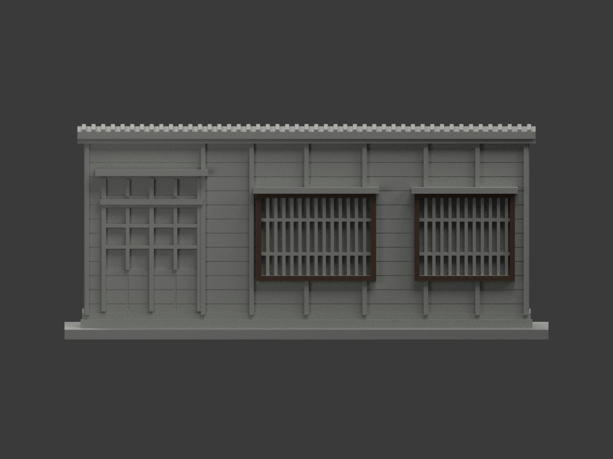
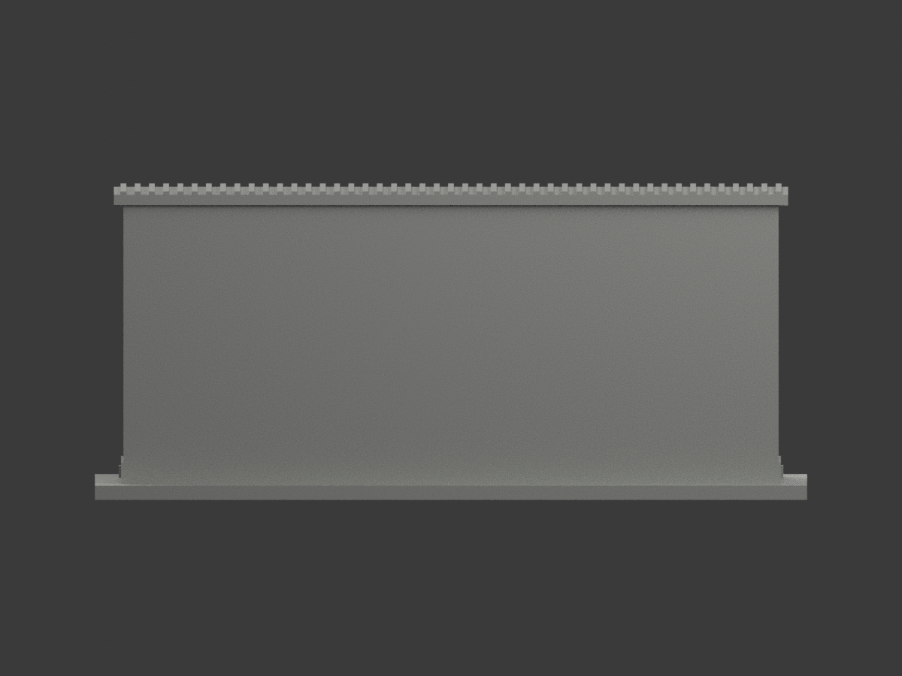
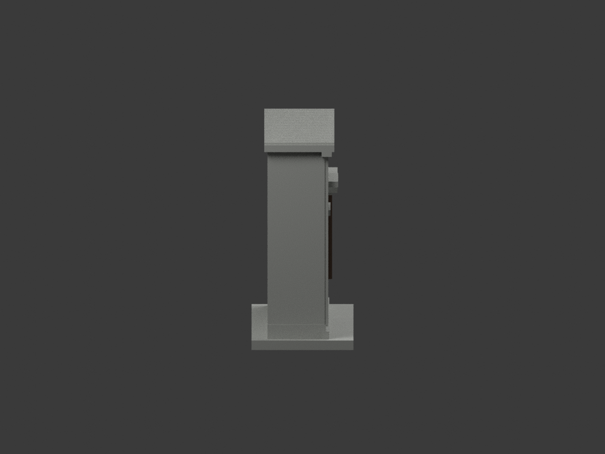
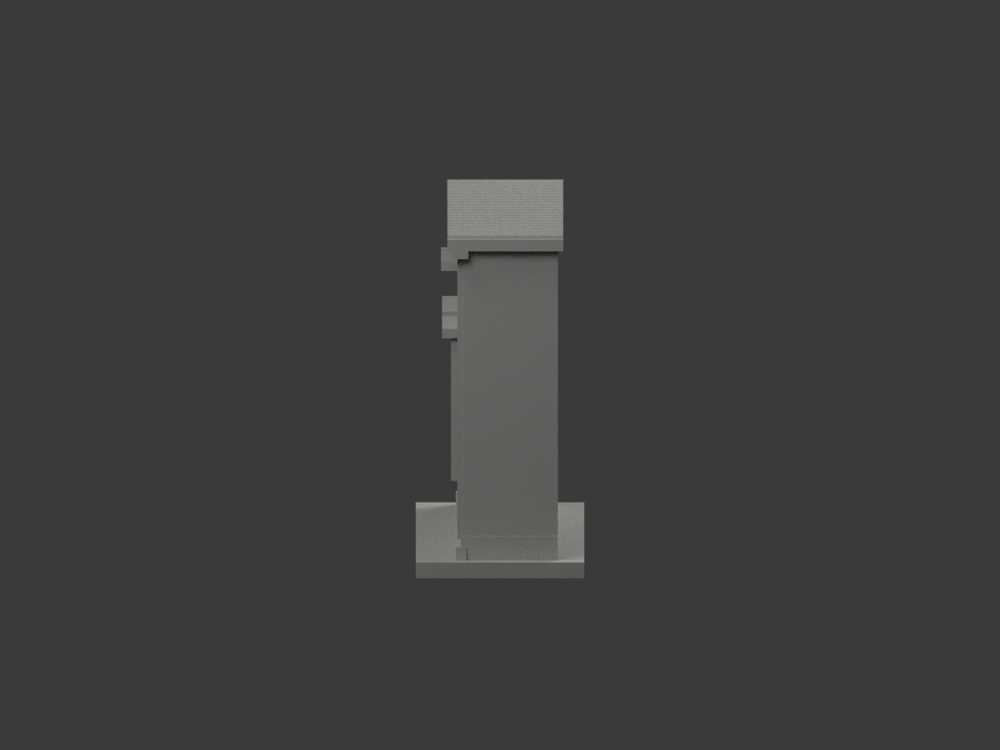
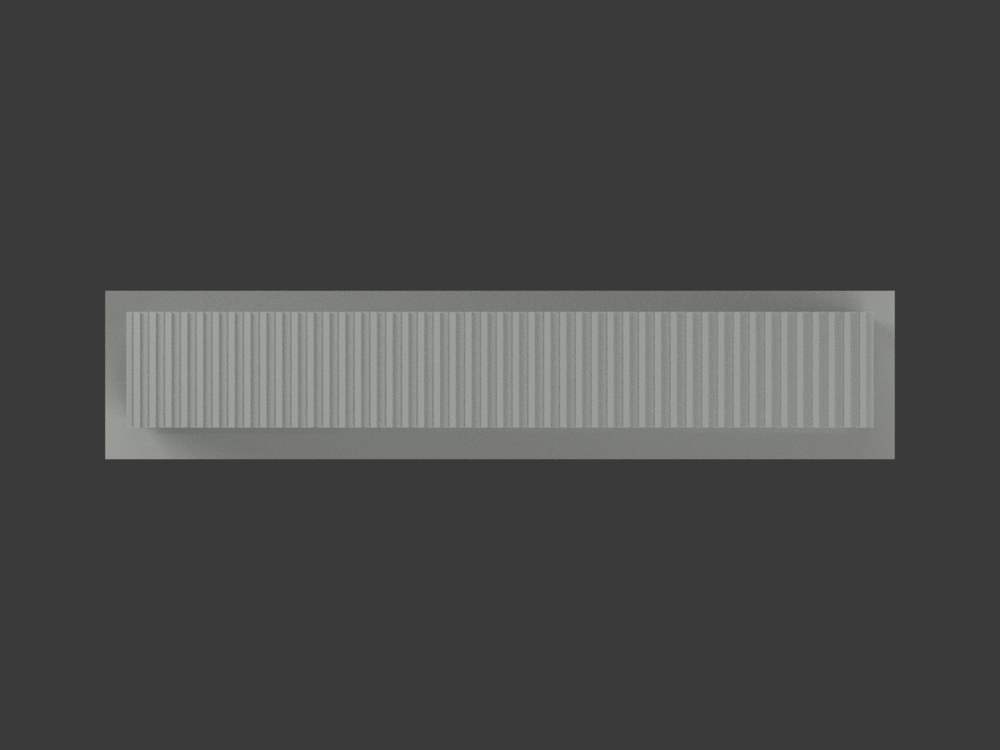
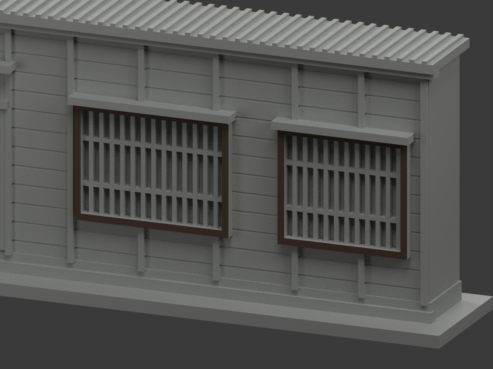
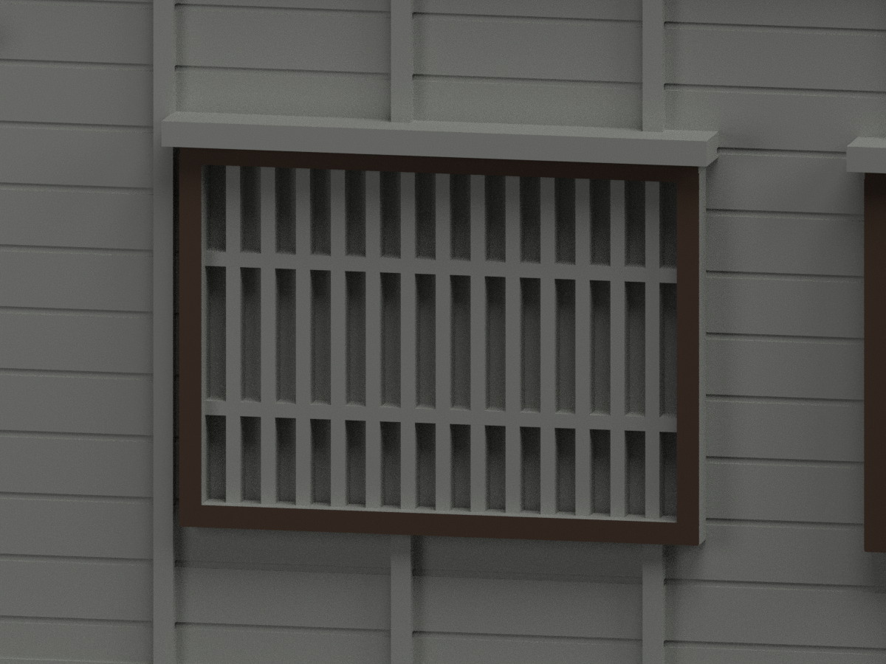
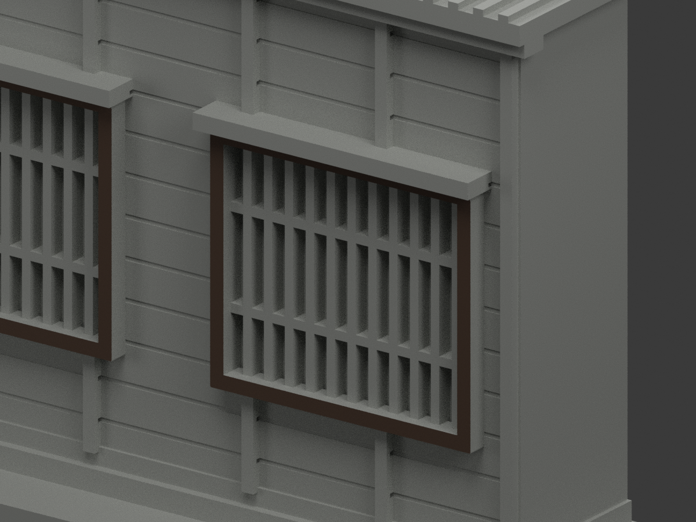

# 林之助畫室庭院側段｜兩窗外框正面局部深棕

**局部補色未完成：只兩窗外框正面48原面深棕；內格柵、門窗背板、木牆、磚基與截口近簷尚未分色。** partial_color_incomplete=true、fully_colored_exterior=false。同項 ntcu-lin-atelier-courtyard-section／count_delta=0，國立臺中教育大學柳川校屬館舍。英文身份 NTCU Lin Atelier Courtyard Section partial color。

**僅庭院側立面片段，不是整棟畫室或美術館。淺背截斷是模型約定，不是實際建築深度；不含2025入口改造。**

| 前斜視 | 後斜視 | 正面 |
|---|---|---|
|  |  |  |
|  |  |  |
|  |  |  |
|  | | |

## 材色範圍

全原y−9.3無限plane三頂點0.0001mm枚舉，48面分為兩個完整共享邊連通24面窗框環，Boolean交界碎面延至z45也保留。兩域x−15.6..21.6／33.4..64.6、z17.7..45只是結果界限，不是人工裁色。48名義深棕、5202中性，原5250三角不變。全原共面連通域一致，沒有normal閾值漏細面、centroid或亮度切三角。

官方庭院VR外照支持兩個完整突出棕色外框正面，與內部細格柵/玻璃簾/板壁/窗棚獨立。色族不等於校準木種或金屬表面。內格柵可能深色金屬但不在這次外框域；玻璃背/簾保持中性。整片木板壁有原模未表現白燈管、灰管和消防牌，不整牆棕。門框/門板的五金字牌及風化不外推；門窗雨庇薄邊、磚基灰通氣槽/混凝土底、框側背皆中性。原屋頂只是淺截口條，不是真完整斜瓦頂，不塗全黑。中性不是實景灰；資料範圍不是實材接縫。

## 來源日期與原始限制

官方VR來源屬2015修復後脈絡，但精確拍攝日期未知，不推出2025入口改造或2026現況。原外觀為照片近似，內格柵加厚/減量、凹窗有背、屋條截斷、人工空白背面不改；補色不追認測繪或完整復原。原照片只私人研究，不公開貼圖，不推定商用權利。

## 檔案與 QA

原STL/build/OBJ字節及5250三角座標拓撲保留。immutable20原件確實含model.obj；不以新生成OBJ取代原件。原README另存ORIGINAL-MONOCHROME-README.md，單色圖與QA歷史保留。appearance.3mf兩展示材與scene.blend真面材同原幾何；export/validate/render/verify及真3MF/scene精確身份 NTCU Lin Atelier Courtyard Section partial color。精確依賴隔離build+color、閉合正體積/3MF座標面材/Blender重開/10張1200×900檢核；保留重建不刪，未試印或驗多料切片，STL本身無色。

## English limitations

NTCU Lin Atelier Courtyard Section partial color. Courtyard elevation section only,notwholeatelier/museum;shallowblankrear isanarbitrarycutoff notactualdepth. Entire originaly=-9.3 plane48faces forms two complete24face outerframecomponents,includingBooleanjunctions throughz45. Nominaldarkbrown48/neutral5202;original5250triangles/STL/build/OBJ unchanged,count_delta0. Innergrilles/glass/curtains,doors/hardware,weatherboardswithlamps/pipes/signs,brickplinthwithgrayvents,hoodedges,frame sides/back,cutoffroofstripneutral. Post2015restorationVRcontext,captureunknown,not2025entrance/2026survey. Originalgeometricapproximation notrevalidated,no publicphotos/textures,not testprinted.


## 2026-11-18 靠門側窗框外頰有限補色

本次只將靠門第一扇窗的 −X 外豎框完整原連通域 **26 面由中性 1 延為既有棕材 0**。保留原 48 個棕色正面，成為 74 棕／5,176 中性；原 5,250 面／2,527 點、面序、STL、OBJ 與幾何完全不變。其餘 5,224 面不動，非全館完成補色。上文及舊 QA／checksum 保留歷史，最新範圍以本節與 `CHEEK-*` 文件為準。

原域 x≈−15.6，y[−9.3,−6.875]，z[17.8,44.2]，面積61.095008545 mm²；26面為完整共享邊共面域，保留與木板溝縫相交的階形邊，**不是完整矩形**，未切面或拉直。靠門外框朝−X可見側厚與前緣屬同棕色族；右側密格柵、左側水平木板壁分別排除。模型粗化厚度與相交階紋不等於實測構造，不藉顏色修復模型形狀。不鏡推第二窗、不改內側／背板／罩簷／板壁／屋頂截口。

官方庭院VR原圖拍攝日期未知，僅2015修復後脈絡，不包含2025入口改造或證明2026現況。名義棕 `#655042` 沿原色盤，不是校準色票、木種鑑定或逐像素深度量測。照片私存，不入公開包／紋理；[來源與域](CHEEK-SOURCE-SCOPE.json)。

### 本次保存與重建

原 native scene 直接改26面，不重建物件、相機、光或材質。完整RNA恰80差：26面在polygon、looptriangle、material attribute共78表示，加原`source_mesh_sha256`更新與新增`side_color_scope`。所有舊材、節點、逐slot與原scope保留；無孤材fake_user變更。原scope為一般部分色說明，新增scope詳本輪。

3MF僅26面p1改0，另補原object缺少的 `pid=1/pindex=1` 預設，讓SDK可編修寫回；每面本來都有明示p1，故預設不另改外觀。XML頂點原字串與所有原材保留。NPZ原座標／面序／dtype不變。

[變更紀錄](cheek-return-change.json) · [本次QA](CHEEK-QA.json) · [本次逐檔校驗](CHEEK-MANIFEST.json) · [公開原件重建基準ZIP](cheek-baseline-inputs.zip) · [基準hash](cheek-baseline-inputs.json)

```sh
unzip cheek-baseline-inputs.zip -d baseline
blender -b -t 2 -P rebuild_cheek_return.py -- baseline rebuilt
blender -b -t 3 -P render_cheek_views.py -- rebuilt
python finalize_cheek_previews.py rebuilt
```

Blender4.3.2、numpy、lib3mf2.5.0；PNG清理另需Pillow。鎖定原公開件重現局部材質修訂，不重建原幾何。原10視角以同定義、1200×900、Cycles48samples重渲；scene存檔相機不變，圖無文字覆蓋。私人同相機前後已親看；該視點26個面心射線中14可見，另12個後緣溝縫小面被旁側原直條面530遮擋。同一完整框域照留，不單獨剔除或切色，不冒稱所有面或像素無遮擋。原幾何製造QA未重跑，未切片或實印，不保證可印／多材工具路徑。發布狀態另行確認。


### 現行發布校驗

本次現行統計為 **74 棕／5,176 中性**，仍為局部補色。舊 QA 與前文的 48 面僅指歷史基準；現行材質統計見 `appearance-materials.json`。本發布的 `SHA256SUMS`／`FREEZE-MANIFEST.json` 已按現行檔案重列，不是舊版校驗檔；前文所提的舊 checksum 是原始基準 ZIP 內所保存的版本。校驗方法、清單層級與既存附圖區別見 [發布版校驗](RELEASE-CHECKSUMS.md)。
