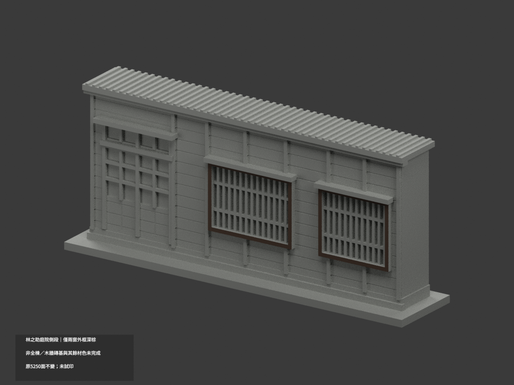
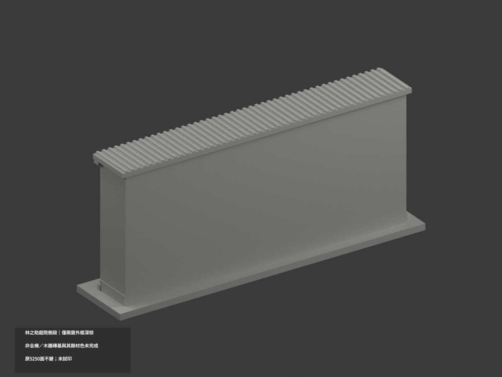
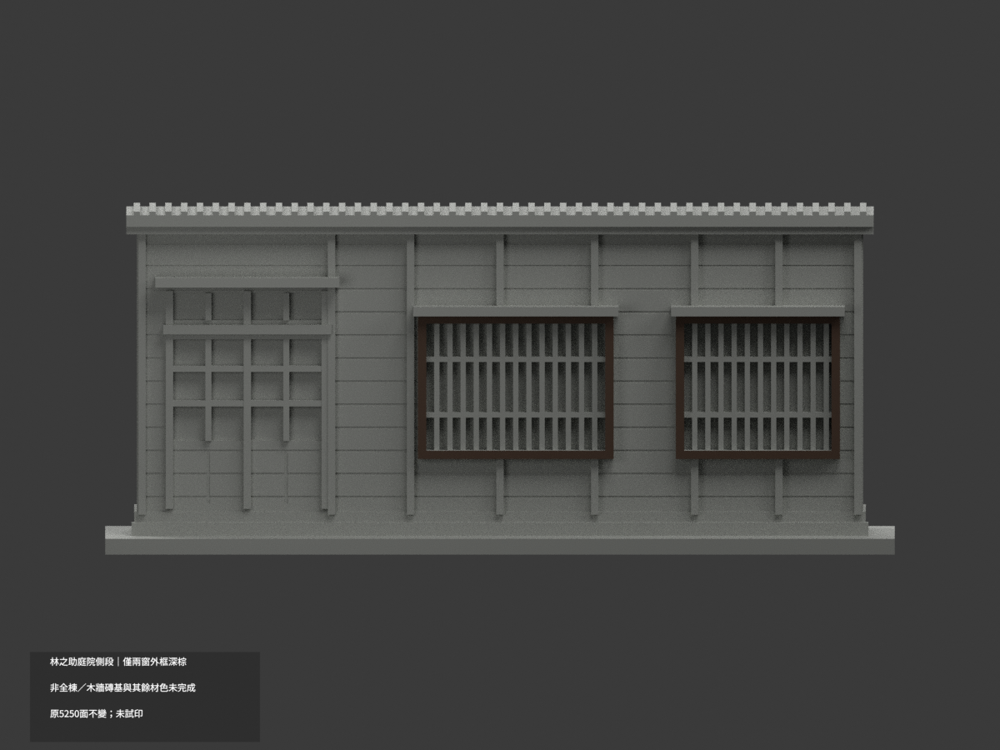
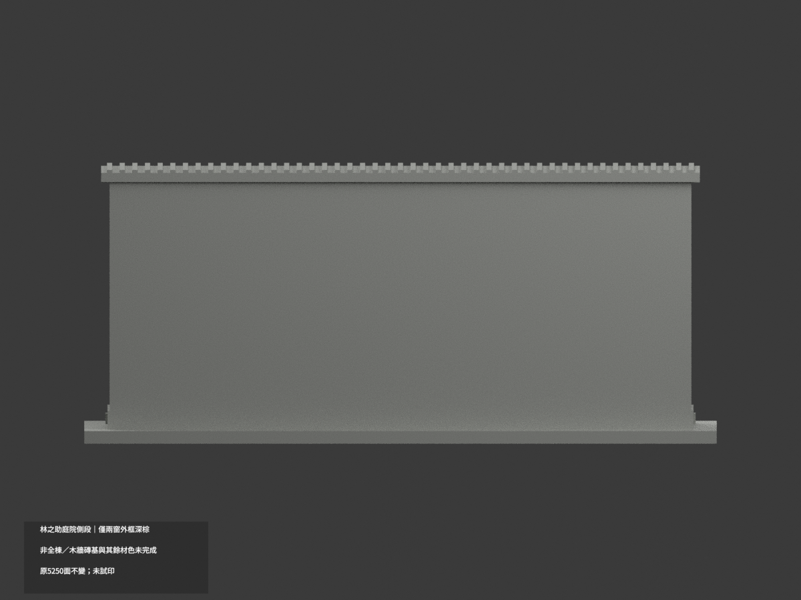
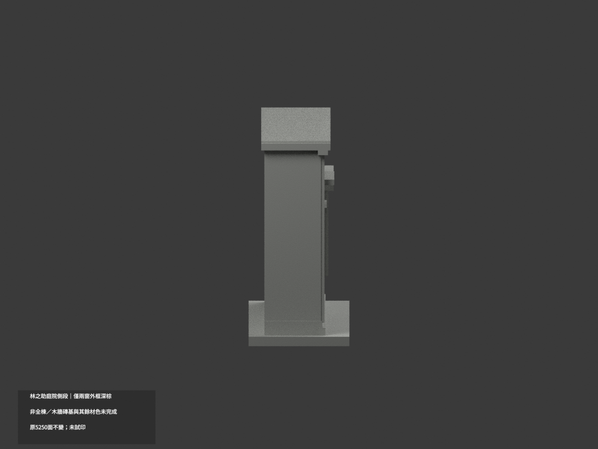
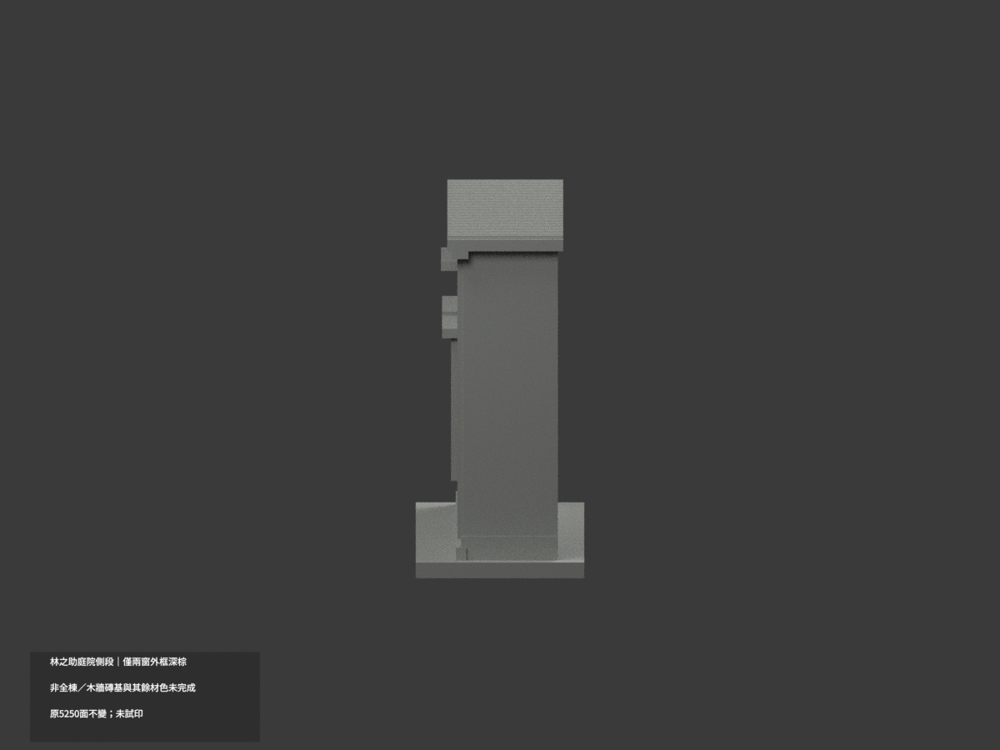
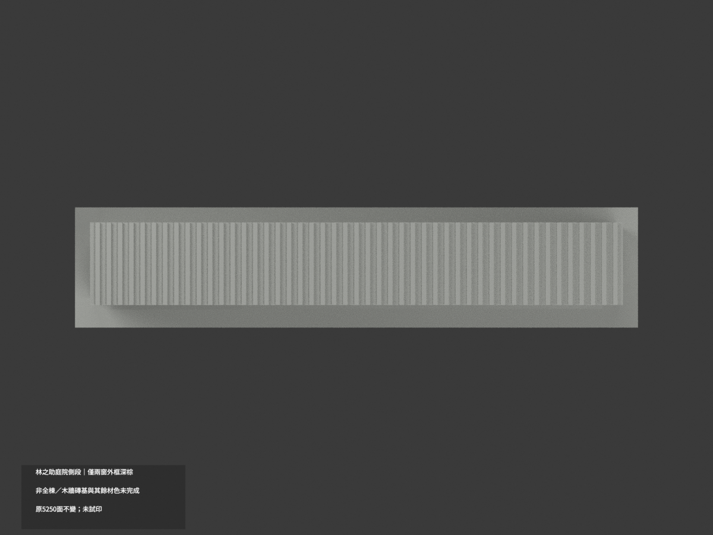
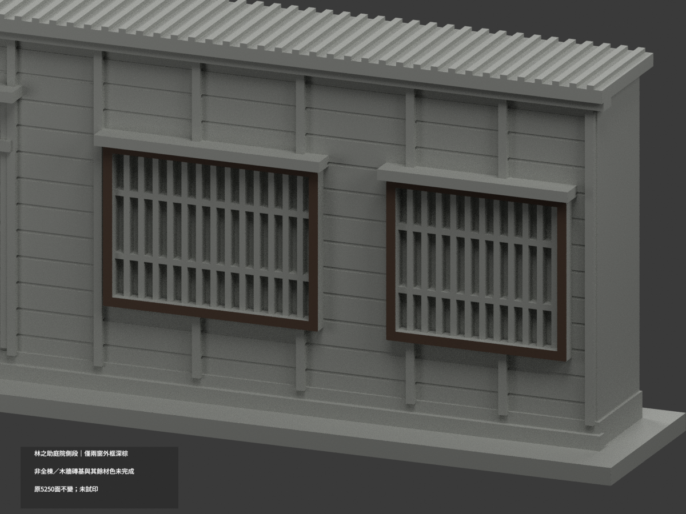
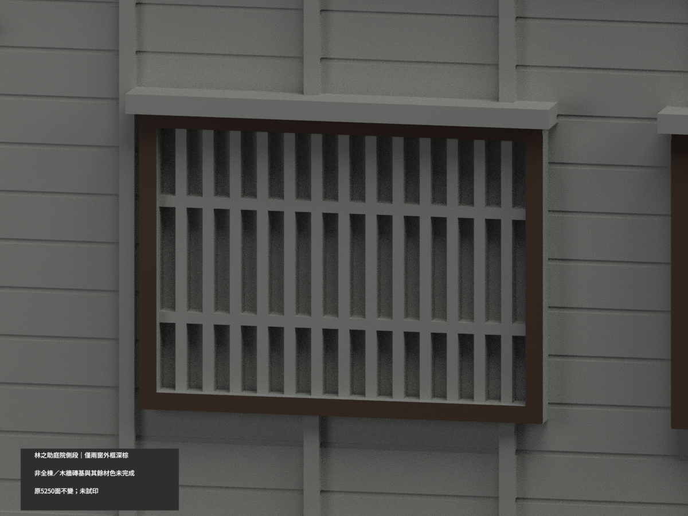
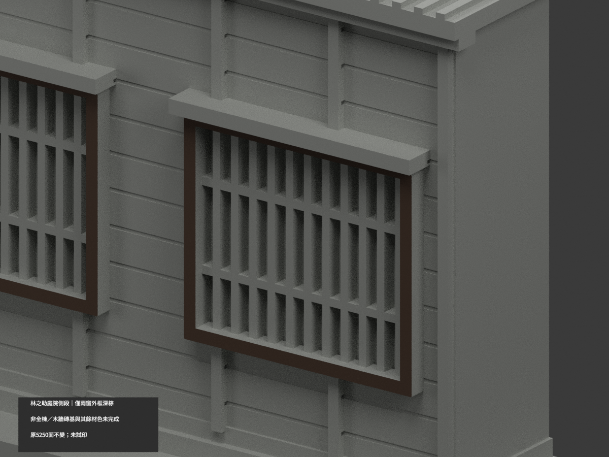

# 林之助畫室庭院側段｜兩窗外框正面局部深棕

**局部補色未完成：只兩窗外框正面48原面深棕；內格柵、門窗背板、木牆、磚基與截口近簷尚未分色。** partial_color_incomplete=true、fully_colored_exterior=false。同項 ntcu-lin-atelier-courtyard-section／count_delta=0，國立臺中教育大學柳川校屬館舍。英文身份 NTCU Lin Atelier Courtyard Section partial color。

**僅庭院側立面片段，不是整棟畫室或美術館。淺背截斷是模型約定，不是實際建築深度；不含2025入口改造。**

| 前斜視 | 後斜視 | 正面 |
|---|---|---|
|  |  |  |
|  |  |  |
|  |  |  |
|  | | |

## 材色範圍

全原y−9.3無限plane三頂點0.0001mm枚舉，48面分為兩個完整共享邊連通24面窗框環，Boolean交界碎面延至z45也保留。兩域x−15.6..21.6／33.4..64.6、z17.7..45只是結果界限，不是人工裁色。48名義深棕、5202中性，原5250三角不變。全原共面連通域一致，沒有normal閾值漏細面、centroid或亮度切三角。

官方庭院VR外照支持兩個完整突出棕色外框正面，與內部細格柵/玻璃簾/板壁/窗棚獨立。色族不等於校準木種或金屬表面。內格柵可能深色金屬但不在這次外框域；玻璃背/簾保持中性。整片木板壁有原模未表現白燈管、灰管和消防牌，不整牆棕。門框/門板的五金字牌及風化不外推；門窗雨庇薄邊、磚基灰通氣槽/混凝土底、框側背皆中性。原屋頂只是淺截口條，不是真完整斜瓦頂，不塗全黑。中性不是實景灰；資料範圍不是實材接縫。

## 來源日期與原始限制

官方VR來源屬2015修復後脈絡，但精確拍攝日期未知，不推出2025入口改造或2026現況。原外觀為照片近似，內格柵加厚/減量、凹窗有背、屋條截斷、人工空白背面不改；補色不追認測繪或完整復原。原照片只私人研究，不公開貼圖，不推定商用權利。

## 檔案與 QA

原STL/build/OBJ字節及5250三角座標拓撲保留。immutable20原件確實含model.obj；不以新生成OBJ取代原件。原README另存ORIGINAL-MONOCHROME-README.md，單色圖與QA歷史保留。appearance.3mf兩展示材與scene.blend真面材同原幾何；export/validate/render/verify及真3MF/scene精確身份 NTCU Lin Atelier Courtyard Section partial color。精確依賴隔離build+color、閉合正體積/3MF座標面材/Blender重開/10張1200×900檢核；保留重建不刪，未試印或驗多料切片，STL本身無色。

## English limitations

NTCU Lin Atelier Courtyard Section partial color. Courtyard elevation section only,notwholeatelier/museum;shallowblankrear isanarbitrarycutoff notactualdepth. Entire originaly=-9.3 plane48faces forms two complete24face outerframecomponents,includingBooleanjunctions throughz45. Nominaldarkbrown48/neutral5202;original5250triangles/STL/build/OBJ unchanged,count_delta0. Innergrilles/glass/curtains,doors/hardware,weatherboardswithlamps/pipes/signs,brickplinthwithgrayvents,hoodedges,frame sides/back,cutoffroofstripneutral. Post2015restorationVRcontext,captureunknown,not2025entrance/2026survey. Originalgeometricapproximation notrevalidated,no publicphotos/textures,not testprinted.
