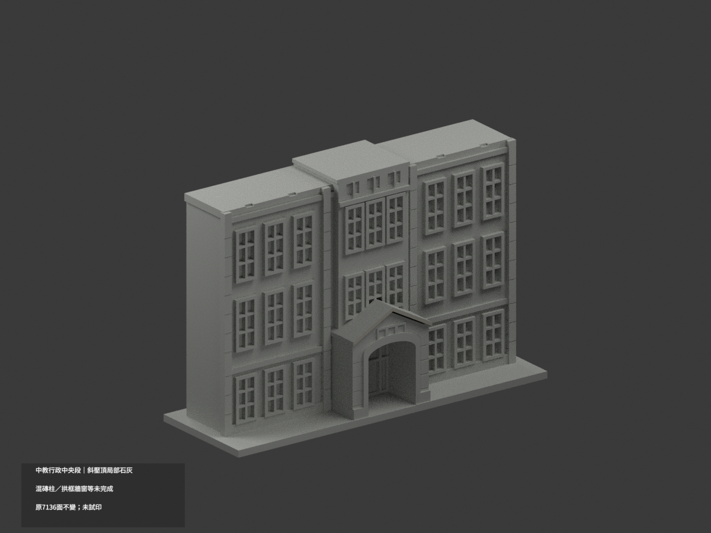
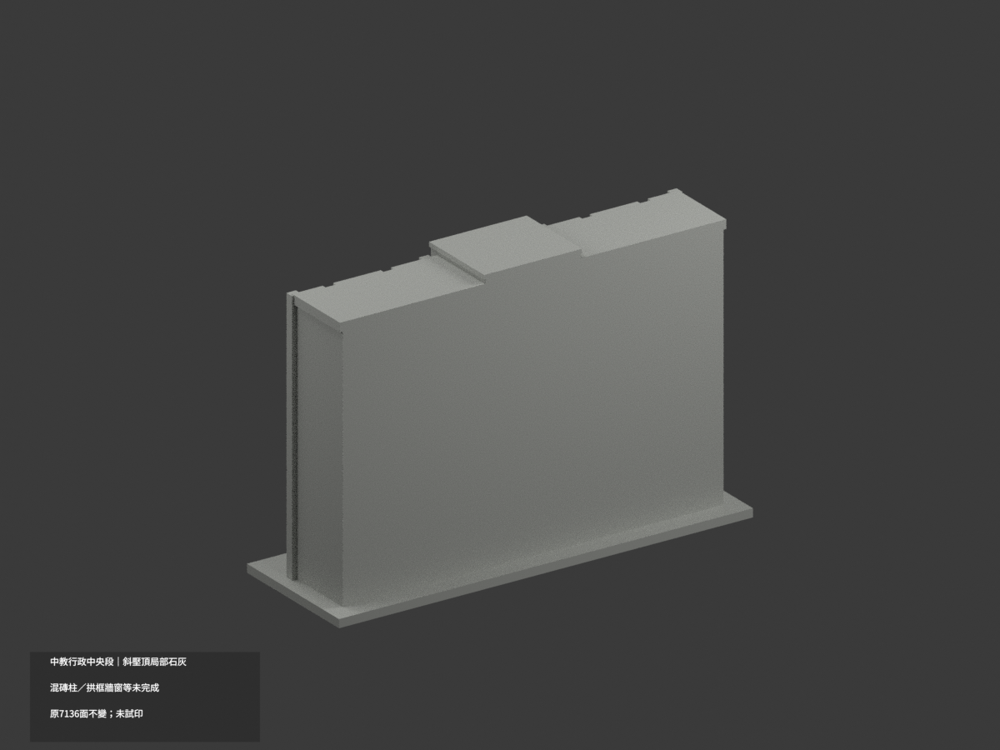
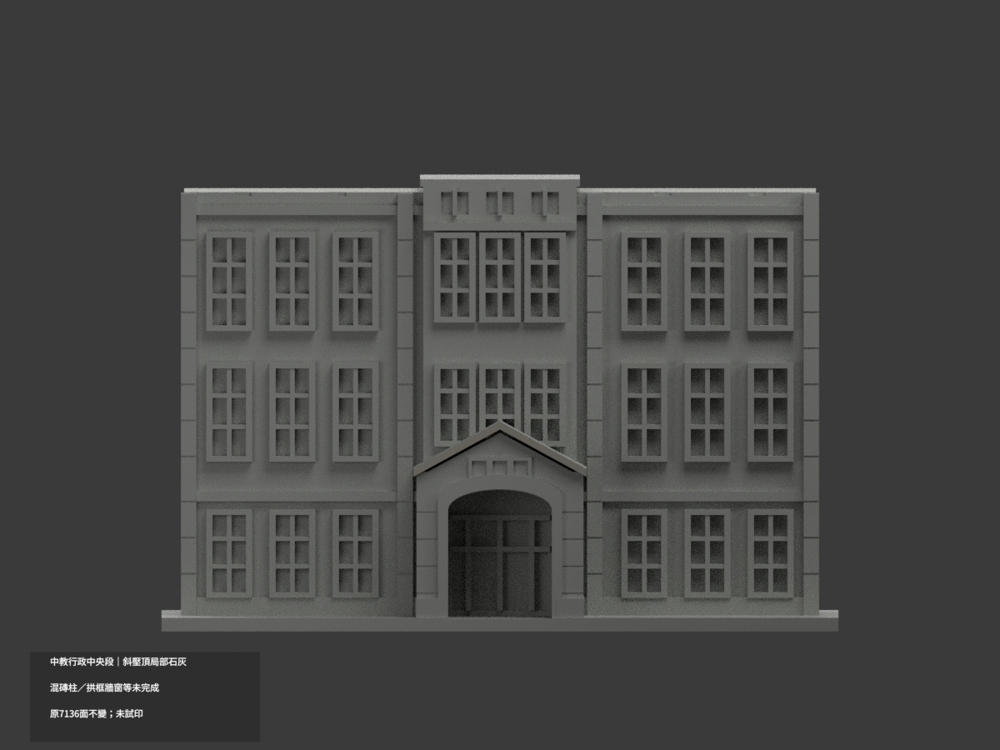
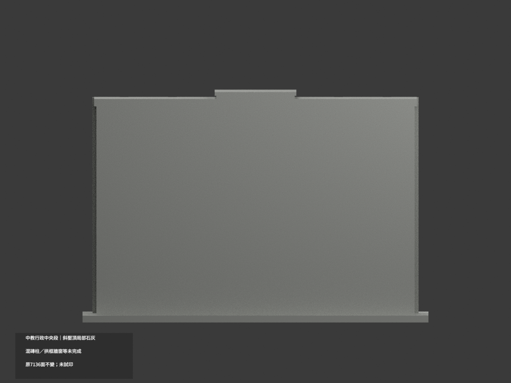
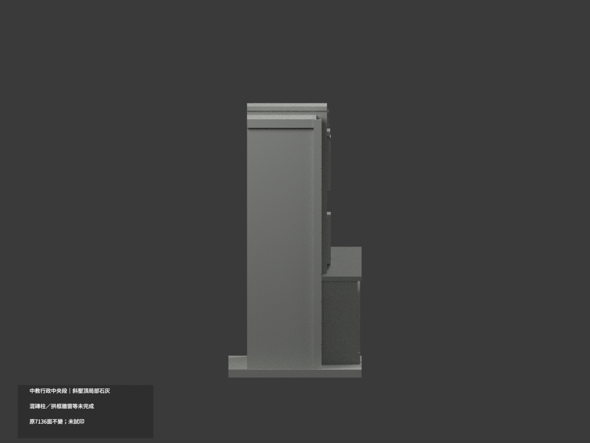
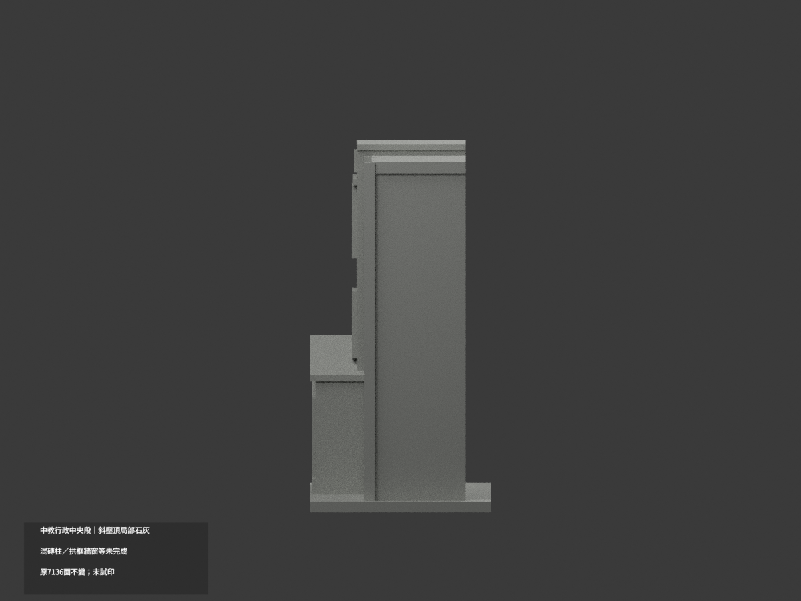
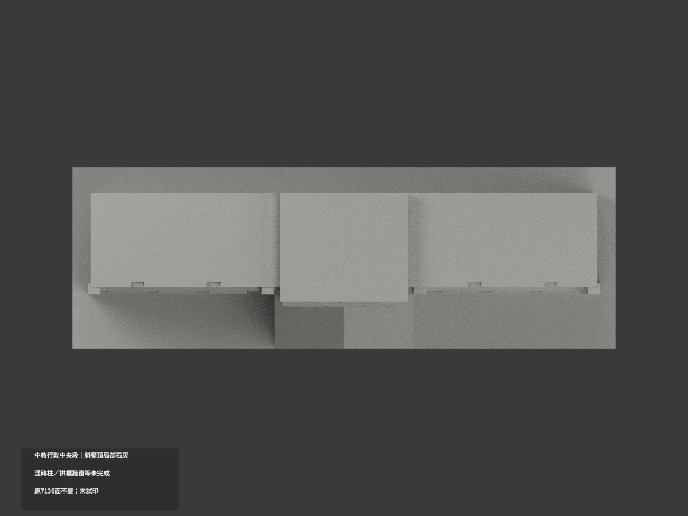
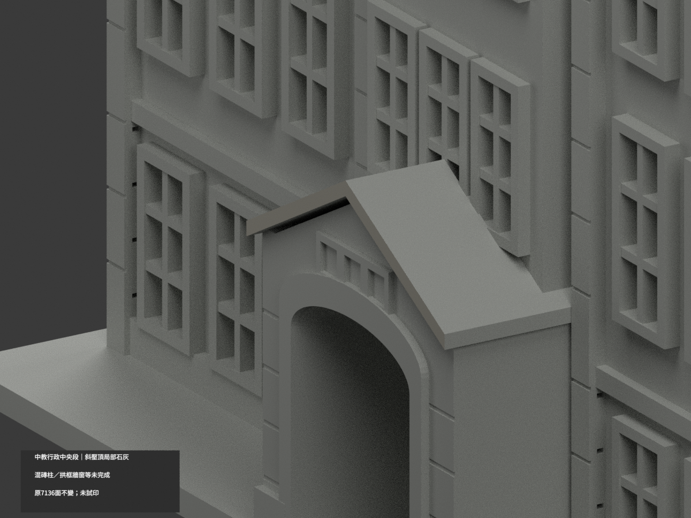
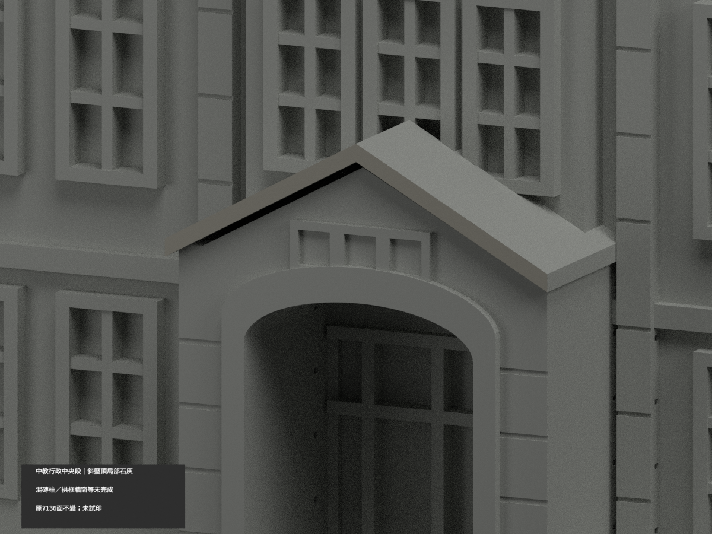
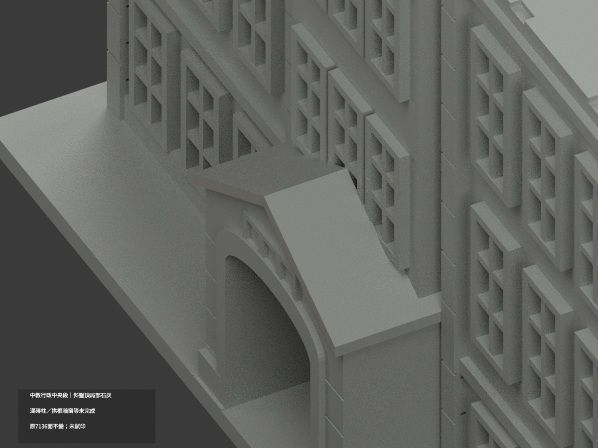

# 中教行政中央入口段｜山牆斜壓頂局部石灰

**混磚柱、拱框與牆窗等材域未完成分色。** partial_color_incomplete=true、fully_colored_exterior=false。僅原斜壓頂完整前域4面名義石灰，非全棟完整補色。

| 總覽 | 背側 | 正面 |
|---|---|---|
||||
||||
||||
||||

## 材色範圍
同 ntcu-administration-central-section 原項目，same-item、count_delta=0。國立臺中教育大學民生校區行政樓中央入口片段，非全U形樓。7136原三角、STL、build_model.py與原model.obj字節不變。原OBJ確實存在250544bytes，依immutable逐hash保留，不是本次生成；早期無OBJ口述已更正，私有更正歷程保留。
- 全y−25無限plane共10面，先依共享邊BFS分6底座與4獨立斜壓頂。完整4面全納，有限原雙斜臂profile全3點核，沒有bbox裁大面、normal或centroid漏片。
- 其他7132面中性，包括整72面連通拱框及落地豎延伸、混灰黃磚柱、金字和牌匾、窗背反光、主牆與梯。壓頂頂底/回邊與中央山牆亦不染。
- 原模型上平面與後方為片段裁切，不是實體屋皮，不塗屋色。原厚化框與近似幾何保留，色審不背書原精度。中性邊界為證據範圍而非真實材縫。

## 來源與日期
親看官方正面外照，兩完整斜壓頂外緣可分辨，僅名義石灰族非校準色票。官方文化資產身份不證照片年份，不稱2026現況。原照私人不公開、不作紋理，未確認CC或再散布授權，不保證商用。

## 格式與列印
[原STL](model.stl) · [原OBJ](model.obj) · [逐面材色3MF](appearance.3mf) · [Blender](scene.blend)
原150mm底座示意比例，非測量比例。實際物件名 NTCU Administration Central Section partial color，依真slug與館名獨立核。STL與原OBJ不冒稱本次彩材；3MF、Blender逐面分材。兩標籤非兩色或四色耗材切片驗證，未實際列印。

## 重建與 QA
原build_model.py → colorize_model.py → export_appearance.py → validate_color.py；Blender render_color.py／verify_color_scene.py。完整隔離Shapely2.1.2精確原build＋color重建，原bytes／全三角multiset、閉合正體積、3MF逐面材、scene重開、十圖1200×900及圖文hash。原README、previews與validation保留歷史，不冒充新QA；原OBJ只讀複製無替換，沒有刪檔。

## English scope
Partial only:4 complete original sloped gable coping front triangles stone gray;7132 neutral. Whole y-25 plane has10 faces in disconnected6-face support and4-face coping components. Full shared-edge BFS component preserved, all-three-vertex finite original profile verified.72-face arch trim, mixed jambs, walls, window backs and lettering remain neutral. Flat top/rear are section cuts, not roofs. Original7136 triangles and original250544-byte OBJ preserved unchanged, not newly generated. Central entrance section not whole U-shaped building, unknown capture,no2026 survey or tested filament slicing.
