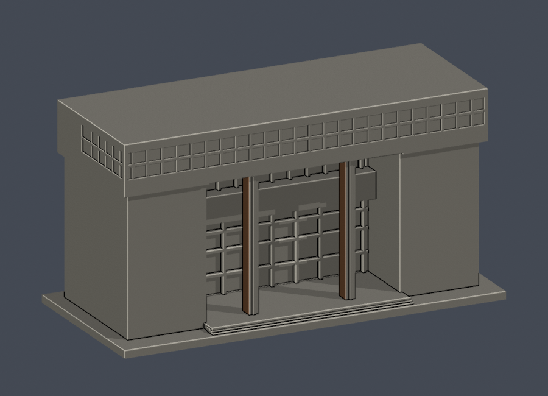
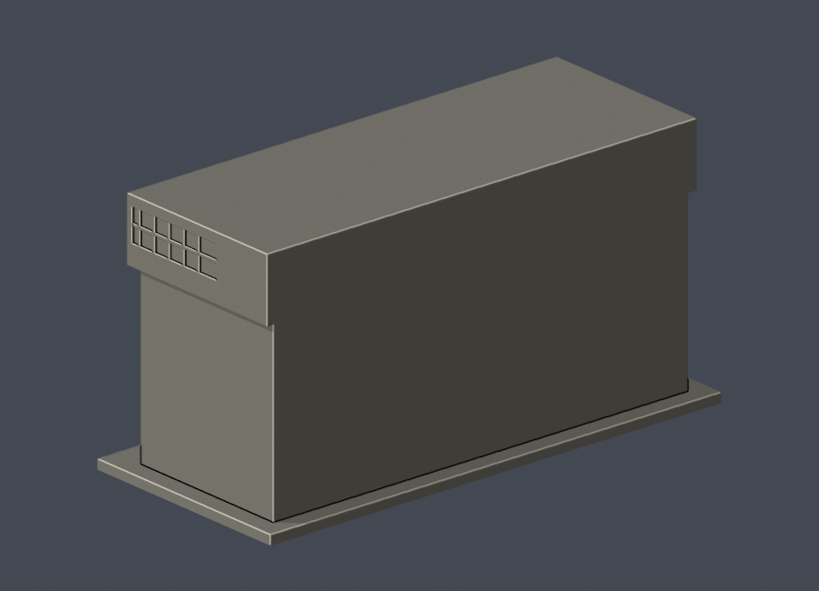
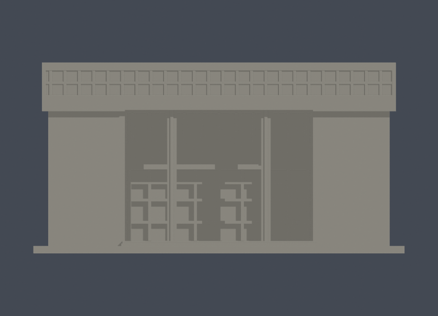
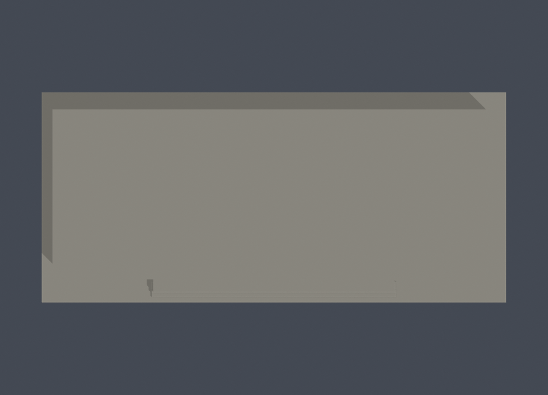
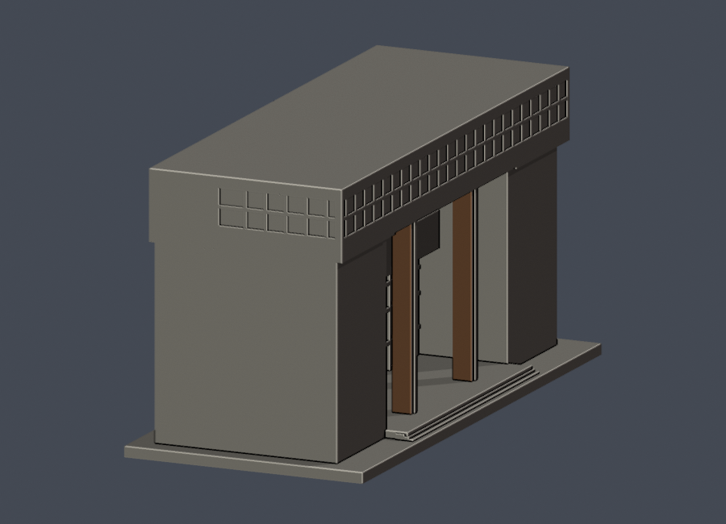
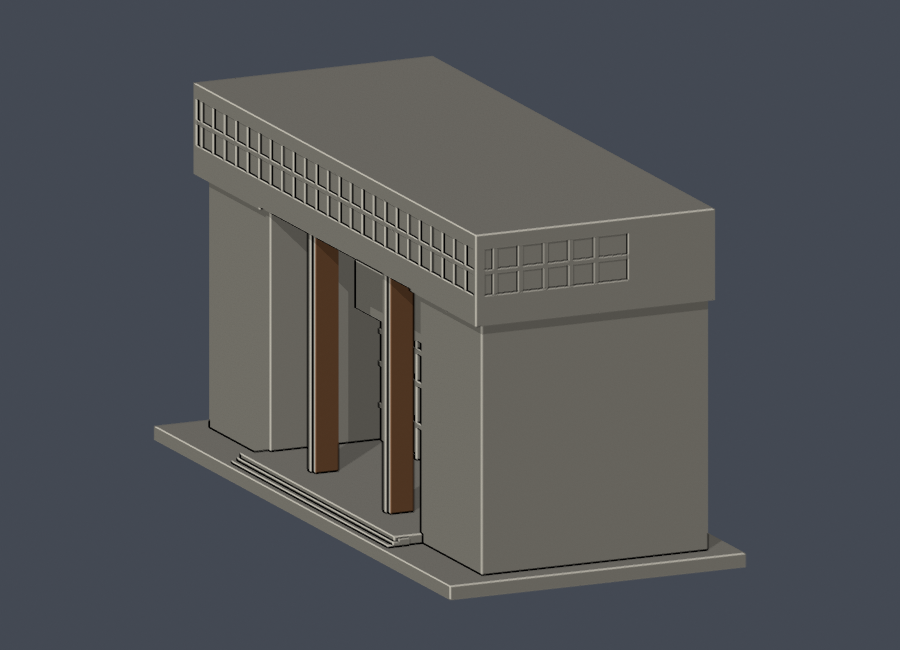

# 國立臺中教育大學｜民生校區｜中正樓入口段

## 2026-11-18 限定補色版

兩根入口柱的 8 個原三角側面，橘褐磚面代理。本次不增加套數、不改原始 STL 幾何，未補部位不代表實景材色。未實體試印。

[彩色 3MF](model-colored.3mf) · [可編輯 Blend](scene.blend) · [原 STL](model.stl) · [本版 3MF 相容性查核](3MF-COMPATIBILITY-QA.json) · [原建模與場景查核（歷史）](independent-verification.json) · [公開版清單](COLOR-RELEASE-MANIFEST.json) · [SHA256SUMS](SHA256SUMS)

| 現版模型預覽 | 現版模型預覽 | 現版模型預覽 |
| :---: | :---: | :---: |
|  前斜視／正面 |  後斜視 |  立面 |
|  頂視 |  左側 |  右側 |

3MF 交付版僅補一個物件預設材質索引，嚴格 SDK 可讀取並在私有副本改色存回重開；原逐面色值、網格、Blender 與預覽不變。[公開相容化程式](source/normalize_3mf_compat.py)可重做此格式步驟。舊查核僅為建模檔案歷史，本版嚴格互通以新版相容性查核為準。

上級索引原代表圖保持原檔；新版彩色渲染請以上表為準。新色適用範圍及試印限制如下。下方舊版本導覽及資料只為歷史保存，舊面數、舊預覽與舊驗證不代表現版；以本章下載與公開版清單為準。

本包是在工作區中斷後，由固定 GitHub 基底 `8f90ae2478f00cce6832a07de537f7d333f6dbc0` 重新下載、查證及製作，不是原完成包的位元恢復；

## 本次變更
只將兩根入口主柱的四個完整長側面（8 個三角面）設為橘褐小面磚色代理 `#A8734B`。x=±20.9、±17.1；y=-23.2..-17.8；z=5..58 毫米，面積1144.800323 mm²。這是模型局部座標，不是真實尺寸。前金屬條、柱腳頂底、附件、其他牆面及人工切面均不改。

新查證官方 pano39/40 front0 與 pano40 right1。照片不直接逐一證明全部四側；對向背光側採同柱材料連續性推論。顏色未校正、不是量測色、磁磚紋理或材料規格；照片日期不明，不保證2026現況。pano40 back2 是庭院，不作柱側依據。

## 保留與交付
原STL/OBJ位元不變，1292頂點、2588三角面；原Blender顯示材質與原相機保持。其餘原暖石色只是原有預覽色，沒有新證據支持，不表示全棟已完成外觀補色。3MF中該原預覽色轉成等價8-bit sRGB #D8D1C2；新增色為#A8734B。

- `scene.blend`：可編輯原場景，僅8面新增材質；保留孤立原材質時設fake-user以防另存遺失。
- `model-colored.3mf`：同原幾何／面序的兩色表面指派，不是拆分多料可列印實體。
- `model.stl`、`model.obj`：原幾何；不承載本次顏色。
- `face-colors.json`、`palette.json`、`domain.json`：逐面材料與限定範圍。
- `previews/`：六視圖。頂面及後方是原入口剖段切面，未補成全棟。
- `original-model-notes.md`：原模型說明，其歷史驗收記載不等於本重建版發布核准。

數位驗證不等於實體試印、切片或支撐檢查。本次未做GUI切片或實體列印。原始參考照片只私存，不隨此公開候選包散布。

## 新版檢核限制
獨立檢核確認原相機、世界、原材質節點及其餘可安全讀取的場景RNA一致。Blender 4.3.2讀取UV Sculpt懸空工具指標會崩潰，因此排除該工具設定；runtime依賴圖與session欄位也不作持久內容比較，不宣稱全檔位元相同。詳見independent-verification.json。

## 歷史版導覽與說明

## 模型預覽

| 模型預覽 | 模型預覽 | 模型預覽 |
| :---: | :---: | :---: |
|   |  |  |

依官方公開實拍自建的局部建築外觀近似模型。不是全棟、不是測繪，也不提供真實建築比例尺。原照片不隨公開包散布。

## 範圍與辨識特徵
兩根落地主柱、兩側大片實牆、三個門廊跨間、真正凹入的門廊空間、後退玻璃門面、橫向招牌帶和頂層連續玻璃帶。

尺寸：150 × 68 × 77.2毫米，含底座，獨立視覺縮放。入口段任意後截，不含完整大廳後殿、後部高牆及側後走廊。背面留白、頂面是截斷平頂；不是整棟屋頂測繪。主柱恰為兩根，玻璃小框不當結構主柱。

實拍拍攝日未標，資料頁更新日不等於拍攝日期。因此這是公開影像所示形體的局部研究，不保證2026現況所有外觀細節不變。浮雕式窗框、玻璃凹槽是列印簡化；沒有將窗框當主柱。未複製任何第三方3D模型。

## 重建與交付
- `build_model.py`：獨立Python參數化自建。依賴版本見`requirements.txt`。
- `model.stl`、`model.obj`：同一毫米網格；STL是正式幾何驗證標的。
- `scene.blend`：正式STL匯入的可編輯網格；`render_preview.py`由實際STL產生front/rear/elevation/top四圖。
- `validate_model.py` / `validation.json`：原STL二面邊、vertex link、單連通殼、正法向/繞序/體積、尺寸、獨立重建SHA与Blend幾何一致。
- `check_layers.py` / `layer-check.json`：起點z=0.071，每0.2毫米檢查閉合輪廓与個別及合成Polygon有效；invalid直接失敗，未修補。
- `check_thin_features.py` / `thin-feature-check.json`：canonical fail-closed v3；0.8毫米形態opening是輔助篩檢，非全面最小壁厚。
- `sources.json`、`qa-summary.json`、`SHA256SUMS`：來源限制、數位QA與逐檔雜湊。

執行順序：python build_model.py；blender -b -t 2 -P render_preview.py；python validate_model.py；python check_layers.py；python check_thin_features.py。

## 列印提醒
底座朝下，單位毫米。高門廊上方挑簷、招牌帶、玻璃框凹槽應自行檢查支撐。主柱約3.8毫米寬、窗框約1.1毫米；省略空調、細字、海報與裝飾燈。

數位QA不等於實體試印或Cura/PrusaSlicer工具路徑驗證，不宣稱保證可印或免支撐。請依噴嘴、材料與層高自行切片並檢查懸空區。

## 驗收狀態
2026-10-13外觀覆核已准，以此版本凍結交獨立QA；發布前須由獨立驗證者放行。

上層連續玻璃帶的窗面僅凹約0.4毫米，細直框為齊平淺分格，不是突出主柱。`check_portico_void.py`與`portico-void-check.json`以原STL共18條射線核對凹廊及雙主柱間淨空；射線距離是模型毫米，不能當實際建築尺寸，有限採樣不是全面空間證明。
