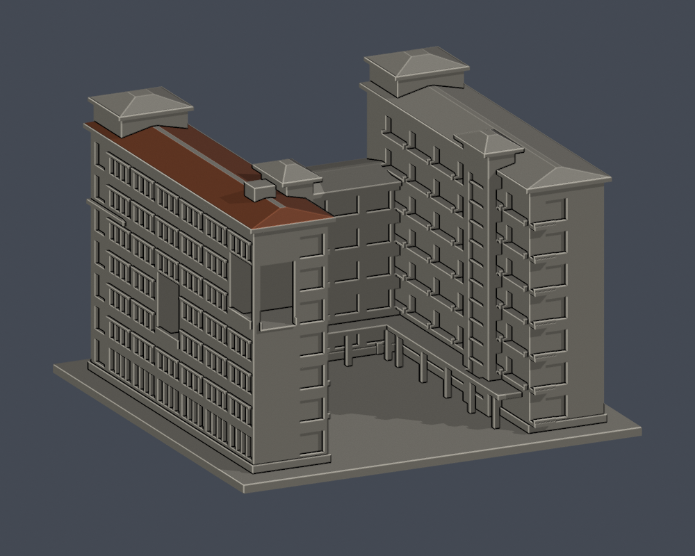
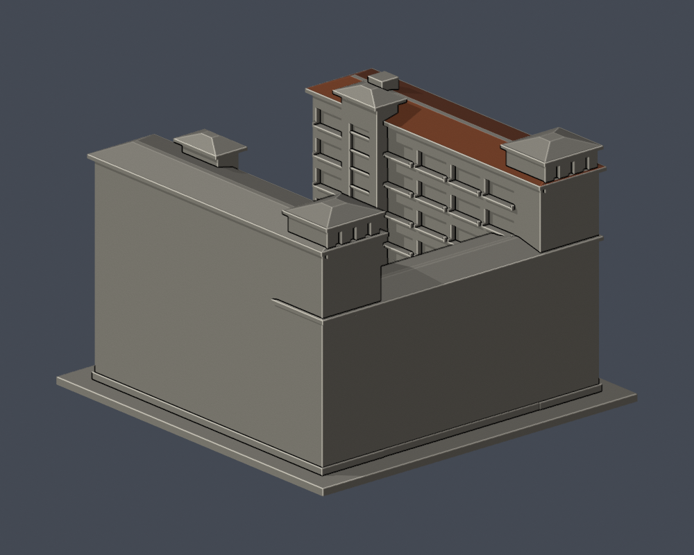
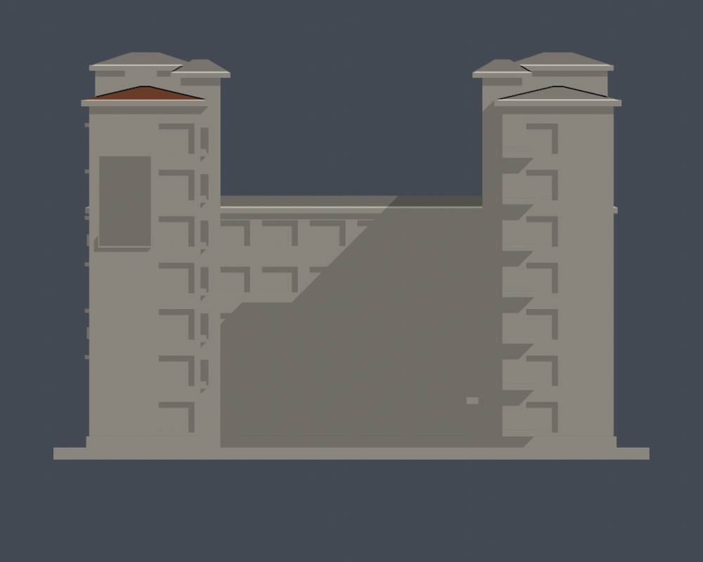
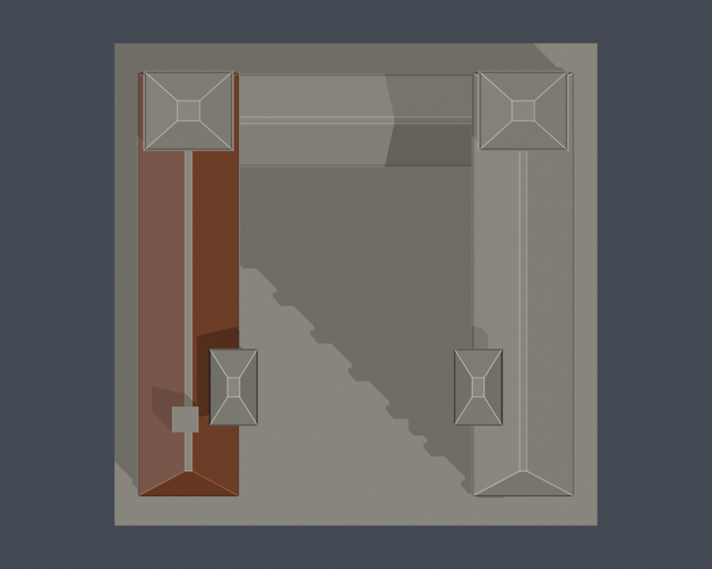
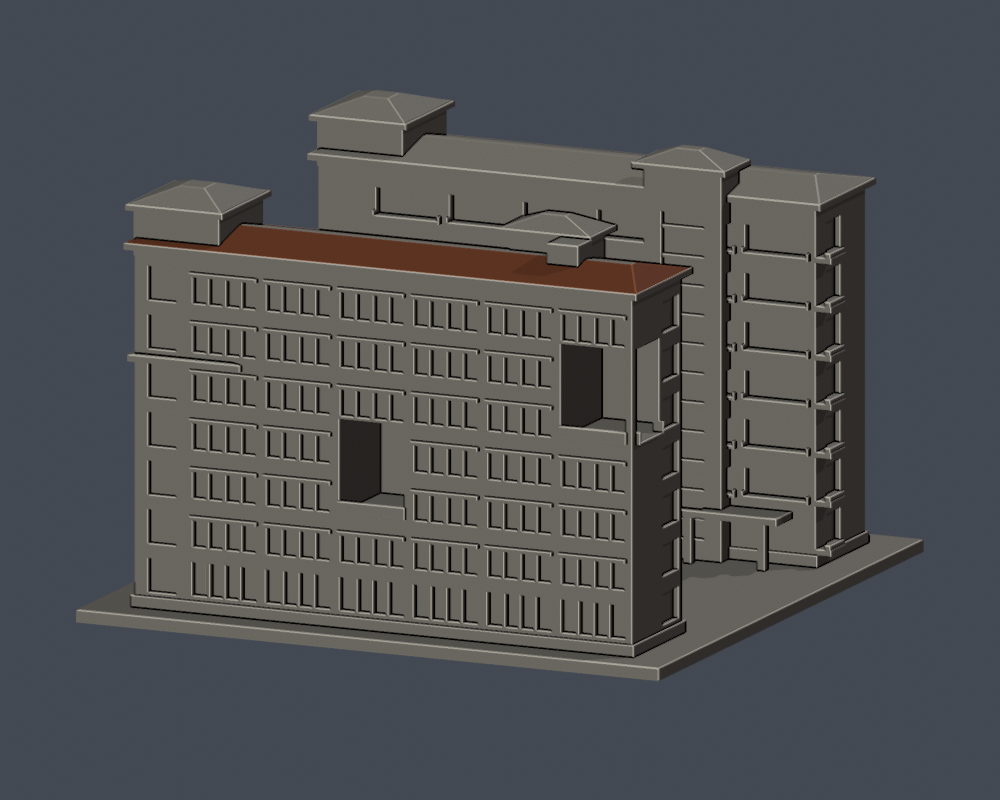
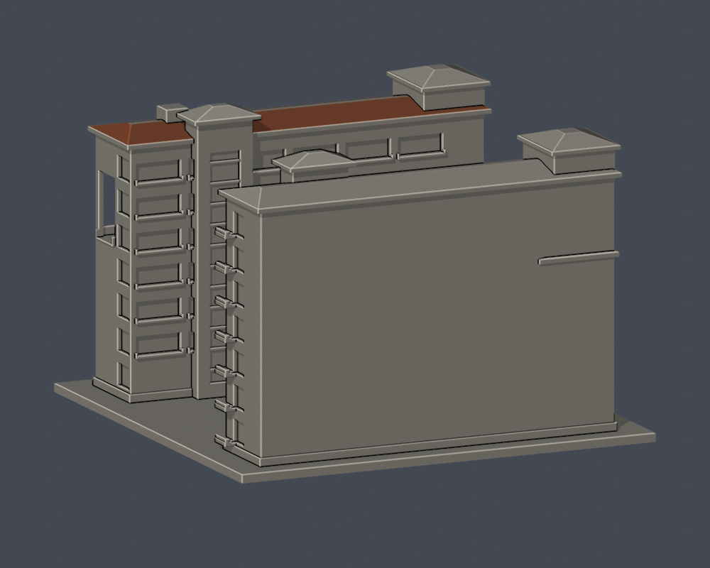

# 國立臺北商業大學｜北商學舍U形全形量體近似（局部立面未核）

## 2026-11-18 限定補色版

東長翼主四坡屋頂的 27 個原三角，橘褐屋面代理。本次不增加套數、不改原始 STL 幾何，未補部位不代表實景材色。未實體試印。

[彩色 3MF](model-colored.3mf) · [可編輯 Blend](scene.blend) · [原 STL](model.stl) · [本版 3MF 相容性查核](3MF-COMPATIBILITY-QA.json) · [原建模與場景查核（歷史）](independent-verification.json) · [公開版清單](COLOR-RELEASE-MANIFEST.json) · [SHA256SUMS](SHA256SUMS)

| 現版模型預覽 | 現版模型預覽 | 現版模型預覽 |
| :---: | :---: | :---: |
| <br>前斜視／正面 | <br>後斜視 | <br>立面 |
| <br>頂視 | <br>左側 | <br>右側 |

3MF 交付版僅補一個物件預設材質索引，嚴格 SDK 可讀取並在私有副本改色存回重開；原逐面色值、網格、Blender 與預覽不變。[公開相容化程式](source/normalize_3mf_compat.py)可重做此格式步驟。舊查核僅為建模檔案歷史，本版嚴格互通以新版相容性查核為準。

上級索引原代表圖保持原檔；新版彩色渲染請以上表為準。新色適用範圍及試印限制如下。下方舊版本導覽及資料只為歷史保存，舊面數、舊預覽與舊驗證不代表現版；以本章下載與公開版清單為準。

這是從固定 GitHub 基底 8f90ae2478f00cce6832a07de537f7d333f6dbc0 重新製作的候選包，不是遺失成品的逐位元恢復。全形量體近似、局部立面未核，不代表 2026 年現況。

## 本次範圍

只將東長翼主四坡屋頂 27 個完整三角面由原材質 0 改為新材質 1，橘褐色 #B8663E，面積 3239.548304 mm²。色碼是依照片選取的未校色外觀代理，不是測色或指定漆料。原場景暖石色 #D8D1C2 仍只是預覽色，未經實景驗證。

建模程式先在 +X 製作東側雙層深凹與屋頂服務盒，最後 scale((-1,1,1)) 鏡射。因此地理東翼在交付場景的 -X，主屋頂 x=-68..-36、y=-66..66、z=90.5..94。以不同樓層的兩處深凹、北端高位凹口及服務盒確認，不將未詳建的 +X 西外牆誤當東翼。四坡因服務盒等交界分割，不能以外觀對稱猜測面數。

平截屋脊頂面、淺色屋檐、其他六組坡屋頂、服務盒、外牆及所有未選區域保持原樣。內側部分屋坡是同一連續屋面材質的推論，並非每個三角形均在照片直接可見；隱蔽處不宣稱已實測。

## 來源與限制

重新讀取校方環境照片與模型原始建構程式，私有查核記錄保存來源版本。照片拍攝年月未核定，下載日期不是拍攝日期；不得把舊照片當現況。來源網址見 sources.json 與 continuation-sources.json。原始照片、下載 HTML 及私人核對圖不在公開候選包。

原模型的 U 形量體、七層兩翼與較低連接翼均是照片近似。西側外長立面及南外連接翼未充分查證，刻意未鏡射東側細節。尺寸沒有實測比例尺；室內、地下室和精確窗格不在範圍。

## 檔案與驗證

model.stl 與原基底逐位元相同，本次無幾何修補。scene.blend 保留原鏡頭、世界、渲染設定與原材質，只新增上述材質及面指派；為保存原有零使用者材質，僅啟用該材質 fake user。六張 previews 為本次重渲染，之後鏡頭設定還原。

model-colored.3mf 提供雙材質交換；4271 頂點、8586 三角形，逐三角順序與座標完全符合原 STL。strict lib3mf 零警告，模型有效、流形且定向，面色一致；3MF 再製雜湊一致。完整獨立檢核詳 independent-verification.json。

場景比對涵蓋可安全讀取的持久 RNA、幾何、原材質節點、相機與世界；排除執行期更新狀態與 Blender 4.3.2 可能崩潰的 UvSculpt 懸空筆刷／曲線指標域，不宣稱無例外讀取所有 RNA。

這不是實體試印或 GUI 切片測試，也不是新的製造認證。原模型屋檐、開廊等可能需支撐，列印前仍須切片檢查。原有輪廓與薄特徵歷史檢核未因此自動視為本次重跑。build_model.py 只重製原單色幾何，不會重建本次補色；補色重建及審核腳本保存在私人備份。

## 歷史版導覽與說明

## 模型預覽

| 模型預覽 | 模型預覽 | 模型預覽 |
| :---: | :---: | :---: |
|   |  |  |

**全形量體近似，局部立面未核；不是精確全館測繪，亦不代表2026年現況。**

官方環境照片及114學年度新生手冊；照片攝影年月未完全核定。各館獨立比例，尺寸均由照片估計，沒有固定建築比例尺。第三方原照片與PDF不包含於公開包。


## 已保留的外觀
- C棟是同一U形宿舍：兩長翼地上7層，連接翼依空間配置示意及手冊照片採5層；地下室未重建。
- 保留開放中庭與可見低層沿邊連廊；中央露天空間不填實、不以屋頂封口。
- 球場侧6個大窗跨每跨含兩窗組，3–4層中央、5–6層端部有兩層高深凹，不能做成均一網格。
- 北端兩翼不對稱：一端有高位深凹，另一端有疊層陽台。坡屋頂與突出樓梯核有實拍及配置圖支持。

## 明確限制
- 西側外長立面及南側外連接翼欠清晰实拍，刻意留白，不鏡射東側窗列。全形量體不等於全館細節完整。
- 每層窗格細分、室內廊道进深與未見内侧局部仍是照片近似；未重建室內、房間或地下室。
- 兩層高深凹採深挖並保留内侧薄背牆，是否完全貫穿與背侧構件未核；不宣稱實測真通道。
- 低層連廊沿西／後方可見範圍建模；未見另一侧不添造。樓梯核的水平偏移及屋頂坡角為近似。
- 没有本棟太陽能板證據，因此未把公能樓／弘毅樓的光電外推到宿舍。部分屋頂機電及細栏杆省略。

## 列印與來源

- 單位毫米，含底座最大150mm，底座朝下。尺寸詳validation.json。
- 開廊、雨棚、凹口頂部和屋檐可能需要支撐。窗框及獨立柱做加粗／背牆連接，仍須實際切片檢查工具路徑。
- 數位幾何QA不是實體試印，不是Cura／Prusa切片驗證，不能保證免支撐可列印。
- [model.stl](model.stl)是列印網格；[scene.blend](scene.blend)由該STL匯入，可編修三角網格。
- [build_model.py](build_model.py)是自行撰寫參數來源，未下載第三方3D；所有previews PNG均由交付STL渲染。
- [sources.json](sources.json)、[validation.json](validation.json)、[contour-validity-check.json](contour-validity-check.json)、[thin-feature-check.json](thin-feature-check.json)詳載依據與QA。
- 0.2mm逐層輪廓、固定z偏移0.071mm，單環與合成多邊形都須有效。薄篩採已核SHA的canonical fail-closed v3，0.8mm opening不是完整最小壁厚證明。

## 重跑

Python 3.12安裝requirements.txt，且PATH內有Blender 4.3以上，再執行：

```sh
python build_model.py
blender -b -t 2 -P render_preview.py
python validate_model.py
python check_contour_validity.py
python check_thin_features.py
python check_recess_rays.py
python check_manifest.py
```

## 原STL深凹／開放空間射線

[check_recess_rays.py](check_recess_rays.py)只讀交付STL，確認第一正向命中位置；[recess-ray-check.json](recess-ray-check.json)保存逐條射線起點、方向、預期範圍與命中。這驗證模型幾何，不證明實際建築凹深。

玻璃細框為可列印的粗化分格，不是牆柱數。六個主窗組分跨及兩處不同樓層凹口依照片保存，沒有為了整齊再加窗列。東侧兩處雙層凹口從x=-66外牆至x=-42.5背面，模型凹深23.5mm；中心與入口側垂直射線僅撞底座z=3mm，U庭未封頂。
