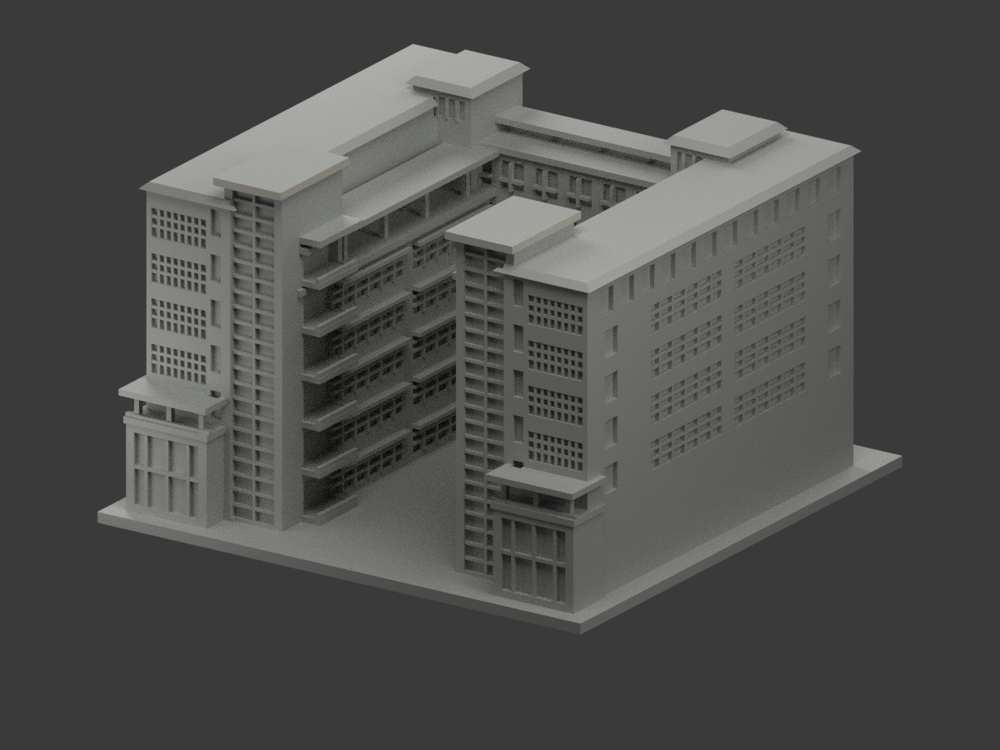
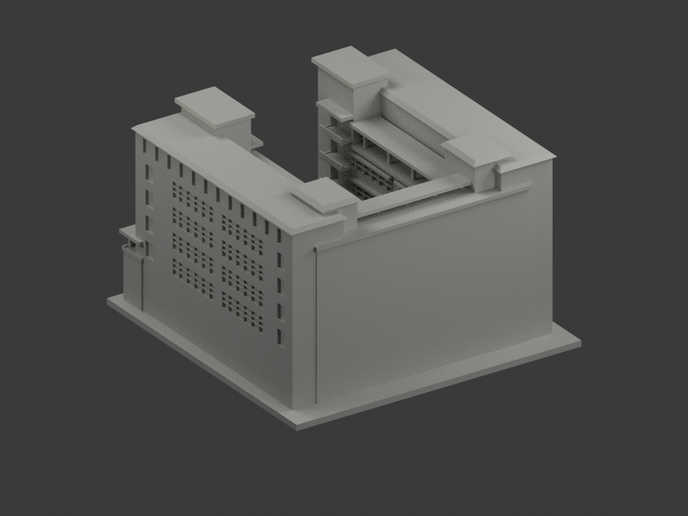
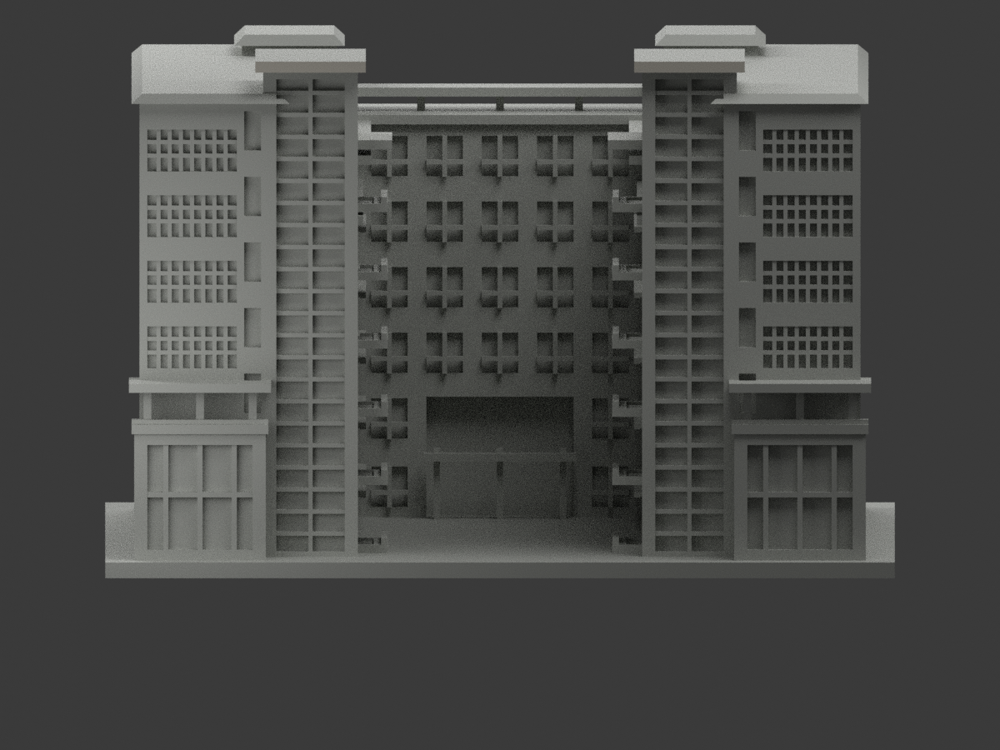
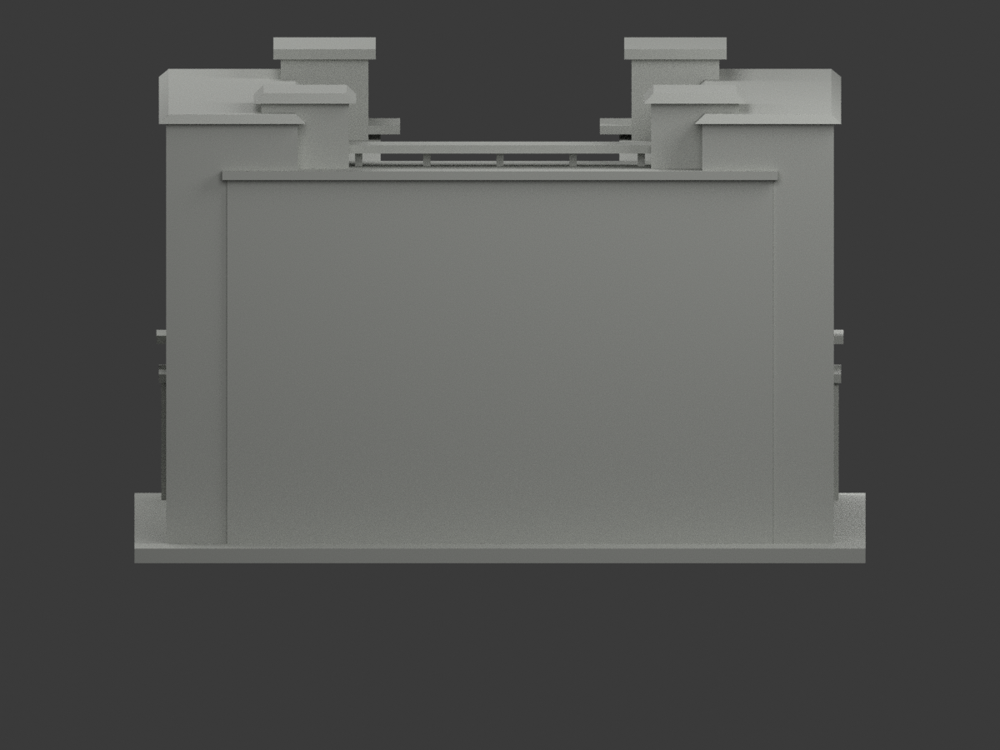
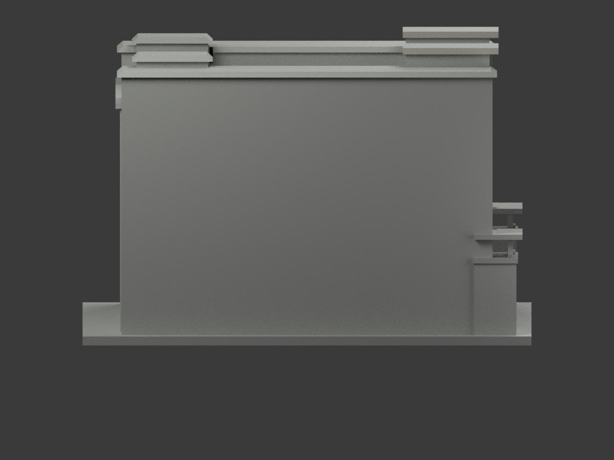
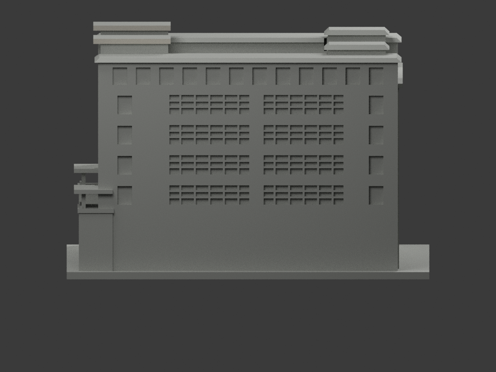
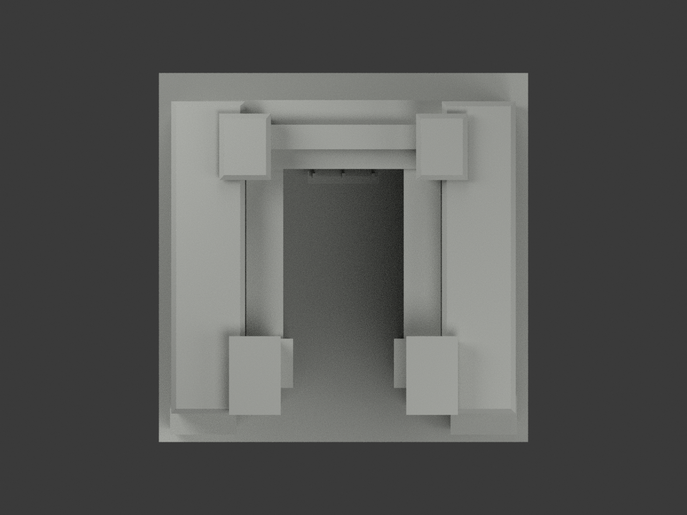
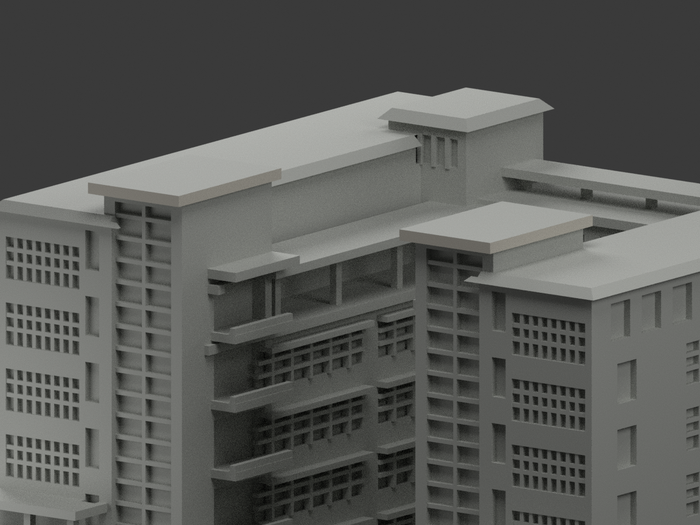
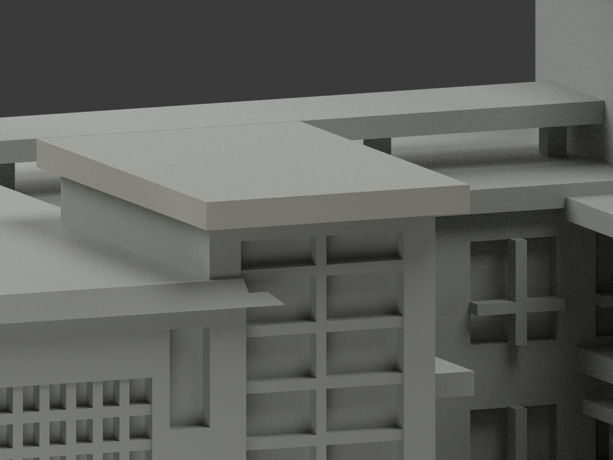
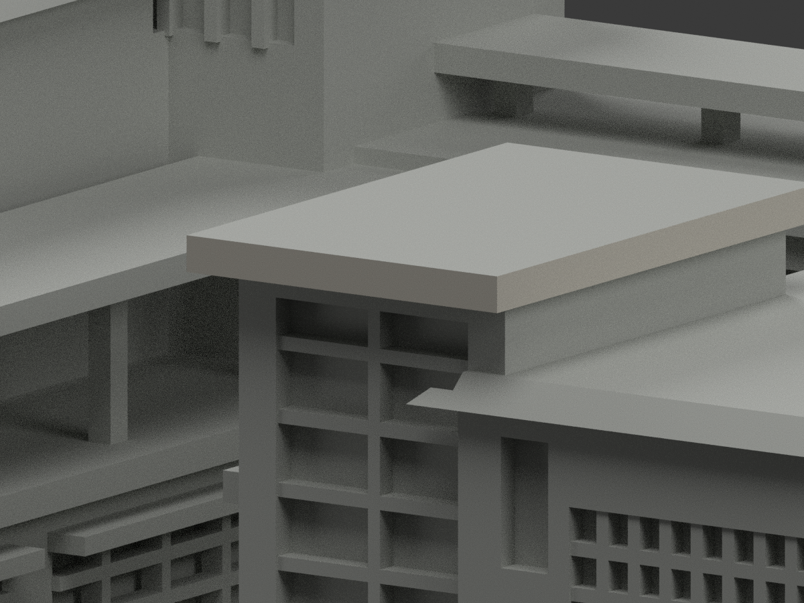

# 北商桃園弘毅樓｜雙塔帽側緣同材質延續

## 模型預覽

| 前斜視 | 後斜視 | 正面 |
|---|---|---|
|  |  |  |
|  |  |  |
|  |  |  |
|  | | |

## 本次前梯塔帽側緣同材質延續

以現行 root 精確頂點與材質表為基準，保留兩前梯塔帽正面原 4 個已色三角，僅將四個完整側緣矩形的 8 原中性三角延用淡暖灰槽 0。新版淡暖灰 12 面、中性 21,904 面；原 21,916 三角／10,100 點、STL bytes、頂點表、面序與座標皆不變。既有色盤名稱及名義色保持原樣。

四個有限域 x=−46.5、−25.5、25.5、46.5 mm，y=−64…−32、z=95.5…97.6 mm，逐域核對所有三頂點、向外法向、完整四角與原兩三角。總解析面積 268.8 mm²，原浮點網格面積 268.7998046875 mm²。帽頂、底面、後緣、整段塔身、文字、陽台、玻璃及混材牆全部排除，不切面、不改厚度、不補造細節。

本輪親看總務處官方完整中庭照片 mobilead_4469_4517116_97186.jpg，可見兩塔正面帽緣及內側上緣同屬淺色。外側緣明示為同一帽構件的材料延續推論，不是四側各自照片確證。模型仍是原簡化帽板，非測繪或實際構造細節；原影像 EXIF 2015-06-17 僅日期線索，未獨立驗證時鐘，不是 2026 現況。私人參考照片不入公開包，不表示色彩量測、照片授權或實體試印。

所有舊 QA、來源登錄、原建模／配色程式及舊 checksum 保留。舊說明中的「側緣中性」記錄原版範圍，本節明示新增 8 面。同色推論驗證在 `qa-continuous-walls/`，新版校驗表 `CONTINUOUS-CAPS-SHA256SUMS`。新版 root PNG 與 scene.blend 無文字覆蓋；舊 previews/ 仍是歷史基準，不應當作新版預覽。

新版 3MF 完整精度字串精確對回原 STL，避免舊輸出小數截位傳播；不改幾何。lib3mf 在臨時材料編輯副本的重存精度誤差另記，交付不採重存副本。重建包 `rebuild-continuous-caps.zip` 含固定 SHA 的原公開 NPZ／STL／色盤，執行 `python build_continuous_caps.py`，再 `python verify_continuous_exchange.py`；Blender 執行 `render_continuous_caps.py`、`verify_continuous_scene.py`。numpy、lib3mf 2.5.0、Blender 4.3.2。原 colorize_model.py 及 export_appearance.py 是歷史入口，會還原舊 4 面版本。原製造限制與未經多料切片／試印限制完整保留。

場景僅同步更新 source_mesh_sha256 以對應本次含材質指派的 color-mesh.npz，並更新 scope，明示四個完整塔帽側緣同淺灰推論，以及頂底、後緣、塔身與混材牆維持中性、非現況證明；其餘原屬性、全部材質定義與幾何不變。

本頁為現行說明；根 README.zh-TW.md 保留舊版本原文及原 bytes，僅作歷史記錄。

## 前版說明與保留限制（完整歷史文字）

# 北商弘毅樓｜雙塔帽前緣局部淺暖灰

**局部補色未完成：只雙樓梯塔帽前緣4原面淺暖灰；塔牆、玻璃、磚灰混壁、屋面與其餘面尚未分色。** partial_color_incomplete=true、fully_colored_exterior=false。同項 ntub-hongyi／count_delta=0，國立臺北商業大學桃園校區。英文身份 NTUB Hongyi partial color。

**維持原單一弘毅樓全形量體／有證立面近似，不是完整立面、屋頂或設備測繪。**

## 材色範圍

全原y−64無限plane三頂點0.0001mm枚舉，恰4面分為兩個完整共享邊2面矩形。依原碼雙塔帽x中心±36、寬21，z95.5..97.6；界限只描述完整原域，不作人工截色。4名義淺暖灰，其餘21912中性，原21916三角不變。全原共面連通域一致，無normal閾值漏小面、centroid或亮度切三角。

官方庭院照片同時可見兩塔帽前薄緣，兩邊均直接有據，不靠鏡射單塔。帽上水平皮/底/左右背返維持中性。塔身有金字、設備與樹遮，不延伸整白牆；玻璃有反光、窗框樓層，不整藍。外翼淺坡屋、後服務塔帽、未定位光電/設備、平台棚、實板陽台代理、混磚灰牆及其他簷帶全部中性。中性不代表實景灰；資料覆蓋邊界不是實材接縫。

## 來源日期與原始限制

兩張官照原DateTimeOriginal分別2017:08:30 09:57:33及2015:06:17 11:43:40，僅EXIF相機元資料，無時區與鐘準驗證；第一張DateTime2017:08:30 14:12:54是修改欄，不當拍攝時間。不換算UTC，不稱2026現況。原碼公開照片整體近似、未知遠側背面留白；既有PV證據只知設備存在未定翼/完整範圍，不能加造，亦不冒稱確定裝PV前版本。補色不追認精確幾何或整棟復原。來源照片僅私人研究，不公開貼圖，不推定商用權利。

## 檔案與 QA

原STL/build與21916三角座標拓撲/字節保留；immutable23件無OBJ，不新增或冒稱原OBJ。原README另存ORIGINAL-MONOCHROME-README.md，單色圖/QA歷史保留。appearance.3mf兩展示材與scene.blend真面材同原幾何；export/validate/render/verify及真3MF/scene精確身份 NTUB Hongyi partial color。精確依賴隔離build+color、閉合正體積/3MF座標面材/Blender重開/10張1200×900檢核；保留重建不刪，未試印或驗多料切片，STL本身無色。

## English limitations

NTUB Hongyi partial color. Sameonebuilding/slug,count_delta0,originalphoto-derived overallmassing notmeasured fullcondition. Entire originaly=-64 plane4triangles forms two complete2triangle capfrontrectangles,nominalpalewarmgray4/neutral21912;original21916triangles/STL/build unchanged,noimmutableOBJ. Bothcaps directlyobserved incourtyardphoto,notmirrorinference. Tops/undersides/returns,lettered towers,glazing/reflections,mixedwalls,balconyproxies,roofs/PVunknownneutral. EXIF2017:08:30 09:57:33 and2015:06:17 11:43:40 have notimezone/clockverification;modificationisnotcapture,no2026claim. PVlocationnotestablished,nofabricatedequipment orprePVdate. No publicphotos/textures,not testprinted.
