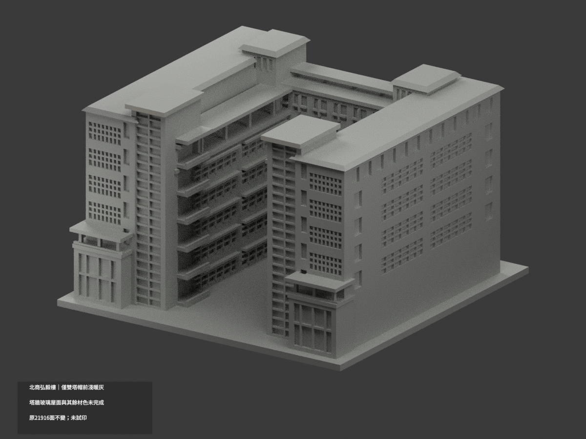
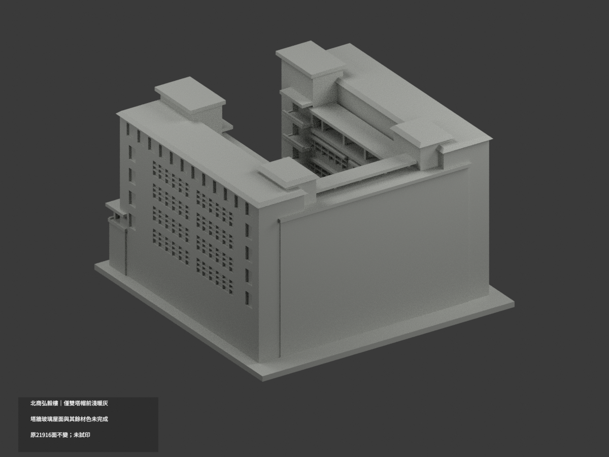
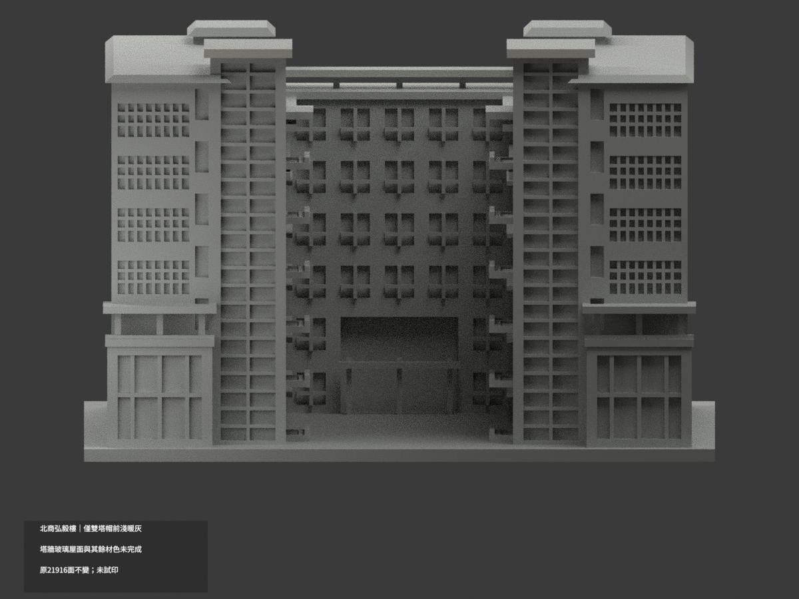
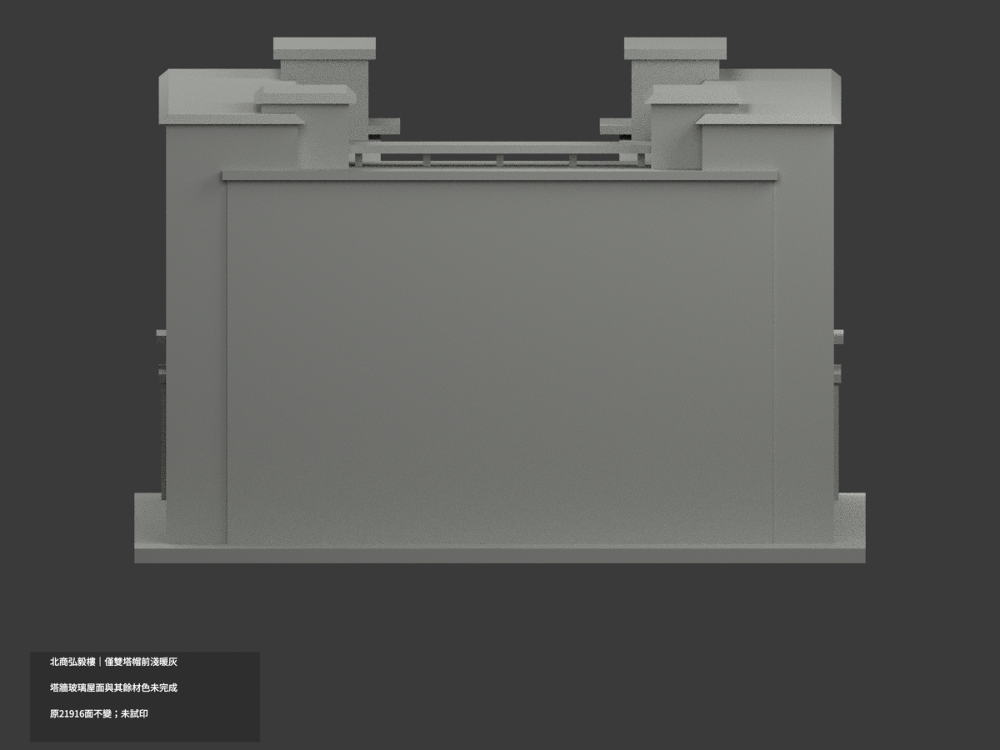
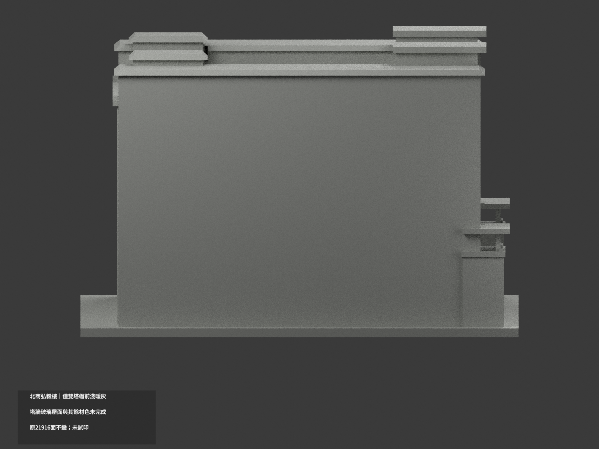
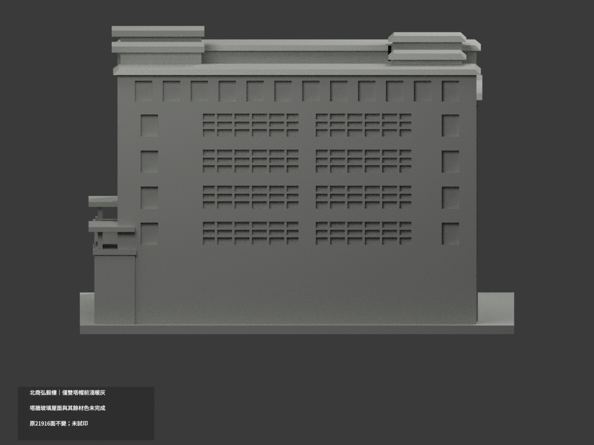
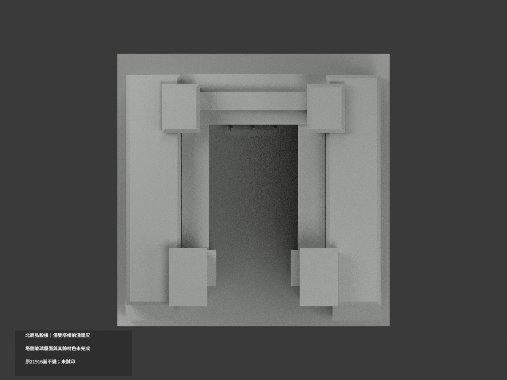
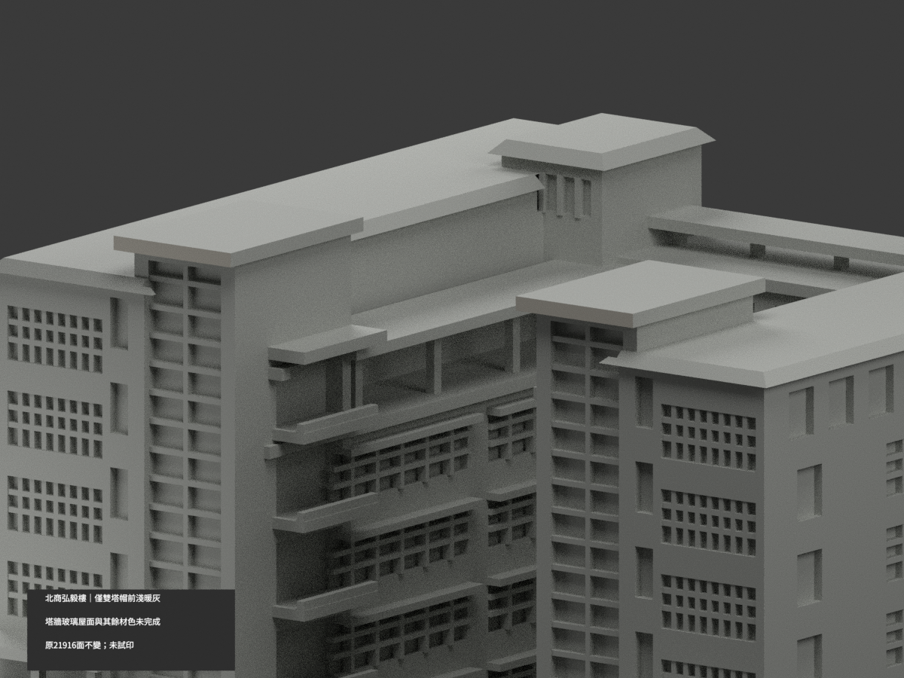
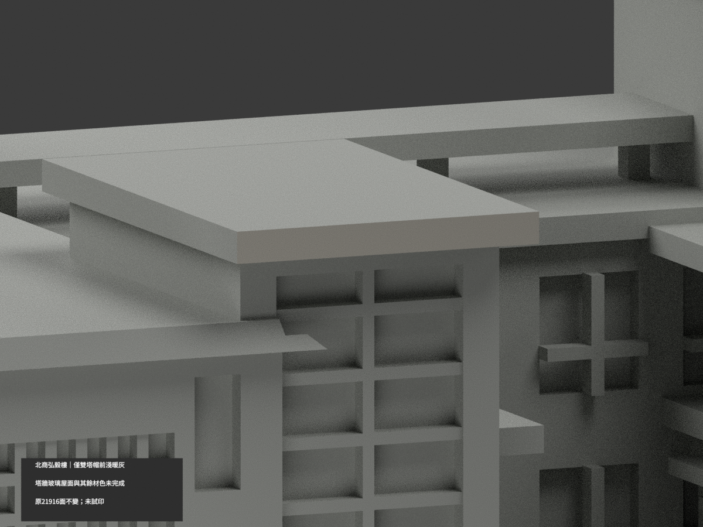
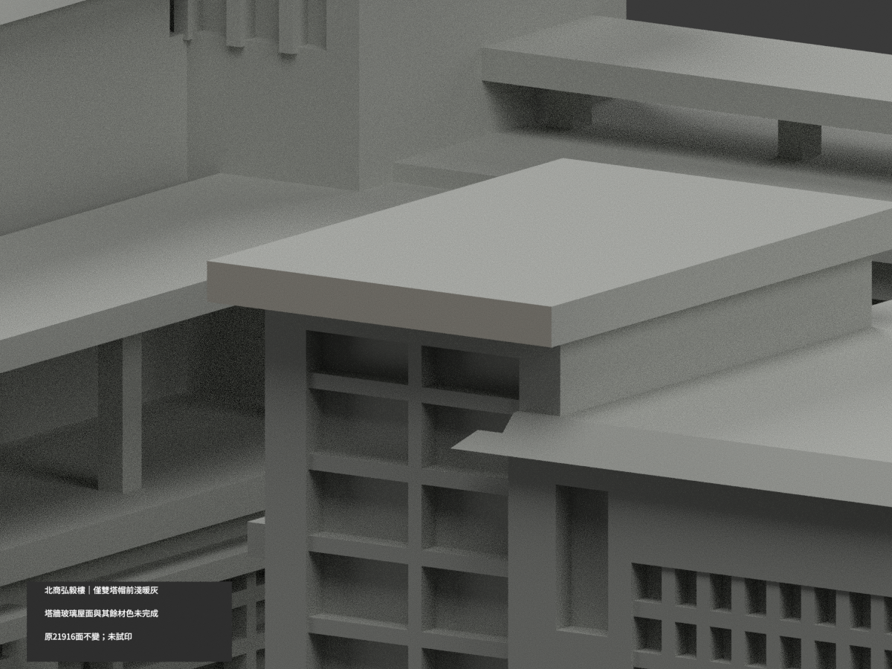

# 北商弘毅樓｜雙塔帽前緣局部淺暖灰

**局部補色未完成：只雙樓梯塔帽前緣4原面淺暖灰；塔牆、玻璃、磚灰混壁、屋面與其餘面尚未分色。** partial_color_incomplete=true、fully_colored_exterior=false。同項 ntub-hongyi／count_delta=0，國立臺北商業大學桃園校區。英文身份 NTUB Hongyi partial color。

**維持原單一弘毅樓全形量體／有證立面近似，不是完整立面、屋頂或設備測繪。**

| 前斜視 | 後斜視 | 正面 |
|---|---|---|
|  |  |  |
|  |  |  |
|  |  |  |
|  | | |

## 材色範圍

全原y−64無限plane三頂點0.0001mm枚舉，恰4面分為兩個完整共享邊2面矩形。依原碼雙塔帽x中心±36、寬21，z95.5..97.6；界限只描述完整原域，不作人工截色。4名義淺暖灰，其餘21912中性，原21916三角不變。全原共面連通域一致，無normal閾值漏小面、centroid或亮度切三角。

官方庭院照片同時可見兩塔帽前薄緣，兩邊均直接有據，不靠鏡射單塔。帽上水平皮/底/左右背返維持中性。塔身有金字、設備與樹遮，不延伸整白牆；玻璃有反光、窗框樓層，不整藍。外翼淺坡屋、後服務塔帽、未定位光電/設備、平台棚、實板陽台代理、混磚灰牆及其他簷帶全部中性。中性不代表實景灰；資料覆蓋邊界不是實材接縫。

## 來源日期與原始限制

兩張官照原DateTimeOriginal分別2017:08:30 09:57:33及2015:06:17 11:43:40，僅EXIF相機元資料，無時區與鐘準驗證；第一張DateTime2017:08:30 14:12:54是修改欄，不當拍攝時間。不換算UTC，不稱2026現況。原碼公開照片整體近似、未知遠側背面留白；既有PV證據只知設備存在未定翼/完整範圍，不能加造，亦不冒稱確定裝PV前版本。補色不追認精確幾何或整棟復原。來源照片僅私人研究，不公開貼圖，不推定商用權利。

## 檔案與 QA

原STL/build與21916三角座標拓撲/字節保留；immutable23件無OBJ，不新增或冒稱原OBJ。原README另存ORIGINAL-MONOCHROME-README.md，單色圖/QA歷史保留。appearance.3mf兩展示材與scene.blend真面材同原幾何；export/validate/render/verify及真3MF/scene精確身份 NTUB Hongyi partial color。精確依賴隔離build+color、閉合正體積/3MF座標面材/Blender重開/10張1200×900檢核；保留重建不刪，未試印或驗多料切片，STL本身無色。

## English limitations

NTUB Hongyi partial color. Sameonebuilding/slug,count_delta0,originalphoto-derived overallmassing notmeasured fullcondition. Entire originaly=-64 plane4triangles forms two complete2triangle capfrontrectangles,nominalpalewarmgray4/neutral21912;original21916triangles/STL/build unchanged,noimmutableOBJ. Bothcaps directlyobserved incourtyardphoto,notmirrorinference. Tops/undersides/returns,lettered towers,glazing/reflections,mixedwalls,balconyproxies,roofs/PVunknownneutral. EXIF2017:08:30 09:57:33 and2015:06:17 11:43:40 have notimezone/clockverification;modificationisnotcapture,no2026claim. PVlocationnotestablished,nofabricatedequipment orprePVdate. No publicphotos/textures,not testprinted.
