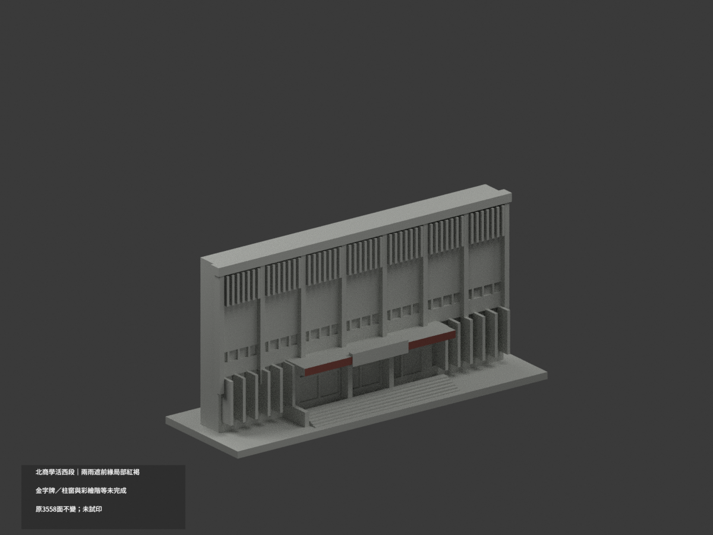
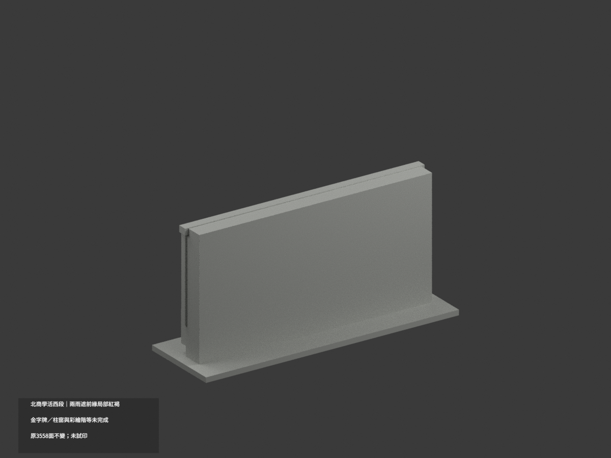
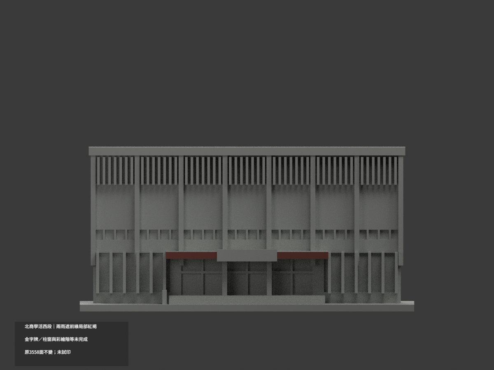
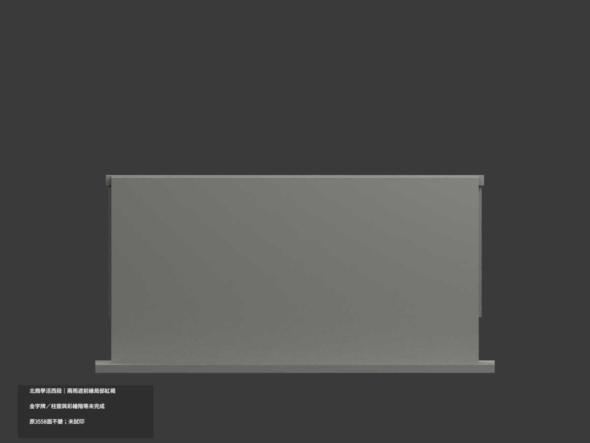
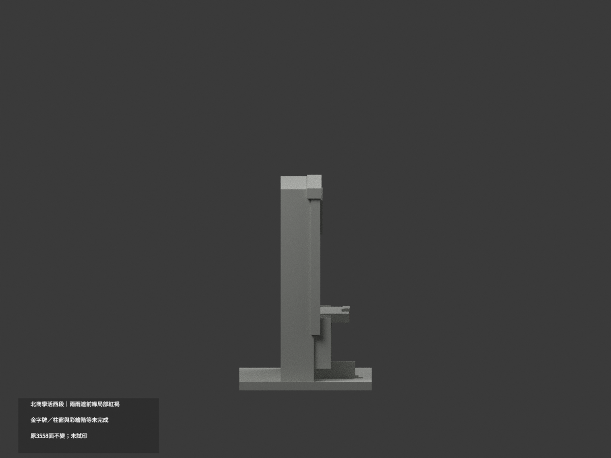
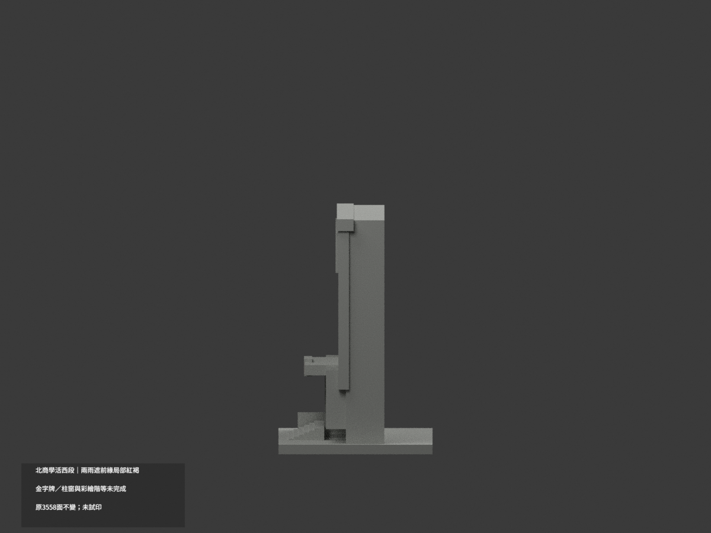
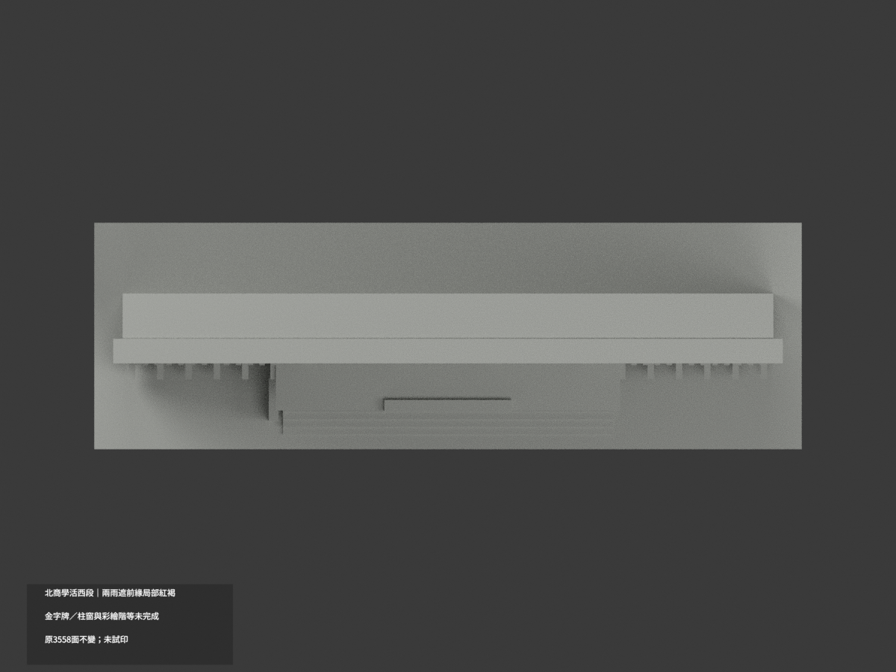
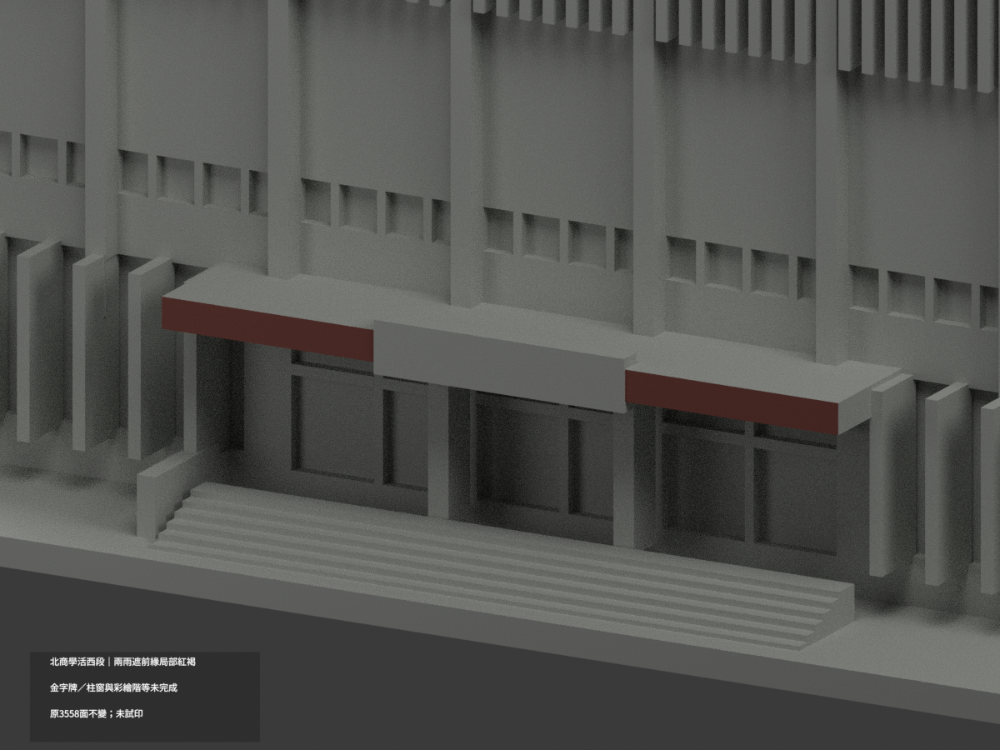
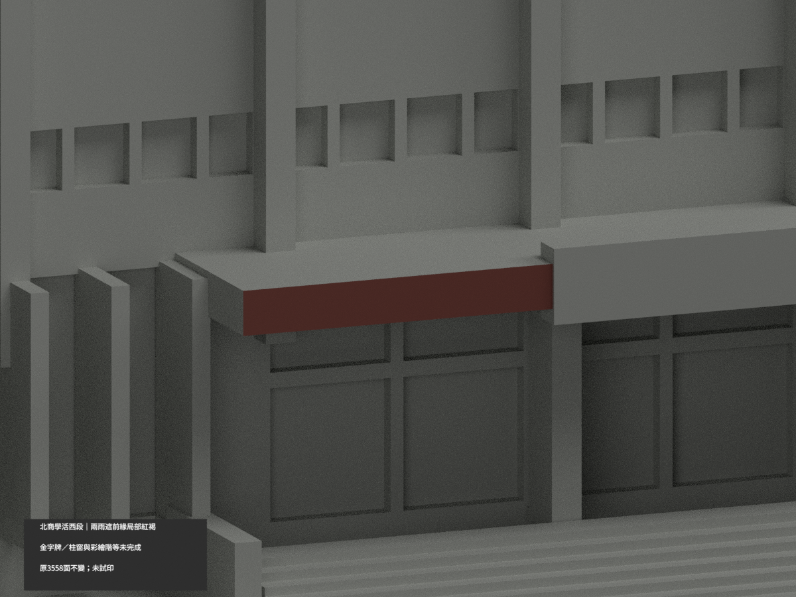
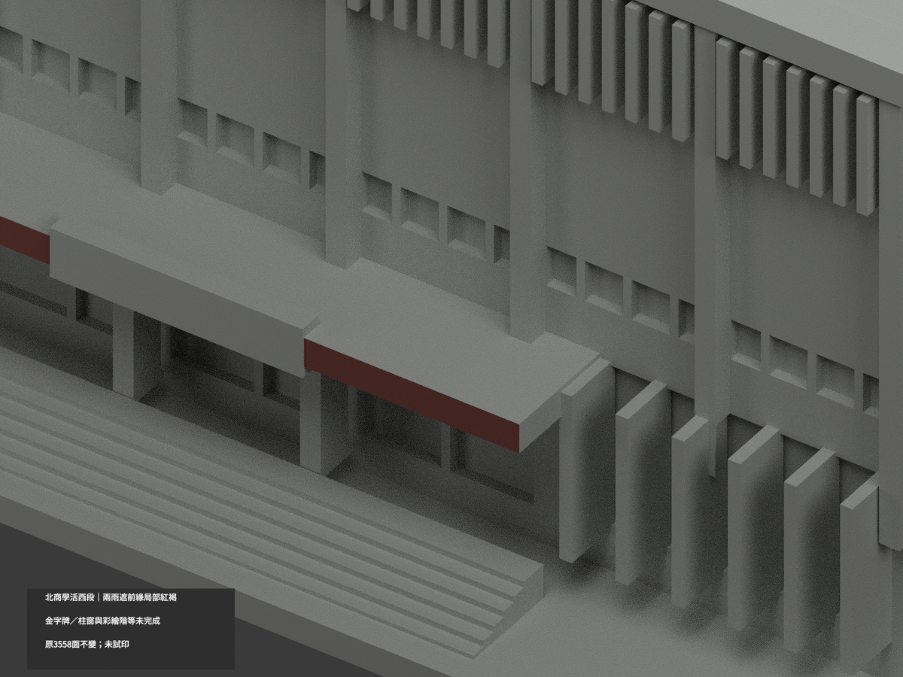

# 北商學生活動中心西向主立面段｜局部雨遮紅褐

**金字牌、柱窗與彩繪階等材域未完成分色。** partial_color_incomplete=true、fully_colored_exterior=false。只兩完整雨遮前緣4面名義紅褐，非全館補色。

| 總覽 | 背側 | 正面 |
|---|---|---|
||||
||||
||||
||||

## 材色範圍
同 ntub-student-center-west-facade 原項目，same-item、count_delta=0。國立臺北商業大學臺北校區，西向主立面片段非整館。原3558三角及STL/build_model.py字節完全保留，20原件無OBJ，不造原件。
- 兩雨遮前緣整y−15.8平面4面，分左右各2面完整共邊矩形。全3頂點有限域核對，不以中心或normal篩選，不截小三角。
- 其餘3554面中性：中央金字牌、49上部fin混風扇與樹遮、主柱、門窗反光背板、告示支柱、彩繪階梯、混主牆、屋檐、雨遮上底側面及後方切面。
- 平直背面是原模型片段截斷，不是真實背立面。近似窗列與支撐保留，補色不追認原幾何精度；不加字、不補整館。中性界線是證據範圍而非真實材縫。

## 來源與日期
親看官方photo18及photo22外觀；近景支持兩平整紅褐雨遮前緣，高視角只補定位。EXIF為2023-09-02，無時區且時鐘未校驗，不等於2026現況。名義色族非校準色票。原照私人保存、不公開、不作紋理、不建人物，未確認再散布或CC授權，不保證商用。

## 格式與列印
[原STL](model.stl) · [逐面材色3MF](appearance.3mf) · [Blender](scene.blend)
保留原150mm底座示意尺寸，不是測量比例。實際物件名 NTUB Student Center West Facade partial color，獨立核對真slug與館名。STL無色，3MF與Blender逐面分材；兩材標籤非兩色或四色耗材切片驗證，未實際列印。

## 重建與 QA
原build_model.py → colorize_model.py → export_appearance.py → validate_color.py；Blender render_color.py／verify_color_scene.py。完整隔離Shapely2.1.2精確原build＋color重建、原bytes與全三角multiset、共面均一、閉合正體積、3MF逐面材、scene重開、十圖1200×900及圖文hash。原README/previews/validation保留歷史，不冒充新QA，不刪檔。

## English scope
Partial color only:4 original triangles on two complete canopy fascia front rectangles, muted red brown;3554 neutral. Original3558 triangles and20 files preserved, no immutable OBJ. West elevation section only, not the entire building. Gold-lettered sign,49 fins, window backings, piers, colorful painted stairs, mixed walls, canopy returns/top/underside and rear cut remain neutral. EXIF2023-09-02 has no verified timezone/clock, not2026 appearance. Nominal family only, count0, unchanged geometry, no tested filament slicing.
