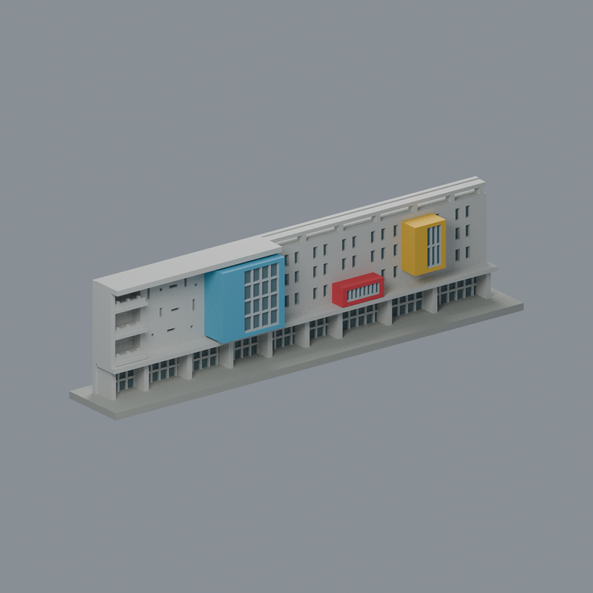
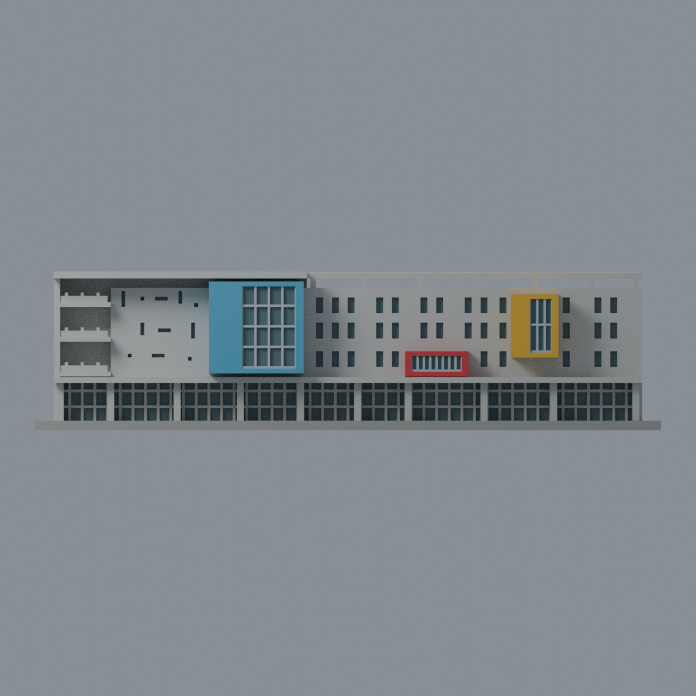
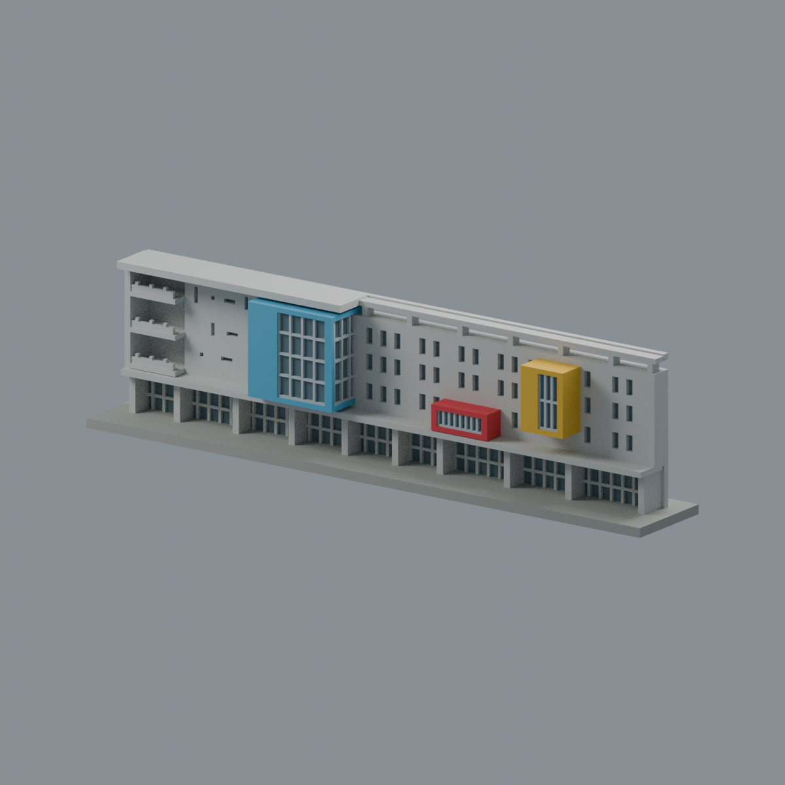
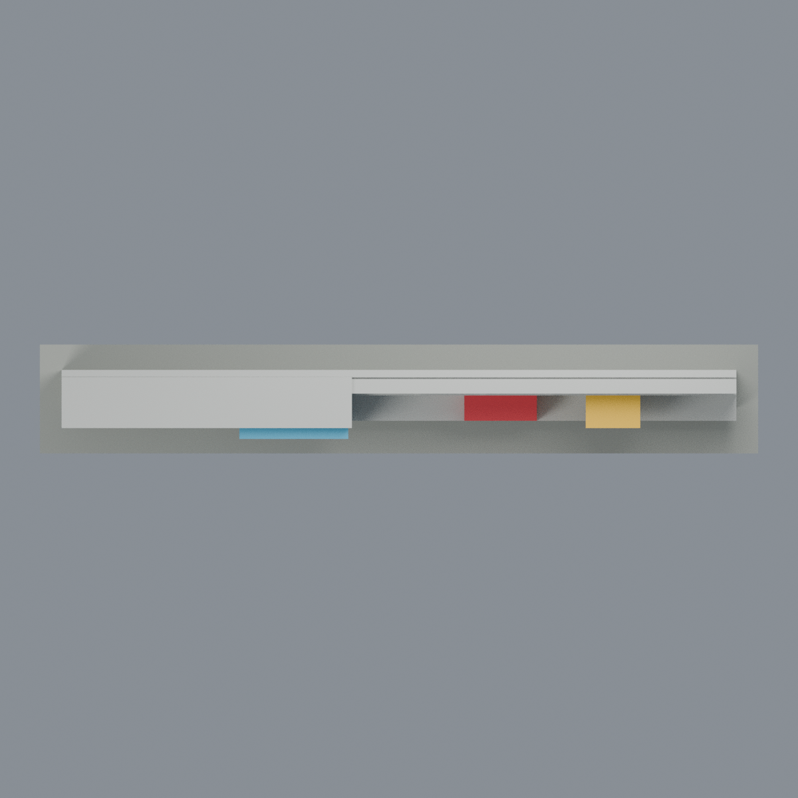
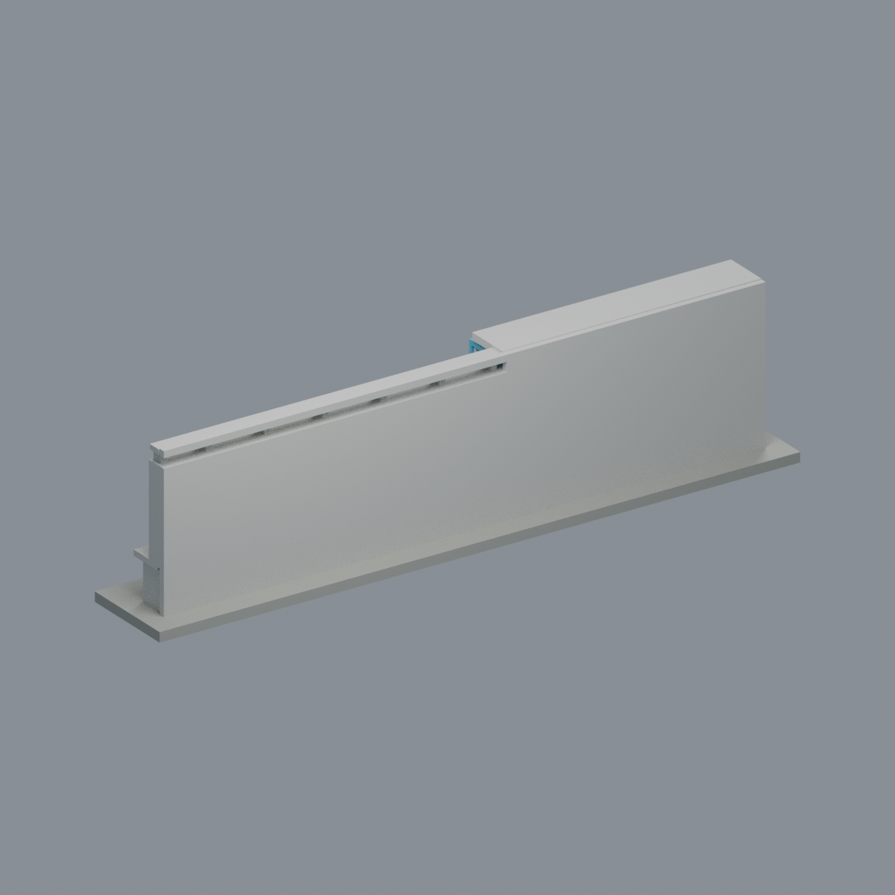

# 國立臺北大學綜合體育館彩色凸窗入口立面段

<table>
  <tr>
    <td align="center" valign="top"> 入口斜視</td>
    <td align="center" valign="top"> 正立面</td>
    <td align="center" valign="top"> 右側斜視</td>
  </tr>
  <tr>
    <td align="center" valign="top"> 俯視</td>
    <td align="center" valign="top"> 背面展示切面</td>
    <td></td>
  </tr>
</table>

[Blender 色版](../scene.blend) · [3MF 色版](../model.3mf) · [單色列印 STL](../model.stl)

五張 WebP 均由目前已發布的色版模型以原相機重跑，只調整展示檔案格式。模型為入口立面薄切段，不是整棟體育館；背面只是展示切面。未做實體試印；細窗櫺、懸挑及縮放應另行評估。幾何、材質和原始 PNG 都未變更。

[原版模型說明與重建](../README.md) · [目前模型校驗](../PUBLIC-MODEL-SHA256SUMS) · [展示來源記錄](render-proof.json) · [展示檔案校驗](SHA256SUMS)
