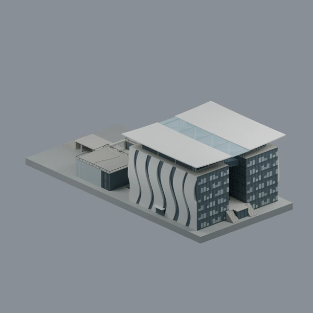
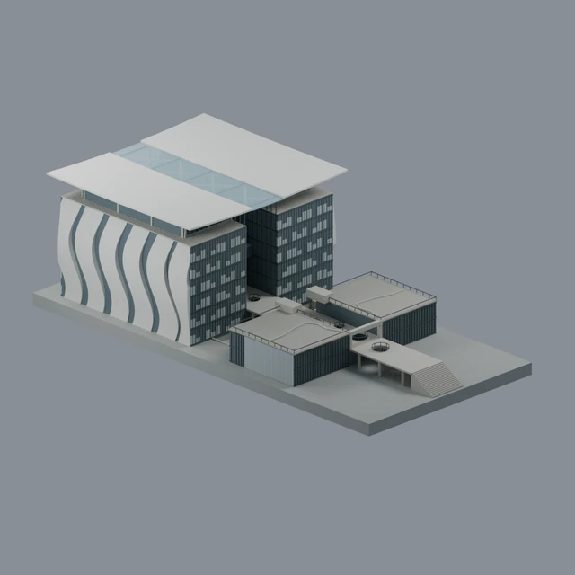
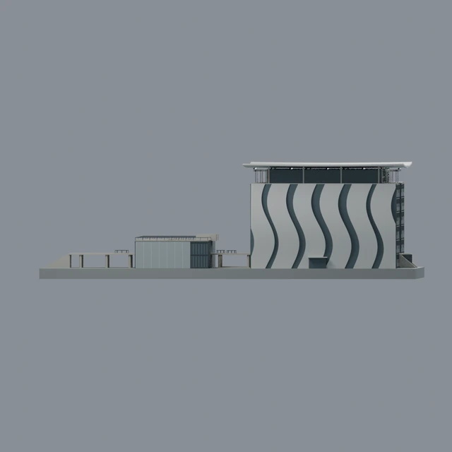
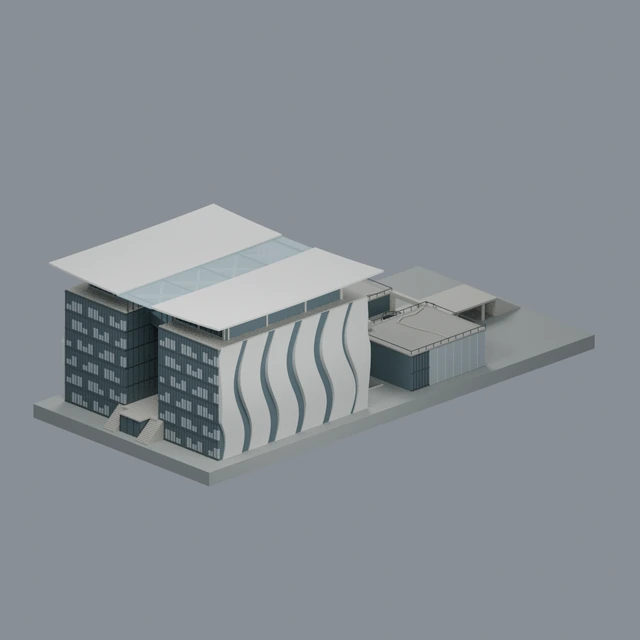
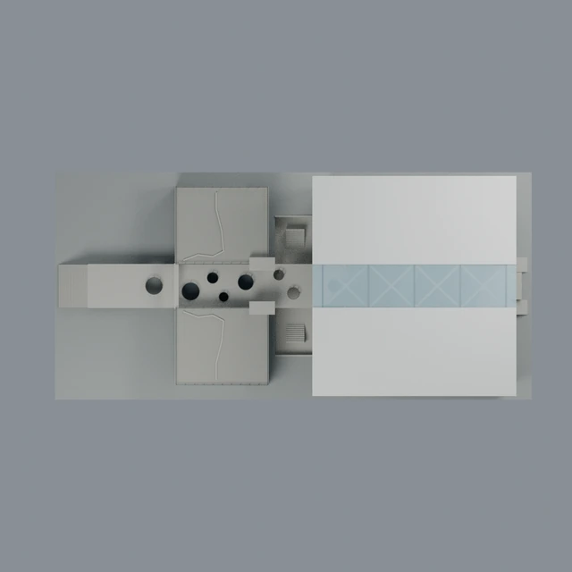

# 國立臺北大學三峽校區圖書資訊大樓｜現版五視角

| 模型預覽 | 模型預覽 | 模型預覽 |
| :---: | :---: | :---: |
|  正面斜視 |  背面斜視 |  正立面 |
|  左斜視 |  俯視 |  |

從現版八材質 Blender 重繪原五個鏡位；大圖為無損 WebP。模型、相機、材質、首頁代表圖與原工程證據不變。

[現版 Blender](../scene.blend) · [現版彩色 3MF](../model.3mf) · [原 STL](../model.stl) · [模型與來源](../README.md) · [QA 與保留限制](../QA.md) · [渲染證據](render-proof.json) · [展示校驗](SHA256SUMS)
