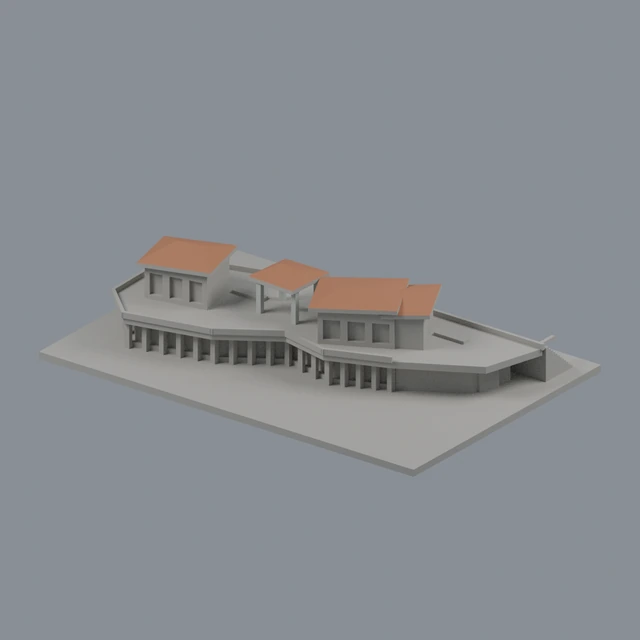
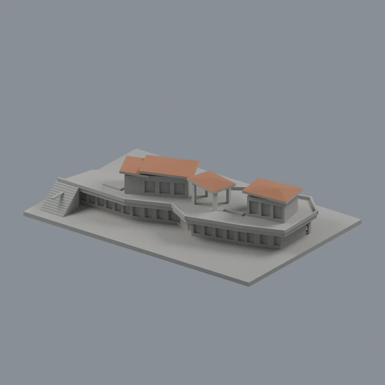

# 心湖會館

## 模型預覽


| 模型預覽 | 模型預覽 | 模型預覽 |
| :---: | :---: | :---: |
| 正面斜視<br>[](display/front-current.webp) | 背面斜視<br>[](display/rear-current.webp) | [四個視角與現版下載](display/README.md) |

## 東端外階補色（2026-11-20）

只補模型東端外階朝外的 **12 道既有豎踢面，共 32 三角**，約 177.070 mm²。沿用原三材版的淡灰色值 **#B8BCB5**，未新增或調整材質，也不推定現場樓梯與亭柱是同一種實體材料。原 42 個屋面、36 個亭柱面、全部 2,444 個三角及原 STL 均不變。新檔獨立保存，原彩色與單色場景、3MF 及原圖不覆寫。

[本次 Blender](side-color-20261120/scene.blend) · [本次三材 3MF](side-color-20261120/model-colored.3mf) · [逐面範圍與來源](side-color-20261120/domain.json)

| 補色前 | 補色後 |
| :---: | :---: |
| [補色前端部總覽（比對存檔）](side-color-20261120/before-end-overview.png) | [補色後端部總覽（比對存檔）](side-color-20261120/after-end-overview.png) |
| 同角度，保留原色與完整底座。 | 只變更外階豎踢面。 |
| [補色前豎踢面（比對存檔）](side-color-20261120/before-stair-riser-detail.png) | [補色後豎踢面（比對存檔）](side-color-20261120/after-stair-riser-detail.png) |
| 局部裁切，同樣平光便於比較。 | 淡灰只覆豎踢面，水平踏面、中央凸條及鄰面維持中性。 |

[設計單位完工實照](https://www.fieldscapedesign.com/副本-高峰國小幼稚園)的日照斜視及樓梯近軸俯視可辨端部連續淡灰踢面；[校方完工紀錄](https://new.ntpu.edu.tw/news/62bd4b68836cf05bcfa9be83/心湖會館新建工程)的暖色斜照只用於定位。模型的 12 道階梯屬前版幾何近似，並非現場分段、植栽洞與窄樓梯的一一對應。兩處被凸條扣去的原區塊未補；踏面、植栽、欄件、側牆與舊版未分界的混合材域不延伸。色值未校準，不宣稱窗牆已完成、原施工色票或 2026 現況。照片不隨包。

[逐面、Blender 及 3MF 驗證](side-color-20261120/verification.json) · [重建與對照圖驗證](side-color-20261120/reproduction-QA.json) · [本次 SHA256SUMS](side-color-20261120/SHA256SUMS)。新檢查圖採同鏡頭，存檔仍維持原相機、燈光與場景設定。原列印限制照舊，未做新切片及實體試印。

新版重建從套件根目錄執行：

    python side-color-20261120/rebuild_exchange.py
    blender -b appearance/scene.blend -t 2 -P side-color-20261120/apply_side_color.py -- --qa-renders


## 歷史參考：3 材質外觀版（2026-10-21，東端外階補色前）


[舊版來源界線與原圖存檔](appearance/README.md) · [舊版表面色 3MF](appearance/ntpumind-appearance.3mf) · [舊版可編輯場景](appearance/scene.blend)

僅原網格四組折面金屬屋坡採來源支持的銅紅色代理，中央四柱淺灰；混合材質牆面、未分草坪與鋪面、屋頂厚邊及未知區域保持中性，不聲稱整棟還原。 原 STL 與歷史 QA 不變；這是外觀改善，不是新增幾何。原單色正面（歷史檔案留存，不作本頁預覽）／原單色背面（歷史檔案留存，不作本頁預覽）


整體外觀近似。依公開竣工實拍手工參數化重建的建築外觀近似模型，沒有抓取現成3D mesh，也不是測繪或工程用模型。

## 模型與下載


- [STL](model.stl)
- [可編輯 Blender 場景](scene.blend)：匯入實際交付STL的三角網格，單位毫米
- [參數化重建腳本](build_model.py) 與 [相依版本](requirements.txt)
- [公開來源與採用特徵](sources.json)

尺寸（含底座）：150 × 100 × 31.5 mm；最長150mm。本件獨立縮放，與其他館舍不是同一比例。

## 保留的外觀

- 折線二樓露臺與主要樓板輪廓
- 三組上層亭體，其中中央亭下保持開放
- 非等高折坡屋頂、地面層柱廊與後側玻璃窗帶
- 東側寬樓梯與粗化矮牆

## 範圍與不確定處

- 側邊設備機座、空調群、管線、實體植栽不逐件製作
- 欄杆以1.15mm實牆化，避免細桿失真或列印斷裂
- 屋頂折線、各亭體與露臺進深是實拍比例估算，沒有施工測繪
- 2021年完成實拍與查核時官方照片仍在刊載；不宣稱照片攝於2026年

## 重建與檢查

以Python 3.12安裝requirements.txt，依序執行：

```sh
python build_model.py
blender -b -t 2 -P render_preview.py
python validate_model.py
python check_contour_validity.py
python check_thin_features.py
python verify_package.py
```

- 原始STL的法向量、繞序、正體積、水密、每邊兩面、vertex link單環及單一連通表面都有檢查；沒有以修復後的STL代替輸入證據。
- 獨立暫存路徑重建的STL SHA必須一致；saved Blend實際網格也要與交付STL幾何一致。
- [validation.json](validation.json)、[0.2mm逐層檢查](contour-validity-check.json)與[0.8mm參考寬度篩檢](thin-feature-check.json)分開提供；斷言失敗即非零退出，不能忽略。
- 輪廓採0.2mm層距、起點z=0.071mm，逐層檢查degree 2閉合及個別/組合Polygon有效性。
- 薄特徵以canonical shared-edge法，1mm層距、0.4mm半徑形態opening輔助檢查，不等於全面最小壁厚。

## 列印注意

毫米匯入，底座朝下。露臺、屋簷、跨橋等懸挑處可能需要支撐；請在Cura、PrusaSlicer等實際切片器逐層查看橋接、支撐可移除性、細部與首層黏著。欄杆、玻璃格柵等已做粗化或凹刻，勿再任意縮小。

本件沒有實體試印，也沒有Cura/Prusa的實際工具路徑驗證；數位幾何通過不保證所有機器、材質、噴嘴或設定都可直接印成功。

## 版本

2026-10-13 修訂版已通過外觀覆核並凍結；獨立幾何審核結果另附。來源照片與原始PDF不在公開包重新散布。
