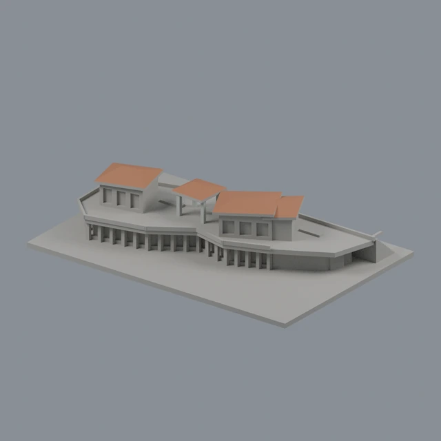
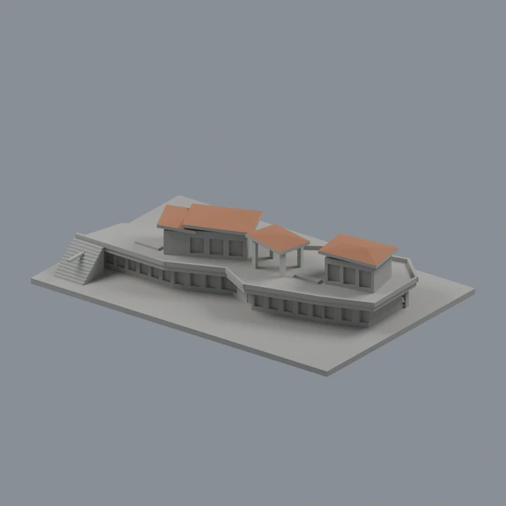
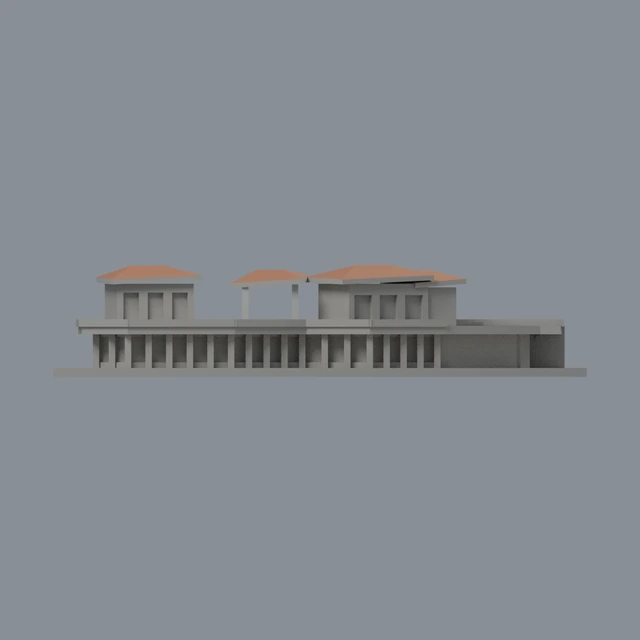
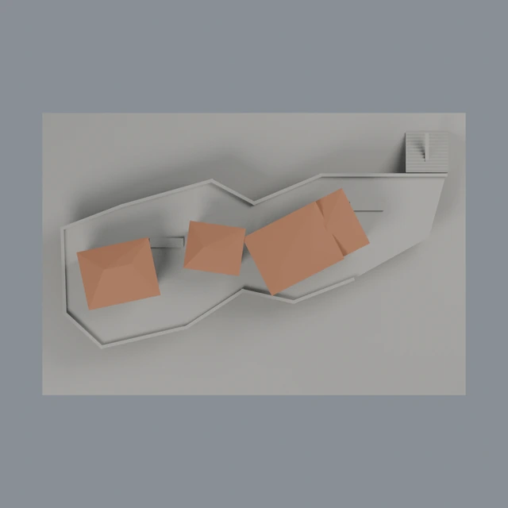

# 國立臺北大學三峽校區｜心湖會館現版展示

點選縮圖查看同一鏡位的無損 WebP 大圖。

| 模型預覽 | 模型預覽 | 模型預覽 |
| :---: | :---: | :---: |
|  正面斜視 |  背面斜視 |  正立面 |
|  頂視 |  |  |

四張圖從已保存的最新版 Blender 重繪。該版只補東端外階既有 12 道豎踢面（32 個三角形）的近似淡灰，未改幾何、踏面、其他材域或相機。只展示心湖會館外觀，不代表實測、現況或其他場地／室內變體。

[現版可編輯 Blender](../side-color-20261120/scene.blend) · [現版彩色 3MF](../side-color-20261120/model-colored.3mf) · [原 STL](../model.stl) · [補色證據與限制](../side-color-20261120/domain.json) · [模型原始說明及重建](../README.md) · [渲染驗證](render-proof.json) · [展示校驗](SHA256SUMS)

原模型說明、PNG、重建及工程紀錄均保留。
