# 國立臺北教育大學｜臺北校區建築模型

第八批新增防空洞第一入口地上段、舊警衛室2024可見段、舊琴房山牆簷廊段3模型；既有19模型逐檔原樣保留。合計22模型覆蓋18個主要命名館舍範圍與5個補充／局部範圍，行政A＋圖書館H合計只算1模型。芳蘭樓仍只有入口局部，其他量體近似亦有未知面。18名冊覆蓋不代表所有歷史／附設建物或全校完成。各件自建，最長150毫米含底座，各自獨立比例。

| 建築模型 | 建築模型 | 建築模型 |
| :---: | :---: | :---: |
| [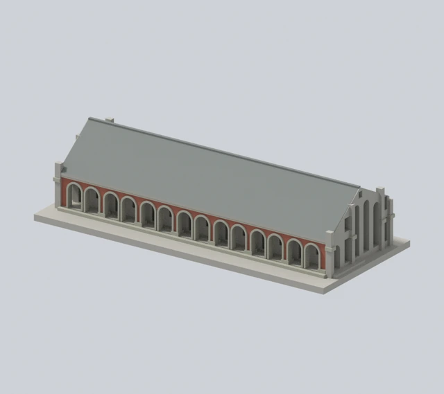](臺北校區/buildings/ntue-assembly-hall/README.md) **[大禮堂](臺北校區/buildings/ntue-assembly-hall/)** | [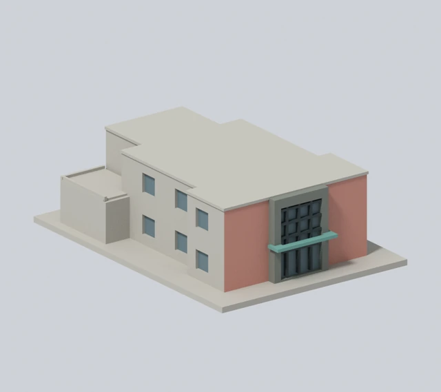](臺北校區/buildings/ntue-wenhui/README.md) **[文薈樓](臺北校區/buildings/ntue-wenhui/)** | [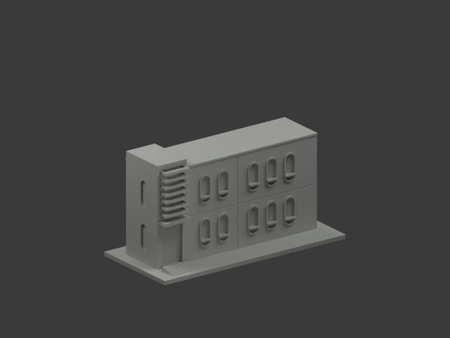](臺北校區/buildings/ntue-fanglan-entrance/README.md) **[芳蘭樓入口暨可見立面段](臺北校區/buildings/ntue-fanglan-entrance/)** [局部材色3MF](臺北校區/buildings/ntue-fanglan-entrance/appearance.3mf) · [範圍與限制](臺北校區/buildings/ntue-fanglan-entrance/README.md) |
| [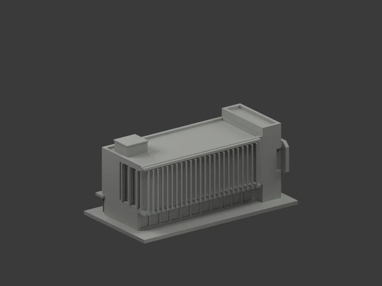](臺北校區/buildings/ntue-montue/README.md) **[北師美術館](臺北校區/buildings/ntue-montue/)** [局部材色3MF](臺北校區/buildings/ntue-montue/appearance.3mf) · [範圍與限制](臺北校區/buildings/ntue-montue/README.md) | [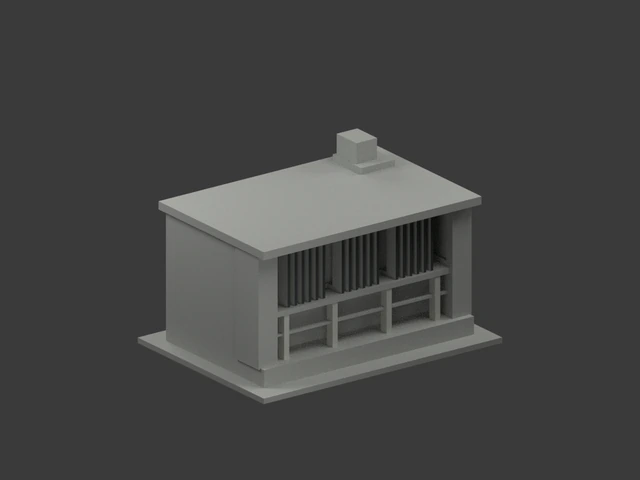](臺北校區/buildings/ntue-creative/README.md) **[創意館](臺北校區/buildings/ntue-creative/)** [局部材色3MF](臺北校區/buildings/ntue-creative/appearance.3mf) · [範圍與限制](臺北校區/buildings/ntue-creative/README.md) | [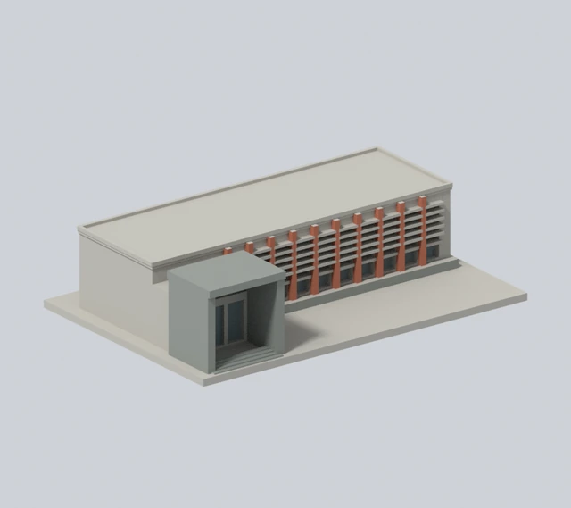](臺北校區/buildings/ntue-pool/README.md) **[泳健館](臺北校區/buildings/ntue-pool/)** |
| [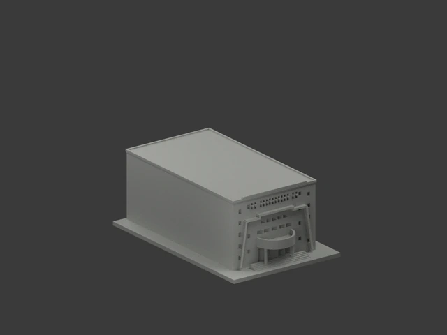](臺北校區/buildings/ntue-gym/README.md) **[體育館](臺北校區/buildings/ntue-gym/)** [局部材色3MF](臺北校區/buildings/ntue-gym/appearance.3mf) · [範圍與限制](臺北校區/buildings/ntue-gym/README.md) | [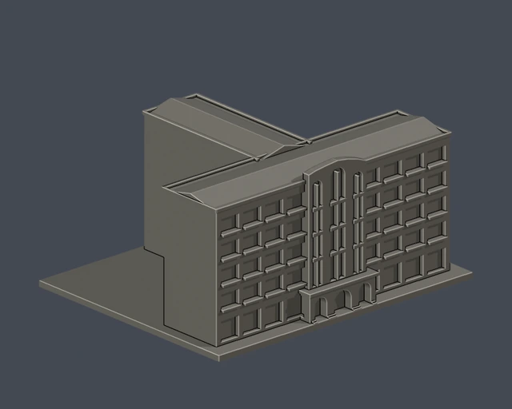](臺北校區/buildings/ntue-science/README.md) **[科學館](臺北校區/buildings/ntue-science/)** | [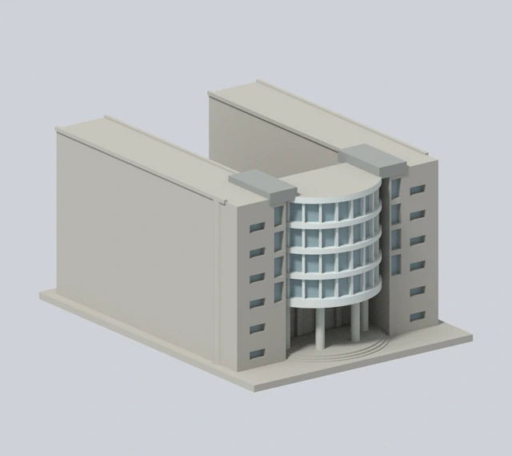](臺北校區/buildings/ntue-arts/README.md) **[藝術館](臺北校區/buildings/ntue-arts/)** |
| [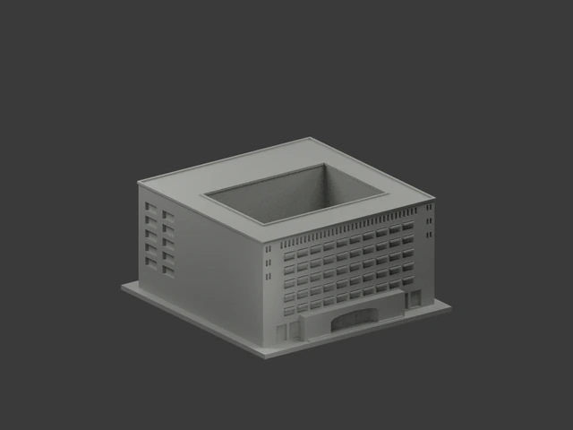](臺北校區/buildings/ntue-admin-library-complex/README.md) **[行政大樓暨圖書館建築群](臺北校區/buildings/ntue-admin-library-complex/)** [局部材色3MF](臺北校區/buildings/ntue-admin-library-complex/appearance.3mf) · [範圍與限制](臺北校區/buildings/ntue-admin-library-complex/README.md) | [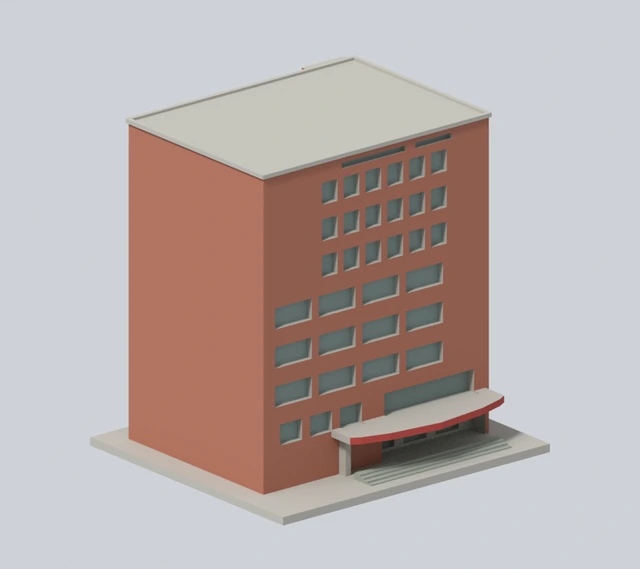](臺北校區/buildings/ntue-zhishan/README.md) **[至善樓](臺北校區/buildings/ntue-zhishan/)** | [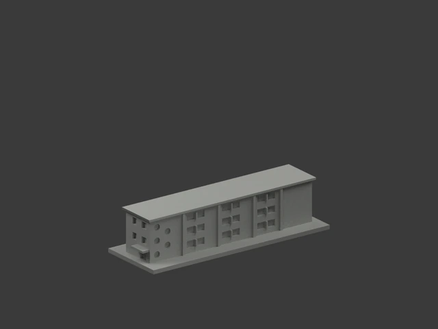](臺北校區/buildings/ntue-mingde/README.md) **[明德樓](臺北校區/buildings/ntue-mingde/)** [局部材色3MF](臺北校區/buildings/ntue-mingde/appearance.3mf) · [範圍與限制](臺北校區/buildings/ntue-mingde/README.md) |
| [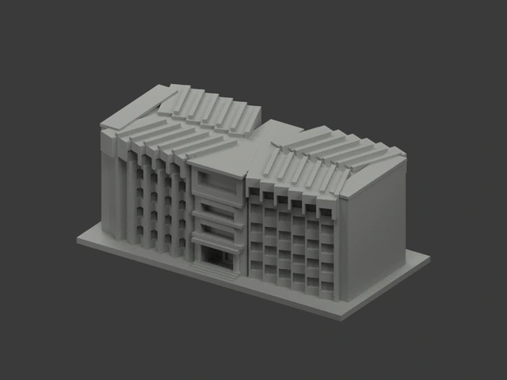](臺北校區/buildings/ntue-dormitory-1/README.md) **[第一宿舍](臺北校區/buildings/ntue-dormitory-1/)** [局部材色3MF](臺北校區/buildings/ntue-dormitory-1/appearance.3mf) · [範圍與限制](臺北校區/buildings/ntue-dormitory-1/README.md) | [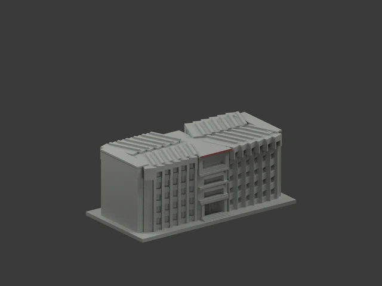](臺北校區/buildings/ntue-dormitory-2/README.md) **[第二宿舍](臺北校區/buildings/ntue-dormitory-2/)** [局部材色3MF](臺北校區/buildings/ntue-dormitory-2/appearance.3mf) · [範圍與限制](臺北校區/buildings/ntue-dormitory-2/README.md) | [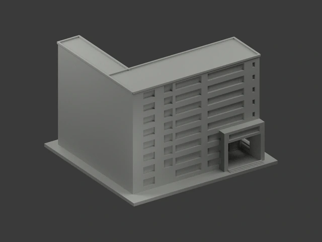](臺北校區/buildings/ntue-duxing/README.md) **[篤行樓](臺北校區/buildings/ntue-duxing/)** [局部材色3MF](臺北校區/buildings/ntue-duxing/appearance.3mf) · [範圍與限制](臺北校區/buildings/ntue-duxing/README.md) |
| [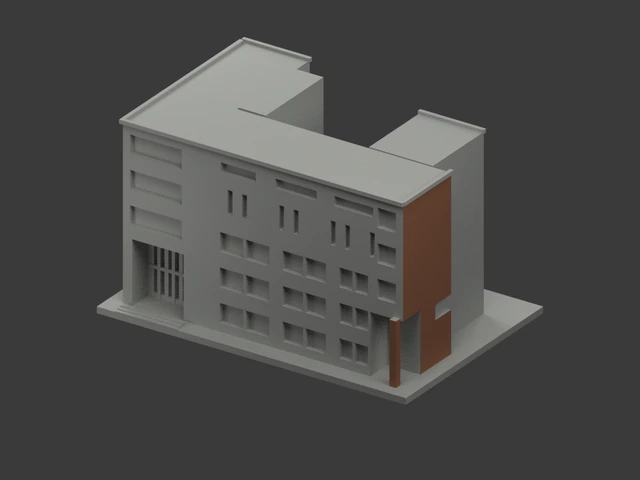](臺北校區/buildings/ntue-audiovisual/README.md) **[視聽館](臺北校區/buildings/ntue-audiovisual/)** [局部材色3MF](臺北校區/buildings/ntue-audiovisual/appearance.3mf) · [範圍與限制](臺北校區/buildings/ntue-audiovisual/README.md) | [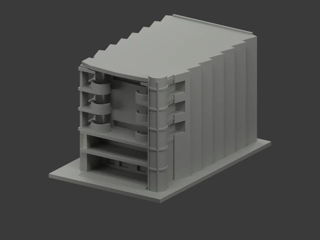](臺北校區/buildings/ntue-student-center/README.md) **[學生活動中心](臺北校區/buildings/ntue-student-center/)** 學生活動中心（前批索引，不重計） [局部材色3MF](臺北校區/buildings/ntue-student-center/appearance.3mf) · [範圍與限制](臺北校區/buildings/ntue-student-center/README.md) | [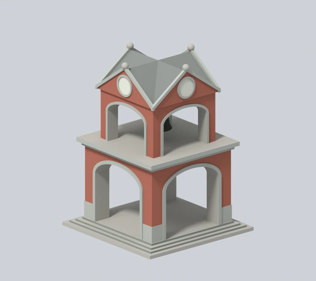](臺北校區/buildings/ntue-bell-tower/README.md) **[百年紀念鐘樓](臺北校區/buildings/ntue-bell-tower/)** 百年紀念鐘樓（前批索引，不重計） |
| [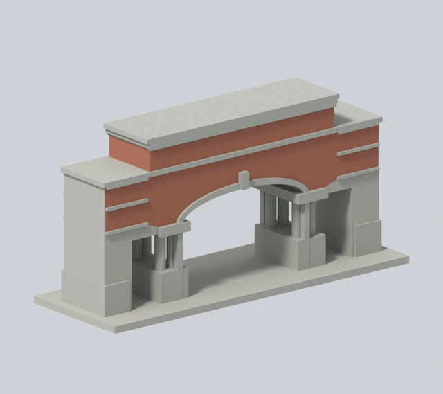](臺北校區/buildings/ntue-main-gate/README.md) **[正門入口段](臺北校區/buildings/ntue-main-gate/)** | [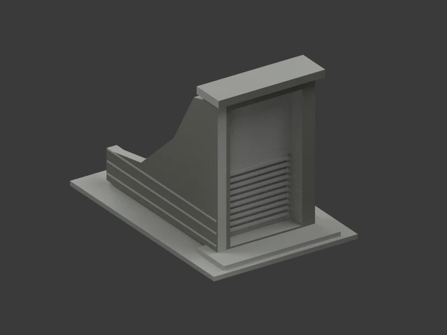](臺北校區/buildings/ntue-air-gallery-entry-segment/README.md) **[國立臺北教育大學｜防空洞藝廊第一入口地上段](臺北校區/buildings/ntue-air-gallery-entry-segment/)** 防空洞藝廊第一入口地上段 [局部材色3MF](臺北校區/buildings/ntue-air-gallery-entry-segment/appearance.3mf) · [範圍與限制](臺北校區/buildings/ntue-air-gallery-entry-segment/README.md) | [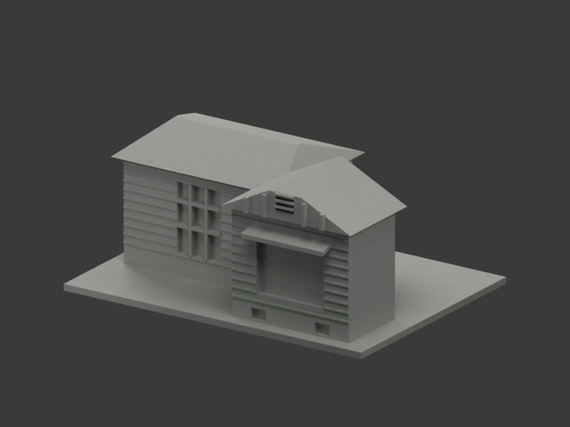](臺北校區/buildings/ntue-historic-guardhouse-2024-segment/README.md) **[國立臺北教育大學｜舊警衛室可見外觀段（2024）](臺北校區/buildings/ntue-historic-guardhouse-2024-segment/)** 舊警衛室可見外觀段（2024） [局部材色3MF](臺北校區/buildings/ntue-historic-guardhouse-2024-segment/appearance.3mf) · [範圍與限制](臺北校區/buildings/ntue-historic-guardhouse-2024-segment/README.md) |
| [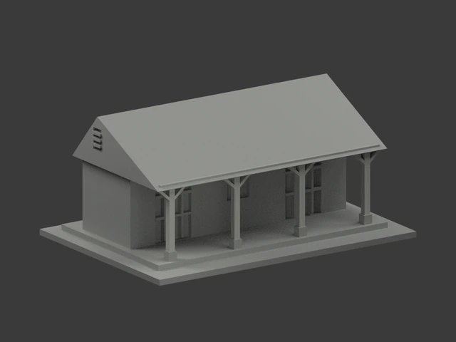](臺北校區/buildings/ntue-janitor-veranda-segment/README.md) **[國立臺北教育大學｜舊琴房／小使室山牆簷廊段](臺北校區/buildings/ntue-janitor-veranda-segment/)** 舊琴房／小使室山牆簷廊段 [局部材色3MF](臺北校區/buildings/ntue-janitor-veranda-segment/appearance.3mf) · [範圍與限制](臺北校區/buildings/ntue-janitor-veranda-segment/README.md) |  |  |

[後續清單](CONTINUATION.md)。來源攝影日及未見屋頂細節未知，限制明列各件README。新增三件均為明示局部：防空洞不含地下／第二入口；舊警衛室以2024外觀為限、後部平直截斷；舊琴房只有三開間四柱段，不含另外便所。底座朝下；入口框、窗罩、簷廊與厚化斜撐可能需支撐。原照片/PDF不散布，數位QA不是實體試印或切片器驗證。本批外觀已核可，獨立QA通過才可發布。

[補充棟界與附設校區](SUPPLEMENTARY-SCOPE.md)
