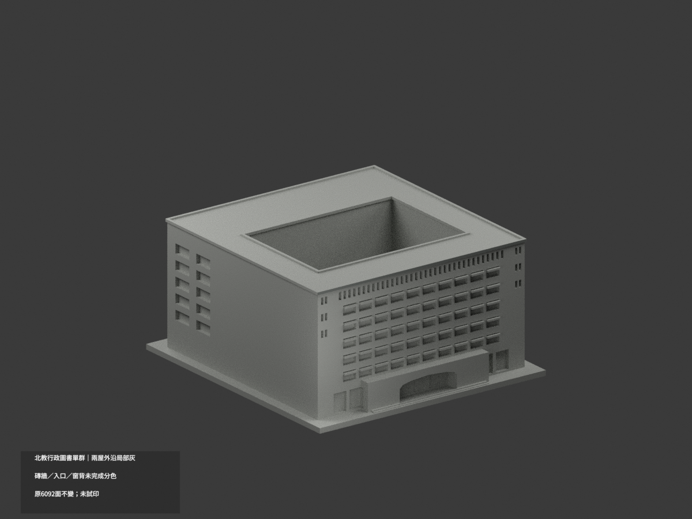
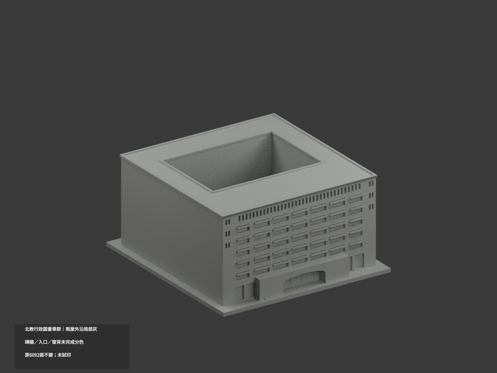
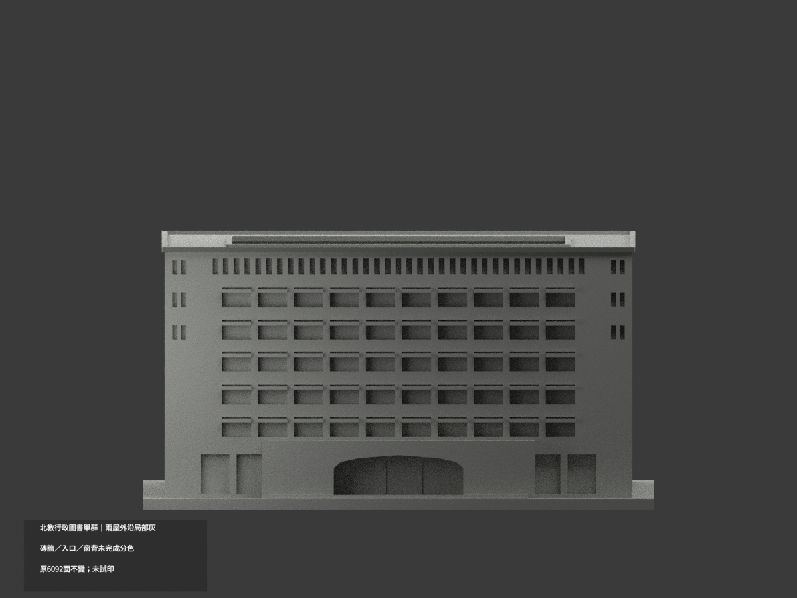
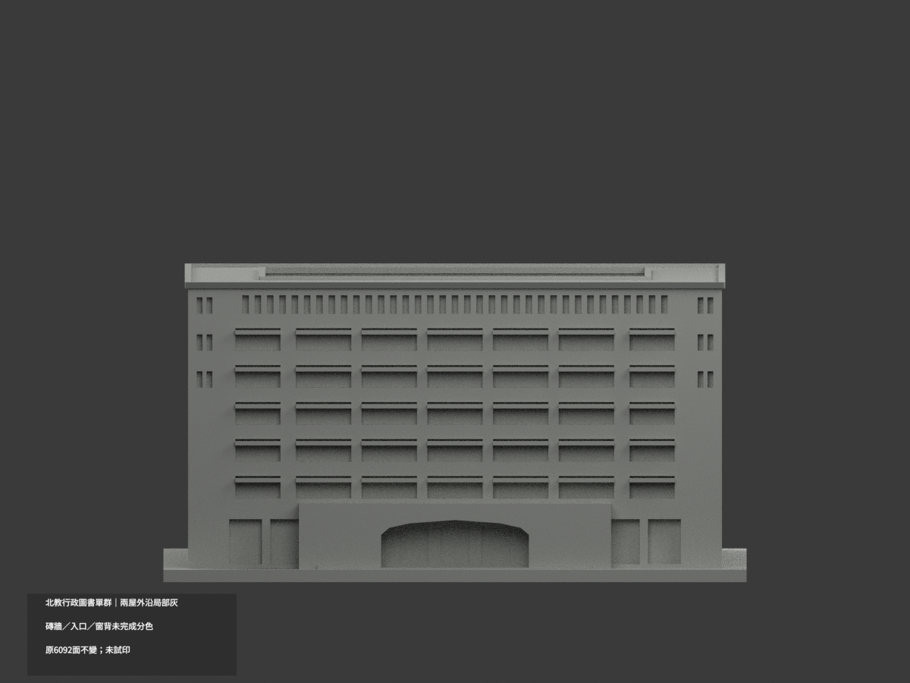
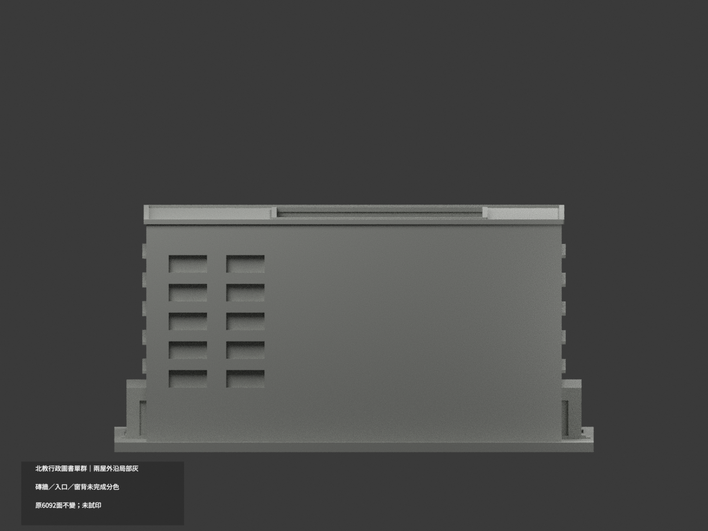
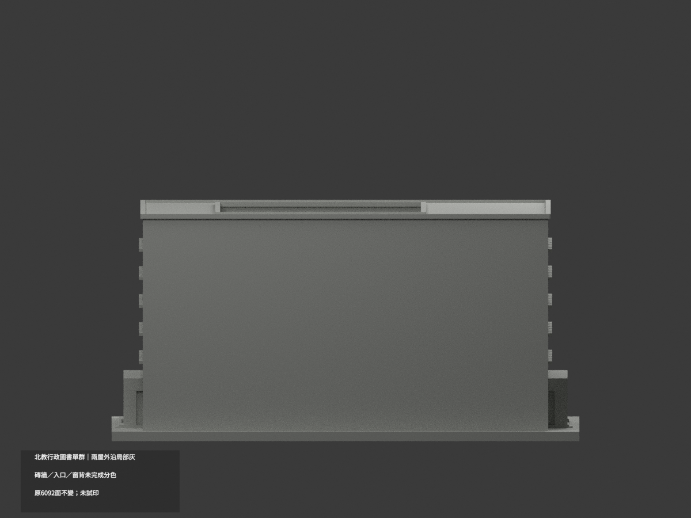
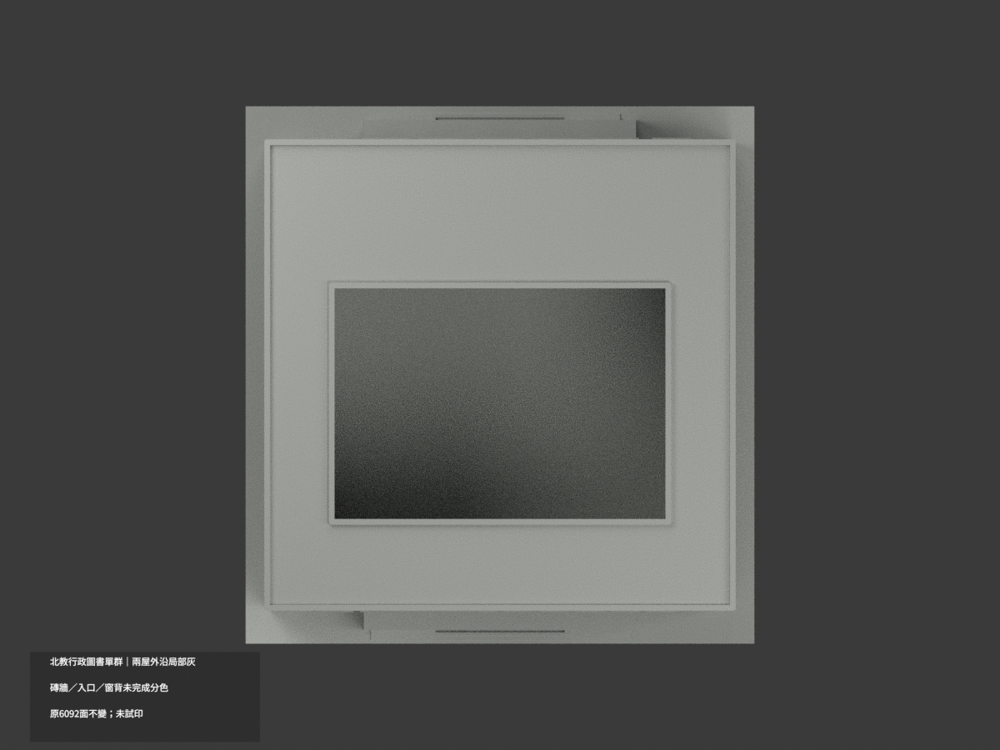
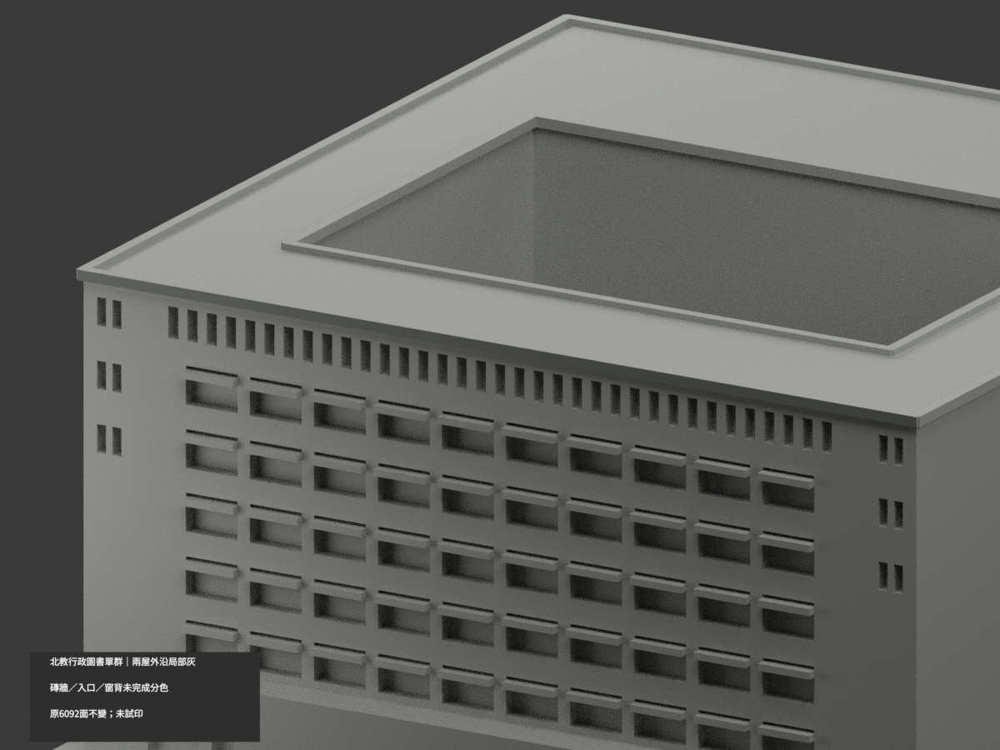
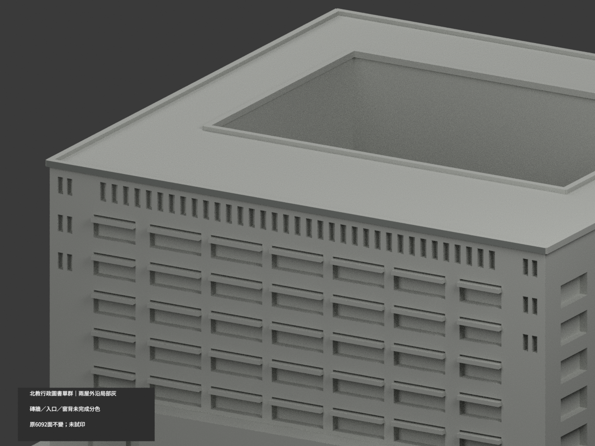
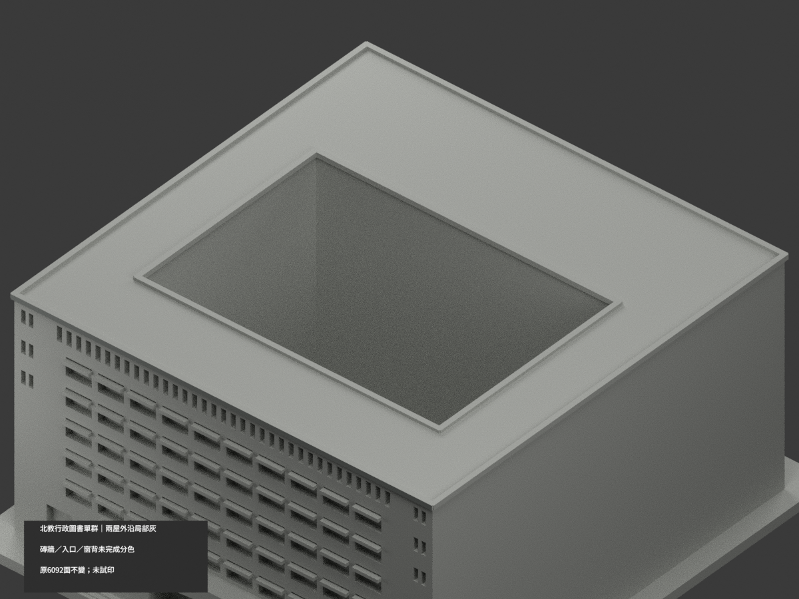

# 北教行政圖書單群｜兩正面屋外沿局部灰

**磚牆、入口及窗背未完成分色。** `partial_color_incomplete=true`、`fully_colored_exterior=false`。行政與圖書兩命名館保留原同一連通院落群、同一slug，不拆套。

| 總覽 | 背側 | 正面 |
|---|---|---|
||||
||||
||||
||||

## 材色範圍
同 `ntue-admin-library-complex` 原項目，same-item、count_delta=0。**6092原三角面、STL與build_model.py字節不變**，不切面或造金字；原公開包無OBJ，不因原code會輸出而假稱保留。
- 只兩個完整屋頂外沿垂直矩形：y−65.8及y+65.8、x−65.5..65.5、z71.2..72.7，2＋2＝4原面中灰。
- 每三角全部頂點須符合原有限plane與界限，不採中心點／normal門檻。全1625共面連通域均一、0撤色。
- 其餘6088中性：全高混紅磚／灰基座牆、入口上方金字與下灰石跨面、窗背混玻璃／簾／框、窗橫浮條、水平屋頂、內院邊、側return、連翼、階與地面。
- 色／中性邊界是本次證據範圍，不是真實材接縫；不新增材料邊界、不追認原近似量體與開口為實測。院落保留原透空。

## 來源／日期與權利
只親看校方PDF物理頁11／42的四張建築外觀照片，不使用內部平面或安全資訊。拍攝日期未知，2023填表日期不是拍攝日期，不聲稱2026現況。兩正面真屋邊灰族可與原獨立外沿對位。
原照／PDF私存，不公開或貼圖；未確認CC／再散布授權，不保證商用。HEX是名義灰族，不是校準色票。來源GO是有界放行，先期review-only文字非免除builder QA。

## 格式與列印
[原STL](model.stl) · [逐面材色3MF](appearance.3mf) · [Blender](scene.blend)
原142×150mm展示底座，照片近似非精測比例。STL無色；3MF／Blender真逐面材。兩材標籤不是驗證兩色／四色耗材切片；**未實際列印**，無切片路徑。

## 重建與 QA
原 `build_model.py` → `colorize_model.py` → `export_appearance.py` → `validate_color.py`；Blender `render_color.py`／`verify_color_scene.py`。
完整隔離原build＋color重建、原bytes／三角multiset、閉合正體積、3MF面材、scene重開、十圖1200×900與圖文hash核對；程序不代替人工來源審核。
原README／previews／render／validation保留歷程，不冒充本次QA；沒有刪檔。

## English scope
Partial color only:4 existing outward vertical roofedge fasciafaces (2+2) nominalgray. All6088 otherfacesneutral. Two namedadministration/librarybuildings remain ONE originalconnectedgroup andslug. Original6092 triangles unchanged;no originalOBJ. Photo captureunknown;2023formdate notcapturedate. Exteriorphotosonly,no interior/securityreconstruction. Not testprinted or validatedfilament slicing.
