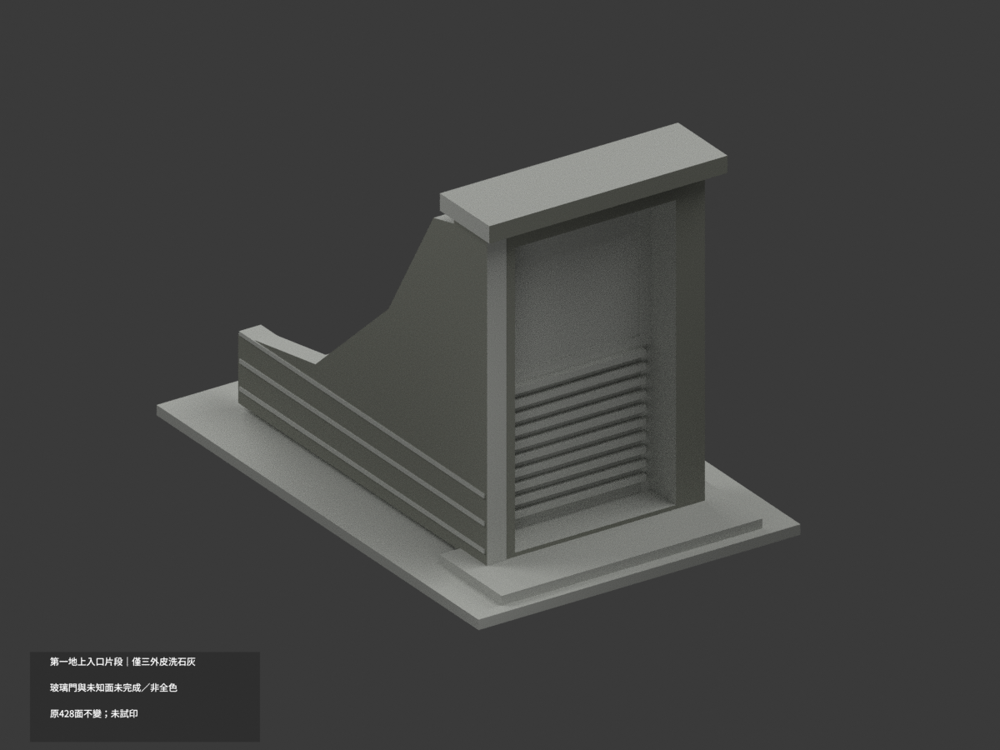
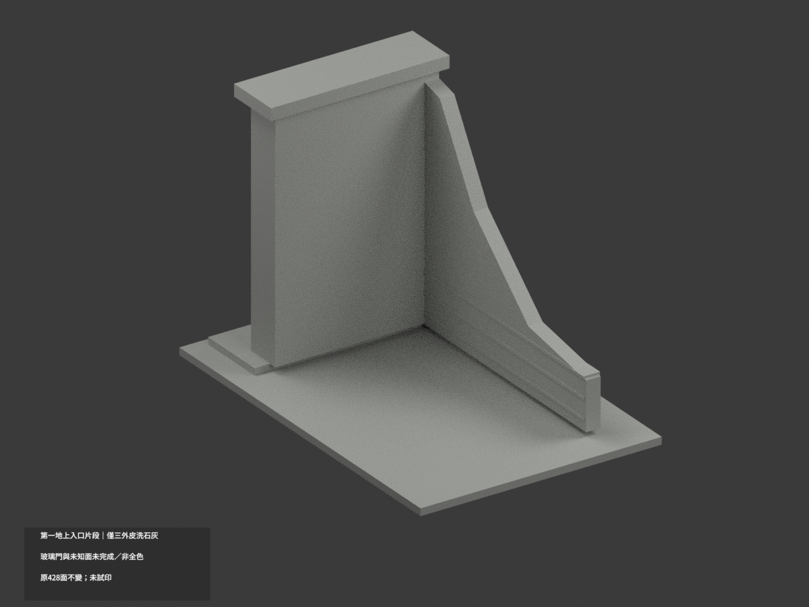
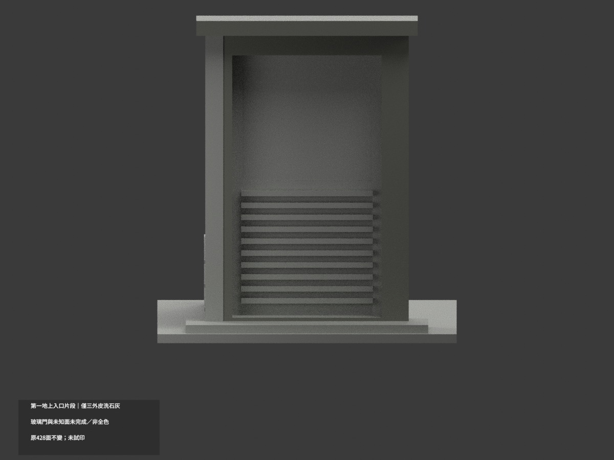
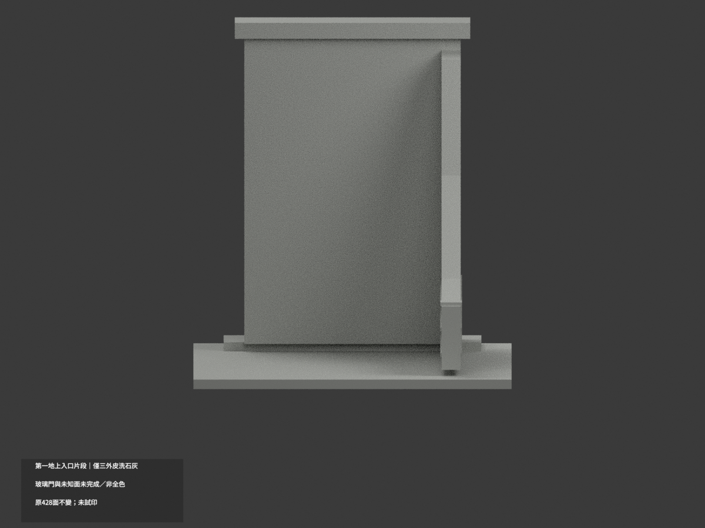
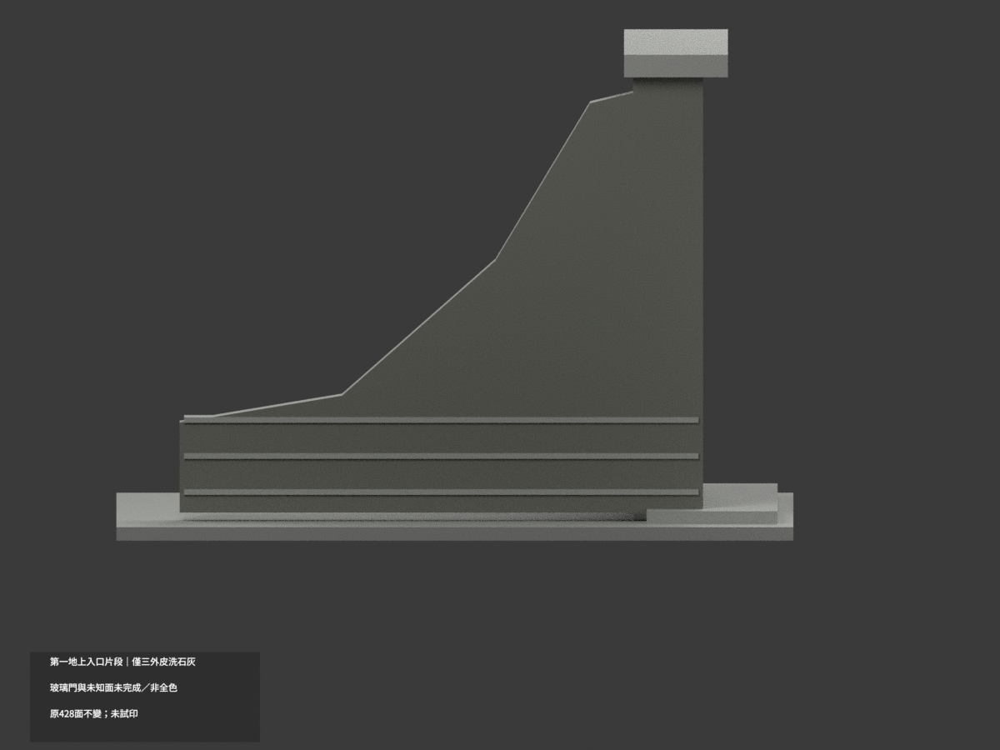
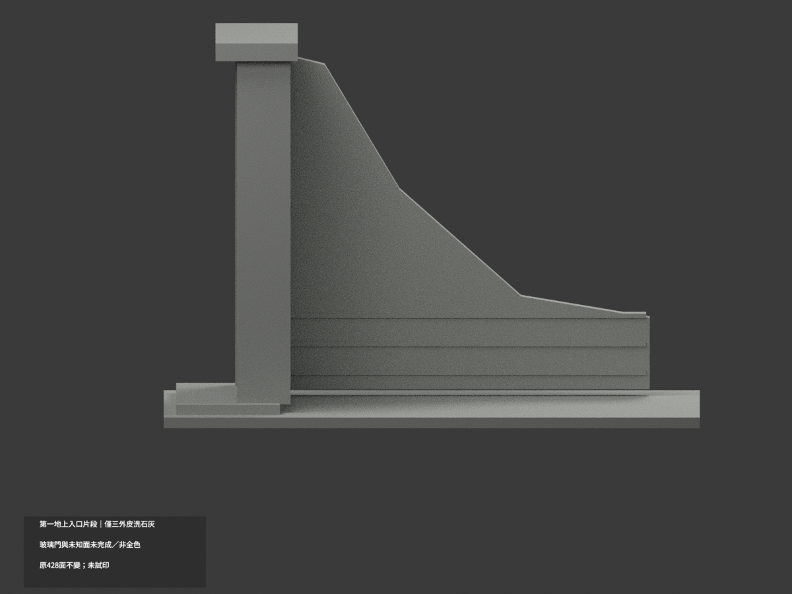
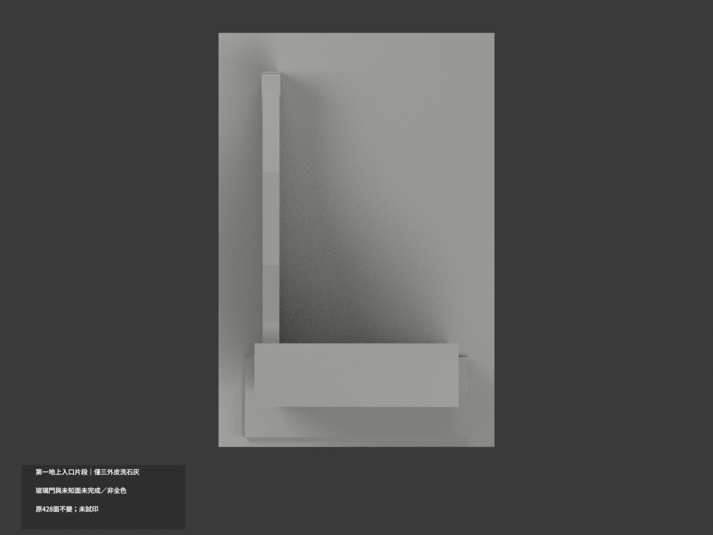
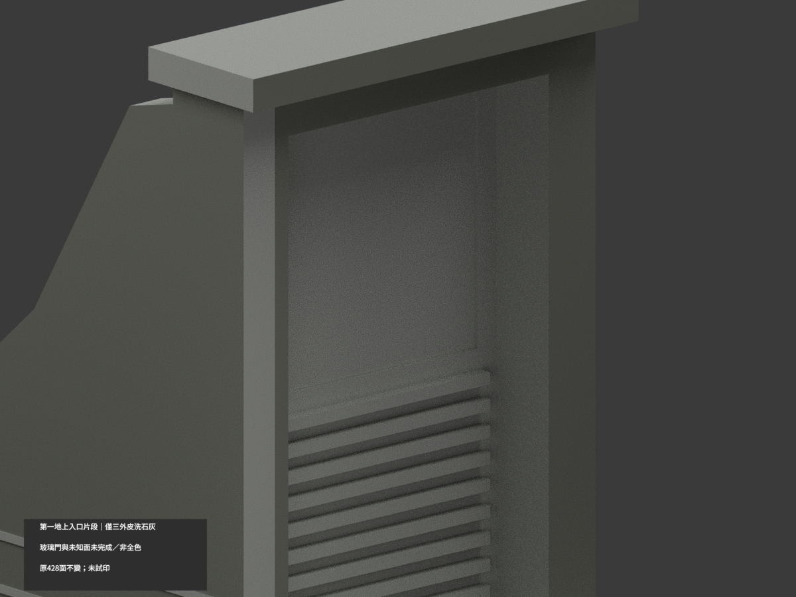
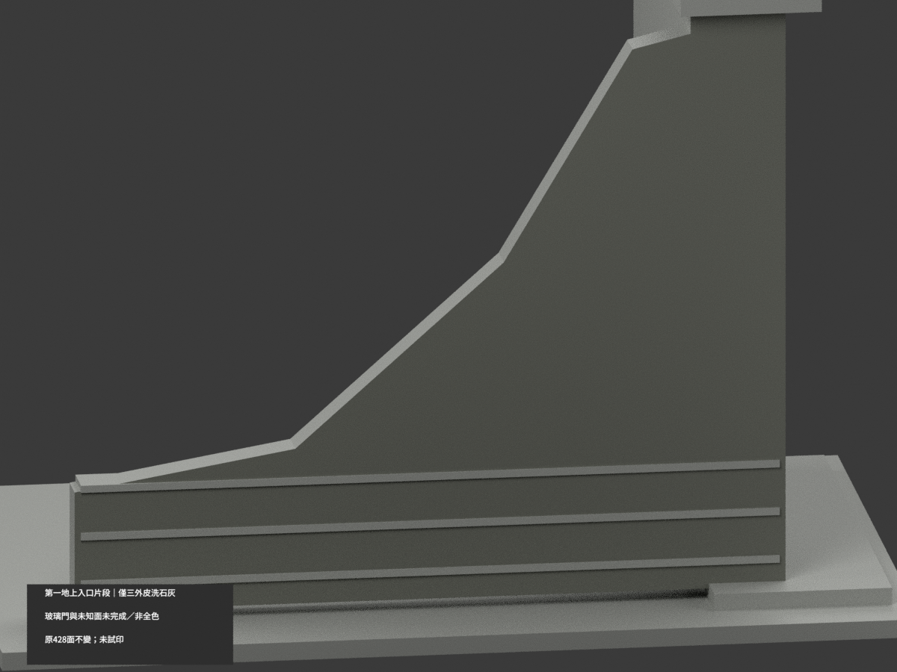
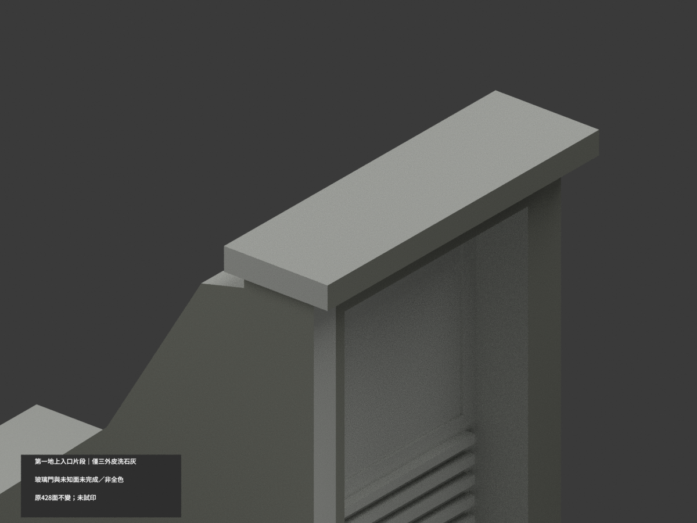

# 北教防空洞第一地上入口片段｜局部洗石灰

**局部補色未完成：僅正框、頂帽前面與左擋牆外面63原面洗石灰；玻璃門與未知面未完成／非全色。** `partial_color_incomplete=true`、`fully_colored_exterior=false`。同項 `ntue-air-gallery-entry-segment`，`count_delta=0`，臺北校區。只跨年代第一地上入口片段，不是全館、地下本體、第二口或2026完整現況。

| 前斜視 | 後斜視 | 正面 |
|---|---|---|
|  |  |  |
|  |  |  |
|  |  |  |
|  | | |

## 材色範圍

三完整原域：正框y−44.5、x±34/z5.5..103.5共10面；帽前y−50.5、x±37/z102..107共2面；左擋牆外x−34、y−45..71/z5..103.5共51原Boolean碎面。全三頂點有限plane/bounds核，不靠面心/原ID/normal硬切。全部原共面連通域一致，沒有新增分面。63洗石灰、365中性，共428原三角不變。

只色族近似，沒有新增洗石粒紋。左側框接觸殘片屬同外皮，另突出三橫course前面與返面不染；窗玻璃反光/展示混材、門與百葉、帽頂/底/端、地台、未知右後全中性。中性不是實景灰證明，資料範圍不是實際材料接縫。

原第一入口厚度/深度/擋牆下降曲線均照片近似保留，右後刻意截斷，不補地下廊道/第二口/全覆土，不補燈箱字樣裝飾或室內。補色不追認原幾何精準度。

## 來源、日期與權利

親看訪客公開外觀照片47/48/49：正框及帽前、左擋牆外皮與接縫連續性。獨立拍攝日未知，頁面或歷史藝廊介紹不等於攝影日/現況使用，不宣2026現況。來源URL/hash見COLOR-SOURCE-REGISTER與原sources.json；照片私人保存，不公開/貼圖，未見CC不推商用。HEX僅展示色族非測色色票。

## 檔案與 QA

原STL/build字節與428三角保持，`appearance.3mf`兩材與`scene.blend`真面材，`color-mesh.npz`同原三角。Immutable原包無OBJ；原build生成OBJ只在private隔離重建保存，不冒原件存在。原README.md保留ORIGINAL-MONOCHROME-README.md，原無README.zh-TW.md。舊previews/QA是單色歷程，不替代本次QA。

依精確原requirements隔離build+colorize、3MF/三角/封閉正體積/scene重開/10張1200×900綁定驗證，重建目錄保留不刪。shapely2.1.2私有target不改共享環境。**未實際列印**，兩展示材不是已驗四色切片；細件/支撐需另核。

## English limitations

Partial only:63complete original exposed stone-plane triangles(10front frame,2cap front,51left retaining exterior),365neutral;428original triangles/STL/build unchanged,count_delta0. All vertices finite-plane/bounds tested and coplanar components uniform. No added texture or geometry. Glass/door/louvers, protruding courses, cap top/underside/ends, ground and unknown right/rear neutral. Only the first ground-level entrance segment across historical photographs, not underground gallery, second portal, whole building or2026current survey. Original photographic thickness/depth/side-slope approximations not endorsed by color QA. Visitor photos47/48/49 personally viewed;capture unknown;private only,no inferred commercial rights. Immutable OBJ absent; builder-generated OBJ only private isolated rebuild. Not test-printed or validated multicolor slicing.
