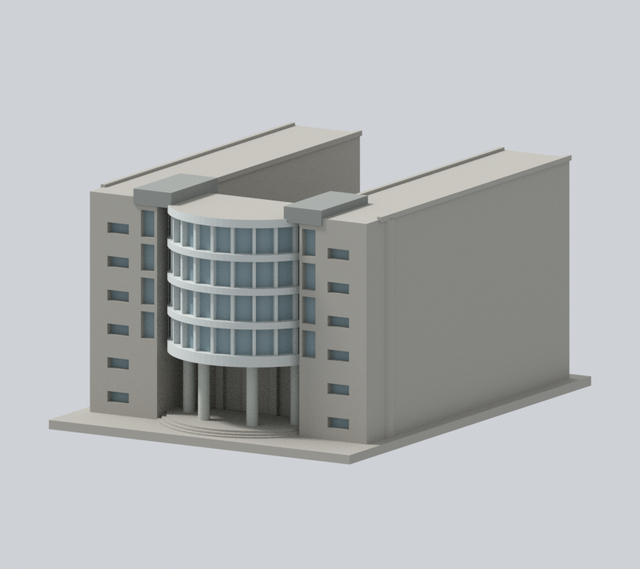
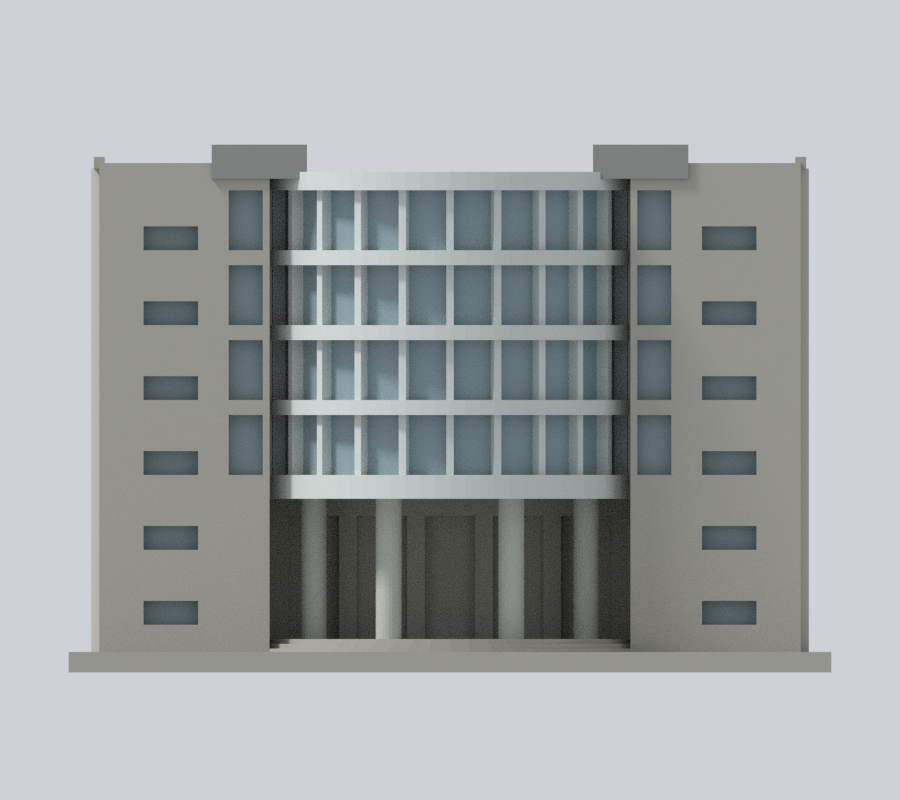
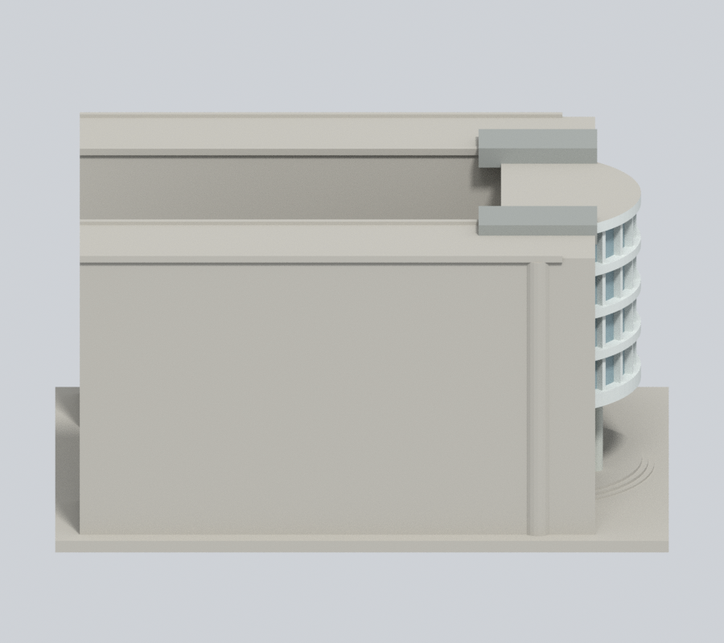
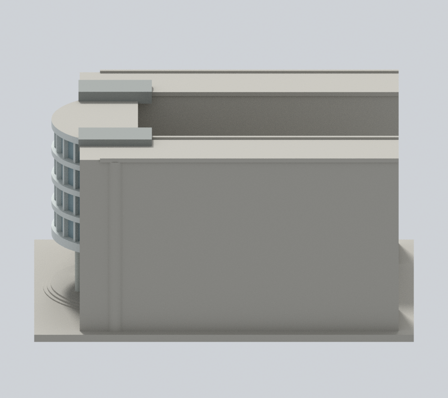
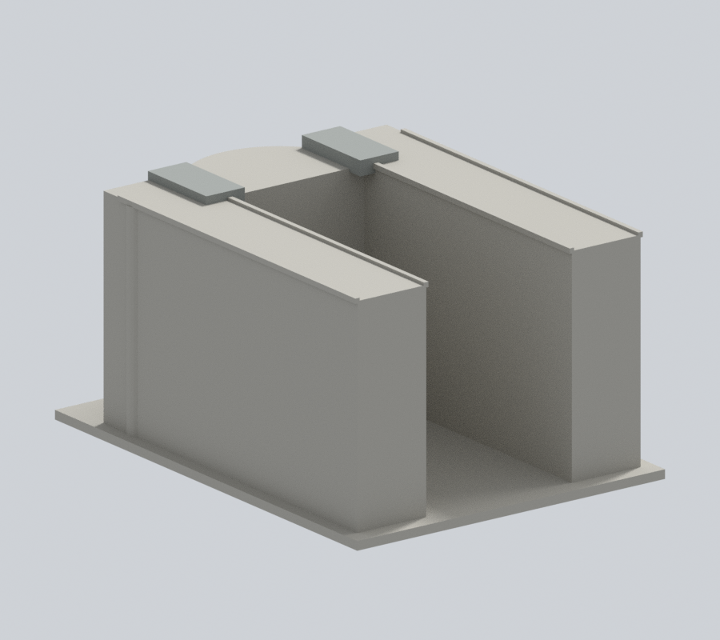
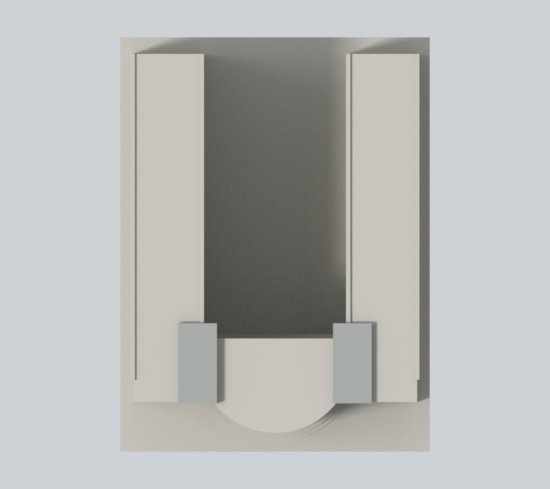
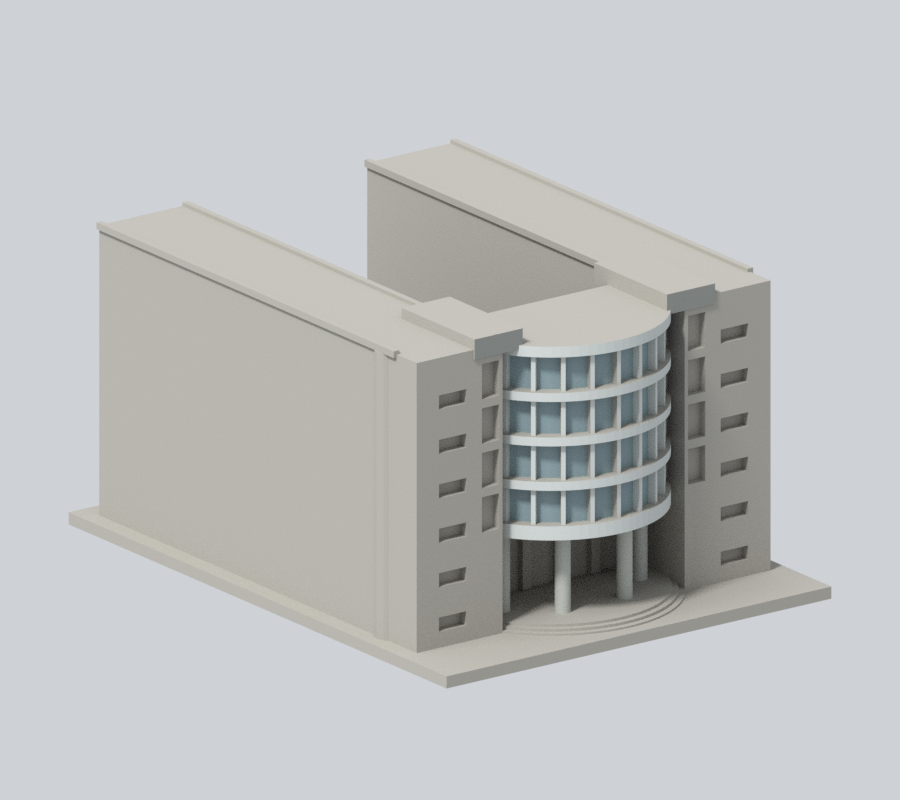

# 國立臺北教育大學｜藝術館

## 模型預覽

臺北校區。自行使用Python實體布林建立的外觀／量體近似模型；沒有下載第三方3D模型，非施工圖、測繪或館內重建。

### 原入口構件延色與既有窗背補色

新增2,520個原中性面：完整曲框／樓帶及入口底板、高帽側頂回折、既有窄窗與小窗真背。**兩側主翼磚／混凝土混材仍缺原面分界，1,360面保留中性；不是全館復色。** 原幾何、原彩面及色票不變。

| 正斜視 | 來源角度 | 正立面 |
| :---: | :---: | :---: |
|  |  |  |
| 左側 | 右側 | 背向 |
|  |  |  |
| 上視 | 原配色正斜對照 | 原配色背向對照 |
|  |  |  |

[彩色3MF](appearance.3mf) · [Blender](appearance.blend) · [材色範圍與限制](APPEARANCE.md) · [逐面與材值驗證](appearance-review-v2/model-verification.json)。原六張預覽仍保留，沒有更換原STL或scene。

## 證據與範圍

依官方正面及斜側入口實拍、1–2F平面建立U形院落及入口量體近似。保留真開放中央院落、半圓凸出上層玻璃面、四根可見入口大柱、兩側窄玻璃直帶、六排磚翼小窗與較高混凝土端帽。主要證據集中入口；長翼高度以入口連續量體推估，院落內壁、後端及深側立面缺實拍而留素面，不能把這些面視為測繪。玻璃密格簡化成四道寬窗帶、連續主水平樓層帶及次要細直框；曲面以80面柱體近似，不是下載模型。入口是真凹空間，背後玻璃退縮，未鑿穿整個建築。

官方文件日期2023年10月25日，實拍攝影日未載；文件更新日不是拍攝日，無法保證2026全部現況。來源、實際PDF頁碼及限制見 [sources.json](sources.json)。原照片／PDF只作私人核對，不隨公開包散布。

## 交付

- [model.stl](model.stl)：毫米，含底座最長150毫米，各件獨立比例
- [scene.blend](scene.blend)：由實際STL匯入的可編修網格
- [build_model.py](build_model.py) 與 [requirements.txt](requirements.txt)：自行建模參數來源；python build_model.py
- [render_preview.py](render_preview.py)：讀取原STL渲染；blender -b -t 2 -P render_preview.py

[原STL射線證據](portal-ray-proof.json) · [射線檢查腳本](check_portal_geometry.py)。原STL三角形射線證實中央入口真空隙深32.5毫米、前柱間淨寬14.2毫米、底板下至階梯淨高20.6毫米；均為模型近似尺寸。底板與柱間不是僅刻表面凹紋。

## 列印與QA限制

底座朝下。各件比例獨立，勿直接拼為同比例校園。入口頂板、半圓陽臺、玻璃曲面懸挑、雨遮及柱廊可能需要支撐，拆支撐仍可能傷細框。沒有實體試印、Cura／Prusa工具路徑驗證，不保證免支撐或保證可印。模型深度、柱距及高度不是實際建築尺寸。

[validation.json](validation.json) 檢原STL水密、正體積、繞序、每邊兩面、vertex link、單表面實體、無分離內腔殼、150毫米限制、重建SHA與Blend一致。[contour-validity-check.json](contour-validity-check.json) 每0.2毫米以0.071偏移逐層檢閉合及個別／組合Polygon有效，不修補後算成功。[thin-feature-check.json](thin-feature-check.json) 採canonical fail-closed v3每1毫米0.8毫米opening參考篩檢，不等於全面最小壁厚或切片模擬。

重跑：python validate_model.py；python check_contour_validity.py；python check_thin_features.py。

本輪外觀與幾何保持結果以 [v2審核](appearance-review-v2/color-continuity-review.json) 為準；未進行新的實體試印。

## 2026-11-13 有限修正補充
以下補充更新本次局部材色範圍；上文原v2數量與QA保留歷史作用域。既有預覽表格、圖像路徑和下載連結保持。

# 國立臺北教育大學藝術館：曲窗框帶端回折續色

保留原2540頂點、5092三角面、112×150×77.5mm與全部transform、幾何、原STL/scene及預覽。不是實測、BIM或現況認證。原基線無OBJ；隔離流程產OBJ不當成原件一致驗證，也不加入公開包。

## 範圍
四列原曲窗的上下水平框帶／窗凹口聯集，共8個完整連通共面域2016面。1968個既有淡灰2保持，僅48個未知0延續同2。原v2限制y<=-40，未納入原窗cut延至-39.5的短端部；全三角polygon核屬原80邊框帶環(半徑25..28.2,y<=-40)與窗cut環(25.2..28,y<=-39.5)聯集，外逸為零（1e-5mm浮點容差）。不以中心點或隨意碎三角畫新界。原窗cut後延在端部可觸connector／主翼聯集；本次僅水平frame/reveal家族推估，並非磚牆背色認證或真實接縫測繪。

[官方防災計畫PDF](https://general.ntue.edu.tw/var/file/44/1044/img/606570806.pdf)第58頁（印2-52）兩張入口正／斜照已實看，淡色曲框帶與兩側磚／灰混材翼明顯區分。小端回折是同原框帶／窗凹口家族延伸推估，不聲稱逐點照片量色；原模型框密度、樓層比例、厚度與接合均是近似，不是本次精測。照片日未知，文件2023年不是拍攝日或2026現況。此輪未將Commons舊源登錄冒充新實看。

原5材值及其餘5044面不變。不動最上117面z73.5整屋頂、未分界磚灰主翼、深院、後端、階梯與地面入口背板，不新增玻璃、窗格、磁磚紋、文字、透明度或幾何。未知不表示實物一定灰色。本次48面位於端部極短回折，原生全館圖差異微小或受遮，不宣稱大幅視覺改善；局部同光比較僅為材色一致性診斷，不是現實光照復原。

七張900×800原生視圖、Cycles CPU96samples、seed0、單執行緒無denoise及原鏡頭/照明保持。公開REVEAL審核只綁公開產物；完整來源及私人比較證據內部保留。

## 工程及歷史
原幾何／薄構件／開口檢查保持原歷史範圍，本次不是重新工程認證。曲面懸挑、入口頂板、細框／柱廊可能需要支撐與承擔拆除損傷風險。未實體試印或Cura/Prusa工具路徑驗證，不保證任意縮放、多色映射或免支撐列印。原版本完整保留Git歷史。
