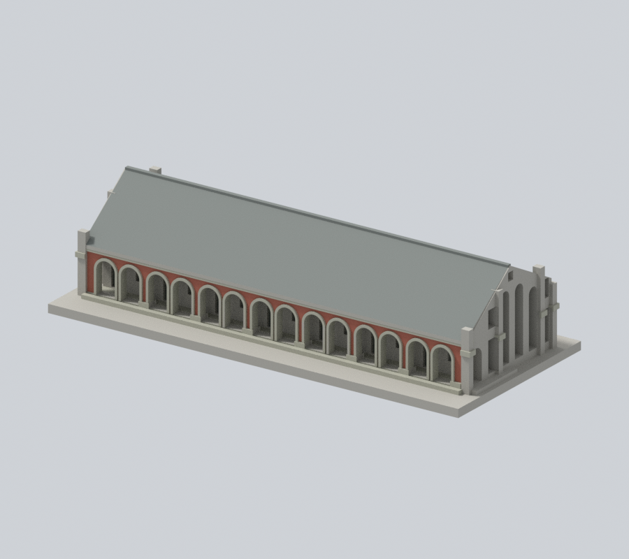
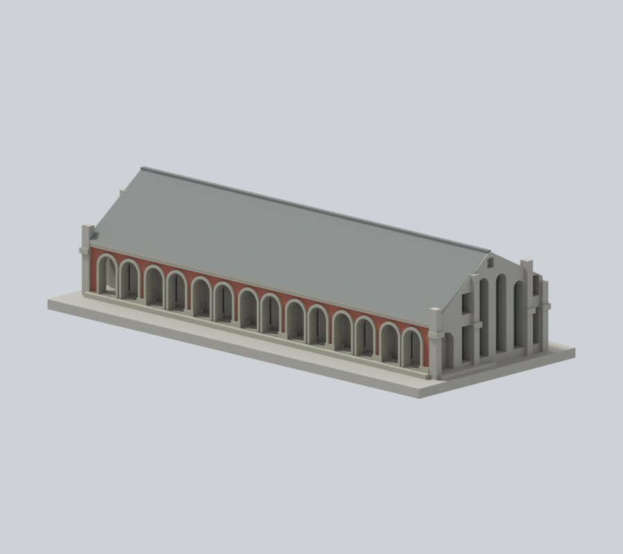
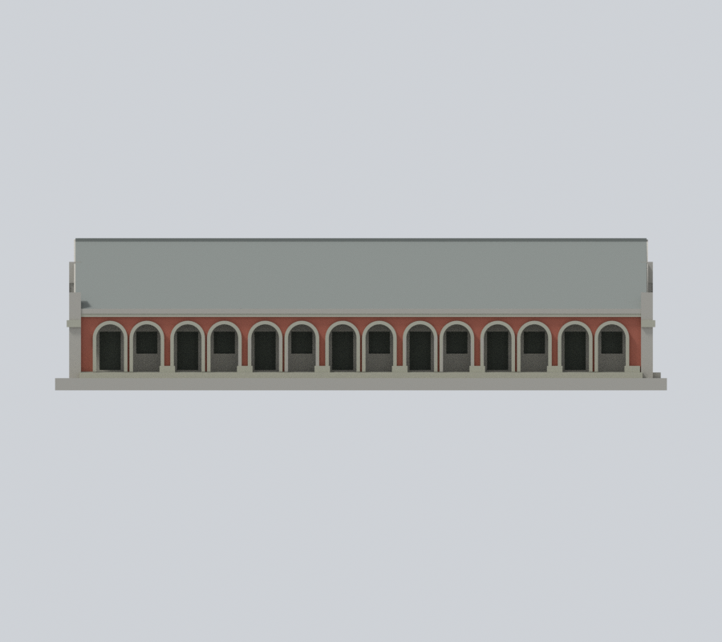
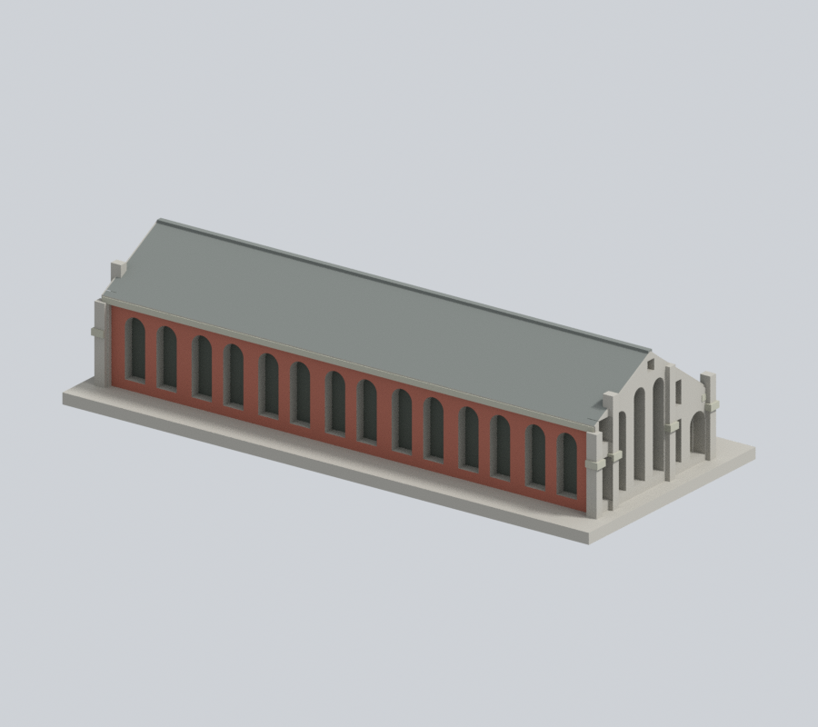
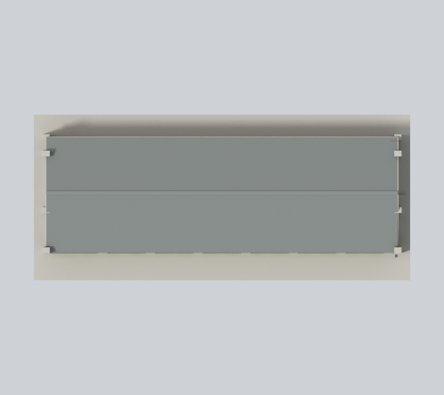

# 國立臺北教育大學｜大禮堂

## 模型預覽

| 新彩色正斜視 | 新彩色來源角度 | 新彩色立面 |
| :---: | :---: | :---: |
|  |  |  |
| 新彩色背向 | 新彩色上視 | 彩色下載 |
|  |  | [彩色3MF](appearance.3mf) · [Blender](appearance.blend) |

臺北校區。自行以公開照片和平面資料建立的外觀近似模型；不是下載第三方3D模型、測繪成果或建築施工圖。

### 原構件側背材料續色（原 8 張預覽全部保留）

保留原前長拱廊磚紅、灰石拱圈／柱腳／簷線與前坡灰瓦色。本版依新親看的拱廊及兩端入口照片、原構件界線和同棟材料家族，續色1,146個原中性面：後外牆、後坡、後簷、兩端既有石帶及側背凹窗背面。全數原彩面、幾何與材料值保留，不增加窗、紋理或飾物。側山牆／扶壁與前廊內壁的實際灰石／淺牆／磚色混材沒有原模型界線，整面保留中性，避免任意斜色塊；後整牆採同棟主材延續推估，開口回折仍未確證。不是全四面實景復原或2026現況確認。

[來源與材料限制](APPEARANCE.md)。原STL／scene、原預覽與列印QA保留；本輪不重測原列印篩檢、不宣稱實體試印。

## 範圍與來源時點

整體外觀近似；拱廊朝向、14拱與兩端山牆按照片核對。

保留七組雙拱、可進深的通長拱廊、非對稱屋坡、背面連續高拱凹窗及山牆扶壁。背面細窗格省略，以免厚化後誤讀成多排方窗。兩端有中央高拱與矩形側翼窗；B端另建斜坡平台，D端未套用。B/D端細部遮蔽與比例為近似，未宣稱完全對稱測繪。未重現屋瓦、磚縫、玻璃、小五金；山牆尺寸、高度與隱蔽局部為目視近似。

官方防災計畫為2023年10月25日版本，實拍攝影日期未載。來源頁更新日不視為攝影日期。大禮堂原建模記錄另列EXIF標示2026年8月22日的四面照片；本版未重讀該四張像素／EXIF，不視作本版新證據，也不能由此保證2026現況。本版另讀2024年9月12日發表旅記的兩端入口、拱廊與前坡照片，發表日不是攝影日；數位島嶼近照的拍攝標示與EXIF展示日期互有差異，照實記錄。

原照片、原PDF及照片對照只用於私人QA，不隨公開包散布。來源精確URL與支持特徵見 [sources.json](sources.json)。

## 模型檔案

- [model.stl](model.stl)：實際交付網格，毫米單位，含底座最長150毫米
- [scene.blend](scene.blend)：由相同STL匯入的可編修網格，參數建模來源為 [build_model.py](build_model.py)
- [requirements.txt](requirements.txt)：Python依賴；執行 python build_model.py 可重建
- [render_preview.py](render_preview.py)：用 Blender 實際讀取交付STL渲染，非示意效果圖

## 列印與驗證

底座朝下。每館獨立縮放，不能直接拼為同一比例校園。建議先在自己的切片器檢查；拱頂、雨遮、百葉與屋簷的懸伸可能需要支撐。長圓窗框、拱邊與窗格屬細件，拆支撐時容易損傷。沒有實體試印，亦未聲稱Cura或Prusa的實際工具路徑驗證、不用支撐或保證可印。

[validation.json](validation.json) 檢查原始STL水密、原法向與繞序、正體積、每邊兩面、vertex link單環、單一連通表面、無分離內殼、尺寸、獨立重建SHA及Blend幾何一致。

[contour-validity-check.json](contour-validity-check.json) 逐0.2毫米、固定z偏移0.071毫米檢查閉合與每個/合成Polygon有效性；不允許repair後算通過。[thin-feature-check.json](thin-feature-check.json) 是canonical fail-closed v3的0.8毫米參考opening輔助篩檢，採1毫米抽樣，不等於全面最小壁厚或切片工具路徑。

驗證命令：python validate_model.py；python check_contour_validity.py；python check_thin_features.py。需先以 blender -b -t 2 -P render_preview.py 建立scene.blend。

本件為作者凍結包，外觀已覆核；需獨立幾何審核通過後才可由指定發布者發布。

## 本版續色驗證

[新版左側](appearance/left.png) · [新版右側](appearance/right.png) · [原版同相機正斜視](appearance-review-v2/original-front.png) · [原版同相機背向](appearance-review-v2/original-rear.png)。

[逐點逐面／材料驗證](appearance-review-v2/model-verification.json) · [完整原面界線](appearance-review-v2/boundary-continuity-audit.json) · [來源判讀](appearance-review-v2/source-register.json) · [九張真渲染審閱](appearance-review-v2/color-continuity-review.json) · [乾淨重建](appearance-review-v2/clean-rebuild-equality.json)。

原appearance-review作歷史保留；現版由appearance-review-v2及appearance-freeze.json綁定。原幾何QA、未試印、尺寸近似及支撐風險不變。本機準備不等於GitHub發布；校級校驗碼本輪不改，須在未來獲准發布時整合。
