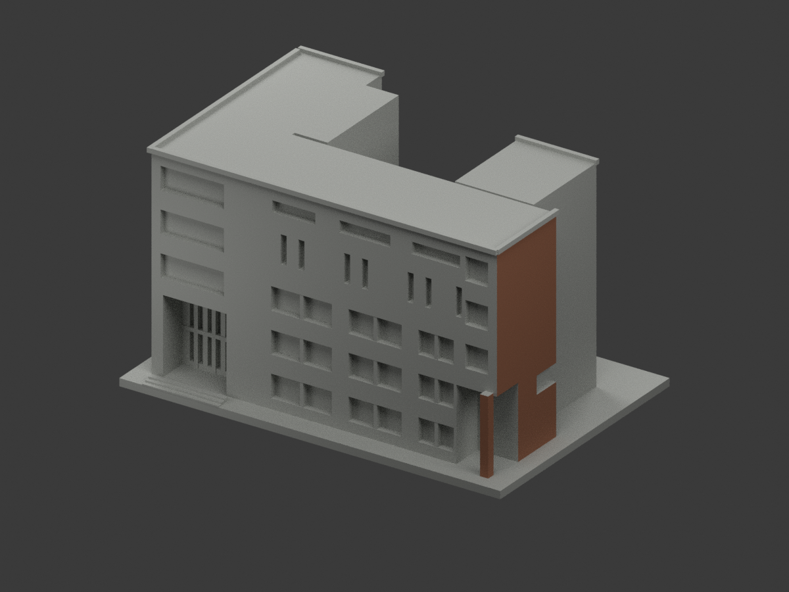
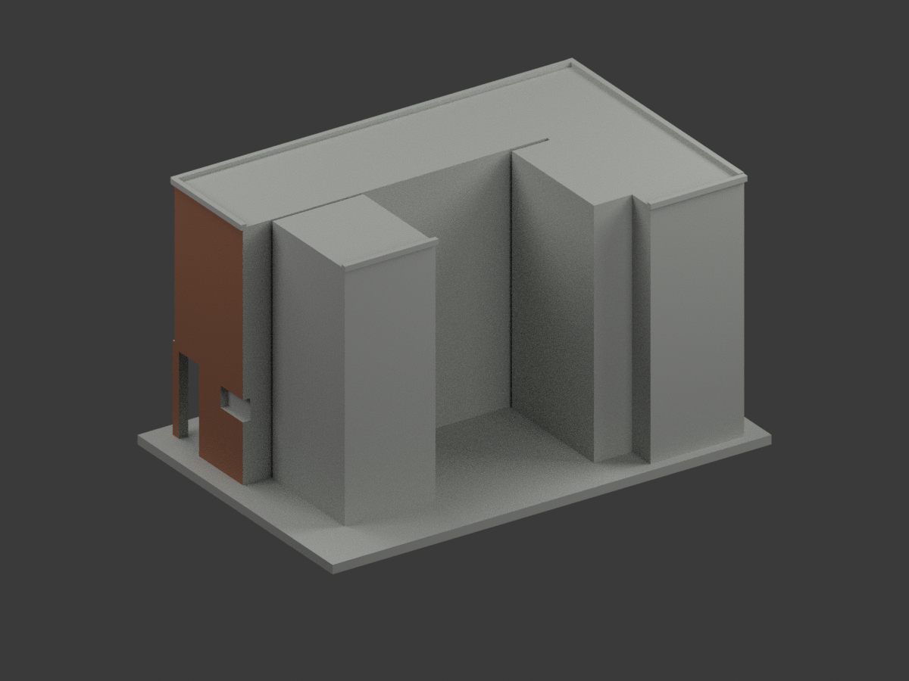
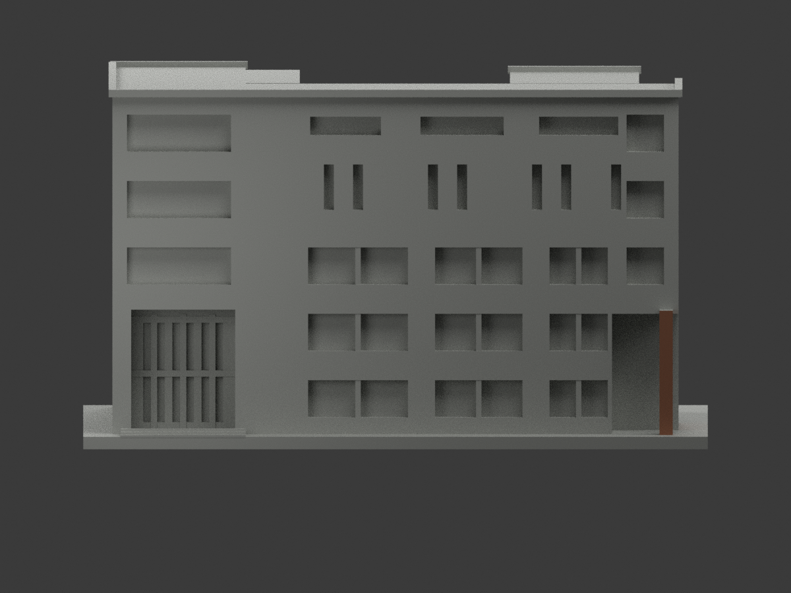
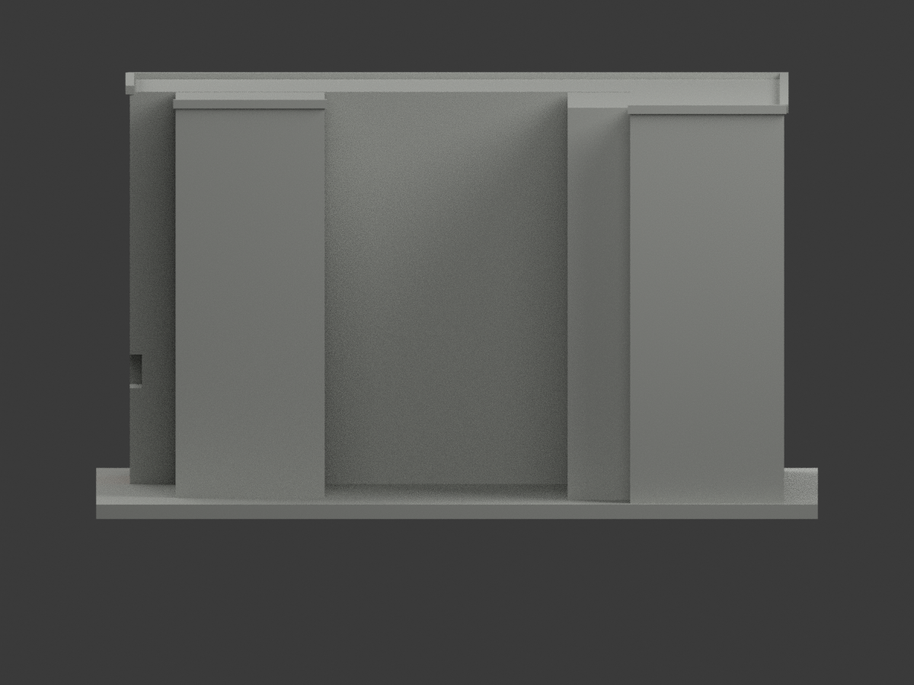
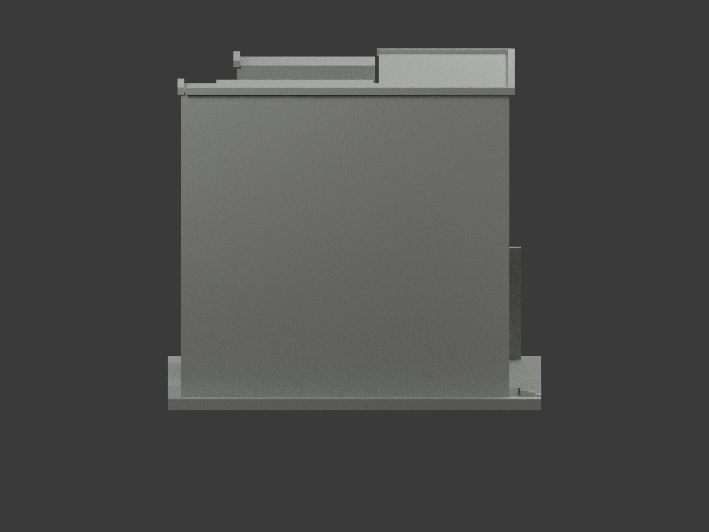
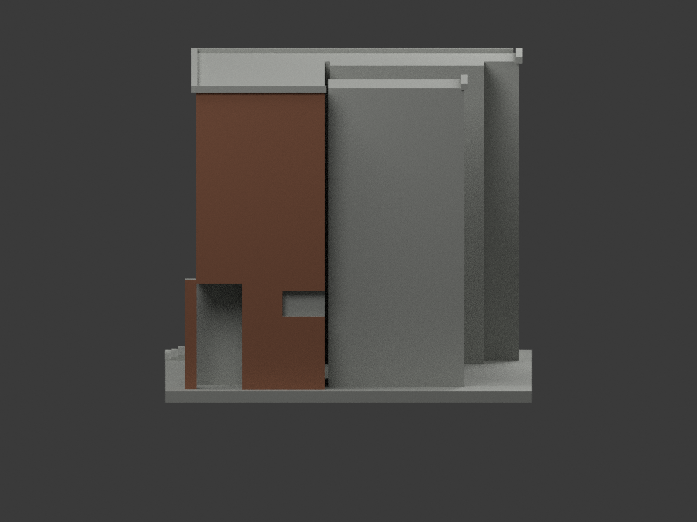
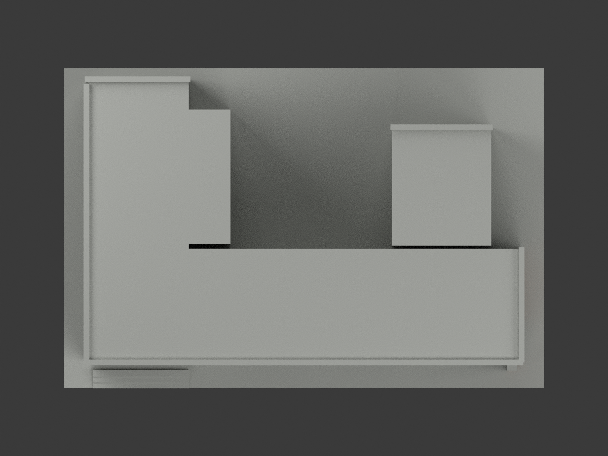
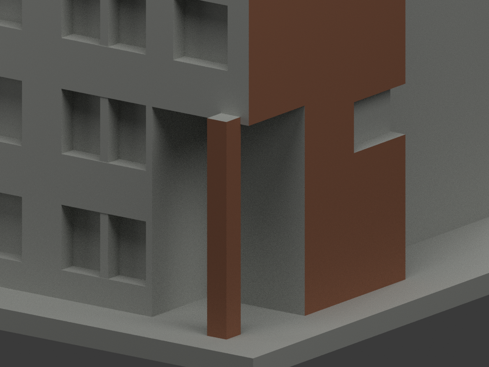
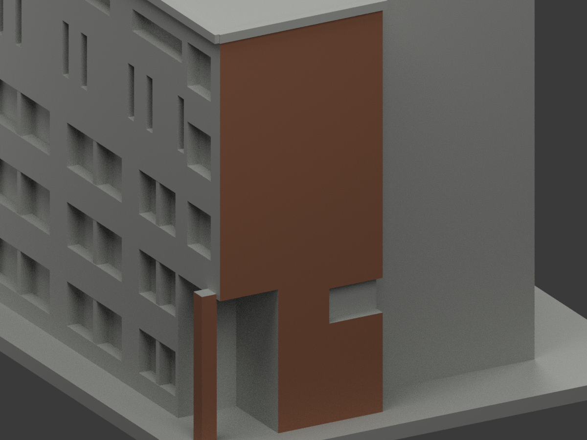
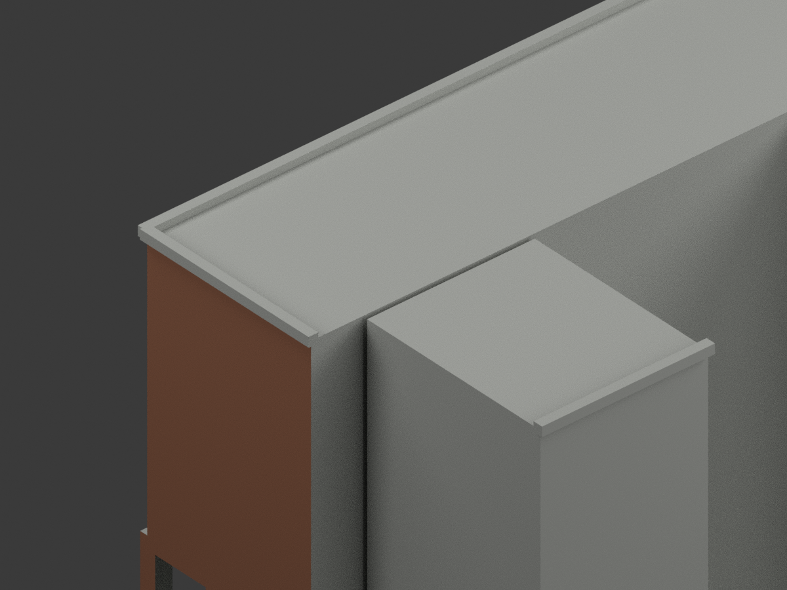

# 北教視聽館｜僅右端完整牆與前柱局部暖磚紅

> **現行版本：角柱 +X 外側補 5 面，合計 15 暖磚／1,201 中性，共 1,216 面，原幾何不變。** 下方「材色範圍」及英文段落保留較早 10 面基準紀錄；請以 [角柱右側有限補色](#2026-11-18-角柱右側有限補色)及[發布版校驗](RELEASE-CHECKSUMS.md)為現況。

**局部補色未完成：僅右端原完整牆8面＋獨立前柱2面暖磚紅；主牆入口與窗背未完成。不是全棟完成補色。** `partial_color_incomplete=true`、`fully_colored_exterior=false`。同項 `ntue-audiovisual`／`count_delta=0`，臺北校區。原單館範圍不變，並非校園全體。20261103處理日期非拍攝日期。

| 前斜視 | 後斜視 | 正面 |
|---|---|---|
|  |  |  |
|  |  |  |
|  |  |  |
|  | | |

## 材色範圍

右端原x68整外壁，y−41.5..−6.5、z2.8..84.8內全部原殘留面共8；右角獨立柱前y−44.6、x63.4..66.6、z3..33共2。逐三角全頂點有限plane/bounds判定，不按原ID盲套、不按面心切色。原開口扣除與Boolean邊界片全部保留，共10暖磚紅／1206中性；全共面連通域一致。

大主前牆不擴磚色；未重建金字及入口細部，不以原大平面偽造材界。淺色入口內頂、橫梁、洞返、窗背混框/玻璃/百葉、屋面屋緣、地面階及柱側面全部中性。後方未知外牆留中性，不能複製前窗或磚色。**中性不是實景灰證明，資料覆蓋界線不是真實材質接縫。**

原1216三角與原STL/build字節、150mm最長含底座不變；每件比例獨立非實測。保留左入口深度、窗寬、屋高的原照片近似與粗化格框；不新增磚紋/字樣/玻璃格，不改右柱下開口，不以補色追認原近似幾何為精測或2026現況。

## 來源、日期與權利

只親看共用官方PDF實頁30/31外觀照片，非室內/安全配置。頁31支持右端牆與角柱同暖磚族，頁30支持磚族及入口淺構件應排除。2023年10月25日填表/文件日期不代表照片拍攝日期；攝影日期未知，不稱2026現況。來源PDF/影像hash見register與原sources.json。原照只私人保存、不公開或貼圖；未見CC不能沿repo license宣商用。HEX只是展示近似色族。

## 檔案與 QA

`appearance.3mf`兩展示材，`scene.blend`真原面材，`color-mesh.npz`原三角。原STL/build保字節。**Immutable原包無OBJ；原程式會匯出OBJ，但隔離生成檔只private，不冒稱原件有OBJ。** 原README.md逐字保留`ORIGINAL-MONOCHROME-README.md`（原無README.zh-TW.md）；舊previews/QA留原單色歷程非新色QA。

依原requirements在隔離副本執行原build及colorize/export/validate；Blender render/verify。精確shapely2.1.2可由獨立target載入，不改共享環境。原build+color隔離重建目錄保留不刪；3MF/STL三角一致、封閉正體積、scene重開、10張1200×900見QA。**未實際列印**；兩材展示不是已驗四色切片工程，厚化細格與入口懸挑仍需支撐/薄件另核。

## English limitations

Very limited partial: only complete original right-end wall x68 within y[-41.5,-6.5],z[2.8,84.8],8triangles, plus independent pier front y-44.6 within x[63.4,66.6],z[3,33],2triangles. All vertices tested within finite original domains, no centroid split or arbitrary tessellation material boundaries.10muted-brick/1206neutral. Main facade, pale entrance structure, returns, mixed glazing/mullions/blinds, roofs, other wall surfaces and steps remain neutral. Original1216triangles/STL/build bytes unchanged, same single-building approximation/count_delta0. No immutable OBJ; original builder exports a private isolated OBJ only. Official PDF physical30/31 exterior photos viewed;2023form date is not photographic date. No2026current or geometry-accuracy endorsement; private references not textures/no inferred commercial rights. No actual print or validated multicolor slicing.


## 2026-11-18 角柱右側有限補色

本次只將原右角柱 +X 外側 x=66.6 的完整共面連通域 5 面（860、861、867、868、871）由中性材 1 延用既有暖磚材 0；合計 15 磚色、1201 中性，其他 1211 面不變。原 1216 面、590 頂點、面序、STL 位元與兩材內容不變。此節取代上文「柱側全部中性」的這一處限制，其餘歷史範圍保留。

來源是官方防災計畫 PDF 第31頁側照，與第30頁區分另一端深入口。照片可見右角柱外頰延續磚材；模型厚度為既有近似，不宣稱逐點配準或精確材色。攝影日期未知，不代表2026現況。只限 +X，未推 -X、背面、頂底、淺色內梁或其他未知牆。原 3.2×30 mm 面域保留上後角既有0.1×1 mm布林交接缺口，不填平、不切三角。原參考照片及PDF只私人保存，不隨公開包散布。

原 scene.blend 直接修材，未重造場景；原相機、光照、物件及全部舊材槽/節點均保留。完整RNA差為5面各3種表示共15項，以及 source_mesh_sha256 更新1項，共16項；沒有新增材、孤材移除或 fake_user 旗標改動。原材料名稱含 front 是保留的歷史標籤，新增側域範圍以本節為準。原隱藏字幕仍是歷史文字，不用於新預覽。

原 appearance.3mf 僅上述5個 triangle p1 改色；另明列一項格式相容性修正：object 增加預設 pid=1/pindex=1。全部原三角已有明確p1，故預設不改其他面色；此修正避免SDK讀入後編修寫回因缺少object屬性而失敗。strict SDK零警告及私人改材寫回已驗，不把可交換格式當多耗材切片認證。

原十張1200×900視角重新使用原場景與相機配方渲染，不變更保存的相機；詳圖保留原局部裁切。私人同相機前後近景另審。原 QA、來源、SHA256SUMS 與 FREEZE-MANIFEST 均為歷史基準快照，不是本版輸出驗證；新驗證見 RETURN-QA.json 與 RETURN-MANIFEST.json。此修訂未重新進行原薄壁/輪廓工程認證，未實體試印或新切片驗證。

### 隔離重現

```sh
unzip return-baseline-inputs.zip -d baseline
blender -b -t 2 -P rebuild_pier_return.py -- baseline rebuilt
blender -b -t 2 -P render_pier_views.py -- rebuilt
python finalize_return_previews.py rebuilt
```

重建只需要Blender4.3.2內建numpy，PNG metadata清除另需Python3＋Pillow，不改像素；渲染讀原場景保留原光照。原 build_model.py 為歷史幾何來源，修訂重現不需重新布林建模。基準ZIP不含私人照片/PDF。這是本機修訂包，發布狀態另核。

### 現行發布校驗

`SHA256SUMS`、`FREEZE-MANIFEST.json` 和 `RETURN-MANIFEST.json` 已按本次公開檔重列；前文提到的舊校驗檔原文仍在原件基準 ZIP。現行材質統計與檔案層級見[發布版校驗](RELEASE-CHECKSUMS.md)。本次只同步發布文件及校驗，原 QA 凍結後的模型與十張預覽位元不變。
