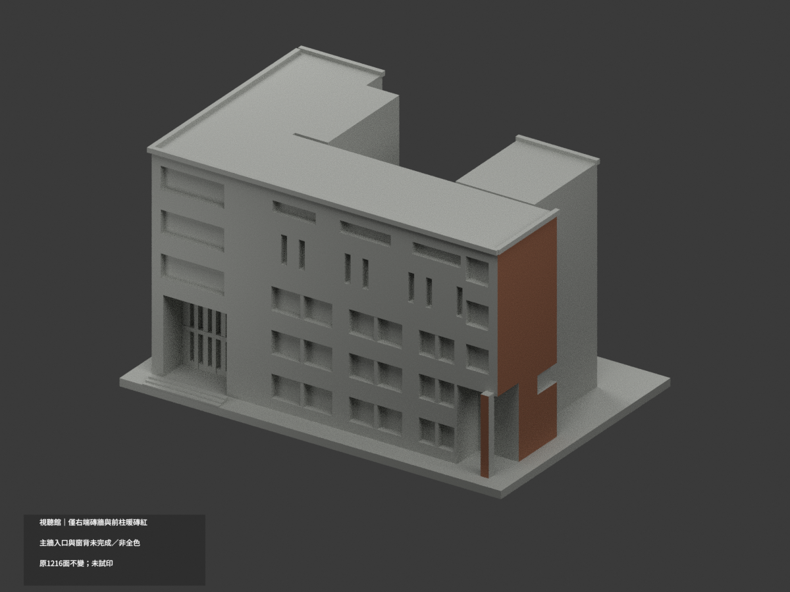
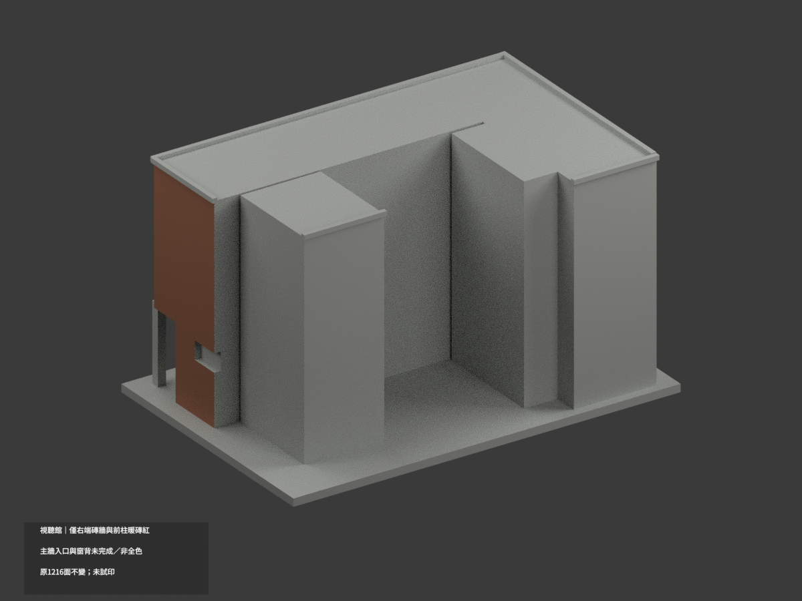
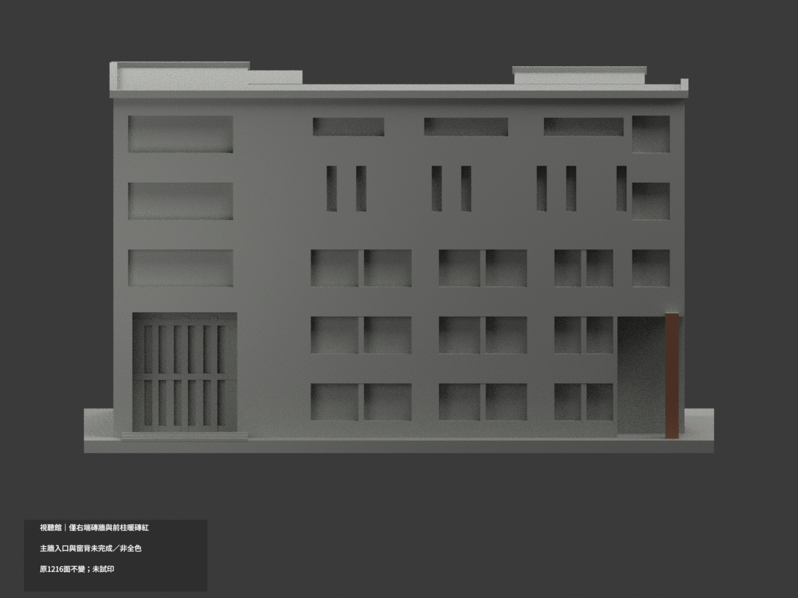
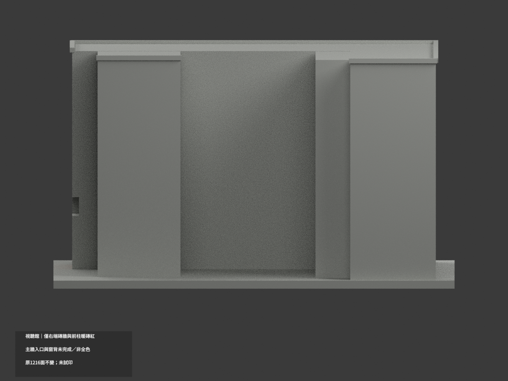
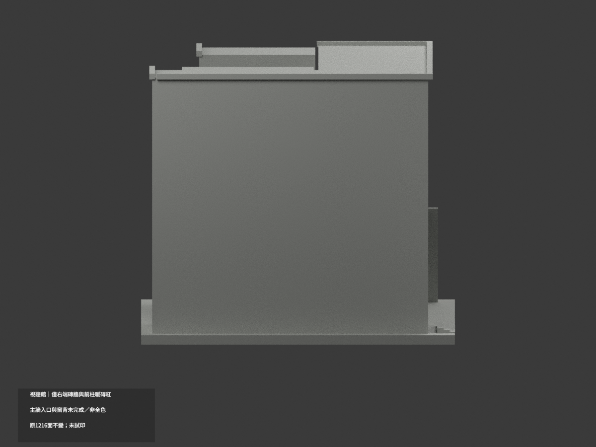
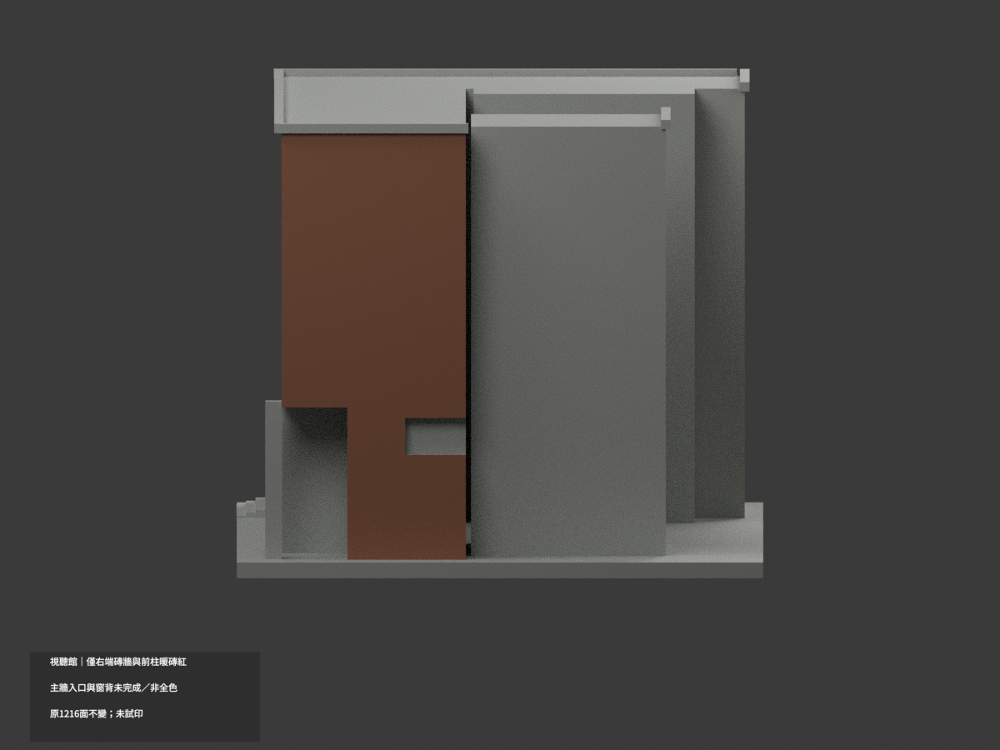
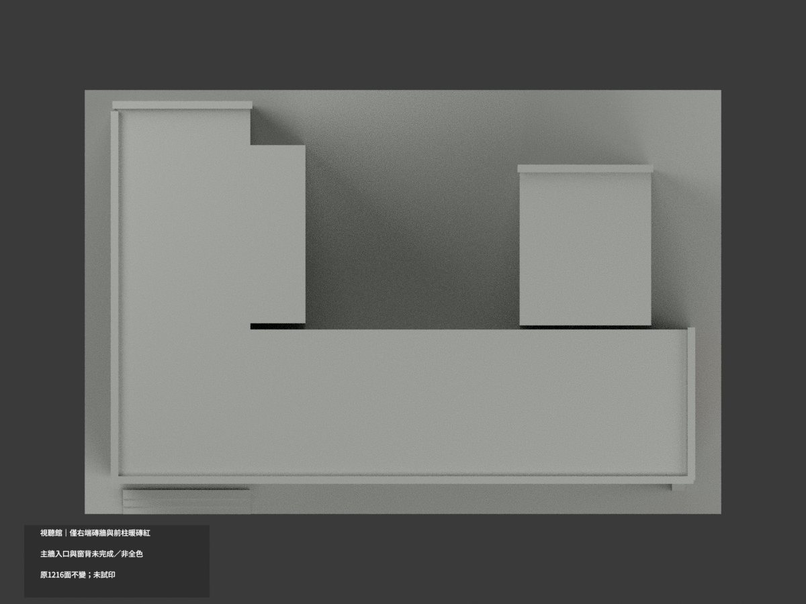
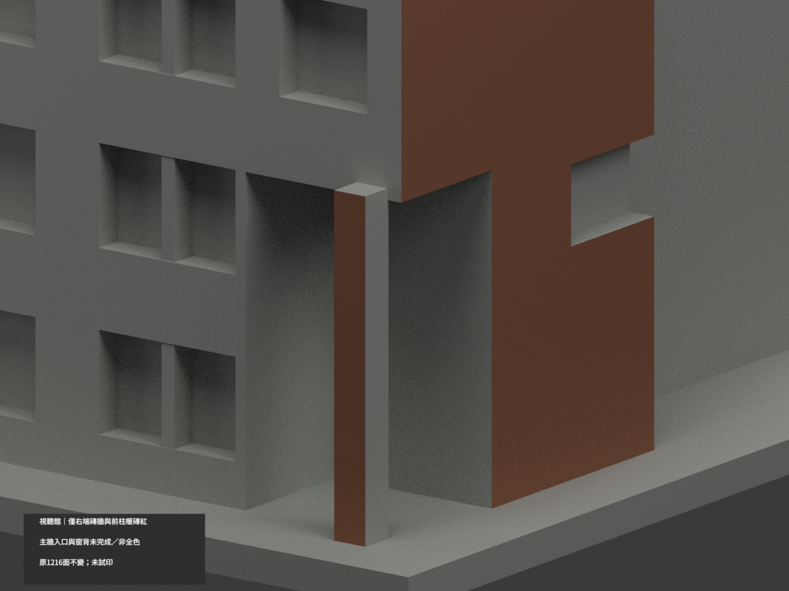
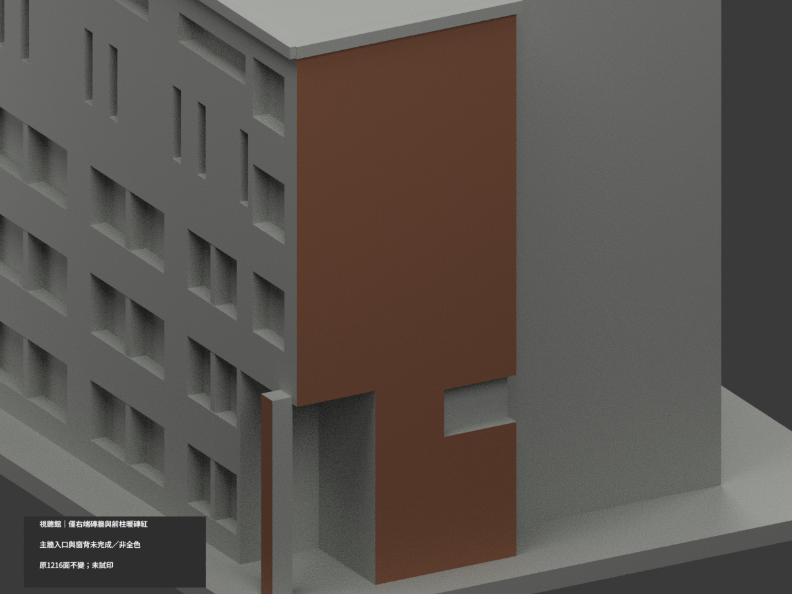
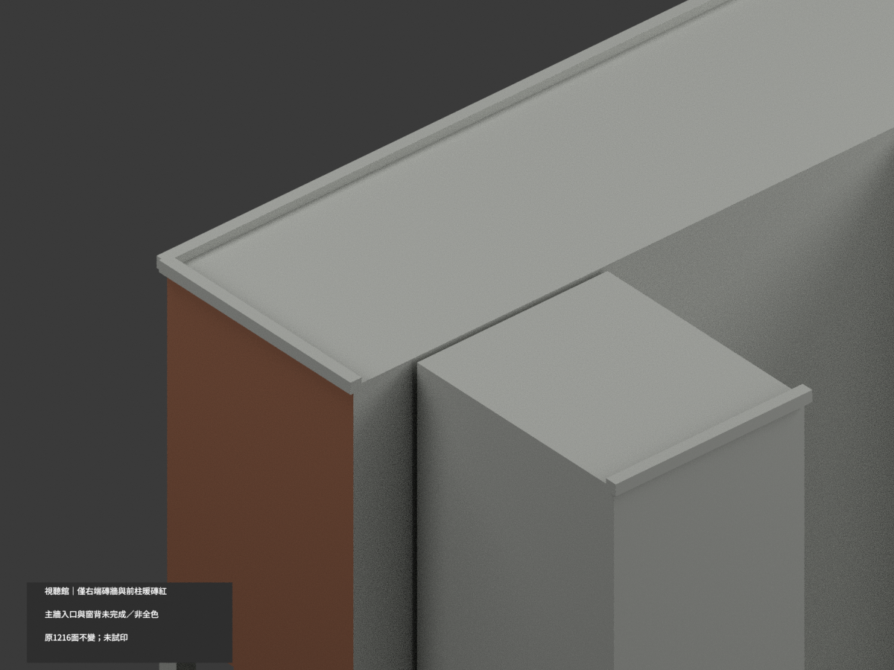

# 北教視聽館｜僅右端完整牆與前柱局部暖磚紅

**局部補色未完成：僅右端原完整牆8面＋獨立前柱2面暖磚紅；主牆入口與窗背未完成。不是全棟完成補色。** `partial_color_incomplete=true`、`fully_colored_exterior=false`。同項 `ntue-audiovisual`／`count_delta=0`，臺北校區。原單館範圍不變，並非校園全體。20261103處理日期非拍攝日期。

| 前斜視 | 後斜視 | 正面 |
|---|---|---|
|  |  |  |
|  |  |  |
|  |  |  |
|  | | |

## 材色範圍

右端原x68整外壁，y−41.5..−6.5、z2.8..84.8內全部原殘留面共8；右角獨立柱前y−44.6、x63.4..66.6、z3..33共2。逐三角全頂點有限plane/bounds判定，不按原ID盲套、不按面心切色。原開口扣除與Boolean邊界片全部保留，共10暖磚紅／1206中性；全共面連通域一致。

大主前牆不擴磚色；未重建金字及入口細部，不以原大平面偽造材界。淺色入口內頂、橫梁、洞返、窗背混框/玻璃/百葉、屋面屋緣、地面階及柱側面全部中性。後方未知外牆留中性，不能複製前窗或磚色。**中性不是實景灰證明，資料覆蓋界線不是真實材質接縫。**

原1216三角與原STL/build字節、150mm最長含底座不變；每件比例獨立非實測。保留左入口深度、窗寬、屋高的原照片近似與粗化格框；不新增磚紋/字樣/玻璃格，不改右柱下開口，不以補色追認原近似幾何為精測或2026現況。

## 來源、日期與權利

只親看共用官方PDF實頁30/31外觀照片，非室內/安全配置。頁31支持右端牆與角柱同暖磚族，頁30支持磚族及入口淺構件應排除。2023年10月25日填表/文件日期不代表照片拍攝日期；攝影日期未知，不稱2026現況。來源PDF/影像hash見register與原sources.json。原照只私人保存、不公開或貼圖；未見CC不能沿repo license宣商用。HEX只是展示近似色族。

## 檔案與 QA

`appearance.3mf`兩展示材，`scene.blend`真原面材，`color-mesh.npz`原三角。原STL/build保字節。**Immutable原包無OBJ；原程式會匯出OBJ，但隔離生成檔只private，不冒稱原件有OBJ。** 原README.md逐字保留`ORIGINAL-MONOCHROME-README.md`（原無README.zh-TW.md）；舊previews/QA留原單色歷程非新色QA。

依原requirements在隔離副本執行原build及colorize/export/validate；Blender render/verify。精確shapely2.1.2可由獨立target載入，不改共享環境。原build+color隔離重建目錄保留不刪；3MF/STL三角一致、封閉正體積、scene重開、10張1200×900見QA。**未實際列印**；兩材展示不是已驗四色切片工程，厚化細格與入口懸挑仍需支撐/薄件另核。

## English limitations

Very limited partial: only complete original right-end wall x68 within y[-41.5,-6.5],z[2.8,84.8],8triangles, plus independent pier front y-44.6 within x[63.4,66.6],z[3,33],2triangles. All vertices tested within finite original domains, no centroid split or arbitrary tessellation material boundaries.10muted-brick/1206neutral. Main facade, pale entrance structure, returns, mixed glazing/mullions/blinds, roofs, other wall surfaces and steps remain neutral. Original1216triangles/STL/build bytes unchanged, same single-building approximation/count_delta0. No immutable OBJ; original builder exports a private isolated OBJ only. Official PDF physical30/31 exterior photos viewed;2023form date is not photographic date. No2026current or geometry-accuracy endorsement; private references not textures/no inferred commercial rights. No actual print or validated multicolor slicing.
