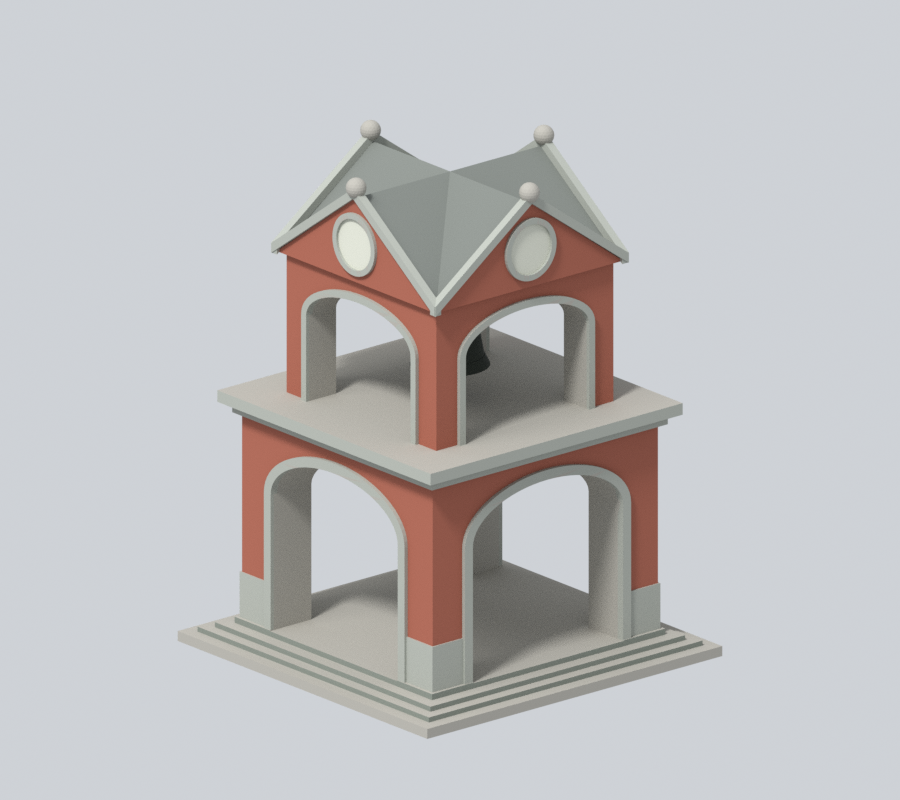
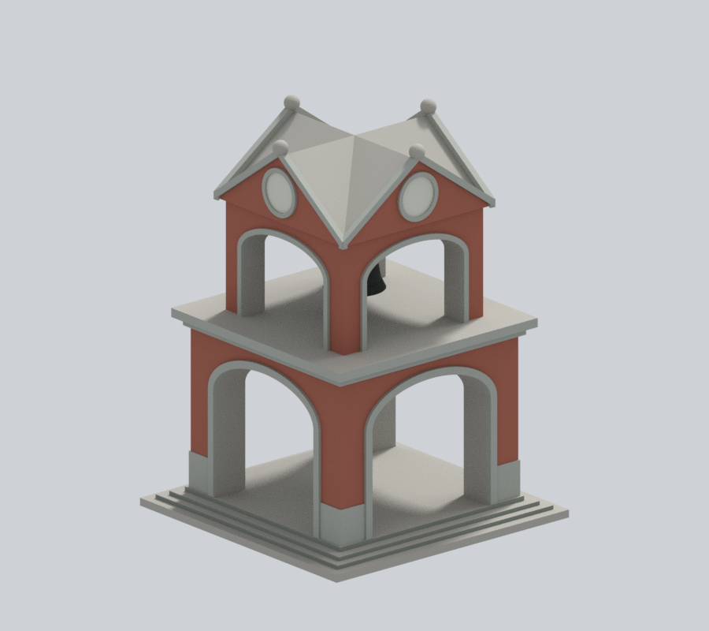
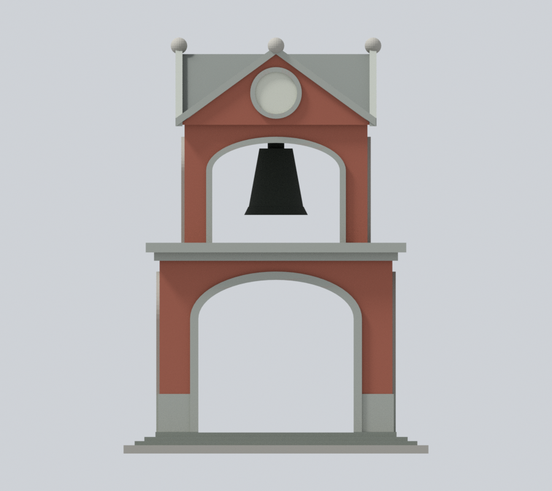
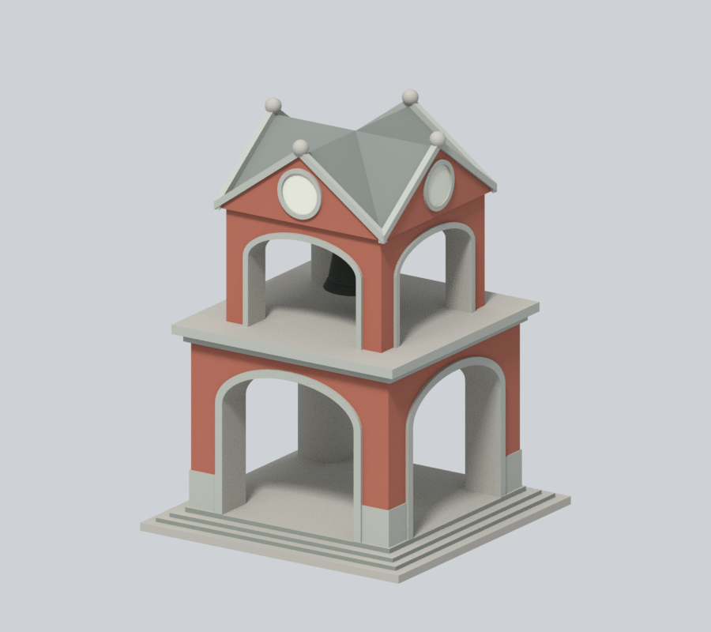
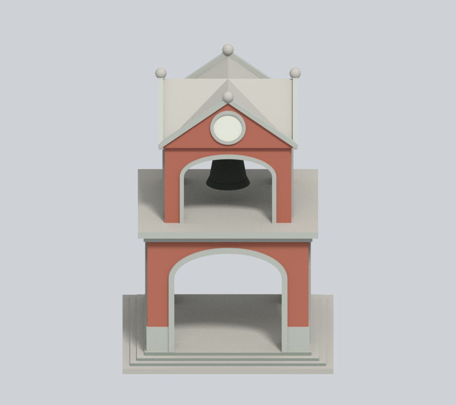
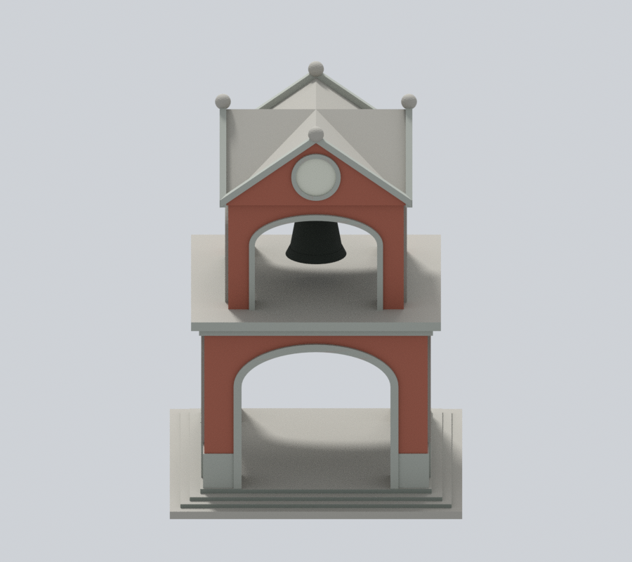
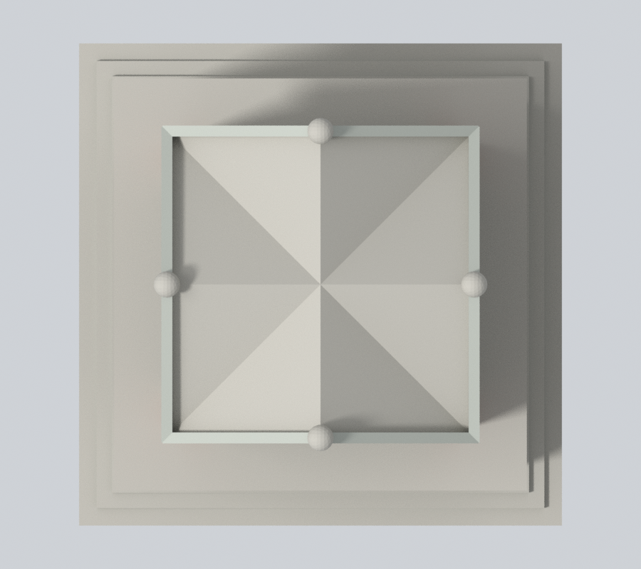

# 國立臺北教育大學百年紀念鐘樓：交叉灰瓦屋面近似

百年紀念是鐘樓名稱，不代表日治原建或實際塔齡百年。本包沿用原3468頂點、6988三角面、110×110×150mm、transform、STL、scene及6張原預覽。不是測繪、BIM或現況認證；原交付無OBJ。

## 本次範圍
8個完整連通共面斜屋域，共32面由unknown0轉為新增灰瓦家族6（#7D817C，roughness0.86）。原兩個交叉三角屋體範圍±35mm、z118.5..144，原有限斜面均有構件邊界；不新增屋瓦或接縫、不切三角色塊。原6材值及其餘6956面保持，垂直山牆、灰石框帶、球飾、深拱和臺基完全不改。

[校方日照照片](https://www.ntue.edu.tw/var/file/0/1000/img/841113662.jpg)本次成功取得並實看；歷史v2下載503不代表目前無法讀取。[訪客序列](https://gogo-kyorochan.official.jp/volume_023/2310_bell-tower-ntue/index-japanese.html)亦可辨灰瓦斜面及其與淺石山牆框的分界。[相鄰角度圖](https://cdntwrunning.biji.co/800_ea490c72084bacca1ce8eb595bf13e37.jpg)可辨四向山牆身分。拍攝日期未核，勿採旅記日治起源說，也不從文章日期當拍攝日。

並非每一象限逐點直接可見；此為同交叉屋面的材質家族延伸推估。灰色值為名義近似，無色卡校準，不重現陰影／污漬色塊。原屋體無瓦細節且造型粗化，補色不提升幾何精度。鐘室與下層內頂材質有別，不由本案擴色。

七張900×800、Cycles CPU96samples、seed0、單執行緒、無denoise的原生鏡頭及照明保留。ROOF-SOURCE-QA、ROOF-NUMERIC-QA與最終公開獨審僅引用公開產物，完整研究與比較另存，不隨包分發。

## 工程與歷史範圍
原四向通拱、懸鐘、鐘盤及球飾皆既有近似，不加時針、刻字或玻璃封板。原validation/contour/thin-feature等報告保留為歷史範圍，不是本輪完整工程重測；未實體試印或實際切片，不保證AMS、任意切片器、多色支撐或任意縮放可印。原拱頂、懸鐘連接、鐘框、屋面及細部風險不變。舊公開版本在原Git歷史保留。

|  |  |  |
| :---: | :---: | :---: |
|  |  |  |
| 正面斜視 | 背面斜視 | 正立面 |
|  |  |  |
| 來源角度 | 左側 | 右側 |
|  |  |  |
| 俯視 |  |  |

