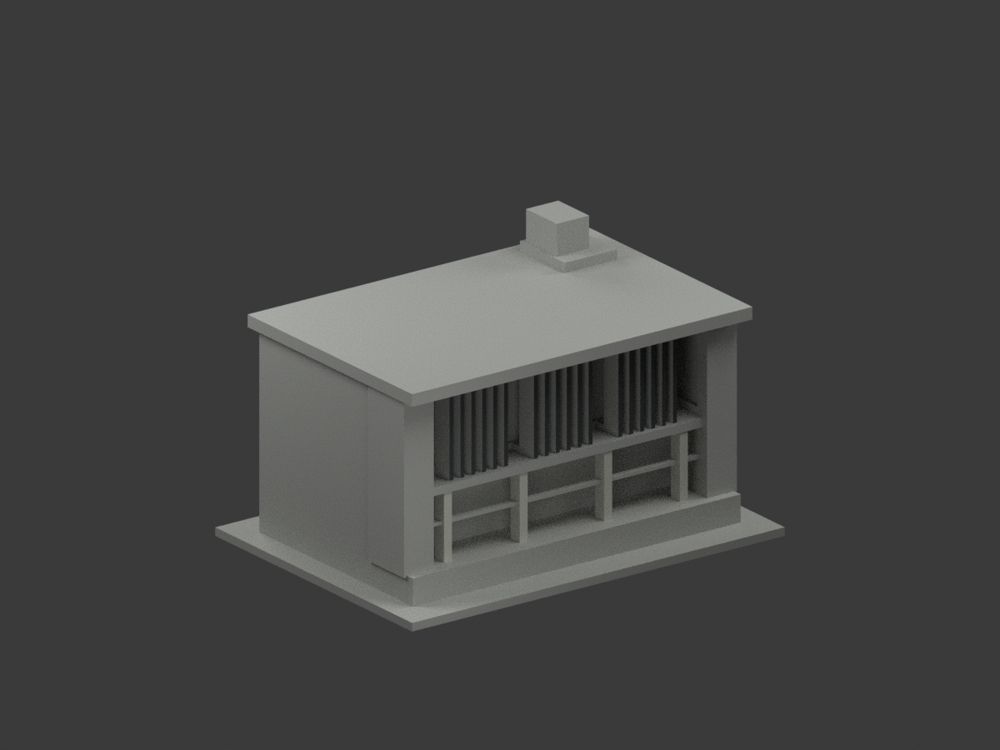
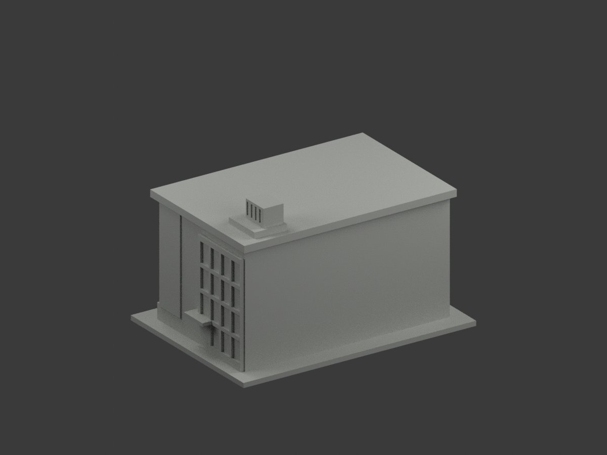
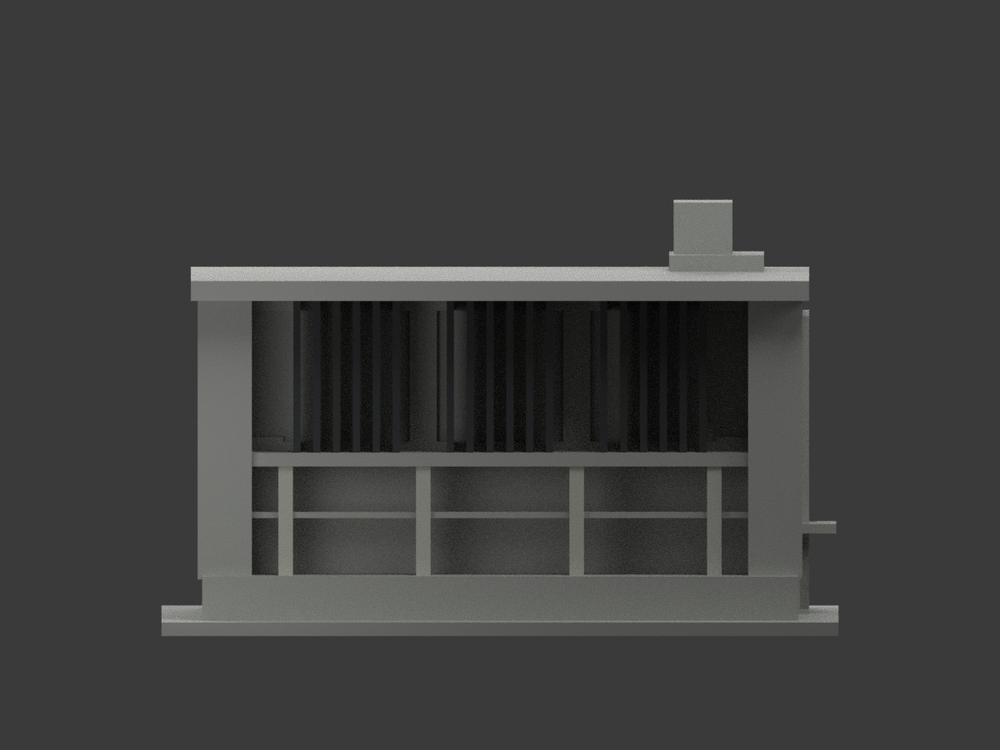
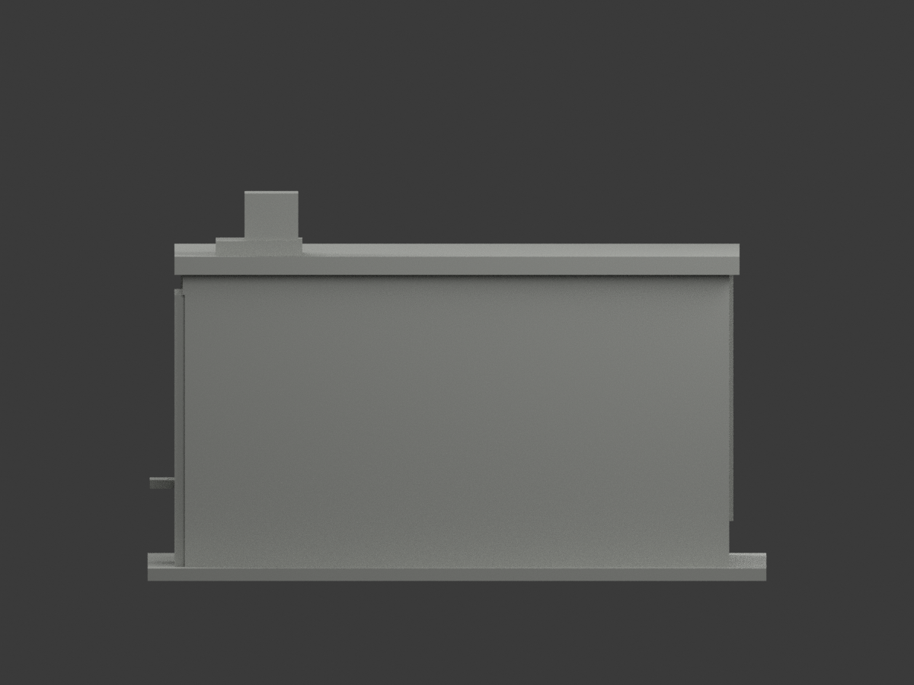
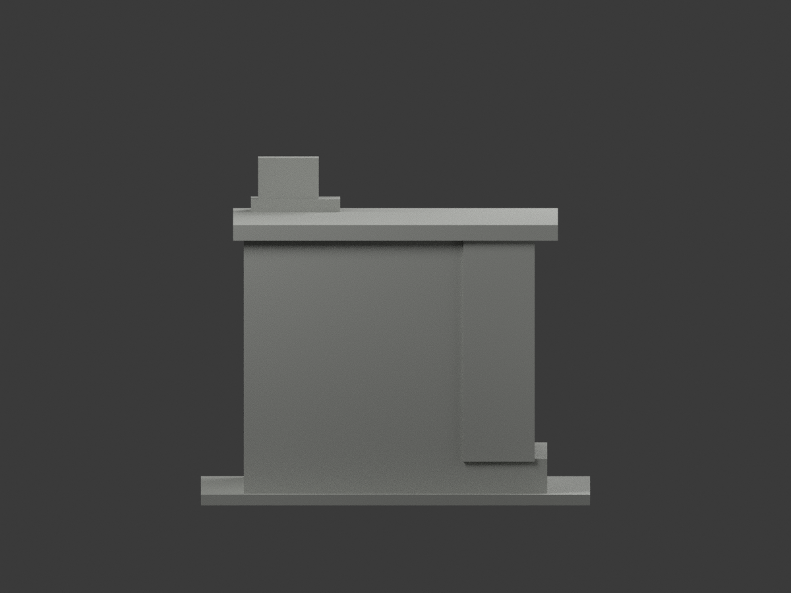
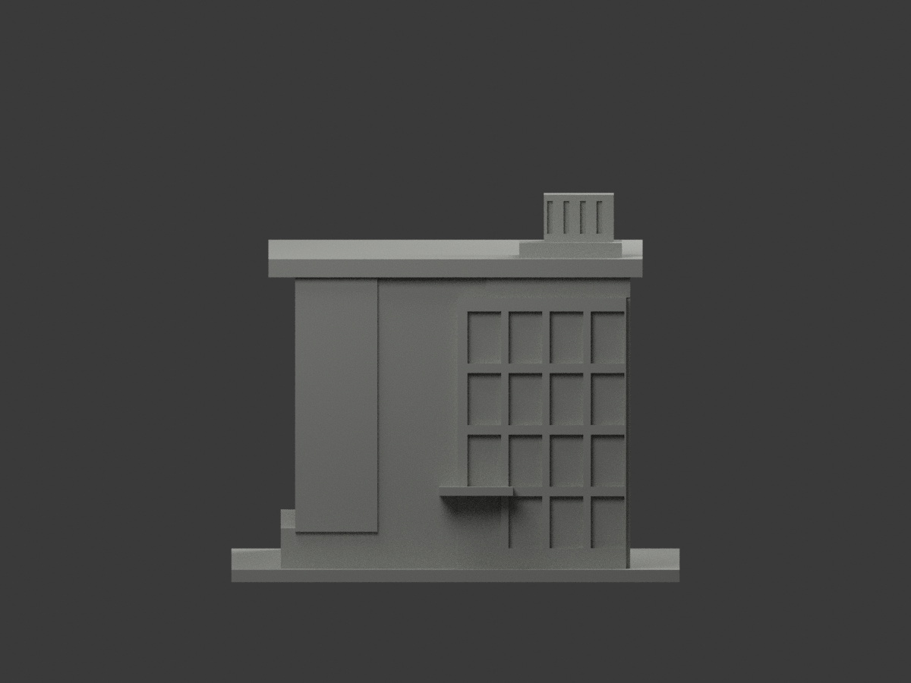
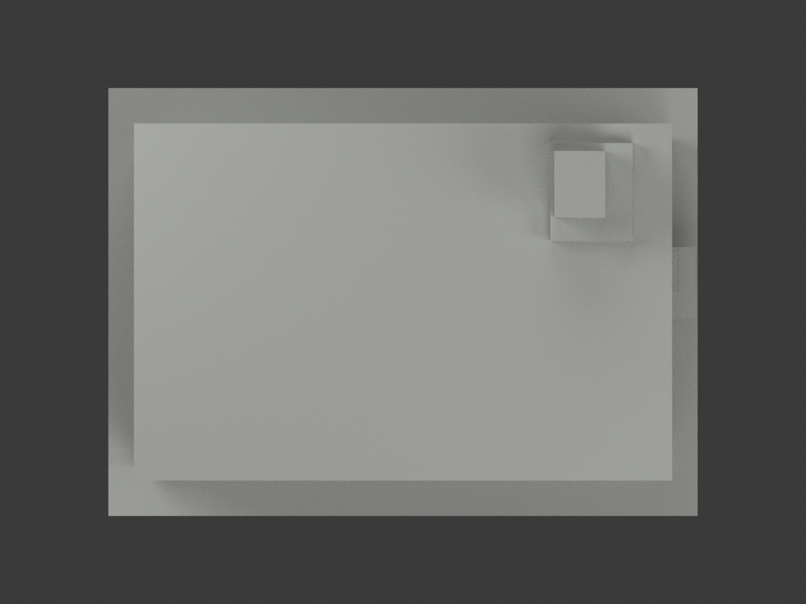
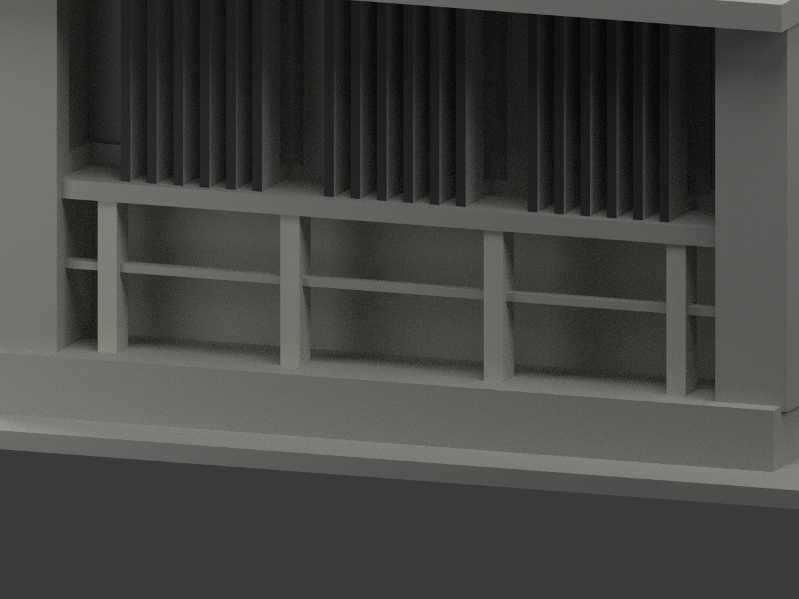
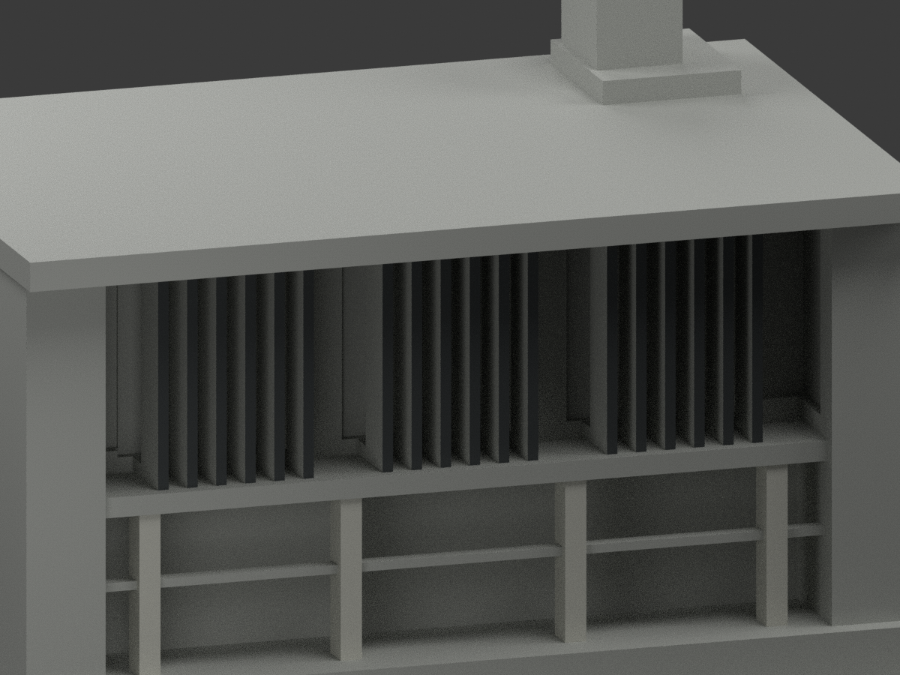
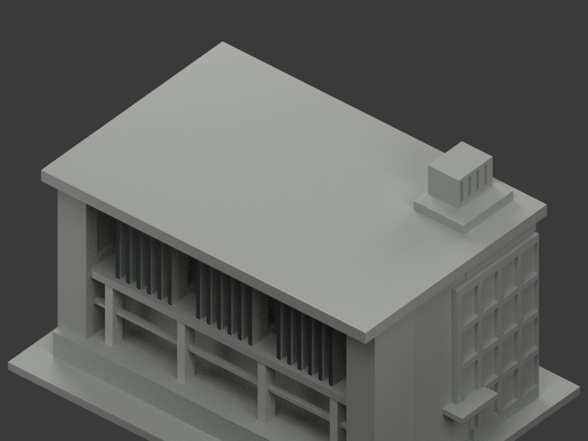

# 北教創意樓｜四根下廊柱側背同材質延續

## 模型預覽

| 總覽 | 背側 | 正面 |
|---|---|---|
||||
||||
||||
||||

## 本次四根下廊柱完整側背奶白延色

只將四根下廊柱的72個原三角從中性1延用原奶白材料2（#CECEC5）。原36深灰上葉片與8奶白柱前面全保留；現36深灰、80奶白、1526中性面，非全館外觀完成。1642原三角、原點表、面序、STL字節與座標均不變，沿用原150mm示意尺度非測量。一個原創意館，同項count_delta=0。

原柱中心x=[−47.5,−17,17,47.5]，寬3.2mm、y−36.5…−31.5深5mm。原名義z11…39，被原基座吞至12.8、上梁遮至37，因此只保留實有z12.8…37。兩側各原8面組成帶孔完整平面，四柱共8個孔側域64面；背面四矩形各2面共8面。橫桿接觸孔為y−35.2…−32.8、z25.5…26.8；孔不補、桿不染、梁不染。12域72面全頂點/外邊與孔/解析差集/零重疊/整共面連通核對，不宣稱全無限平面全選。解析1252.8000000000、原網格1252.7998779297mm²差屬原float32。

本輪親看官方校園防救計畫 https://general.ntue.edu.tw/var/file/44/1044/img/606570806.pdf 第25頁（印2-19）正側兩張原照，擷取影像雜湊與歷史來源登記一致。淡色下廊柱身份及可見側返支持同構件延續；整個原5mm進深與背面仍是同柱同材推論，不冒稱全深背照確證。第26/27頁平面圖不用來證顏色。文件2023日期與照片109年布條都不是拍攝日期，不保證2026現況；原色族非校準材質。原PDF/照片私人保留、不入包、不公開、不作貼圖。

原上葉片36深灰仍不擴染；混材磚基座、玻璃、屋頂、梁、欄桿及整體牆面1526中性面不變。保留原規則化柱/橫桿近似，沒有拓撲或幾何修飾。正確物件名NTUE Creative partial color，既有VERSION-2-OBJECT-NAME-ERRATUM.json原樣保留。所有原QA/source/checksum按原字節保護，以下舊色數/舊說明是本次前歷史快照。

原94採樣層、最大0.8mm開運算損失0.004152519254309331、零超1%層等工程記錄不重算也不升級為薄壁、耗材、切片、支撐或實印保證。新qa-continuous-column含兩份獨審、strict3MF零警告與材料往返、Blender奶白材質及頂點編輯存檔重開、scene重渲染精確、ZIP孤立重建、歷史保護及10新圖親看。重建python continuous-column-source/build_continuous.py，verify_exchange.py；Blender render_continuous.py、strip_previews.py、Blender verify_scene.py。原色盤front文字是保留歷史標籤，本次見新域。此為本地包，不代表已上傳。

---
## 原版歷史文件（原色數36深灰及8奶白）

場景僅同步更新 source_mesh_sha256 以對應本次 72 面指派更新的 color-mesh.npz，並更新 scope 明示四柱全 5 mm 深度側背同材推論、原 36 深灰和 8 奶白面及橫桿接觸孔保留。其餘原屬性、完整材質定義與幾何不變；palette.json 原 bytes 不變。原未知側背中性說明保留為前版歷史，當前僅本次有限域例外；示意尺度、幾何近似、混材及未實印等限制不撤銷。現行完整校驗以 CONTINUATION-SHA256SUMS 為準，舊校驗及歷史 README 原 bytes 保留。

## 前版說明與保留限制（完整歷史文字）

# 北教創意樓｜百葉及下廊柱前面局部分色

**混材主牆、玻璃與未知域未完成分色。** `partial_color_incomplete=true`、`fully_colored_exterior=false`，非全棟完成補彩。

## 材色範圍
同 `ntue-creative` 原項目，same-item、count_delta=0。**1642原三角面、STL與build_model.py字節不變**，不切面不新增文字；原公開包無OBJ，不因原code會輸出而假稱保留。
- 18片原百葉前端 y−35、每片寬1.6、z39..75，36完整原面深灰；4下廊柱前 y−36.5、寬3.2、z11..39，8完整原面淺灰。
- 每三角全部頂點須符合原有限plane及界限，保留原Boolean裁切；不採中心點／normal門檻。全385共面連通域均一、0撤色。
- 其餘1598中性：上下混淺灰／紅磚無分界牆、所有百葉與柱側背面、橫幅所在樓板、窗背混框反光、欄實板、設備塔、屋頂與邊、側入口及背面、底座。深凹處陰影不是新增玻璃材。
- 色／中性邊界是證據使用範圍，不是真實材接縫。不新增材料邊界，不追認原近似量體為實測；相鄰舊紅磚斜屋頂館不在本包。

## 來源／日期與權利
只親看校方PDF物理頁25兩張建築外觀照片，不使用內部平面或安全資訊。拍攝日期未知，2023填表日期以及照片中109學年度橫幅不是獨立證實的拍攝日期，不聲稱2026現況。
原照／PDF私存，不公開或貼圖；未確認CC／再散布授權，不保證商用。HEX僅名義灰族非校準色票。正式GO覆蓋先期review-only文字，但不免除builder QA。

## 格式與列印
[原STL](model.stl) · [逐面材色3MF](appearance.3mf) · [Blender](scene.blend)
原150×109mm展示底座，照片近似非精測比例。STL無色；3MF／Blender真逐面材。三材標籤不是驗證三色／四色耗材切片；**未實際列印**，無切片路徑。

## 重建與 QA
原 `build_model.py` → `colorize_model.py` → `export_appearance.py` → `validate_color.py`；Blender `render_color.py`／`verify_color_scene.py`。
完整隔離原build＋color重建、原bytes／三角multiset、閉合正體積、3MF面材、scene重開、十圖1200×900與圖文hash核對；程序不代替人工來源審核。
原README／previews／render／validation保留歷程，不冒充本次QA；沒有刪檔。

## English scope
Partial only:36 original upper louver frontfaces darkgray plus8 lower gallery pier frontfaces palegray. All1598 otherfaces neutral. Original1642 triangles unchanged;no originalOBJ. Captureunknown;2023formdate and photographed109year banner not independentcapturedate. Exteriorphotosonly,no interior/security reconstruction. Not testprinted or validatedfilament slicing. Neighboring older brickhall excluded.

## 版本 2 名稱勘誤

3MF 與 Blender 物件顯示名稱統一更正為「NTUE Creative partial color」，並同步匯出、渲染與驗證程式的名稱。場景重新開啟與保存後，除物件名稱及非渲染執行期記錄外，網格、材質、變換、相機、燈光與字幕語義完全相同；場景檔案雜湊因此更新。原 STL、材色陣列與十張預覽位元不變，未重新渲染。原有局部補色及未試印限制不變。
