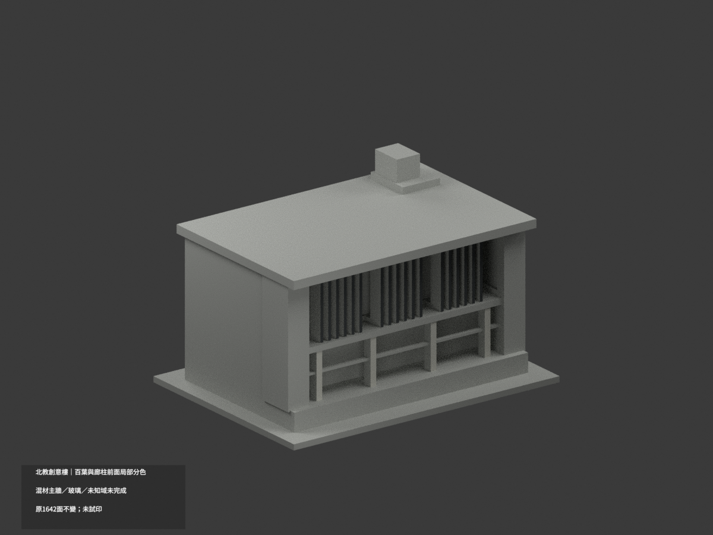
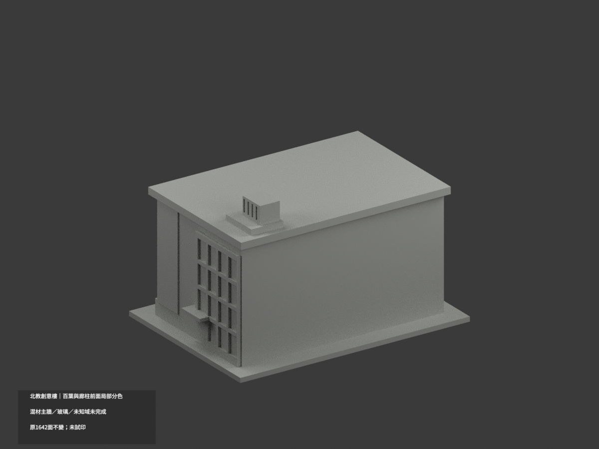
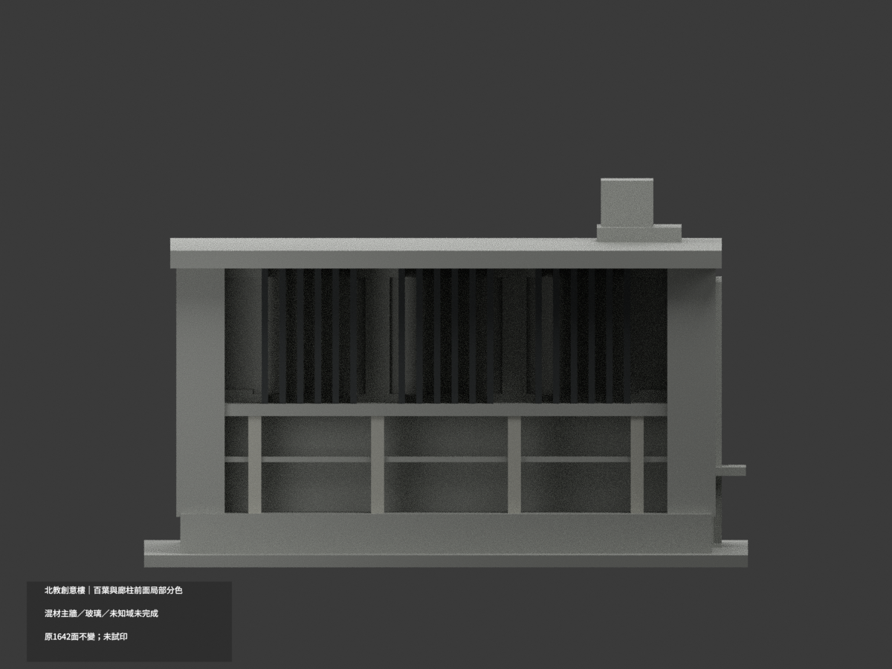
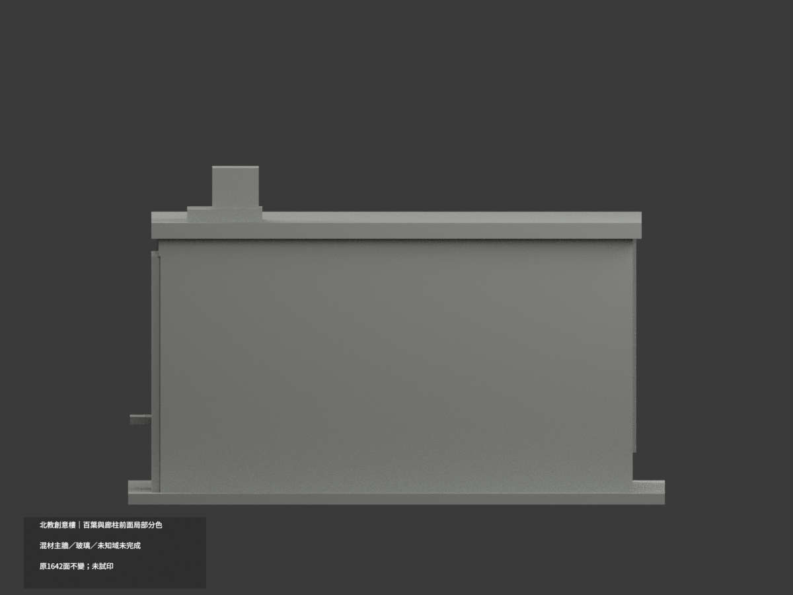
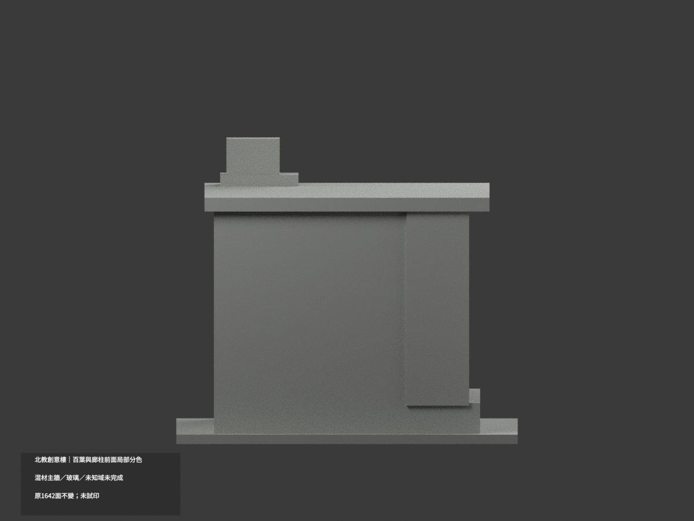
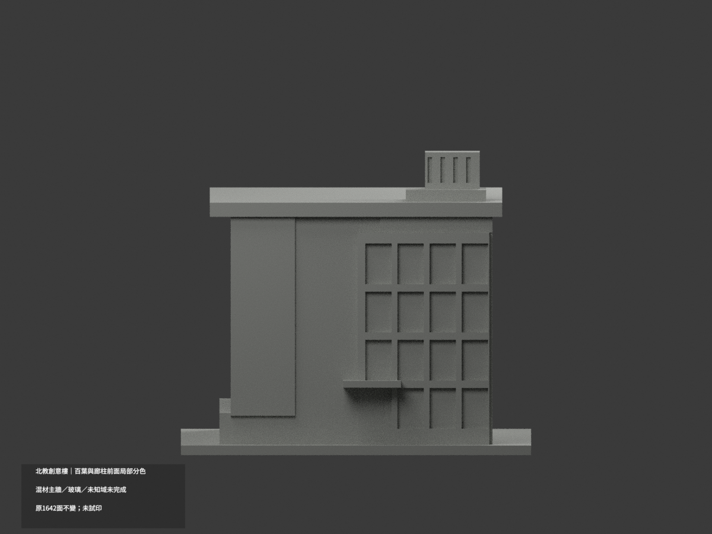
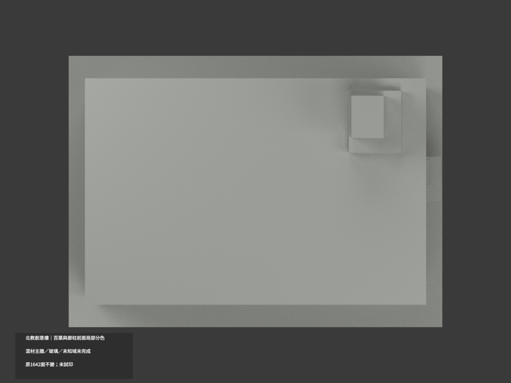
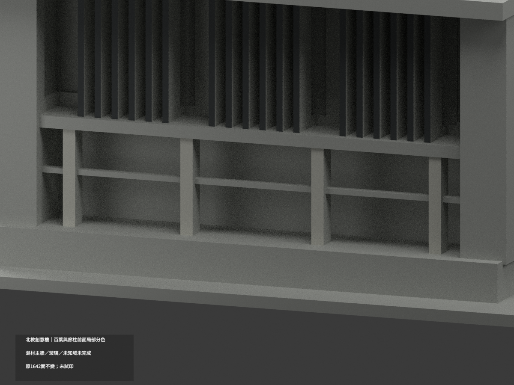
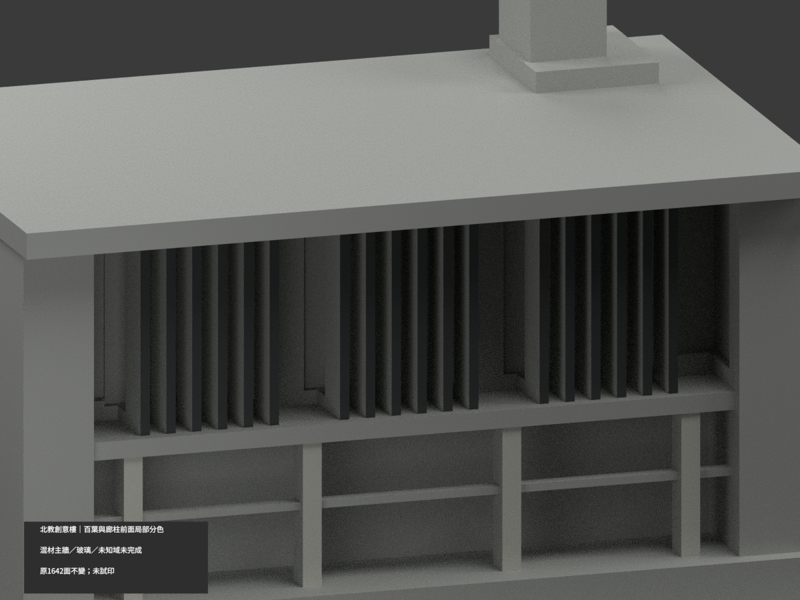
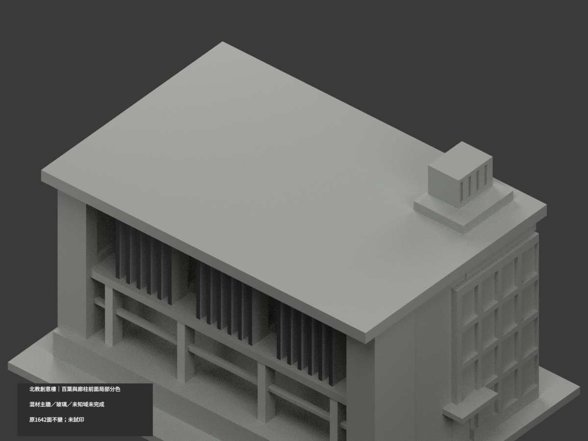

# 北教創意樓｜百葉及下廊柱前面局部分色

**混材主牆、玻璃與未知域未完成分色。** `partial_color_incomplete=true`、`fully_colored_exterior=false`，非全棟完成補彩。

| 總覽 | 背側 | 正面 |
|---|---|---|
||||
||||
||||
||||

## 材色範圍
同 `ntue-creative` 原項目，same-item、count_delta=0。**1642原三角面、STL與build_model.py字節不變**，不切面不新增文字；原公開包無OBJ，不因原code會輸出而假稱保留。
- 18片原百葉前端 y−35、每片寬1.6、z39..75，36完整原面深灰；4下廊柱前 y−36.5、寬3.2、z11..39，8完整原面淺灰。
- 每三角全部頂點須符合原有限plane及界限，保留原Boolean裁切；不採中心點／normal門檻。全385共面連通域均一、0撤色。
- 其餘1598中性：上下混淺灰／紅磚無分界牆、所有百葉與柱側背面、橫幅所在樓板、窗背混框反光、欄實板、設備塔、屋頂與邊、側入口及背面、底座。深凹處陰影不是新增玻璃材。
- 色／中性邊界是證據使用範圍，不是真實材接縫。不新增材料邊界，不追認原近似量體為實測；相鄰舊紅磚斜屋頂館不在本包。

## 來源／日期與權利
只親看校方PDF物理頁25兩張建築外觀照片，不使用內部平面或安全資訊。拍攝日期未知，2023填表日期以及照片中109學年度橫幅不是獨立證實的拍攝日期，不聲稱2026現況。
原照／PDF私存，不公開或貼圖；未確認CC／再散布授權，不保證商用。HEX僅名義灰族非校準色票。正式GO覆蓋先期review-only文字，但不免除builder QA。

## 格式與列印
[原STL](model.stl) · [逐面材色3MF](appearance.3mf) · [Blender](scene.blend)
原150×109mm展示底座，照片近似非精測比例。STL無色；3MF／Blender真逐面材。三材標籤不是驗證三色／四色耗材切片；**未實際列印**，無切片路徑。

## 重建與 QA
原 `build_model.py` → `colorize_model.py` → `export_appearance.py` → `validate_color.py`；Blender `render_color.py`／`verify_color_scene.py`。
完整隔離原build＋color重建、原bytes／三角multiset、閉合正體積、3MF面材、scene重開、十圖1200×900與圖文hash核對；程序不代替人工來源審核。
原README／previews／render／validation保留歷程，不冒充本次QA；沒有刪檔。

## English scope
Partial only:36 original upper louver frontfaces darkgray plus8 lower gallery pier frontfaces palegray. All1598 otherfaces neutral. Original1642 triangles unchanged;no originalOBJ. Captureunknown;2023formdate and photographed109year banner not independentcapturedate. Exteriorphotosonly,no interior/security reconstruction. Not testprinted or validatedfilament slicing. Neighboring older brickhall excluded.

## 版本 2 名稱勘誤

3MF 與 Blender 物件顯示名稱統一更正為「NTUE Creative partial color」，並同步匯出、渲染與驗證程式的名稱。場景重新開啟與保存後，除物件名稱及非渲染執行期記錄外，網格、材質、變換、相機、燈光與字幕語義完全相同；場景檔案雜湊因此更新。原 STL、材色陣列與十張預覽位元不變，未重新渲染。原有局部補色及未試印限制不變。
