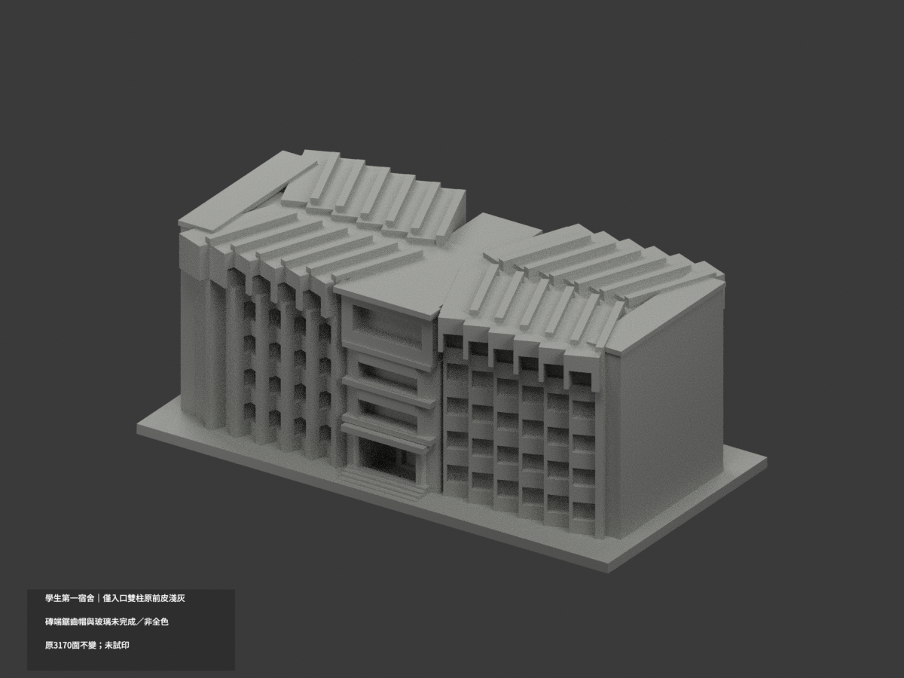
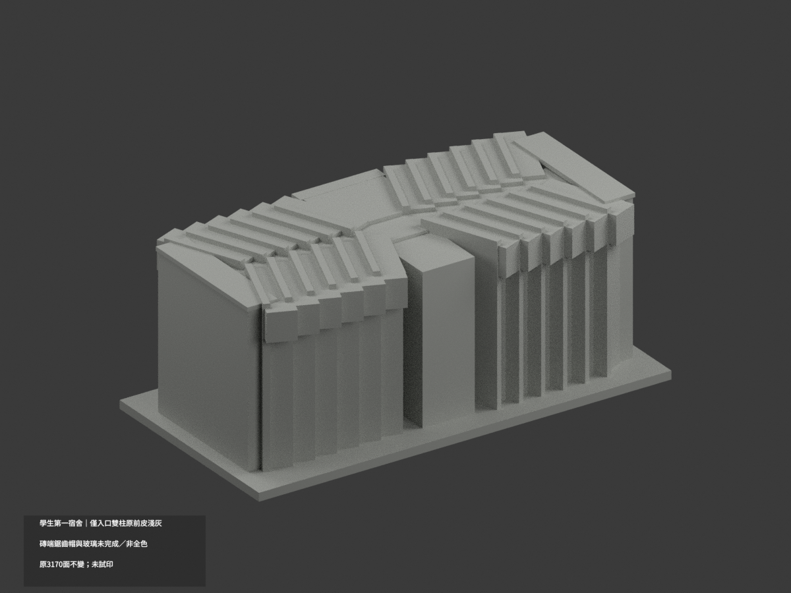
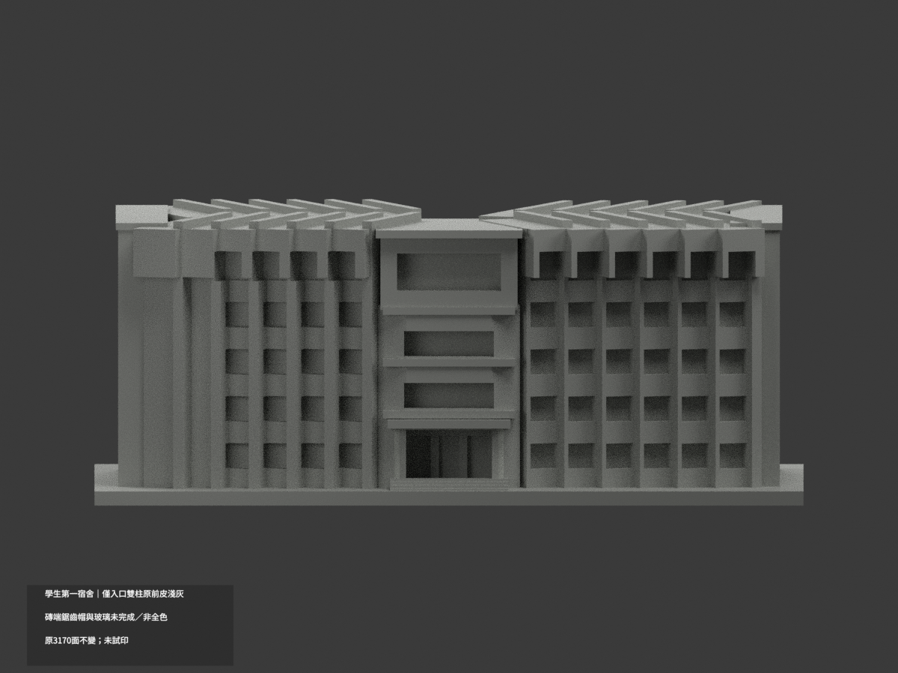
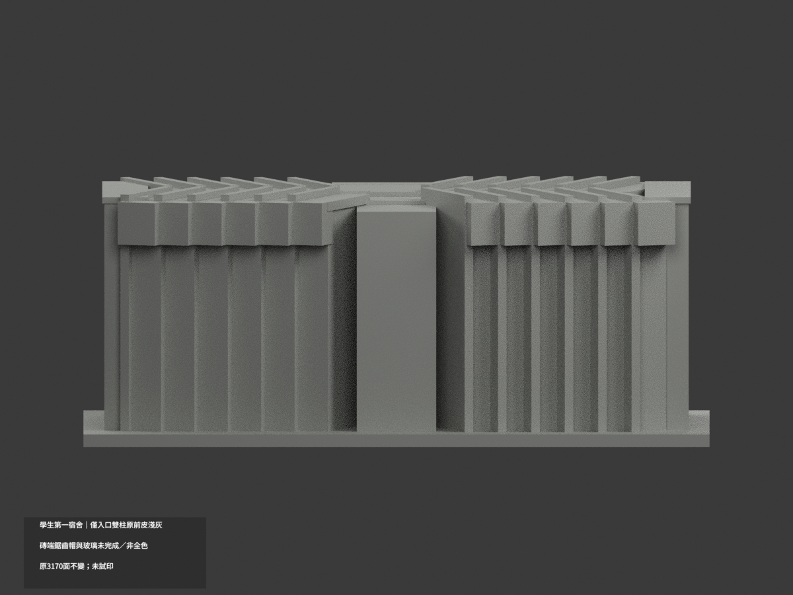
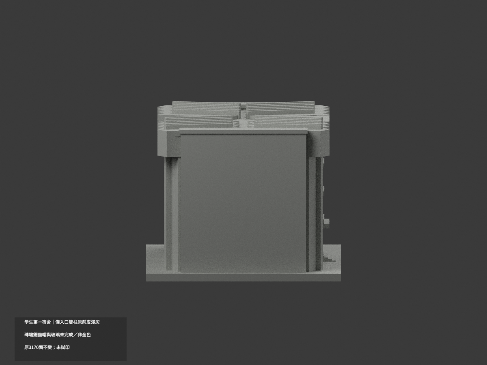
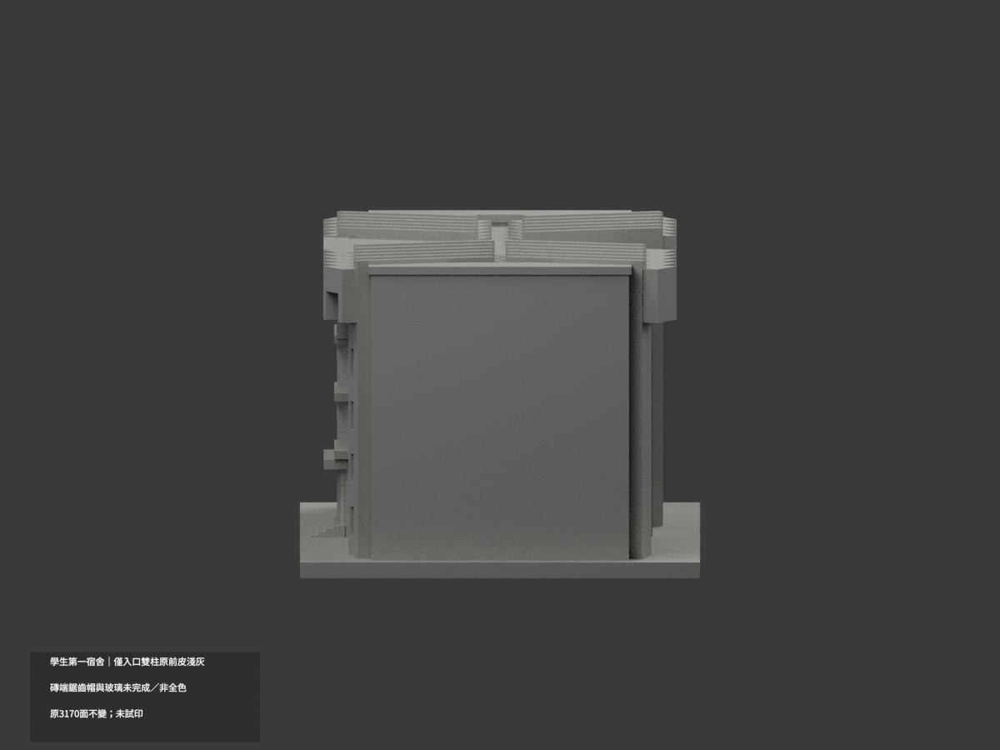
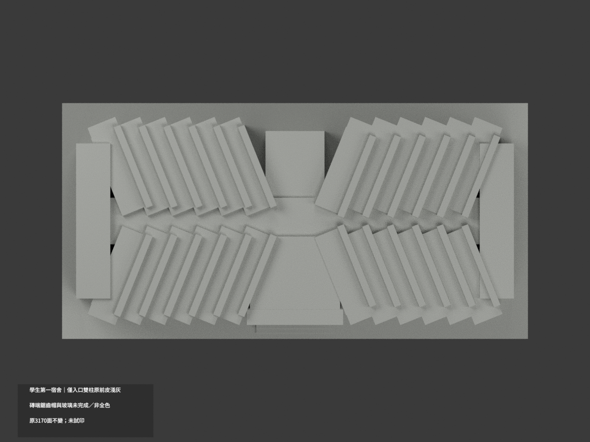
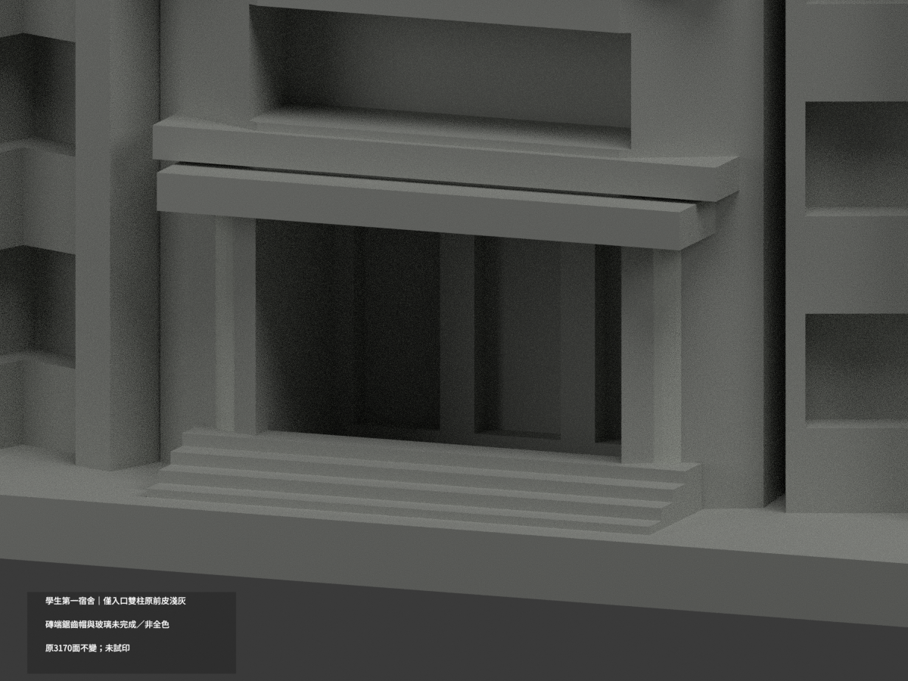
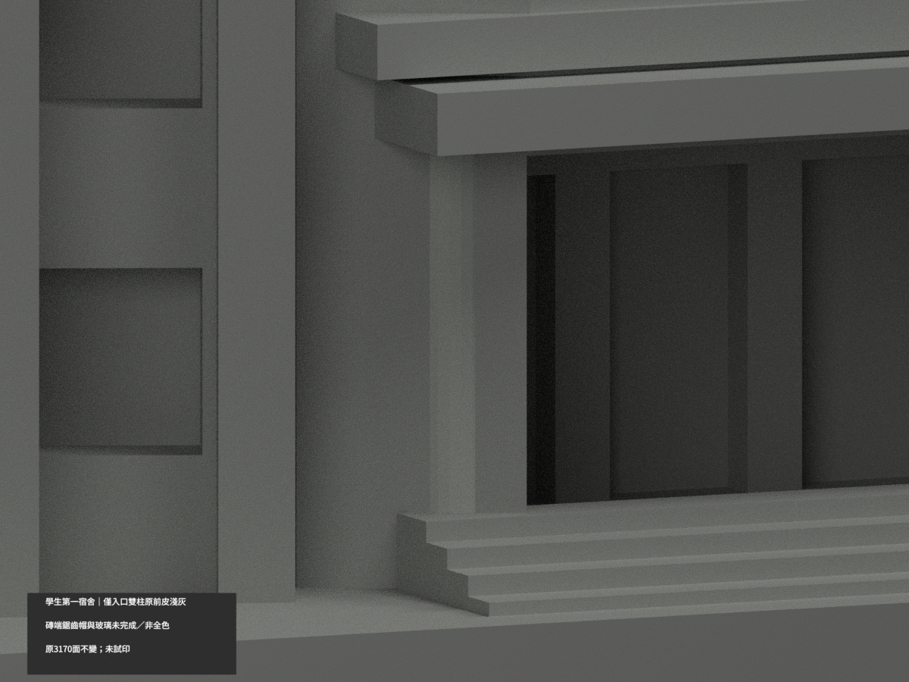
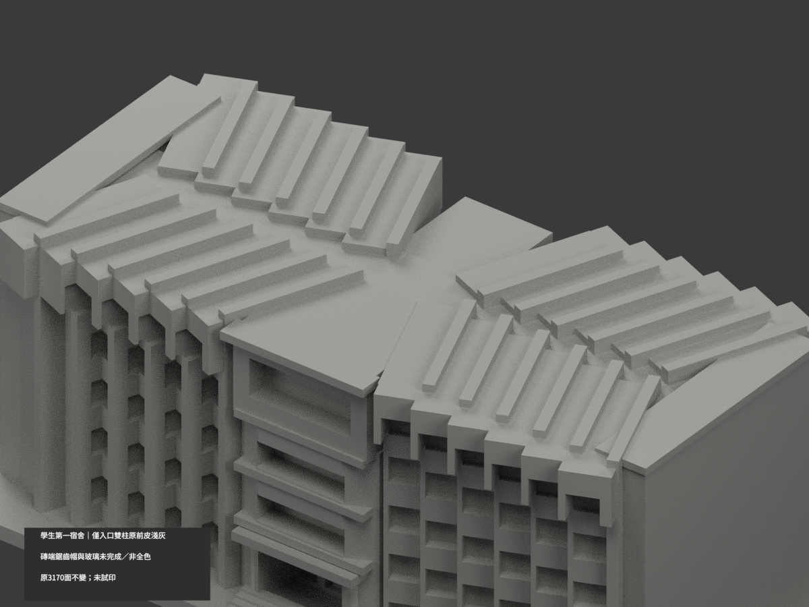

# 北教學生第一宿舍｜僅入口雙柱原前皮局部淺灰

**局部補色未完成：僅入口雙柱原可見前皮20面淺灰；磚端鋸齒帽與玻璃未完成。不是全棟完成補色。** `partial_color_incomplete=true`、`fully_colored_exterior=false`。同項 `ntue-dormitory-1`／`count_delta=0`，臺北校區。只第一宿舍，不借第二宿舍後面證據。處理日期非拍攝日期。

| 前斜視 | 後斜視 | 正面 |
|---|---|---|
|  |  |  |
|  |  |  |
|  |  |  |
|  | | |

## 材色範圍

原24gon雙柱中心(±10.5,−29)、半徑1.3、z3..17。逐原構造facet n=(cos(2π(j+.5)/24),sin(...))，只n_y<0，所有三頂點必在有限chordplane rcos(π/24)、切向±rsin(π/24)、原z範圍。兩柱各5殘露facet、10三角，共20淺灰；3150中性。不用rawnormal閾漏掉小片，不面心裁色，不套ID取代幾何核。

**保留原Boolean扇體埋柱形狀，不把被埋的柱面重新造出。** 全共面連通域一致。柱頂/背側/埋入域不擴染；巨大磚端牆跨不同底磚、管線，不能全紅。鋸齒房翼/高帽受樹遮且未證完整面域；中央扇牆、水平帶、雨庇、窗背混框玻璃內物、後梯、另一長側、屋面/地面全部中性。中性不是實景灰證明，資料範圍不代表真材接縫。

原3170三角及STL/build字節、獨立150mm模型比例不變；原折角房翼、五層窗、入口尺度與背部素面近似保留，不改開口或補內部。此色審不追認原照片/平面導向量體為實測或當前現況。

## 來源、日期與權利

只親看共用官方PDF實頁63兩外觀照片，不讀內部/操作配置。正面入口淺色柱可辨，端照下磚差證不應整端塗紅。2023文件/填表不是攝影日期，capture未知、不稱2026現況。PDF與影像hash見register，URL沿原sources.json。原照只private、不公開/貼圖；未見CC不推商用。名義淺灰非精確色票。

## 檔案與 QA

`appearance.3mf`兩展示材，`scene.blend`真原面材索引，`color-mesh.npz`原三角。STL/build原字節保留。Immutable原包無OBJ；原程式匯出OBJ只在private隔離重建留存，不冒稱原件有OBJ。原README.md逐字保留`ORIGINAL-MONOCHROME-README.md`；原無README.zh-TW.md。舊previews/QA保單色歷程，不是此次色QA。

依原requirements隔離執行原build與colorize/export/validate，Blender render/verify。精確shapely2.1.2可載入獨立target，不改共享環境；重建目錄不自動刪。3MF/STL三角一致、閉合正體積、scene重開與十張1200×900見QA。**未實際列印**；兩展示材不是已驗四色切片，懸挑與厚化細格仍需另核支撐。

## English limitations

Very limited partial:20original outward entrance-column triangles,10per original24gon cylinder at(+/-10.5,-29),r1.3,z3..17;3150neutral. Every vertex tested against finite chordplane/tangent/z for front-facing primitive facets. Five Boolean-clipped facets survive per column; embedded shafts are NOT reconstructed. Whole coplanar components uniform. Mixed brick ends/base/pipes, tree-obscured sawtooth caps, central fan body and bands, glazing backs, rear/unknown surfaces and roofs neutral. Original3170triangles/STL/build bytes unchanged/count_delta0, only Dormitory1. No immutableOBJ although original builder generates a private isolated OBJ. Official PDF physical63 exterior images viewed;2023form date not capture. No2026current or surveyed-accuracy endorsement, no public source images/photo textures/commercial-rights inference. No actual print or validated multi-filament slicing.
