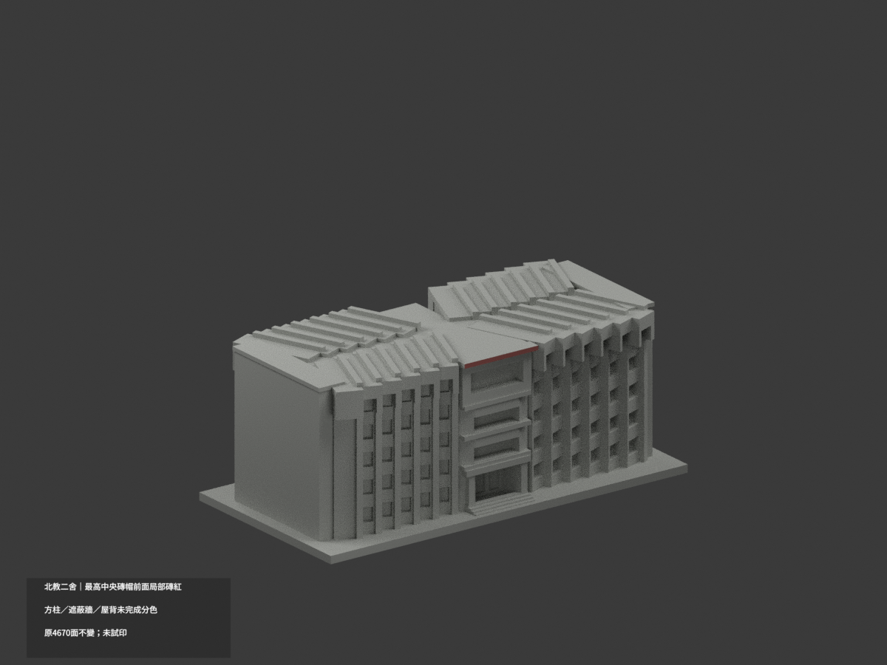
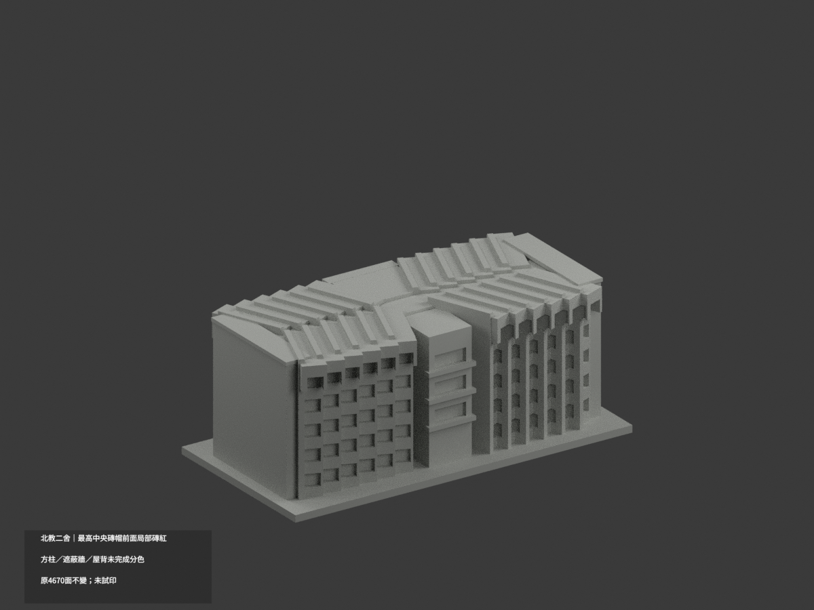
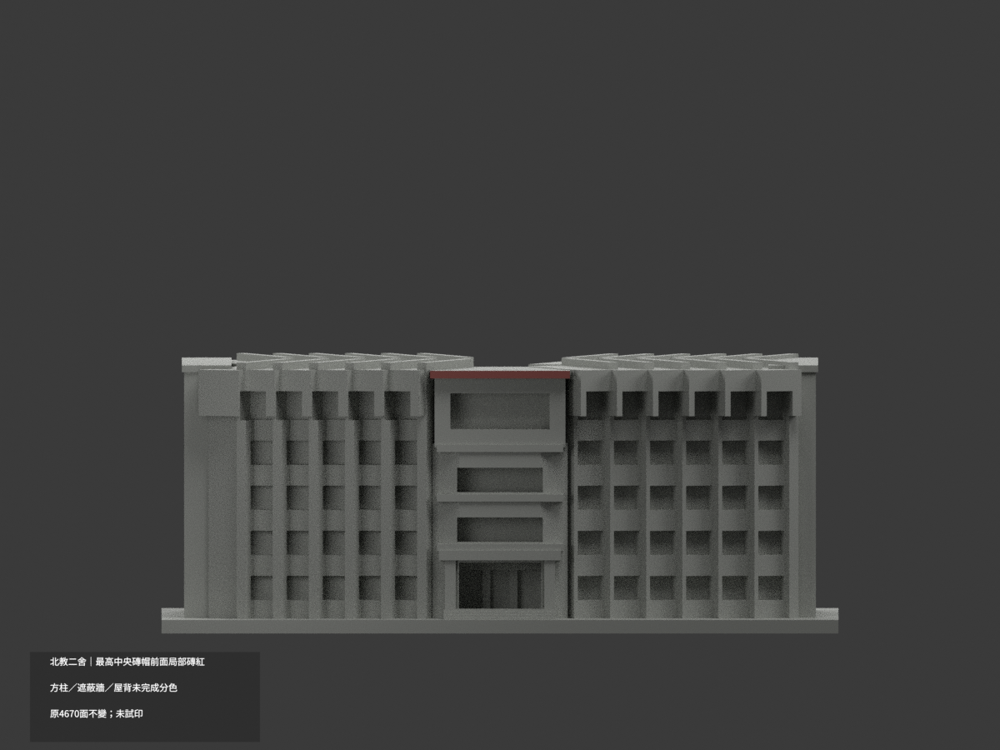
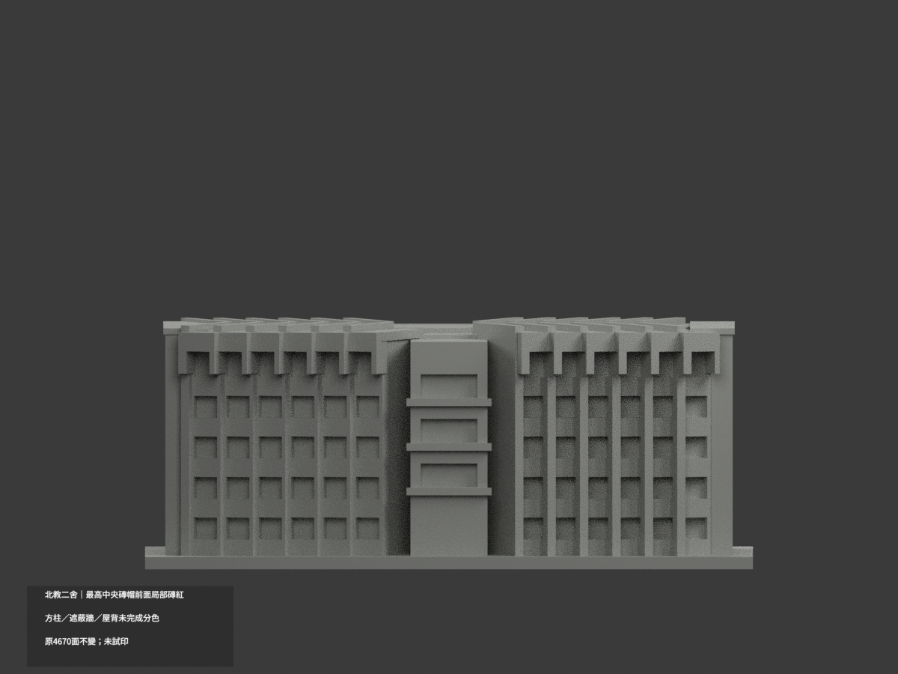
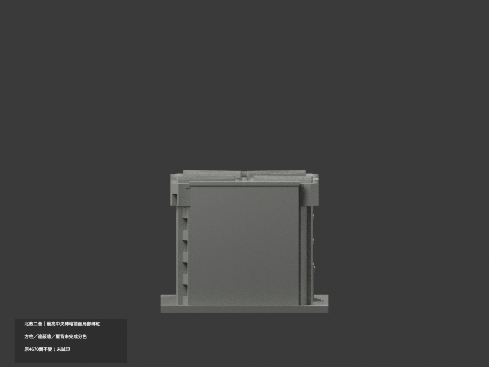
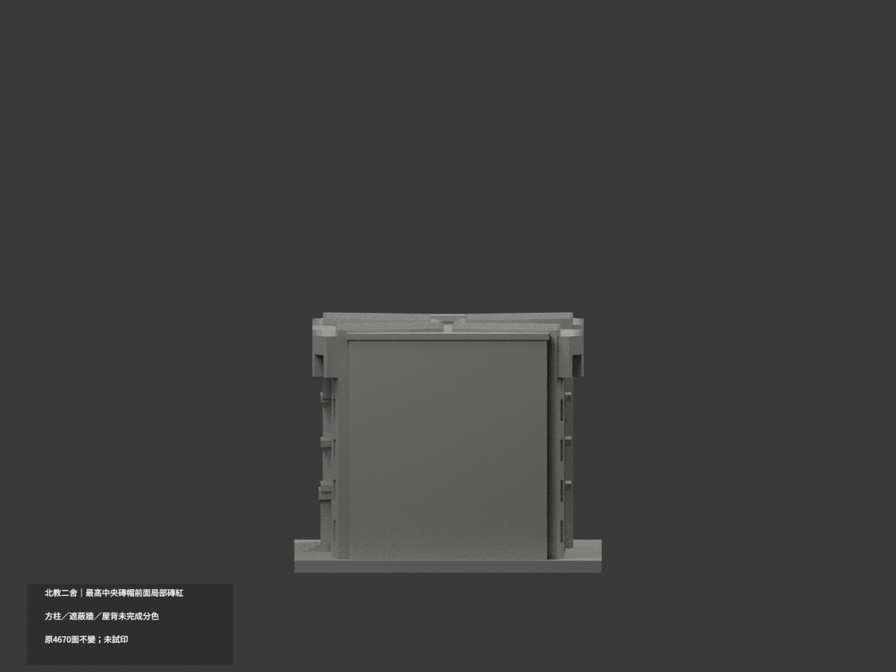
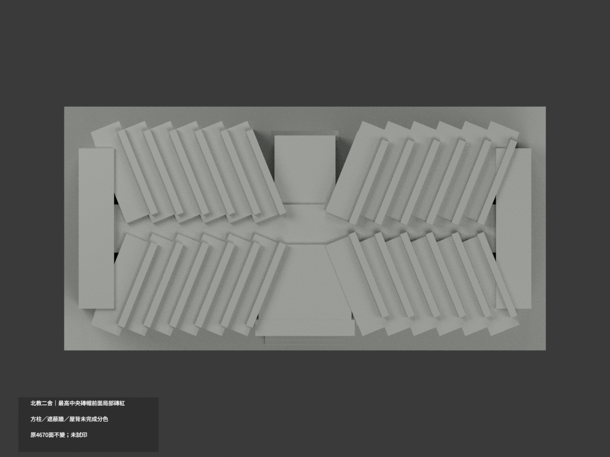
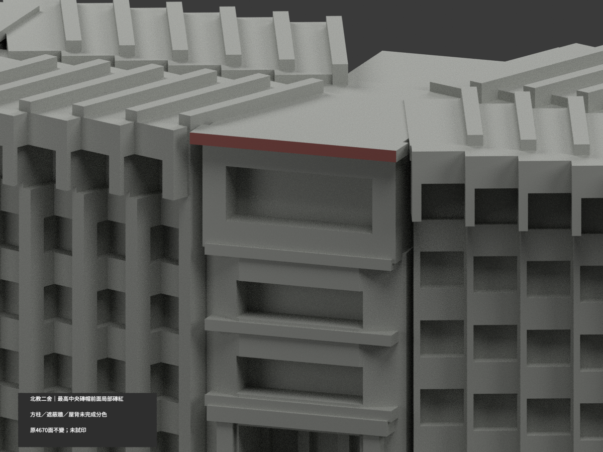
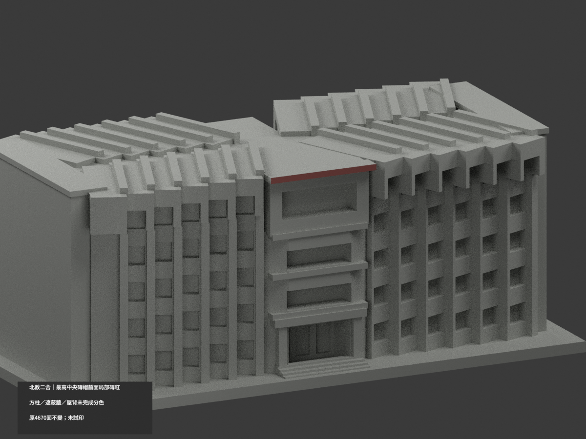
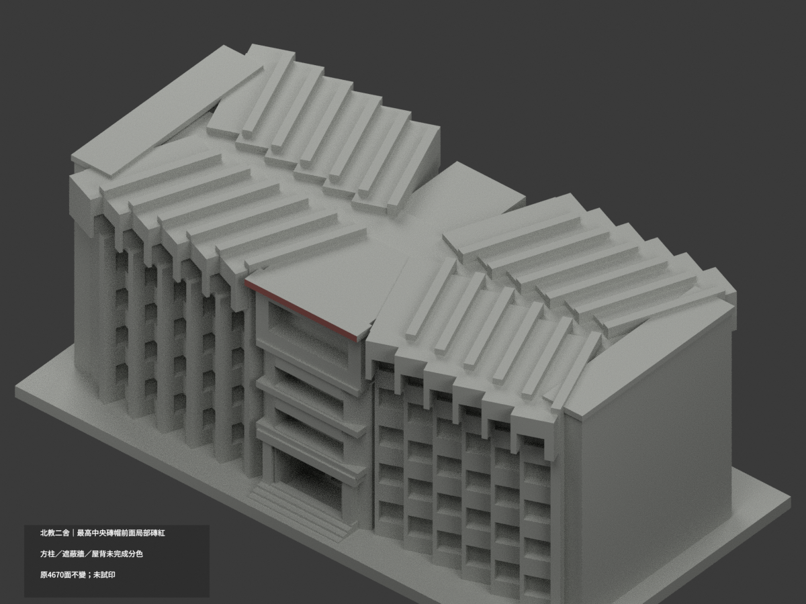

# 北教二舍｜最高中央磚帽前面局部磚紅

**方柱、遮蔽磚牆、背面及屋頂未完成分色。** `partial_color_incomplete=true`、`fully_colored_exterior=false`。極有限兩面分色，非全棟補彩完成。

| 總覽 | 背側 | 正面 |
|---|---|---|
||||
||||
||||
||||

## 材色範圍
同 `ntue-dormitory-2` 原項目，same-item、count_delta=0。**4670原三角面、STL與build_model.py字節不變**。不切面、不造文字。原公開包沒有OBJ，不因原code可輸出而假稱保留。
- 最高中央帽獨立前矩形 y−33.5、x−15.5..15.5、z56.4..58.1，兩個完整原面名義低飽和磚紅。全部三頂點在有限plane與界限內，不採中心點／normal門檻。
- 全1152共面連通域材號均一，0撤色。其餘4668中性：入口方柱跨深色／遮蔽基座、扇面／雨庇／金字帶、各折翼混材牆／帽／窗背、端牆、階與地面、後階梯框、所選帽的上／側／後面與所有屋頂。
- 二舍依自己的正背兩照獨立對位，不搬一舍圓柱顏色。原近似方柱、折翼與背階保持；補色不追認原幾何為精測。
- 色／中性邊界是來源範圍，不是真實材接縫。照片中其他可見磚域不代表原混合面可完整同色，故不硬染。

## 來源／日期與權利
只親看校方PDF物理頁67的兩張建築外觀，不使用內部平面或安全資料。拍攝日期未知；2023填表日與2022防水記事都不是拍攝日期或屋面色材證明，不聲稱2026現況。
原照／PDF私人保存，不公開、不貼圖；未確認CC或再散布授權，不保證商用。HEX僅名義色族，非校準色票。來源GO正式局部放行，先期review-only文字不免除builder QA。

## 格式與列印
[原STL](model.stl) · [逐面材色3MF](appearance.3mf) · [Blender](scene.blend)
原150×76mm展示底座，照片近似非實測比例。STL無色；3MF／Blender有真逐面材。兩材標籤不是驗證兩色／四色耗材切片，**未實際列印**，無切片路徑。

## 重建與 QA
原 `build_model.py` → `colorize_model.py` → `export_appearance.py` → `validate_color.py`；Blender `render_color.py`／`verify_color_scene.py`。
完整隔離原build＋color重建、原bytes／全三角multiset、閉合正體積、3MF面材、scene重開、十圖1200×900及圖文hash核對。程序不代替人工來源核對。
原README／previews／validation／render保留歷程，不冒充新QA；沒有刪檔。

## English scope
Very limited partial color:2 whole original highest central cap frontfaces mutedbrickred;4668 otherfacesneutral. Same slug/count_delta=0;original4670 triangles unchanged,no originalOBJ. Dormitory2 independently mapped from its own two exteriorphotos,not copied from Dormitory1. Captureunknown;2023formdate and2022waterproofingnote are notcaptureproof. Not testprinted,not validatedfilament slicing;original approximate geometry not newlycertified.

## 版本 2 名稱勘誤

3MF 與 Blender 物件顯示名稱統一更正為「NTUE Dormitory 2 partial color」，並同步匯出、渲染與驗證程式的名稱。場景重新開啟與保存後，除物件名稱及非渲染執行期記錄外，網格、材質、變換、相機、燈光與字幕語義完全相同；場景檔案雜湊因此更新。原 STL、材色陣列與十張預覽位元不變，未重新渲染。原有局部補色及未試印限制不變。
