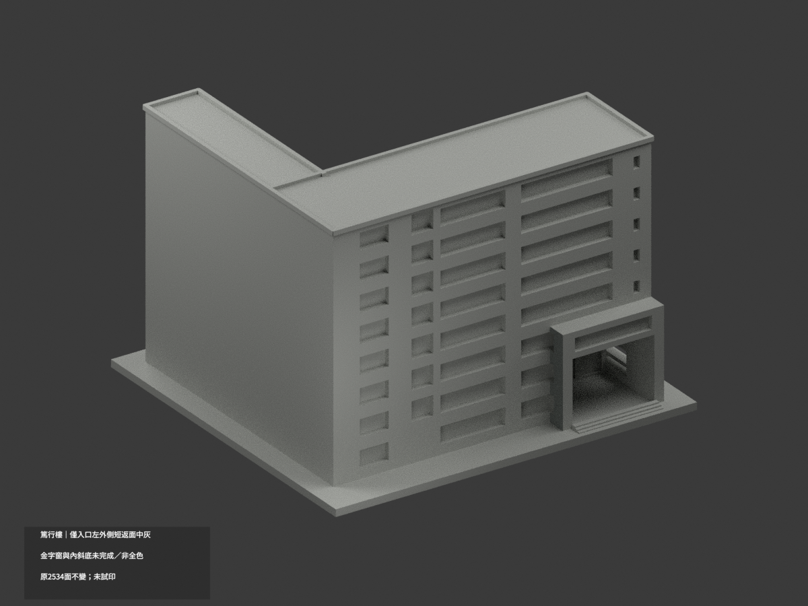
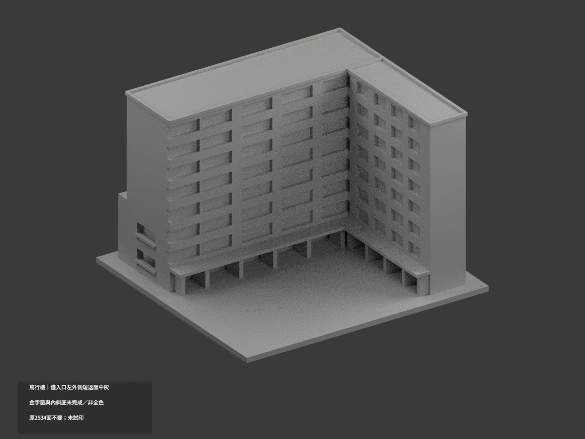
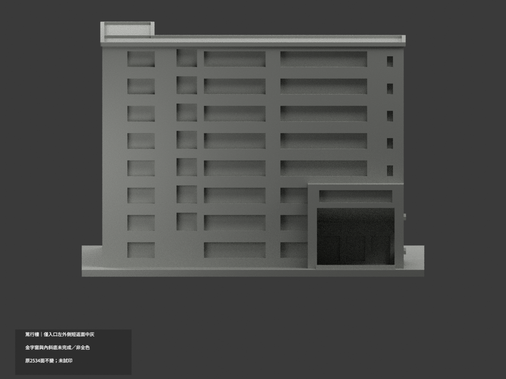
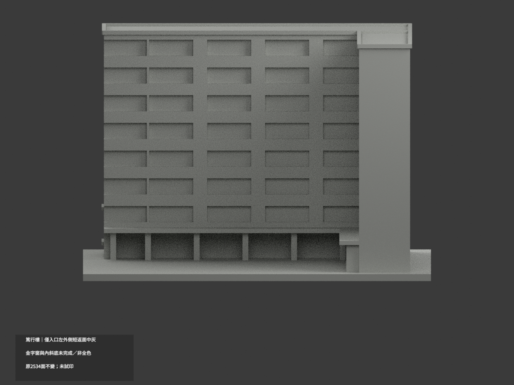
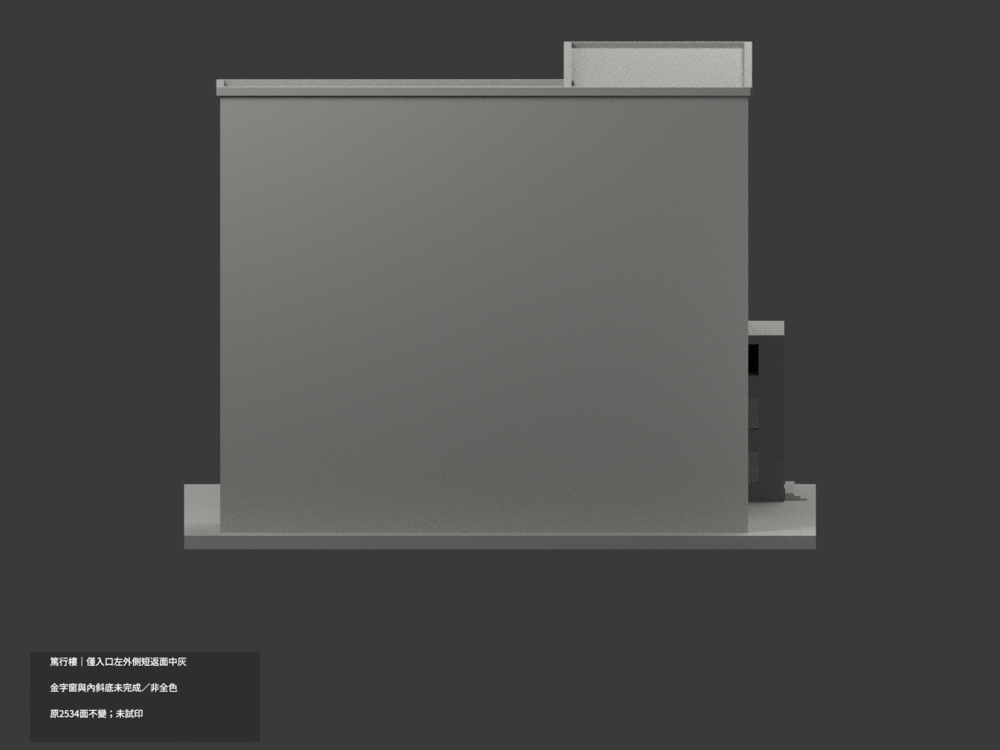
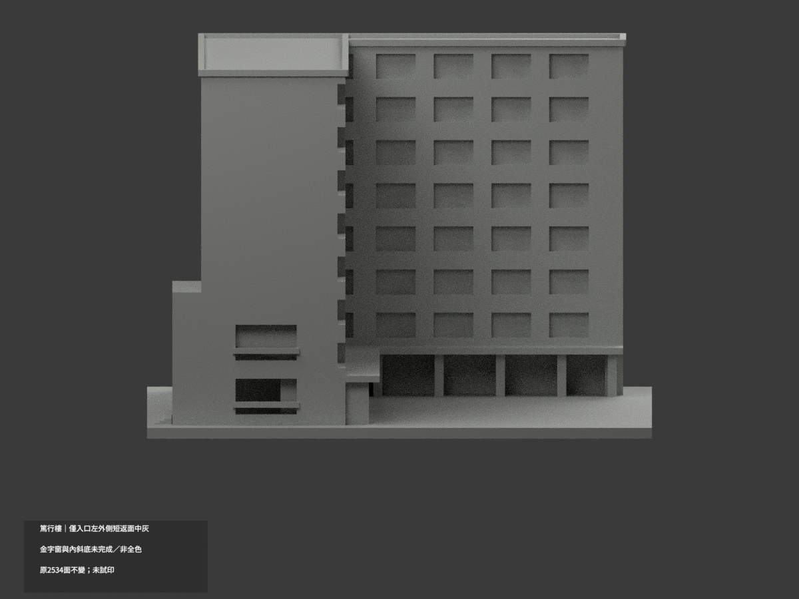
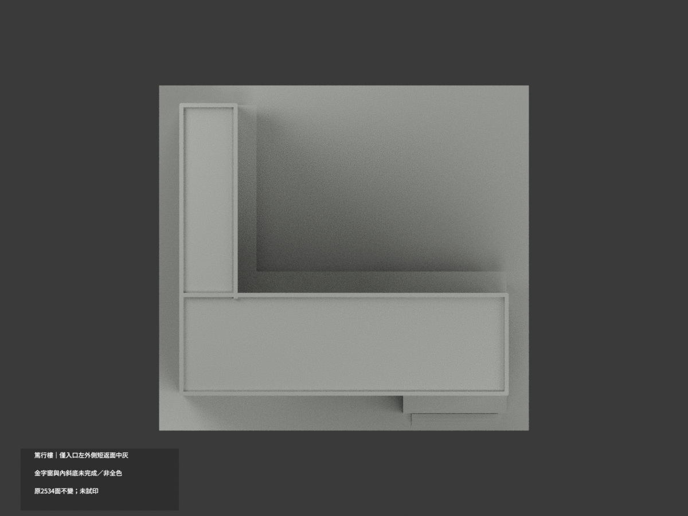
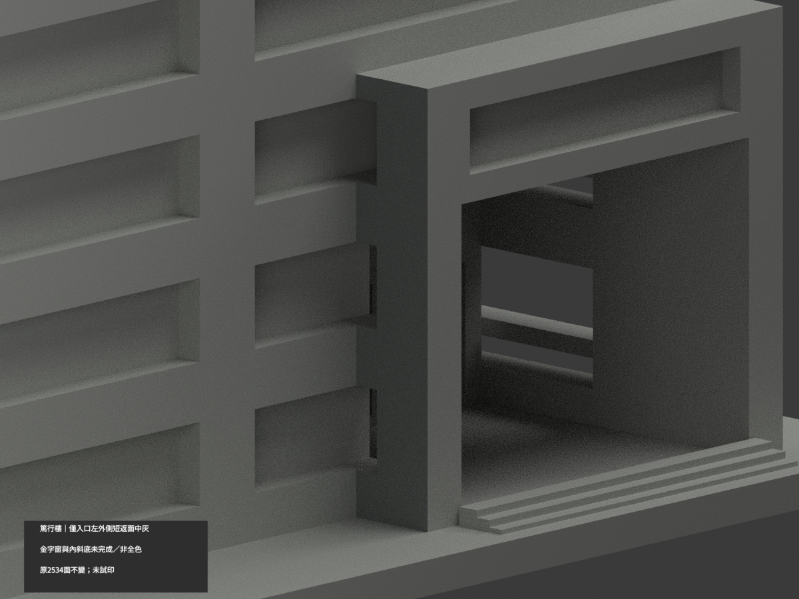
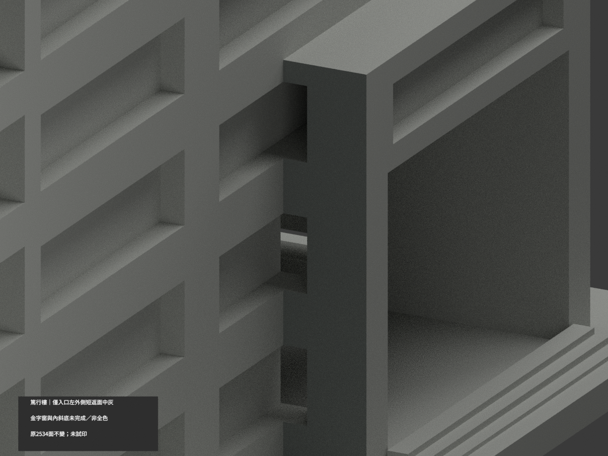
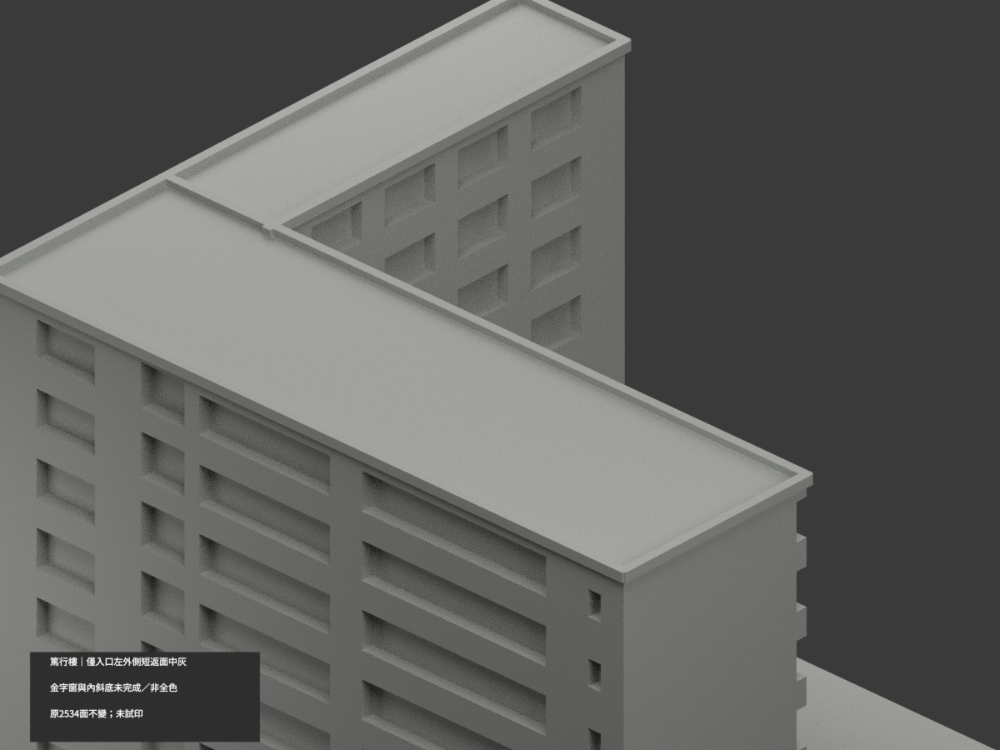

# 篤行樓｜僅入口左外側短返面局部中灰

**局部補色未完成：只入口左外側原短返完整14面中灰；金字窗與內斜底未完成。不是全棟完成補色。** `partial_color_incomplete=true`、`fully_colored_exterior=false`。同項 `ntue-duxing`／`count_delta=0`，臺北校區。原篤行單館不含獨立MoNTUE或前景走廊棚。處理日期非拍攝日期。

| 前斜視 | 後斜視 | 正面 |
|---|---|---|
|  |  |  |
|  |  |  |
|  |  |  |
|  | | |

## 材色範圍

只原入口框左外側x24完整外面，y−63..−51、z3..40；所有三頂點在有限plane/bounds內，共14原Boolean碎面中灰、2520中性。包含主館接觸及窗布林留下的階狀細片，不因片小或normal誤差漏色；不按面心/ID盲套、不補原遮住部分，不重三角化。全共面連通域一致。

這是未有金字的外側短返，**不是內斜底的陰影色**。y−63大正面含金字/上窗線索不整灰；內斜底/內返/門窗背全中性。主紅牆與窗格背沒有本次完整材域核准；院廊柱有樹遮及前景獨立走廊混淆不借染。屋面、屋緣、連接翼、後面、地階皆中性。中性不是實景灰證明，資料界線不是真材接縫。

原2534三角、STL/build字節及獨立150mm模型比例不變。原八層L形外觀近似、窗洞/入口斜頂和院廊保留；不補金字/磚紋/窗細格、不造室內、不把外觀色審當測繪或現況幾何追認。

## 來源、日期與權利

僅親看共用官方PDF實頁81兩外觀圖，不用內部/安全內容。正面左視可辨入口突框窄灰外側與紅主牆；院側照只輔助排除樹遮/前景棚。2023文件/填表不是攝影日，capture未知，不宣2026現況。PDF/影像hash見register，URL沿原sources.json。照片只private、不公開/貼圖，未見CC不推商用；HEX是展示色族非測色色票。

## 檔案與 QA

`appearance.3mf`兩展示材、`scene.blend`實際面材、`color-mesh.npz`原三角。STL/build原字節保留。Immutable原包無OBJ；原程式匯出OBJ只在private隔離重建留存，不冒稱原件有OBJ。原README.md保留`ORIGINAL-MONOCHROME-README.md`；原無README.zh-TW.md。舊previews/QA保單色歷程，非此次色QA。

依原requirements在隔離副本執行build及colorize/export/validate，Blender render/verify。shapely2.1.2可載入獨立target，不能改共享環境或原碼適配新版本；重建資料保留不刪。3MF/STL三角/封閉正體積/scene重開及10張1200×900見QA。**未實際列印**；兩展示材不是已驗四色切片，細框懸挑支撐另核。

## English limitations

Very limited partial:14complete original Boolean-fragment triangles on exterior left entry-frame return x24, y[-63,-51],z[3,40], nominal medium gray;2520neutral. All vertices finite-plane/bounds tested; no centroid clipping, arbitrary triangle color edges or new surfaces. This is the outside return, not the inner sloping porch shadow. Mixed gold-letter/upper-window front plane, inner porch, main walls, glazing, colonnade, roofs and unknown domains neutral. Original2534triangles/STL/build bytes unchanged/count_delta0, one Duxing building excluding MoNTUE and separate foreground canopy. NoimmutableOBJ despite original builder exporting a private isolated OBJ. PDF physical81 exterior photos viewed;2023form date not capture. No2026current or original geometry-accuracy endorsement, no public source images/textures/commercial-rights inference. Not test-printed or validated multicolor slicing.
