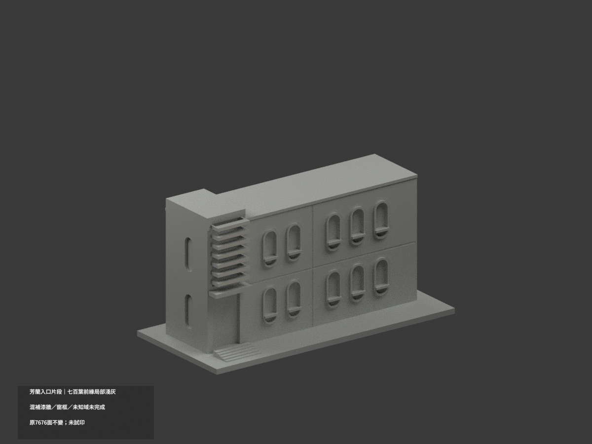
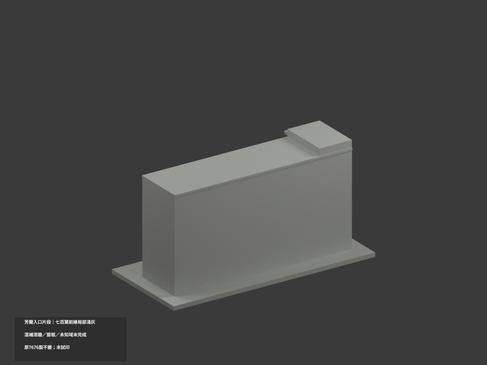
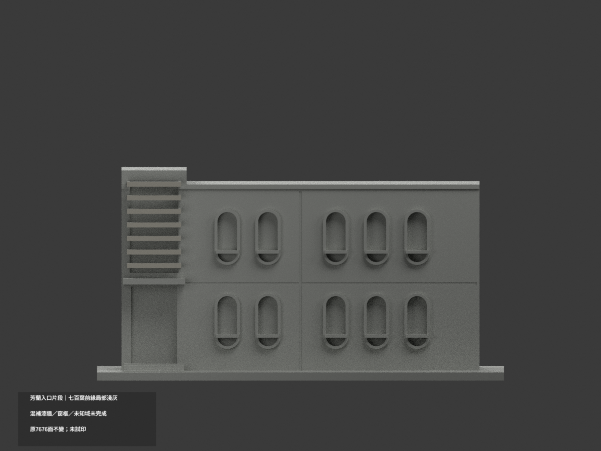
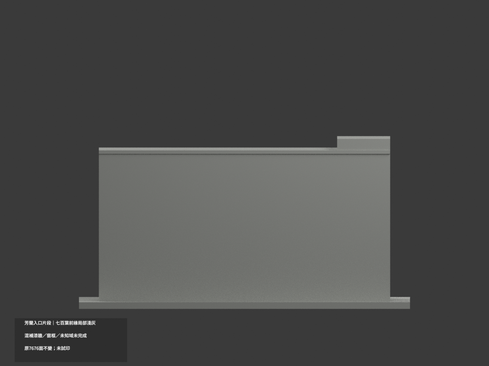
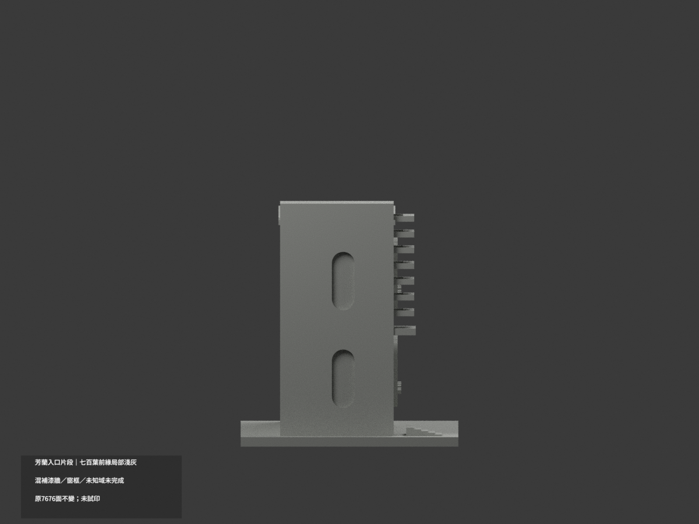
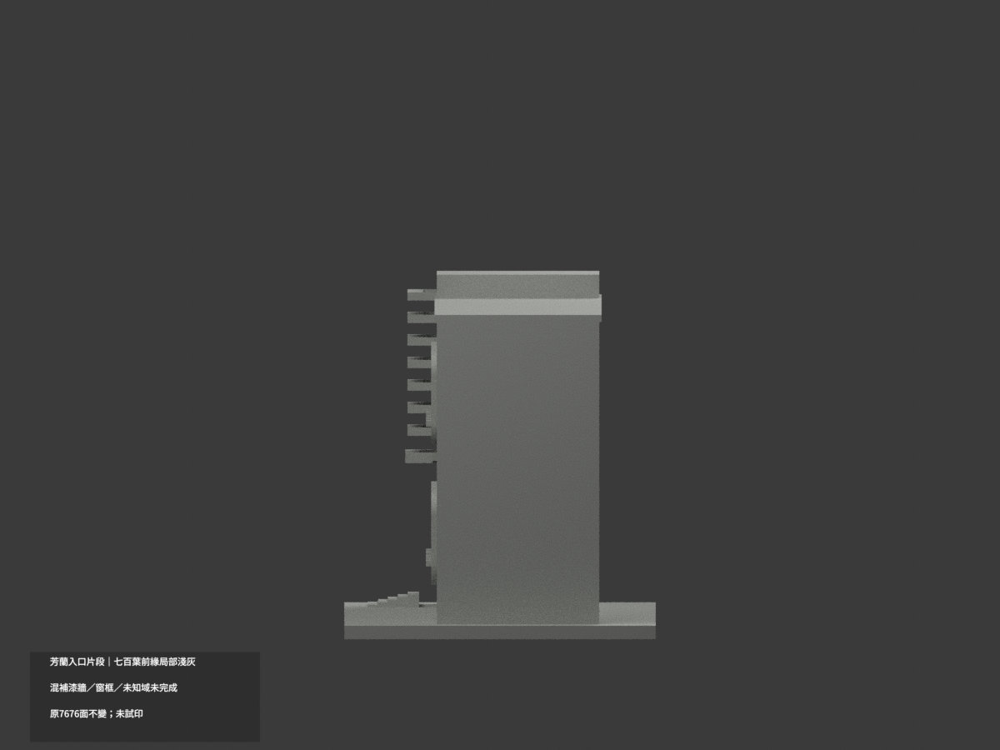
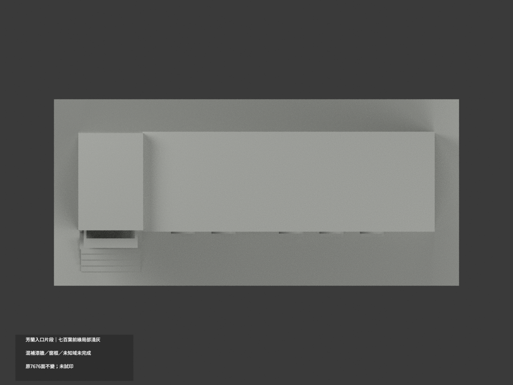
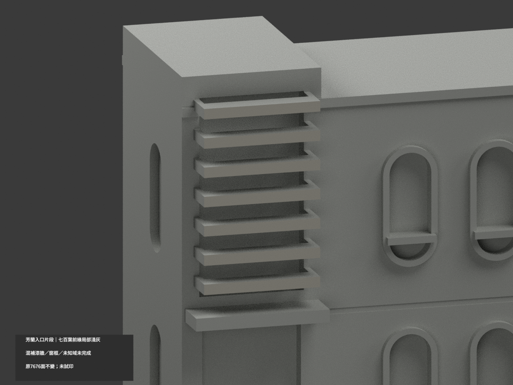
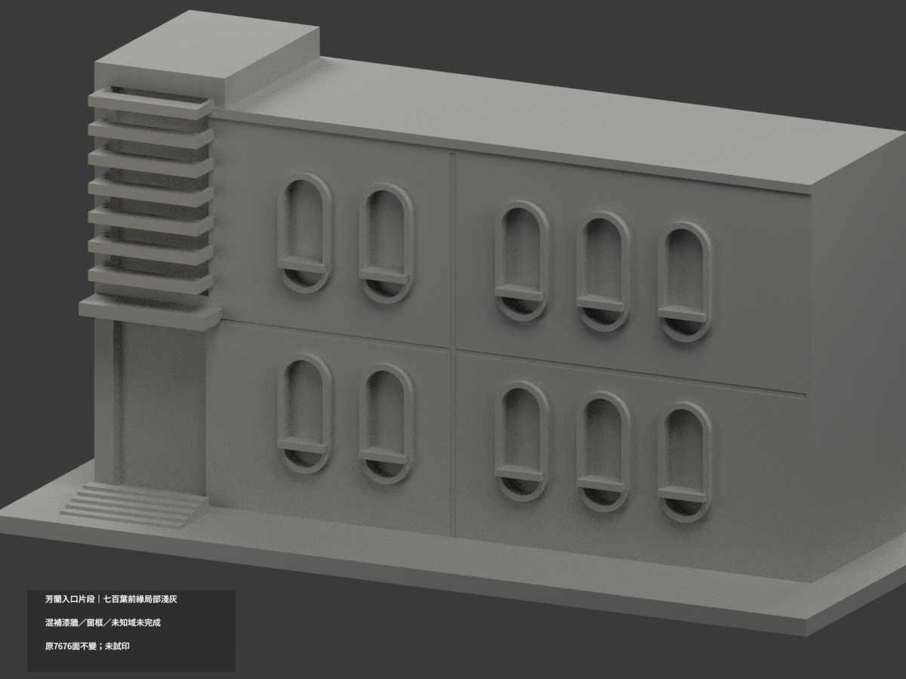
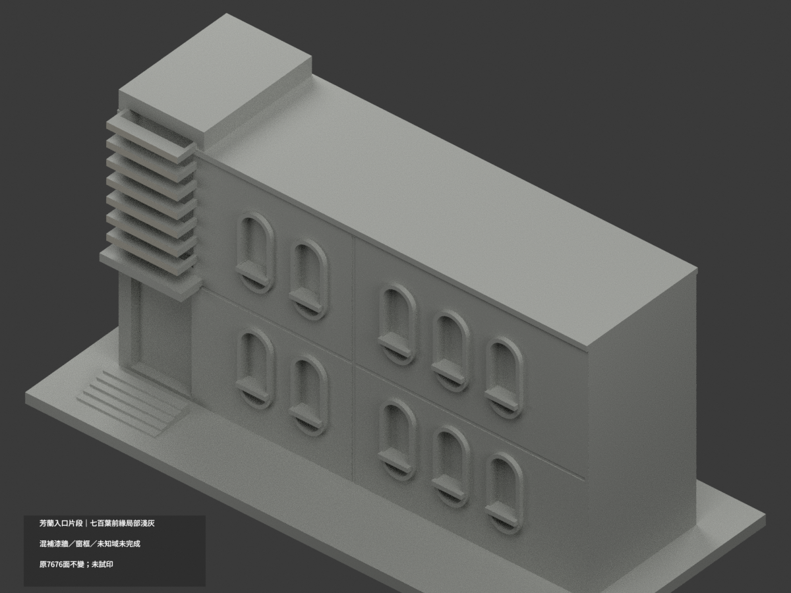

# 芳蘭入口片段｜七百葉前緣局部淺暖灰

**混補漆牆、窗框及未知域未完成分色。** `partial_color_incomplete=true`、`fully_colored_exterior=false`。原入口加五個可見窗 bay 的片段，不是芳蘭全棟；只14面局部補色。

| 總覽 | 背側 | 正面 |
|---|---|---|
||||
||||
||||
||||

## 材色範圍
同 `ntue-fanglan-entrance` 原項目，same-item、count_delta=0。**7676原三角面、STL與build_model.py字節不變**。不切面、不新增金字或遮蔽餘棟。原公開包沒有OBJ，不因code可輸出而假稱保留。
- 七百葉完整前緣 y−20.5、x−64..−44，各z41/46/51/56/61/66/71起厚1.8，共7×2＝14原面淺暖灰。
- 全三頂點符合有限plane與矩形界限，保Boolean裁切；不用中心點／normal門檻。1287共面連通域均一，0撤色。
- 其餘7662中性：百葉上下端背、層間暗處、全主牆混灰／下部補漆、金字側牆、膠囊窗圈與窗背混框反光、入口雨庇／門、地坡、屋頂與未知截面。
- 實景百葉前緣是淺色；間隙陰影不能當成深灰塗料。原厚片間隙保留自然光影，不把實面染黑。
- 色／中性邊界只是證據範圍，不是真實材接縫。原近似窗圈、材分界與量體不因補色追認為精測。

## 來源／日期與權利
只親看校方PDF物理頁91兩張建築外觀，不使用內部平面或安全資料。拍攝日期未知，報告／填表年不是拍攝日，不聲稱2026現況。
原照／PDF私人保存，不公開、不貼圖；未確認CC或再散布授權，不保證商用。HEX僅名義淺暖灰族，不是校準色票。正式GO覆蓋先期review-only文字，但不免除builder QA。

## 格式與列印
[原STL](model.stl) · [逐面材色3MF](appearance.3mf) · [Blender](scene.blend)
原150×69mm展示底座，照片近似非實測比例。STL無色；3MF／Blender有真逐面材。兩材標籤不是驗證兩色／四色耗材切片，**未實際列印**，無切片路徑。

## 重建與 QA
原 `build_model.py` → `colorize_model.py` → `export_appearance.py` → `validate_color.py`；Blender `render_color.py`／`verify_color_scene.py`。
完整隔離原build＋color重建、原bytes／全三角multiset、閉合正體積、3MF面材、scene重開、十圖1200×900及圖文hash核對。程序不代替人工來源核對。
原README／previews／validation／render保留歷程，不冒充新QA；沒有刪檔。

## English scope
Partial entrance fragment and five visible window bays,not the entire Fanglan building.14 original seven louver leading faces lightwarmgray;7662 otherfacesneutral. Original7676 triangles unchanged;no originalOBJ. Dark interlayer shadows are not darkpaint on leadingfaces. Captureunknown;report/formyear notcamera date. Not testprinted or validatedfilament slicing;original approximategeometry not newlycertified.

## 版本 2 名稱勘誤

3MF 與 Blender 物件顯示名稱統一更正為「NTUE Fanglan Entrance partial color」，並同步匯出、渲染與驗證程式的名稱。場景重新開啟與保存後，除物件名稱及非渲染執行期記錄外，網格、材質、變換、相機、燈光與字幕語義完全相同；場景檔案雜湊因此更新。原 STL、材色陣列與十張預覽位元不變，未重新渲染。原有局部補色及未試印限制不變。
