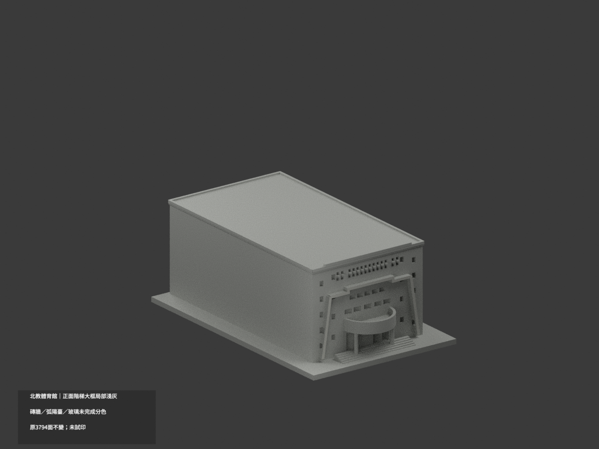
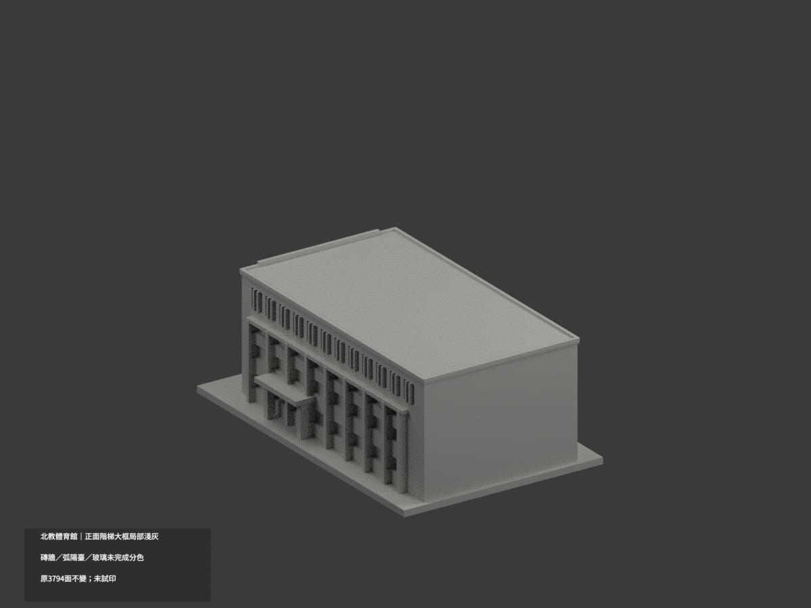
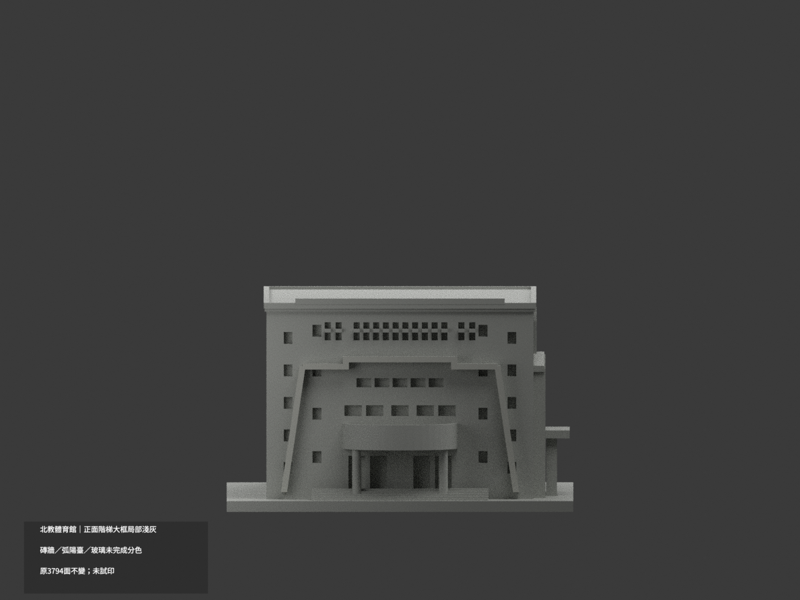
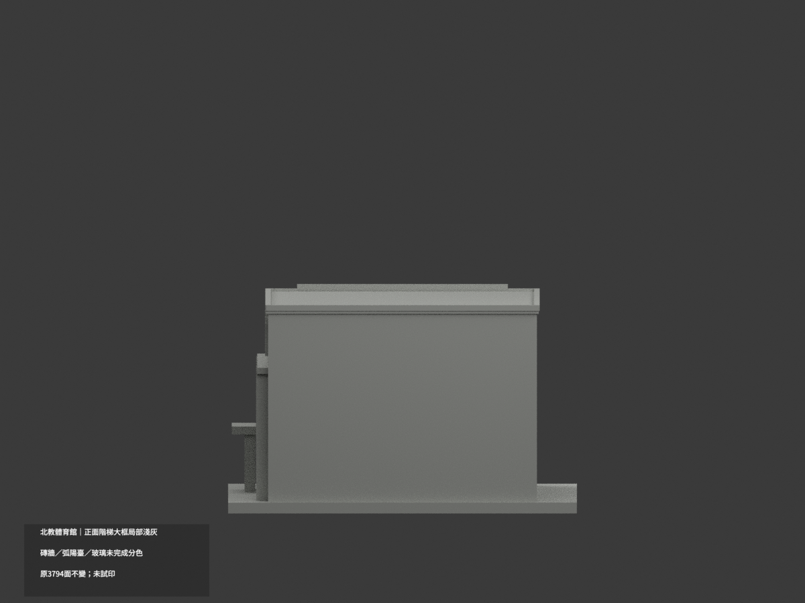
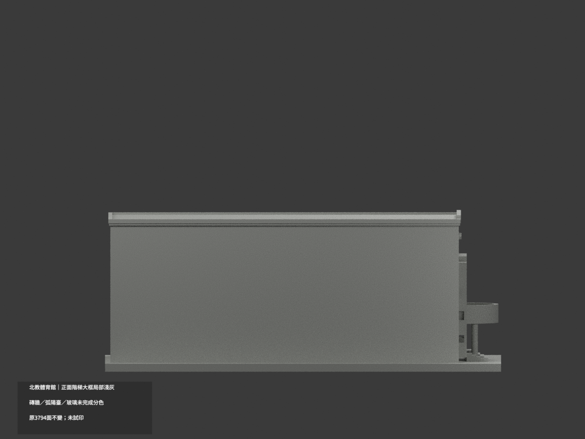
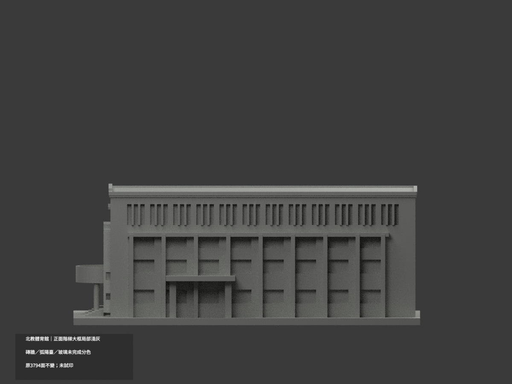
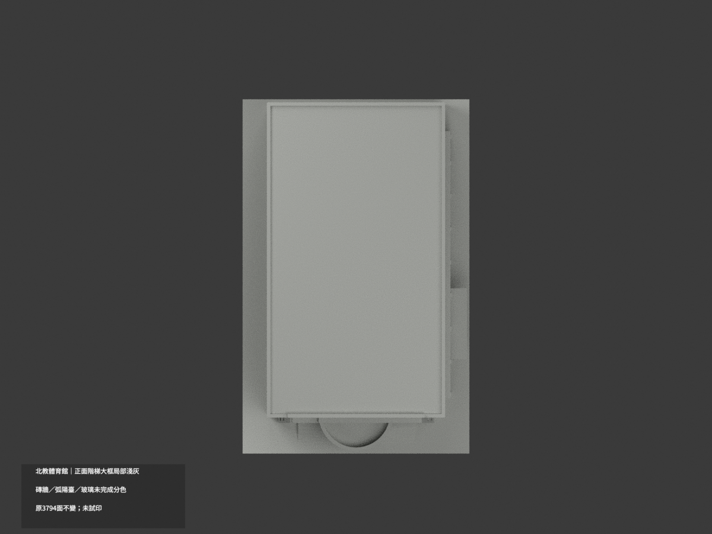
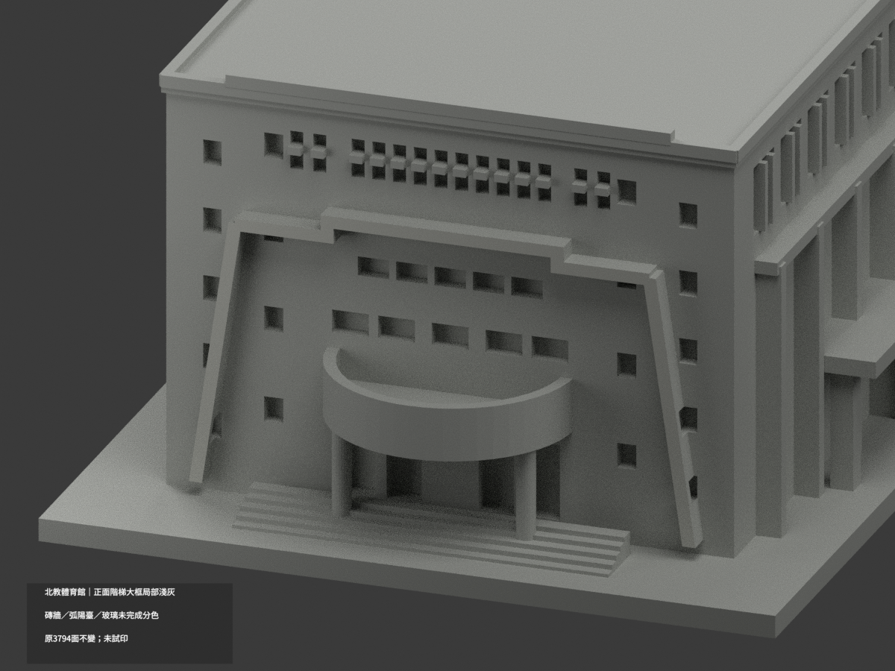
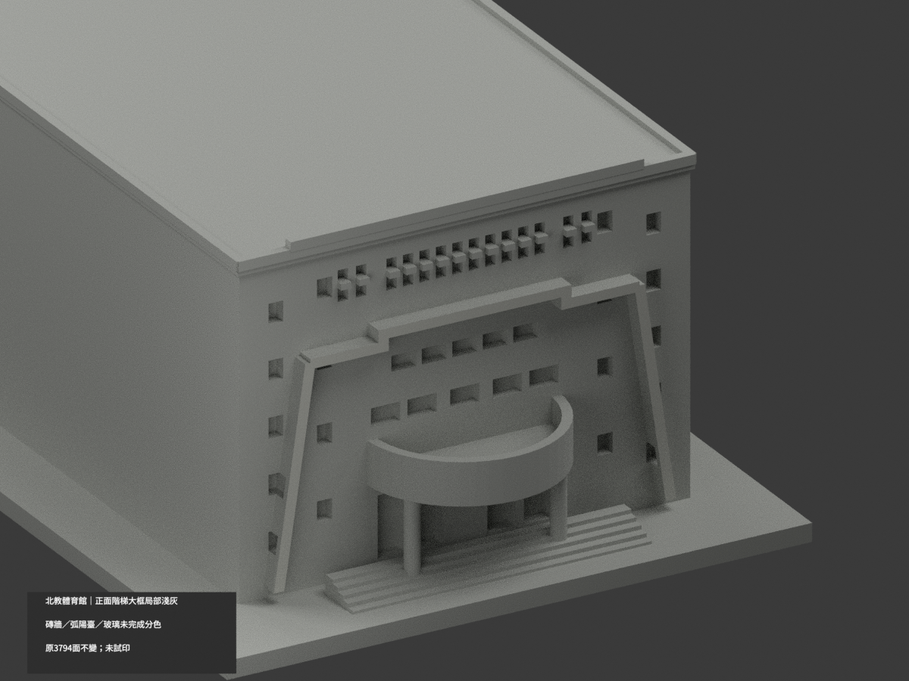
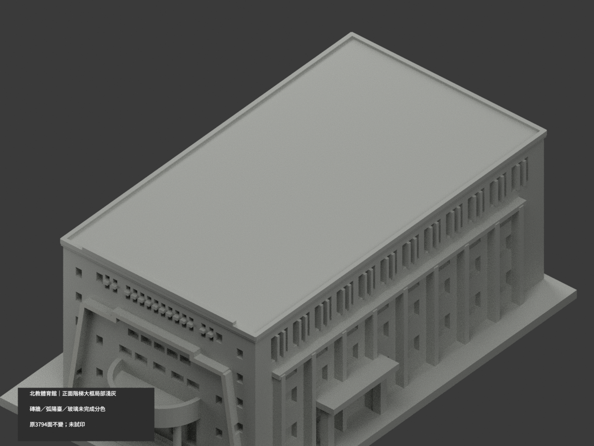

# 北教體育館｜正面階梯大框局部淺灰

**磚牆、弧陽臺、玻璃及未知域未完成分色。** `partial_color_incomplete=true`、`fully_colored_exterior=false`。只原正面框前皮局部補色，不是全棟完成。

| 總覽 | 背側 | 正面 |
|---|---|---|
||||
||||
||||
||||

## 材色範圍
同 `ntue-gym` 原項目，same-item、count_delta=0。**3794原三角面、STL與build_model.py字節不變**。不切面，不改框形或新增金字。原公開包沒有OBJ，不因code可輸出而假稱保留。
- y−66、x−33..33、z5..42.6 內原獨立階梯大框完整前面28面淺灰，包含兩斜邊、肩部、短豎段與中央帽經原Boolean生成的全部碎片，不填滿框內空域。
- 全三頂點符合有限plane及原範圍，不採中心點／normal門檻。全929共面連通域均一，0撤色。
- 其餘3766中性：框厚度／側返／背、主磚牆與文字、弧陽臺上磚下灰混材、入口柱／玻璃、長側框及磚帶、屋頂背面、階地底座。
- 色／中性邊界是來源使用範圍，不是真實材接縫。原近似比例與浮凸框、窗孔、弧台不因補色追認為精測；不納鄰棟。

## 來源／日期與權利
只親看校方PDF物理頁48兩張建築外觀照片，不使用內部平面或安全資料。拍攝日期未知，報告／填表日期不是拍攝日，不聲稱2026現況。
原照／PDF私人保存，不公開、不貼圖；未確認CC或再散布授權，不保證商用。HEX只名義淺灰族不是校準色票。正式GO覆蓋先期review-only文字，但不免除builder QA。

## 格式與列印
[原STL](model.stl) · [逐面材色3MF](appearance.3mf) · [Blender](scene.blend)
原96×150mm展示底座，照片近似非實測比例。STL無色；3MF／Blender有真逐面材。兩材標籤不是驗證兩色／四色耗材切片，**未實際列印**，無切片路徑。

## 重建與 QA
原 `build_model.py` → `colorize_model.py` → `export_appearance.py` → `validate_color.py`；Blender `render_color.py`／`verify_color_scene.py`。
完整隔離原build＋color重建、原bytes／全三角multiset、閉合正體積、3MF面材、scene重開、十圖1200×900及圖文hash核對。程序不代替人工來源審核。
原README／previews／validation／render保留歷程，不冒充新QA；沒有刪檔。

## English scope
Partial original stepped frame frontplane only:28 faces lightgray,including sloping edges and Boolean fragments.3766 otherfaces neutral. Original3794 triangles unchanged;no originalOBJ. Same slug/count_delta=0. Unknown photo capturedate;report/formyear notcaptureproof. Not testprinted or validatedfilament slicing. Approximate original geometry not newlycertified;no neighboringbuilding added.

## 版本 2 名稱勘誤

3MF 與 Blender 物件顯示名稱統一更正為「NTUE Gym partial color」，並同步匯出、渲染與驗證程式的名稱。場景重新開啟與保存後，除物件名稱及非渲染執行期記錄外，網格、材質、變換、相機、燈光與字幕語義完全相同；場景檔案雜湊因此更新。原 STL、材色陣列與十張預覽位元不變，未重新渲染。原有局部補色及未試印限制不變。
