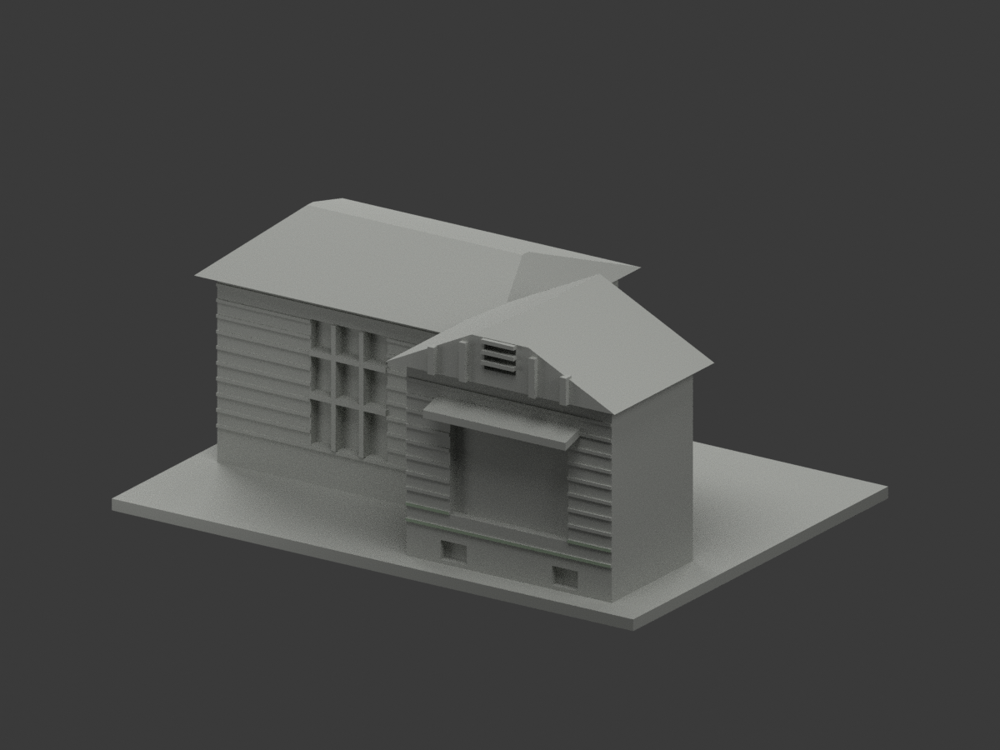
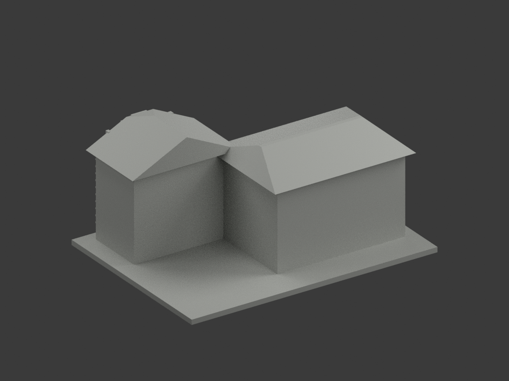
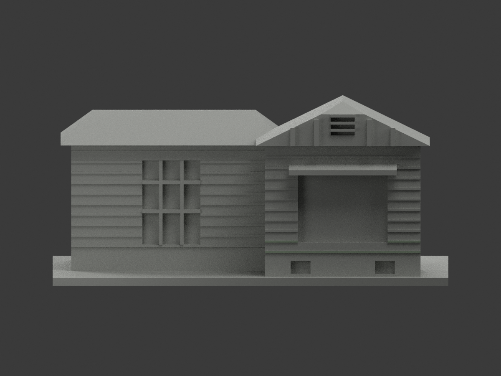
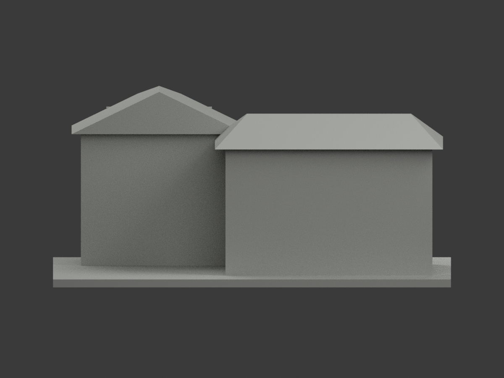
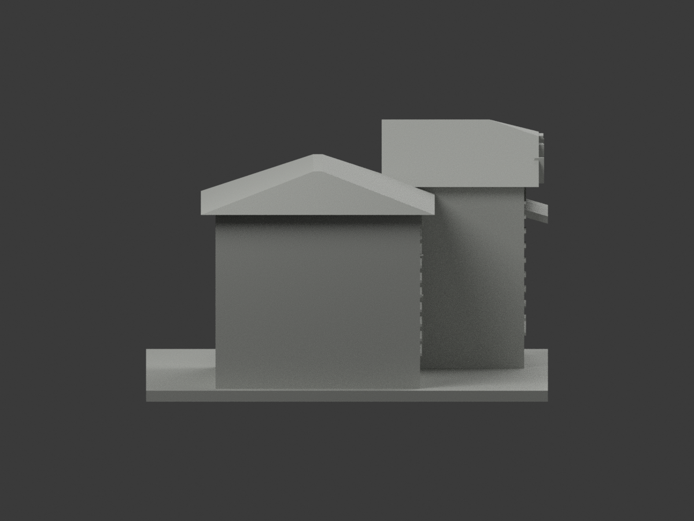
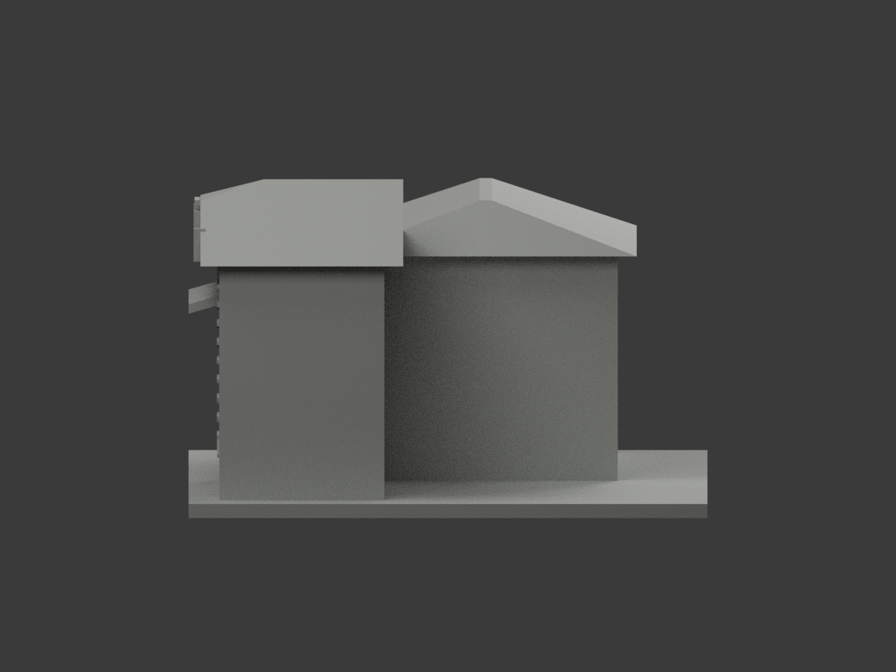
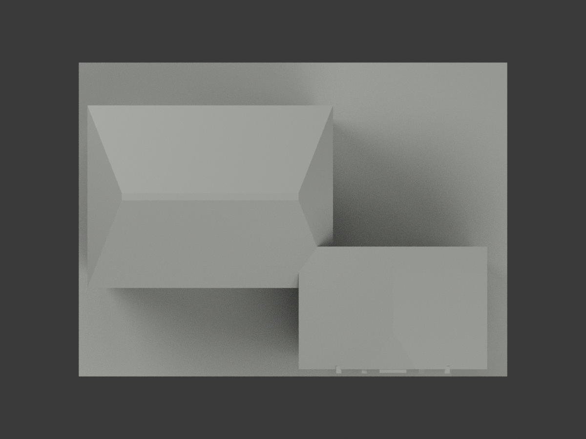
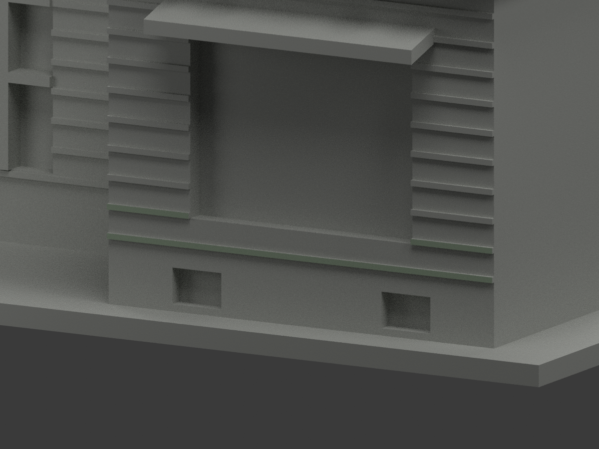
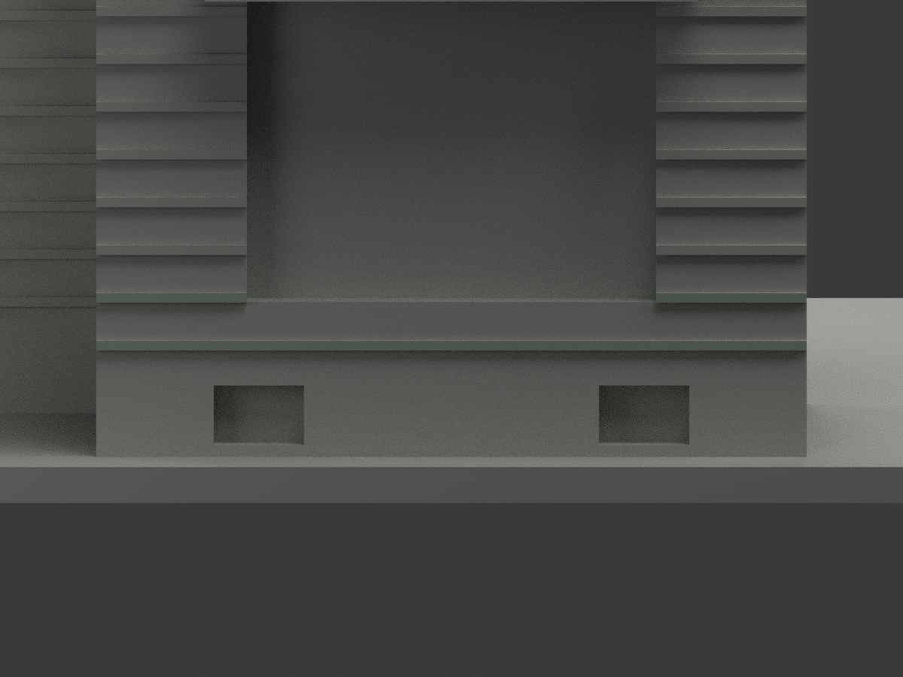
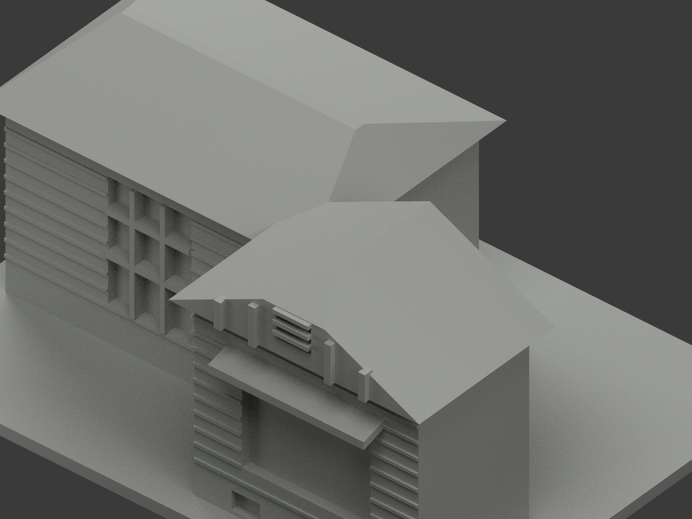

# 北教大舊警衛室2024可見外觀段｜窗臺旁兩短板有限補色

本次只新增4原面[368,371,374,377]，主窗最低窗臺旁左右兩短前板，y=-49、z16..16.8、x5.5..18及52..64.5，共2完整連通共面域。沿原淡綠index0 #A7B8A2，原palette名稱（lowest）為歷史名保留，不改兩材內容。原2面保留→6配色、1218中性、1224原三角；其餘材索引、STL/build（原公開包無OBJ，不新增或虛稱保留）與工程aliases不動。

來源是茱莉2024-09-12公開遊記的原照片重新檢視，非官方照片、不是新角度。原兩圖hash皆精確吻合。主窗臺兩側下段可辨淡綠，位在不規則上方漆木分界之下，以原窗底作粗對位而非任意以顏色高度切三角。原誇張板距/數量與厚度未測量，本次不聲稱對應精確單塊實木板；僅有限下窗臺區域同色族。名義HEX未校準，老化斑駁不均質性未另建圖紋。

保留2024可見外觀版本，發表日期非獨驗拍攝日，不混2016/2020舊照或2026修復現況。官方文資與修復計畫只核身分/進程，不能當完工照片。原35mm後截為人工範圍、不是全屋深度。高板、主連續牆、木漆混界、所有頂底返側、紅窗、鐵欄背板、屋瓦苔蘚、基地/灰腳與前景圍牆紅門皆不新增。

52原件逐Git blob核。原工程/列印限制照留，不因局部材色QA重新認證幾何或多料切片。照片與裁切私人保存、不公開或作貼圖。來源QA是固定pending-final階段快照，最終獨審另檔；以下原2面/高板未知文字屬歷史範圍，僅上述4面例外。

## 原版說明與限制

# 北教歷史警衛室片段｜最低木板局部褪淺綠

**局部補色未完成：只有大窗下最低獨立橫板前面2原三角褪淺綠；混漆牆窗與屋瓦未完成／非全色。** `partial_color_incomplete=true`、`fully_colored_exterior=false`。同項 `ntue-historic-guardhouse-2024-segment`／`count_delta=0`。臺北校區；只2024文章可見投出木構山牆與退後左翼片段，不是2026修復後或完整現況。文章年非拍攝日。

| 前斜視 | 後斜視 | 正面 |
|---|---|---|
|  |  |  |
|  |  |  |
|  |  |  |
|  | | |

## 材色範圍

只有y−49、x5.5..64.5、z12..12.8最低獨立木板完整前面，所有三頂點有限plane/bounds核，2面褪淺綠、1222中性。全共面連通域一致，不按面心/任意高度剪主牆或新增面，不因上板局部有綠漆就染樹遮或剝落區。原粗木板數目/比例非精準實測。

全連續木牆跨上裸木與下漆界中性；其他較高板面、返面、背/側截斷都中性。左窗粗分格混上灰框/老木與下紅框，不整紅；大窗背缺鐵花細界不染。苔瓦/風化、山牆填板/托架/閣窗、加設鐵皮罩、基座/通風洞背/地台全中性。中性色不是實景灰證明，資料範圍不是實材接縫。

原1224三角、STL/build字節不變。後35model-mm人工截斷是近似，不是量得深度；不補暗後室/完整基地/地下基礎，不納19號圍牆紅門/周邊雨棚，不是134號現役校門警衛空間。保留原削山牆、短屋、窗/樓板近似與省略細鐵花；不復原1926原貌或後續修復。

## 來源、日期與權利

親看2024文章的正面照片與合照，最低大窗下木板全寬可見淺綠，色族近似而非色票測量。獨立拍攝日未知；文章年不是攝影年，規劃核准不是工程完工。不稱2026修復後現況。URL沿原sources.json，照片hash與獨審見COLOR-SOURCE-REGISTER；原影像只私人保存，不公開/貼圖，未見CC不推商用。

## 檔案與 QA

原STL/build字節及1224三角不改。appearance.3mf兩展示材、scene.blend真面材、color-mesh.npz同原三角。Immutable原包無OBJ；原程式匯出OBJ僅private隔離重建保存，不冒原件存在。原README.md保留ORIGINAL-MONOCHROME-README.md，原無README.zh-TW.md；舊previews/QA保單色歷程，非此次色QA。

原requirements隔離build+colorize、3MF三角/面材/封閉正體積、Blender重開與10張1200×900綁定驗證；shapely2.1.2私有target不改共享。重建目錄保留。未實際列印，兩展示材不是已驗四色切片；原細件/支撐另核。

## English limitations

Very limited partial:only the lowest complete independent clapboard front y=-49,x5.5..64.5,z12..12.8,2faded palegreen triangles;1222neutral. All vertices finite-plane tested,whole coplanar components uniform,original1224triangles/STL/build unchanged,count_delta0. Main mixed timber/paint wall,higher boards,windows,mossy roof,plinth and cutoffs neutral. Original2024article-visible projecting bay/setback wing only;intentional rear35mm cutoff is not measured depth. Excludes full rear/site,19-address boundary/red gate and134-address active security space. No1926reconstruction or2026restored-current claim. Publication2024 not capture date. NoimmutableOBJ;build-generatedOBJ privately retained only. Private reference photos,no textures/rights inference,not testprinted or validated multicolor slicing.
