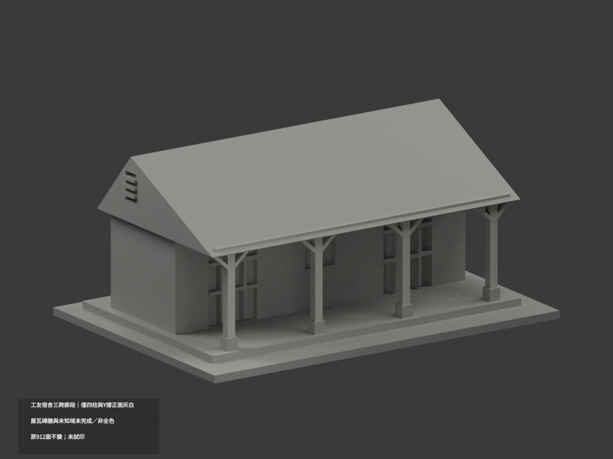
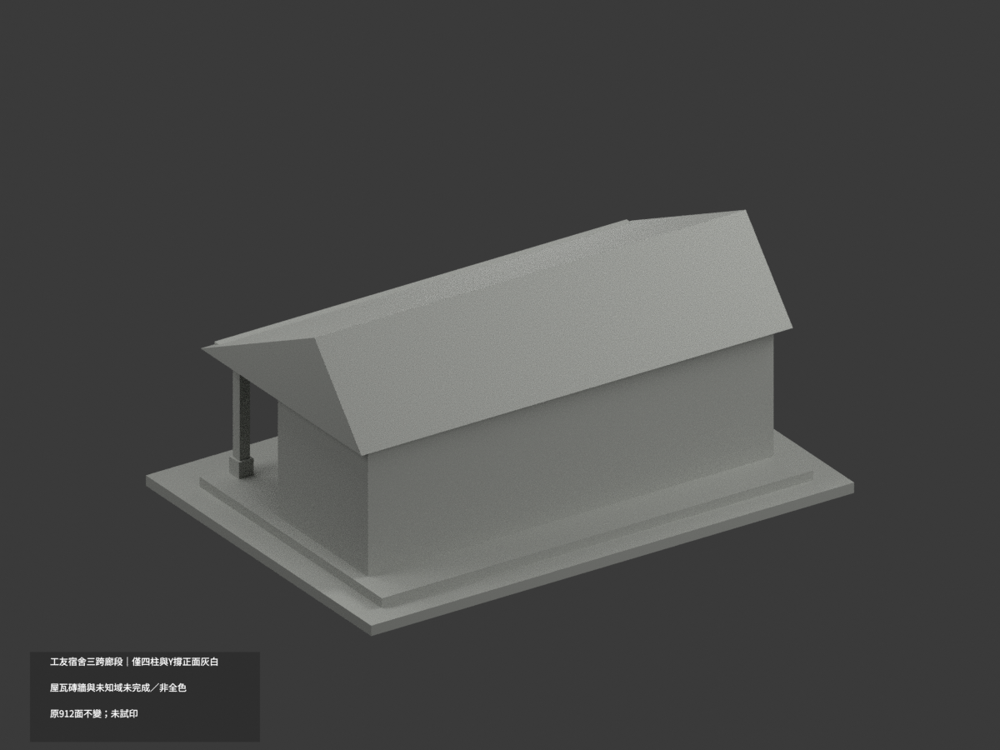
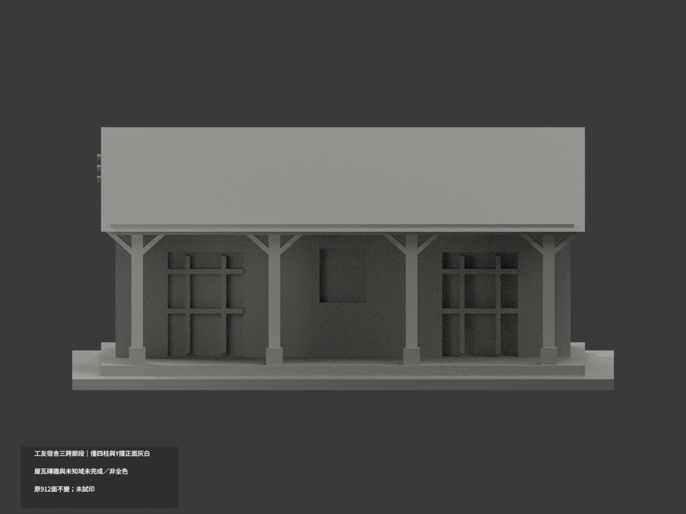
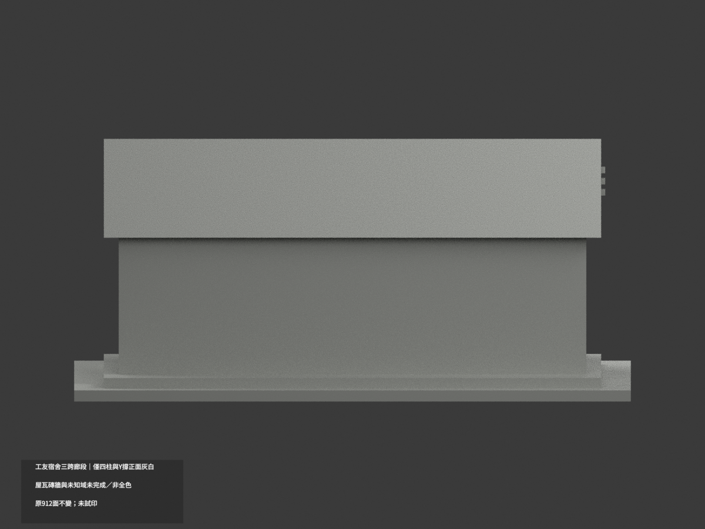
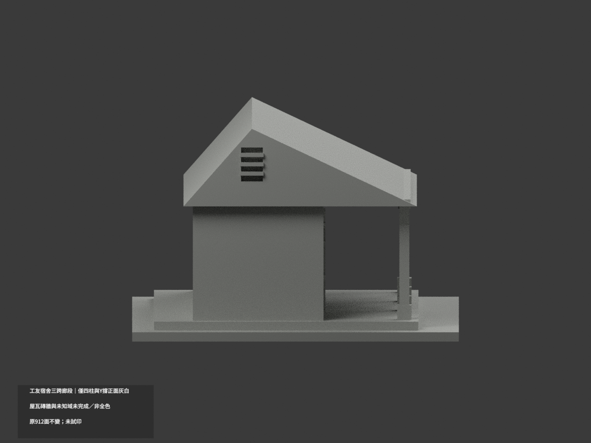
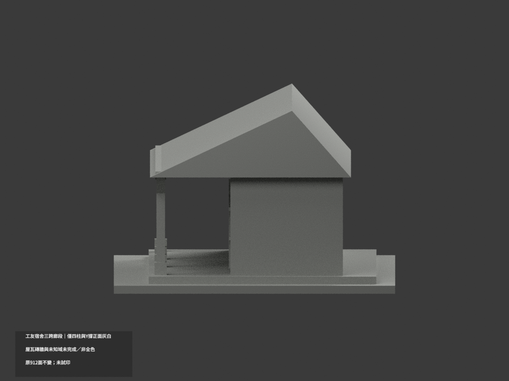
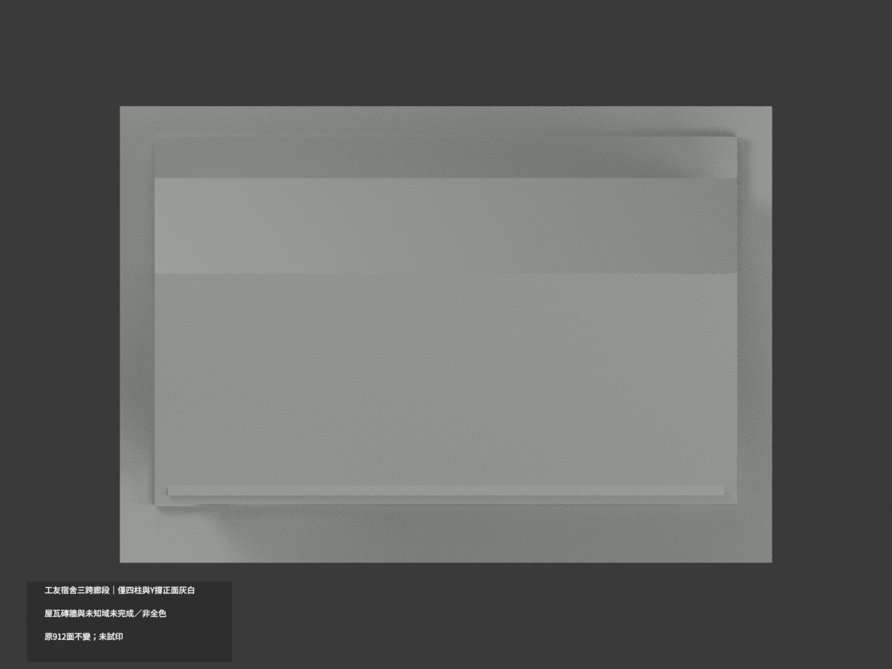
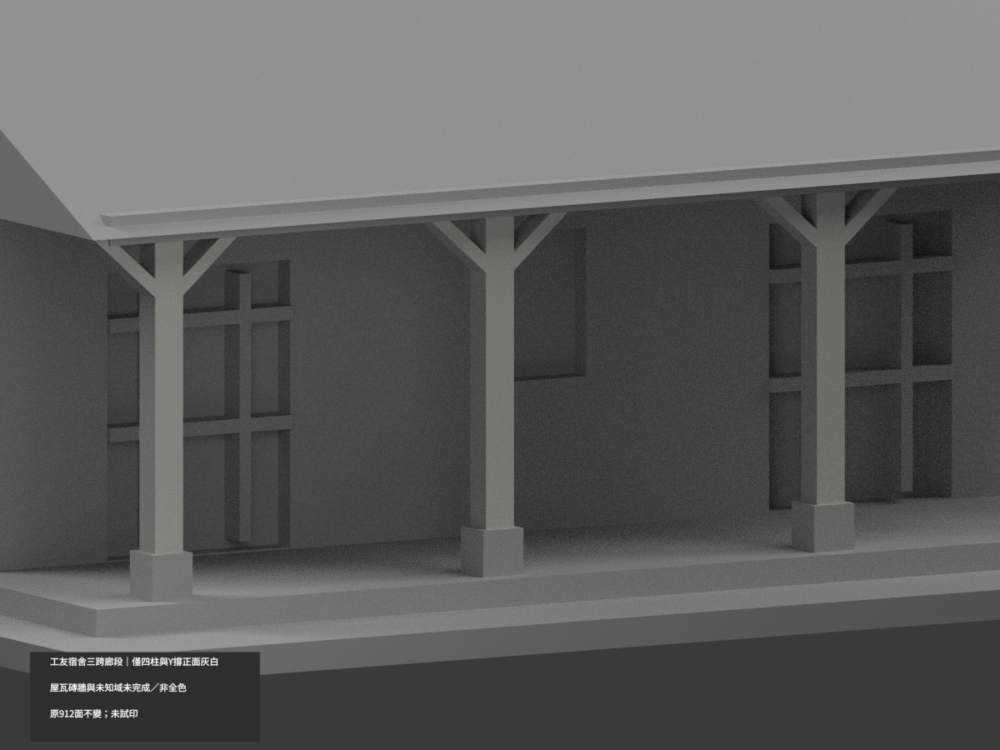
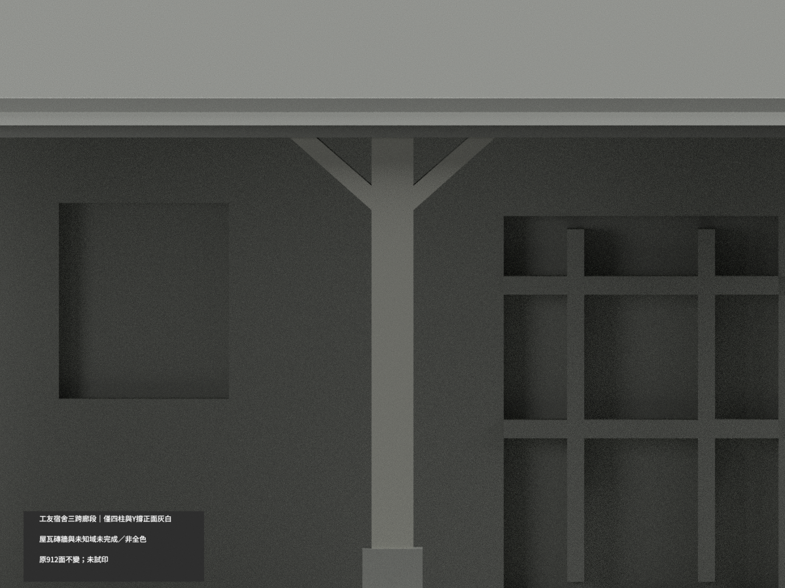
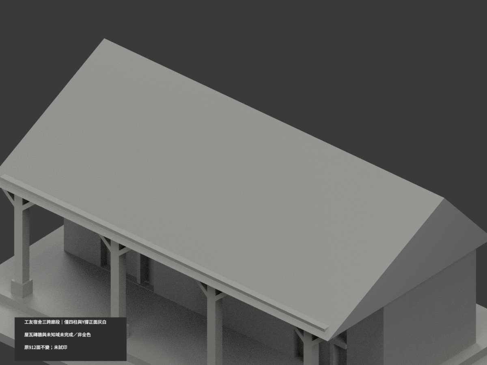

# 舊音樂教室／工友宿舍三跨廊段｜四柱與Y撐局部灰白

**局部補色未完成：只有四柱及Y斜撐真正前面68原三角灰白；屋瓦磚牆與未知域未完成／非全色。** `partial_color_incomplete=true`、`fully_colored_exterior=false`。同項 `ntue-janitor-veranda-segment`／`count_delta=0`，臺北校區。只可見山牆及選定三跨四柱廊段，不是全宿舍或完整柱數。2012／2024異期來源非單日完整現況、非2026修復後。

| 前斜視 | 後斜視 | 正面 |
|---|---|---|
|  |  |  |
|  |  |  |
|  |  |  |
|  | | |

## 材色範圍

四個完整原外露正面域：y−36.6、中心x−57/−19/19/57，各x中心±9、z10.5..43有限界線，外端18／內側16／16／外端18Boolean三角，共68灰白、844中性。每三角全頂點核，不按面心或normal閾值漏細片，不盲套IDs。細柱與Y撐正面共面連通，全部一致，不新增或重切三角。

z10.5是原粗灰腳遮住細柱的物理頂界，內側z42是原前梁遮住柱撐的下界；原梁只至x±64，兩外Y端到x±66/z43仍外露，不能沿z42剪斷同面。完整域勘誤0241已加入4原三角，不改原GO歷史。粗灰腳含頂全中性；柱/撐側背、梁正面/底/側也中性。前梁不同時期深紅褐與剝白漆不整染。磚主牆跨灰基底無材界、瓦坡苔蘚不是綠瓦、玻璃窗背與反光/室內、地板基地皆中性。中性色不是實景灰證明，資料界不是實材接縫。

原912三角、STL/build字節不變。原截斷/長度近似、樹遮開口、省略背窗保留，不補精確木接頭或磚紋；不含獨立廁所/禮堂、樹木/設備箱/販賣機，不把補色追認為現況測繪或全建物復原。

## 來源、日期與權利

親看三張訪客外觀照片：較早兩照與較晚一照均支持細柱/Y前灰白、分離石腳；其餘差異不硬選材。2012文章記2012-02-04是來源自述，非獨立驗證快門日；2024文章脈絡精確拍攝日未核，兩期不合稱同一日或2026現況。來源hash及獨審見COLOR-SOURCE-REGISTER，URL沿原sources.json。照片只private、不公開貼圖，未見CC不推商用。HEX是名義展示色族非測量色票。

## 檔案與 QA

原STL/build及912三角不改，appearance.3mf兩展示材、scene.blend真面材、color-mesh.npz同原三角。Immutable原包無OBJ；原build生成OBJ只private隔離重建保留，不冒原件存在。原README.md留ORIGINAL-MONOCHROME-README.md；原無README.zh-TW.md。舊previews/QA是單色歷程，非本次色QA。

按精確原requirements隔離build+color，3MF/完整三角/封閉正體積/scene重開、10張1200×900綁定核。shapely2.1.2私有target不改共享；重建保留不刪。未實際列印，兩展示材不是已驗四色切片；原細件與支撐仍另核。

## English limitations

Partial only:four complete original upper-post/Y-brace fronts on y=-36.6,x centers[-57,-19,19,57]±9,z10.5..43,18/16/16/18triangles,68offwhite/844neutral. Original foot-top/beam delimit union faces, but beam ends atx±64 and outerY ends extend to±66/z43. Formal0241correction includes4additional original triangles;initial64face coplanar failure retained privately. No arbitrary paint split. Whole coplanar domains uniform;original912triangles/STL/build unchanged,count_delta0. All feet,sides/backs,beam,brick/base mixed walls,weathered roof,glazing and site neutral. Only selected three-bay veranda/gable segment,not full dormitory/column count or detached toilet/auditorium.2012source-reported date and2024article reference differ;no2026current/restoration claim. Original cutoffs/uncertain lengths/tree-hidden openings unchanged. NoimmutableOBJ;private rebuild may generate it. No public photographs/textures/commercial-rights inference;not testprinted or validated multicolor slicing.
