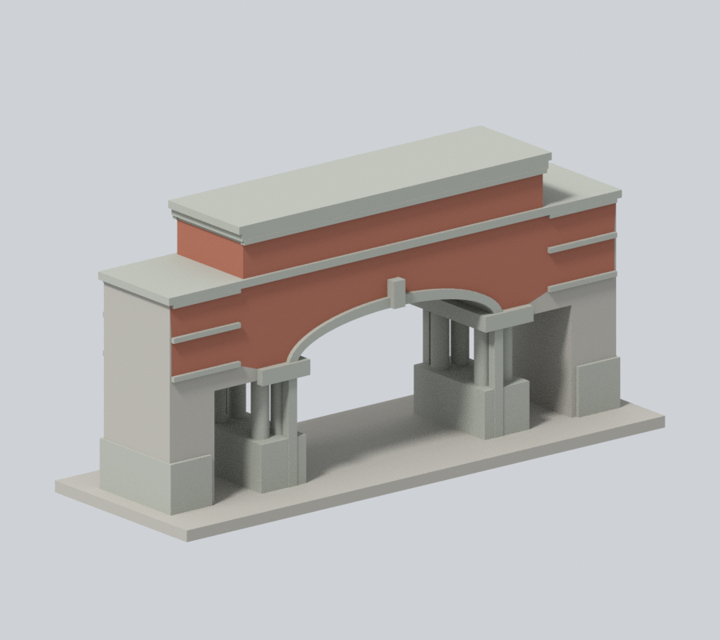
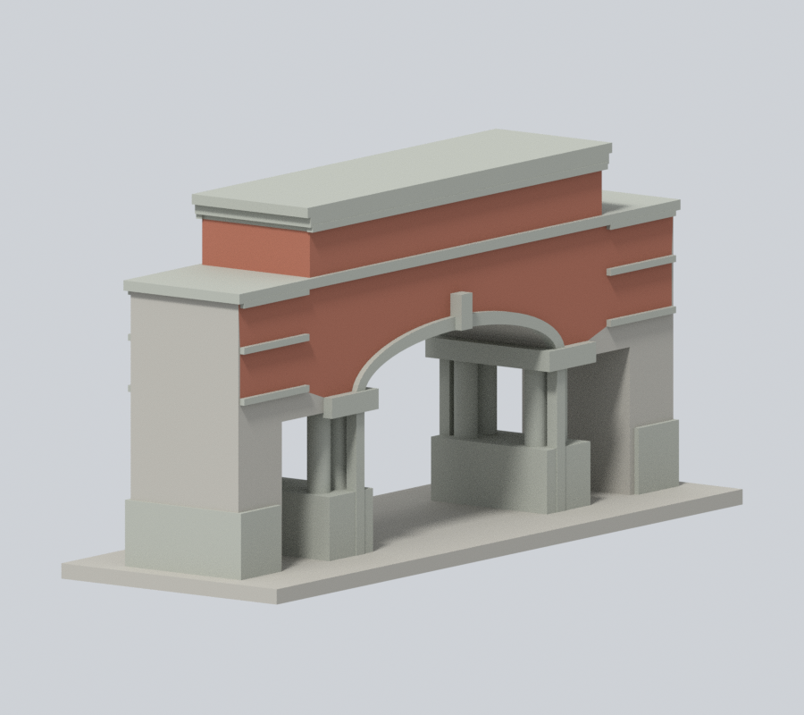
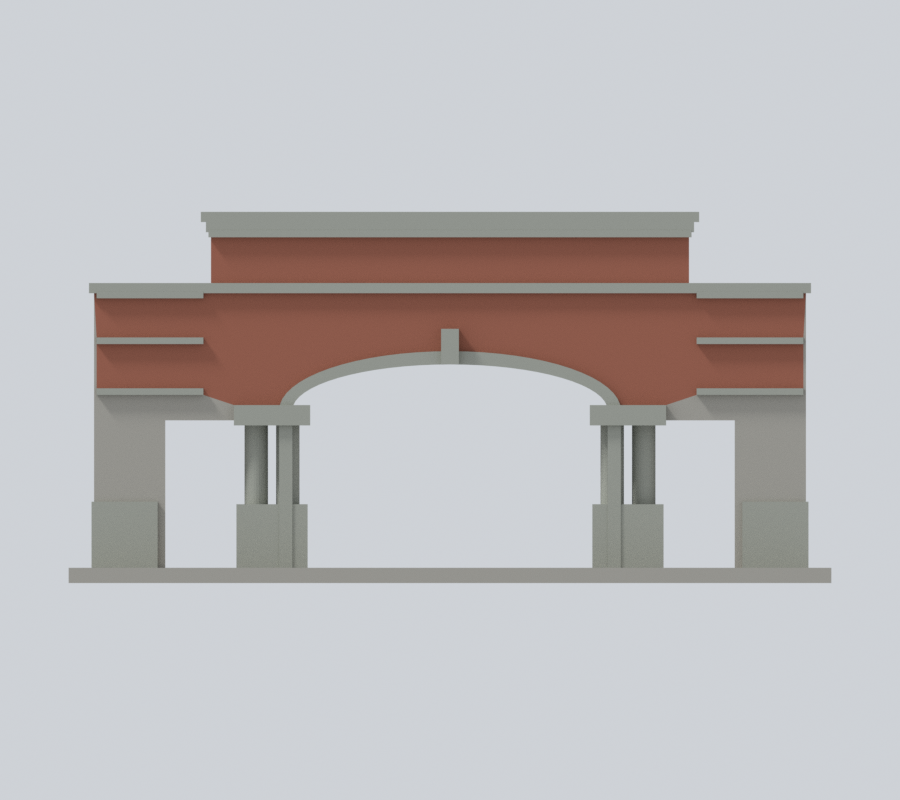
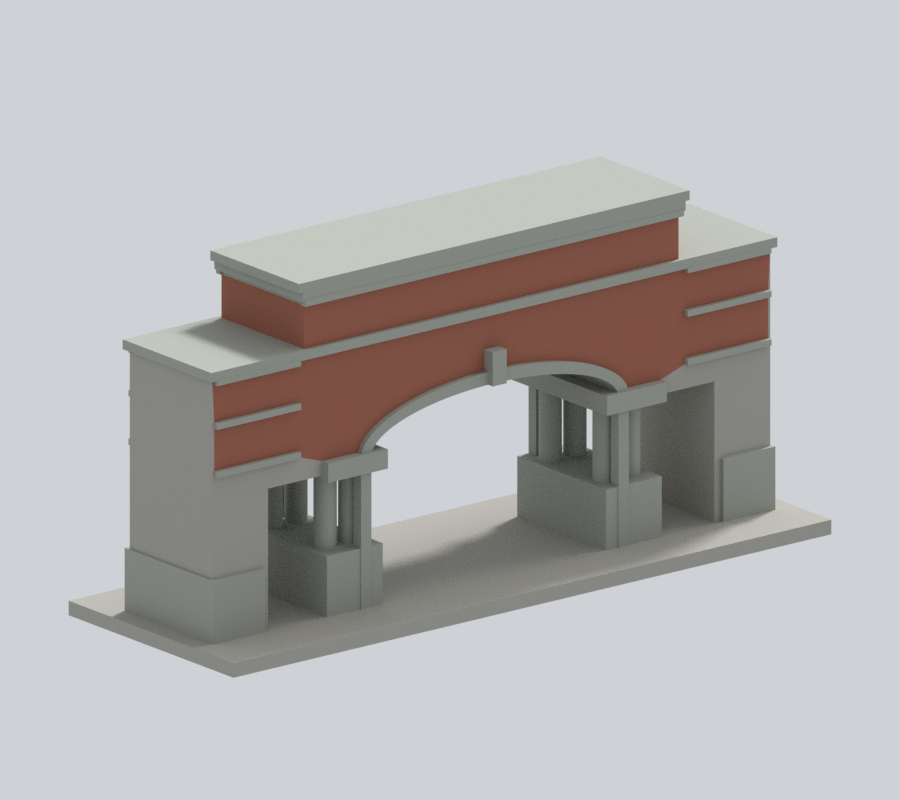
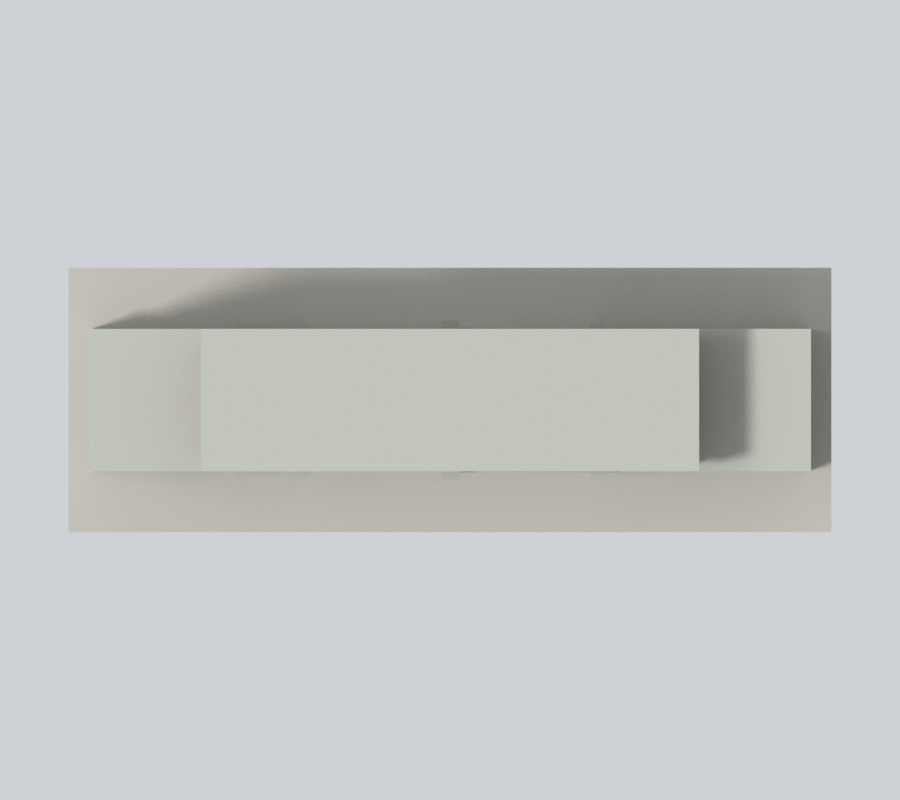

# 國立臺北教育大學｜正門入口段

## 模型預覽

| 新彩色正斜視 | 新彩色來源角度 | 新彩色立面 |
| :---: | :---: | :---: |
|  |  |  |
| 新彩色背向 | 新彩色上視 | 彩色下載 |
|  |  | [彩色3MF](appearance.3mf) · [Blender](appearance.blend) |

臺北校區，自行用Python／實體布林建模，沒有下載第三方3D模型。模型為照片支持的近似，非實測或施工圖。

### 完整原構件返面補色（原 6 張預覽保留）

保留原彩面，再為98個完整原三角面補色：中央高牆8個磚側返、4個灰頂帶側返、54個灰簷頂／底／端面，以及灰拱框32個因float32容差漏分的小面。官方低角、兩張背照及新增遊記低角照片支持材料族；未入鏡頂面與精確側帶延續明列推估。下外牆磚／灰石齒接、門洞米色格狀天花與灰樑、內側磚石混合處沒有原面界，259面仍中性，不以三角中心補出假斜塊。

[左側](appearance/left.png) · [右側](appearance/right.png) · [原版同相機正斜視](appearance-review-v2/original-front.png) · [原版同相機背向](appearance-review-v2/original-rear.png)。七張新版、兩張原版對照均900×800，Cycles CPU 96samples、單執行緒、無降噪。

[來源、範圍與文案勘誤](APPEARANCE.md)。只正門入口段，不含後警衛空間或歷史舊警衛室。原幾何／STL／scene／六張原圖與數位QA不改；未實體試印。

## 來源與界線

以官方低角度、2023年正面及訪客背面照片，自行建立平頂三段高低的門體。中央為較高扁拱車道，兩側人行口為直頂，不做成三個相同半圓拱；保留內側成對圓柱、柱座、柱頭、前後拱框與水平石帶。校名字牆保留主要量體，細字、看板、燈具及交通柵杆省略。原STL三道通口及成對柱間真空隙公開驗證。此件只含照片可辨正門入口門體段與模型底座，不包含其後警衛／收發空間、延伸圍牆或整個校園邊界；和平東路136巷19號的歷史舊警衛室是不同建物，並未混入。門體進深、柱徑及線腳均為列印近似，不是實測。

來源跨不同年代；官方圖片未載拍攝日期，不以網站更新日替代。完整URL及支持特徵見[sources.json](sources.json)。原照片／PDF只留私下核對，不隨公開包散布。

## 模型與重建

- [model.stl](model.stl)：毫米，含底座最長150毫米；每件比例獨立
- [scene.blend](scene.blend)：由交付STL匯入的可編修網格
- [build_model.py](build_model.py)、[requirements.txt](requirements.txt)：python build_model.py
- [render_preview.py](render_preview.py)：blender -b -t 4 -P render_preview.py；圖片皆實際STL

## 列印及數位QA

底座朝下。拱口、頂板、成對圓柱及深門廊需要評估支撐；移除支撐可能傷害薄框、柱或懸掛構件。校名文字、看板及燈具等細節有意省略。沒有實體試印或Cura／Prusa工具路徑驗證，不保證免支撐或保證可印。

[validation.json](validation.json)檢原STL水密、正體積、法向／繞序、每邊兩面、vertex link單環、單一連通表面與無分離內腔殼，尺寸150毫米、重建SHA及Blend一致。[contour-validity-check.json](contour-validity-check.json)以z偏移0.071、每0.2毫米核全部輪廓閉合及Polygon有效，invalid直接失敗，不repair後宣稱成功。[thin-feature-check.json](thin-feature-check.json)使用canonical fail-closed v3的0.8毫米opening輔助篩檢，非完整最小壁厚或切片模擬。

[原STL通口／柱間空隙射線證據](portal-ray-proof.json)與[檢查腳本](check_portal_geometry.py)。原三角形射線不修補mesh；數字全是模型毫米，不能視為現地尺寸。

重跑：python validate_model.py；python check_contour_validity.py；python check_thin_features.py；python check_portal_geometry.py。

原appearance-review保留為前版歷史。本版以appearance-review-v2、appearance-freeze.json及模型SHA256SUMS綁定；校級checksum未改，待授權發布整合。

[逐點逐面驗證](appearance-review-v2/model-verification.json) · [面界審核](appearance-review-v2/boundary-continuity-audit.json) · [來源判讀](appearance-review-v2/source-register.json) · [乾淨重建](appearance-review-v2/clean-rebuild-equality.json)。
