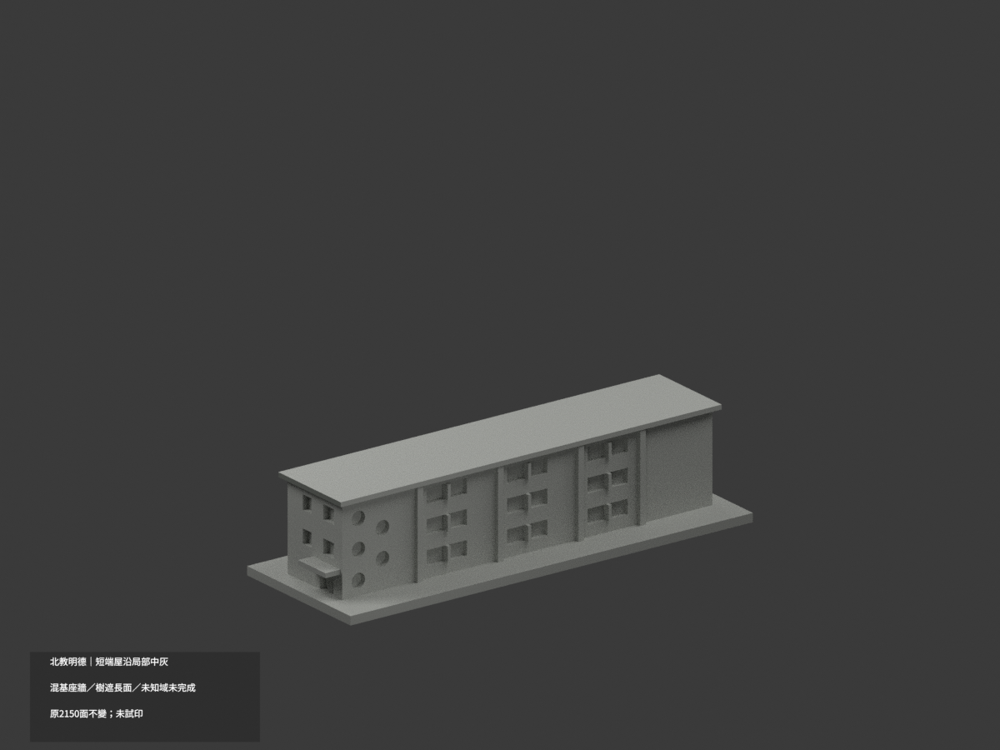
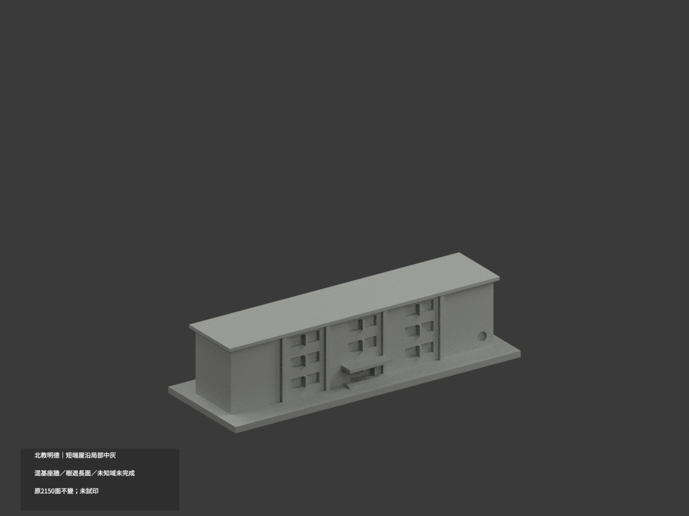
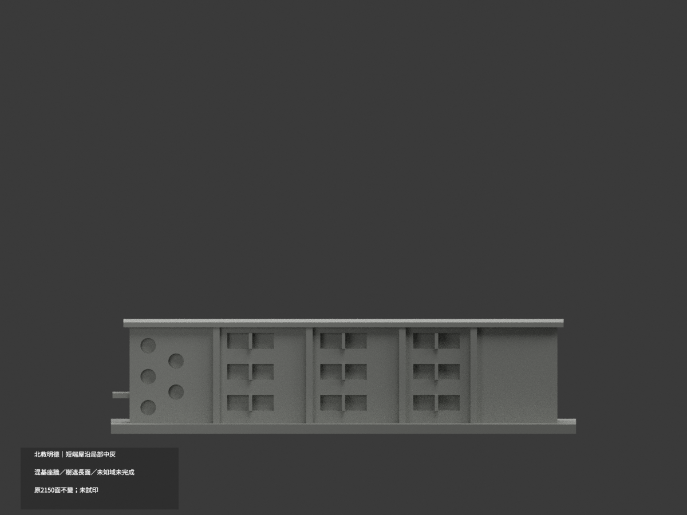
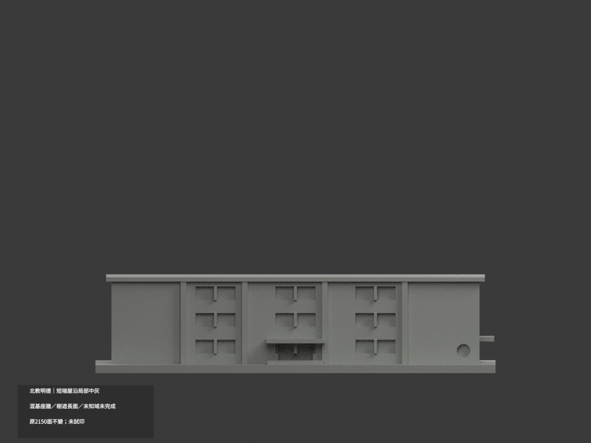
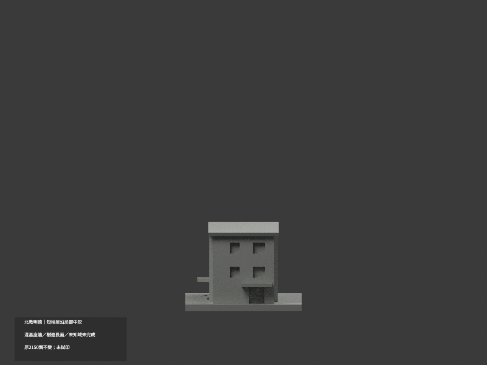
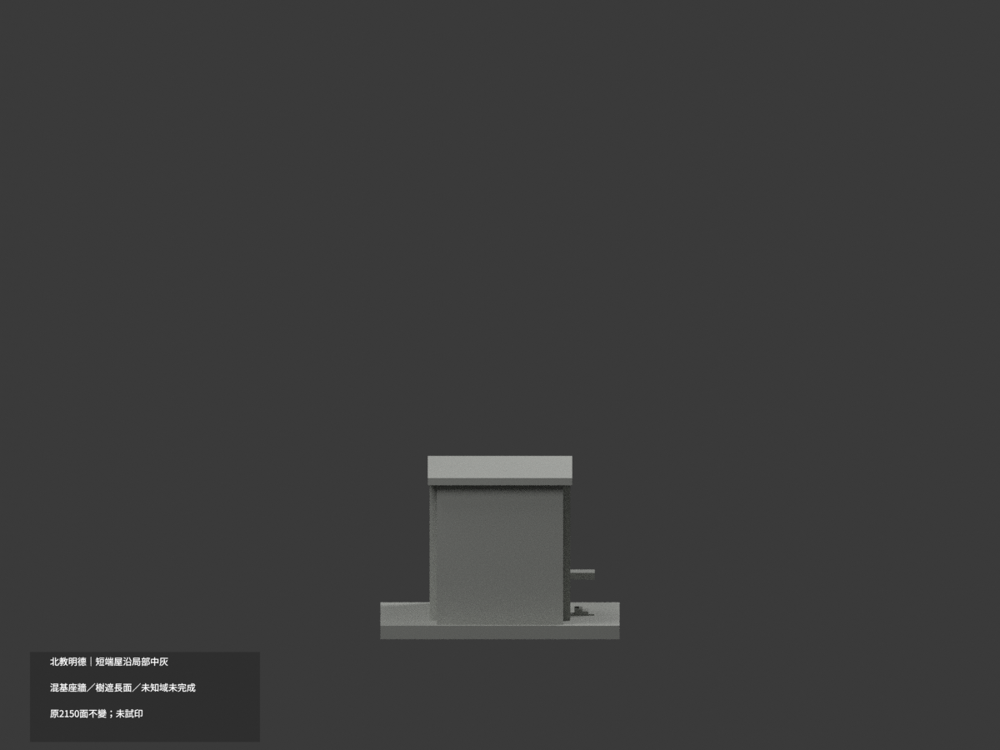
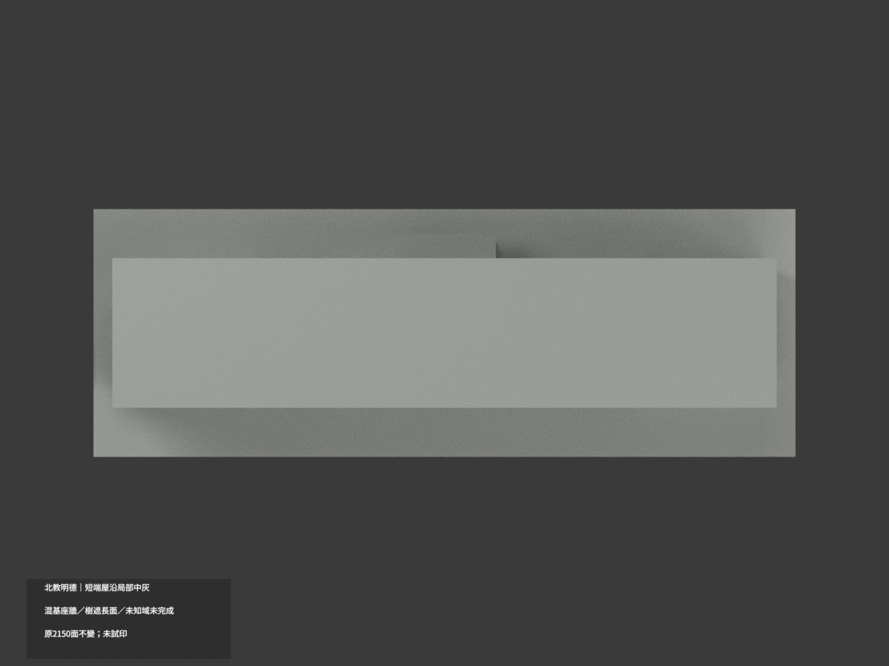
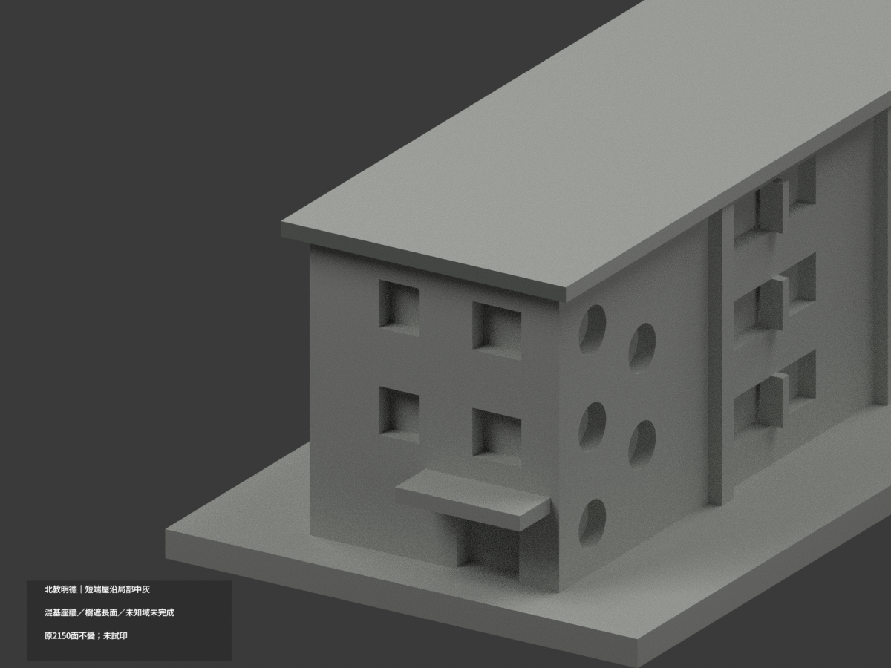
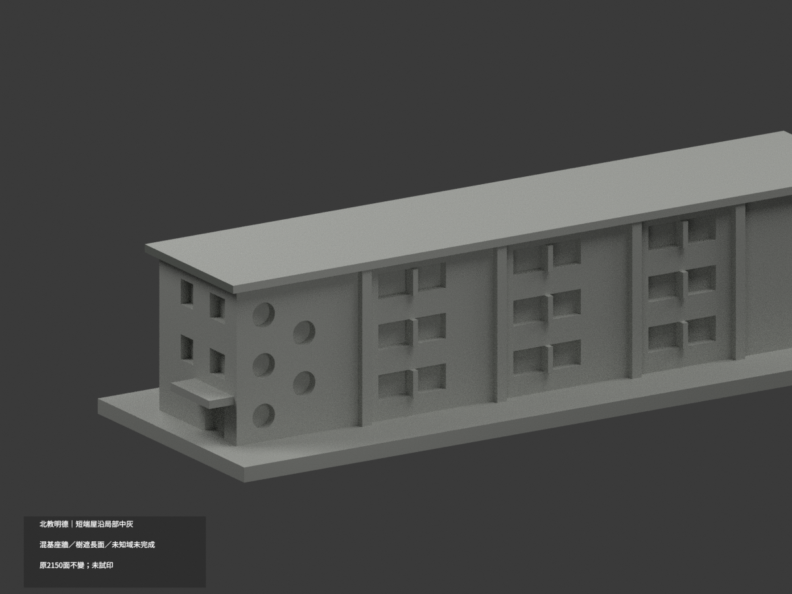
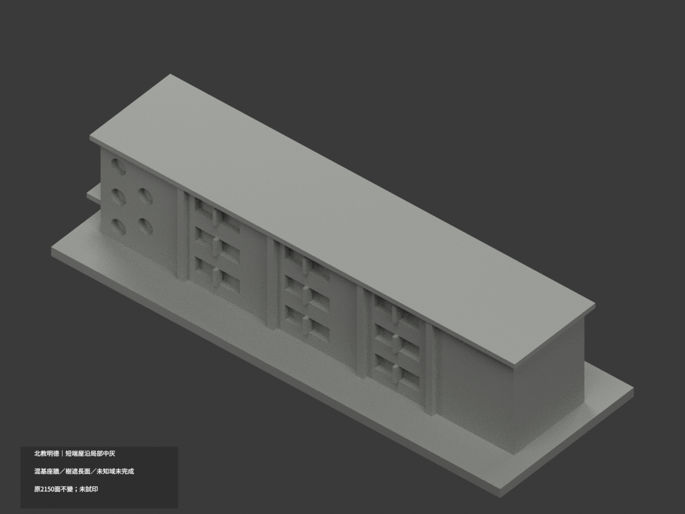

# 北教明德｜短端屋沿局部中灰

**混基座牆、樹遮長面與未知域未完成分色。** `partial_color_incomplete=true`、`fully_colored_exterior=false`。僅兩個原面局部補色，非全棟完成。

| 總覽 | 背側 | 正面 |
|---|---|---|
||||
||||
||||
||||

## 材色範圍
同 `ntue-mingde` 原項目，same-item、count_delta=0。**2150原三角面、STL與build_model.py字節不變**，不切面或加隱蔽窗。原公開包沒有OBJ，不因code會輸出而假稱保留。
- 僅短端屋外沿完整垂直面 x−71、y−16..16、z34..35.6，兩原面名義中灰。全三頂點須符合有限plane與界限，不用中心點／normal門檻。
- 552共面連通域均一，0撤色。其餘2148中性：全高短長牆混上粉磚與下灰基座、凸條跨基座／樹遮段、長屋沿／遠端、屋頂／底、入口雨庇／階、窗背反光框與地面。
- 2022防水記事不證換屋形或屋色，不改原平屋面。保原三層長窄近似、3+2錯列圓窗與另一長面單一低圓窗，不新增遮蔽窗。
- 色／中性邊界是來源範圍，不是真實材接縫；不以補色背書原比例與開口為精測。

## 來源／日期與權利
只親看校方PDF物理頁22兩張建築外觀，不使用內部平面或安全資料。拍攝日期未知；2023-10-25文件日期不是拍攝日，不聲稱2026現況。
原照／PDF私人保存，不公開、不貼圖；未確認CC或再散布授權，不保證商用。HEX僅名義中灰族，不是校準色票。正式GO覆蓋先期review-only文字，但不免除builder QA。

## 格式與列印
[原STL](model.stl) · [逐面材色3MF](appearance.3mf) · [Blender](scene.blend)
原150×53mm展示底座，照片近似非實測比例。STL無色；3MF／Blender有真逐面材。兩材標籤不是驗證兩色／四色耗材切片，**未實際列印**，無切片路徑。

## 重建與 QA
原 `build_model.py` → `colorize_model.py` → `export_appearance.py` → `validate_color.py`；Blender `render_color.py`／`verify_color_scene.py`。
完整隔離原build＋color重建、原bytes／全三角multiset、閉合正體積、3MF面材、scene重開、十圖1200×900及圖文hash核對。程序不代替人工來源核對。
原README／previews／validation／render保留歷程，不冒充新QA；沒有刪檔。

## English scope
Partial only:2 complete short end vertical roof fascia faces mediumgray;2148 otherfacesneutral. Original2150 triangles unchanged;no originalOBJ. Captureunknown;2023documentdate notcamera date.2022waterproofingnote does not establish roofshape/color changes. Original narrow three-storey approximation and staggered circularwindows retained. Not testprinted or validatedfilament slicing.

## 版本 2 名稱勘誤

3MF 與 Blender 物件顯示名稱統一更正為「NTUE Mingde partial color」，並同步匯出、渲染與驗證程式的名稱。場景重新開啟與保存後，除物件名稱及非渲染執行期記錄外，網格、材質、變換、相機、燈光與字幕語義完全相同；場景檔案雜湊因此更新。原 STL、材色陣列與十張預覽位元不變，未重新渲染。原有局部補色及未試印限制不變。
