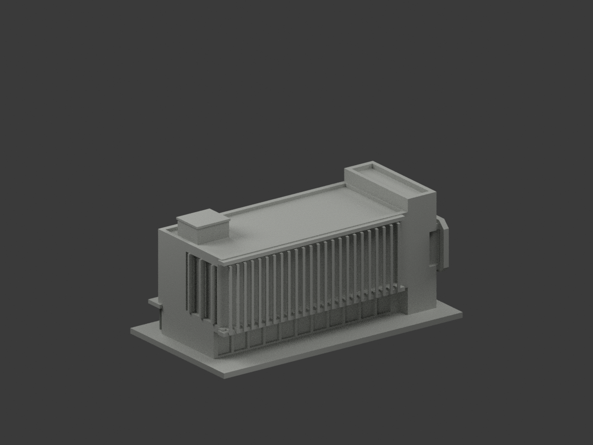
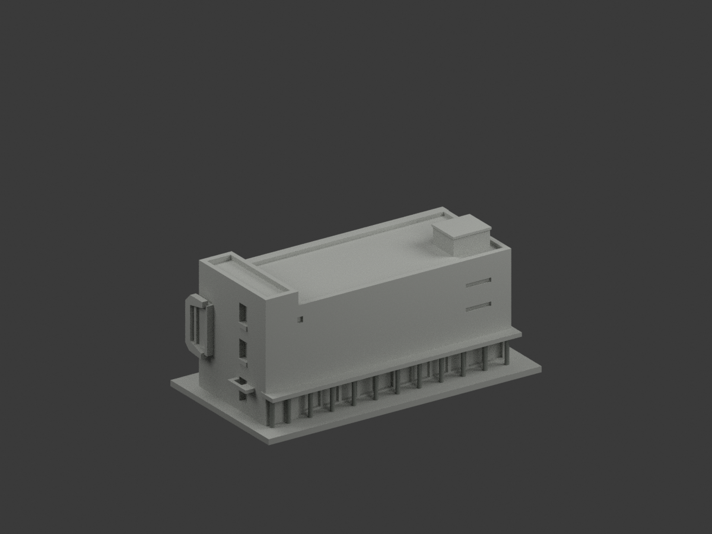
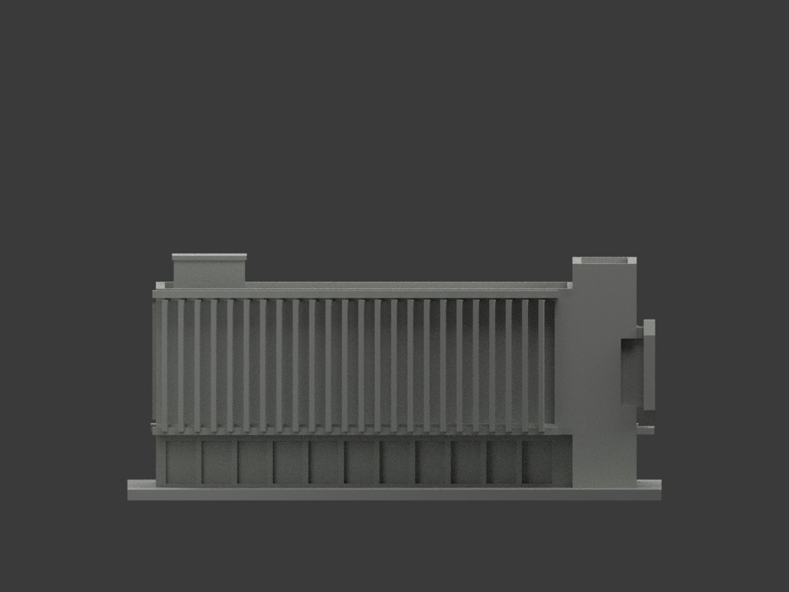
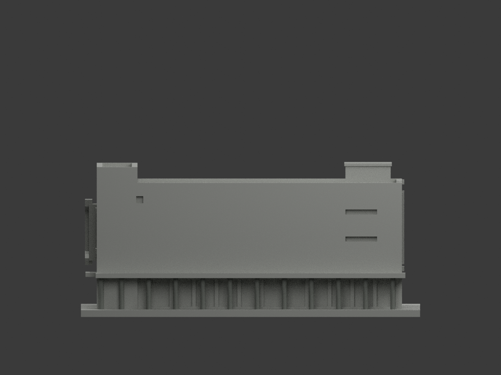
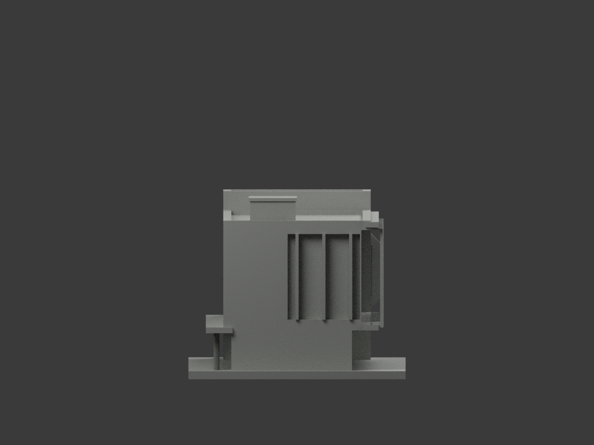
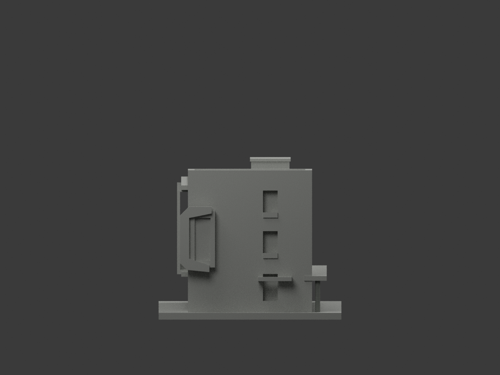
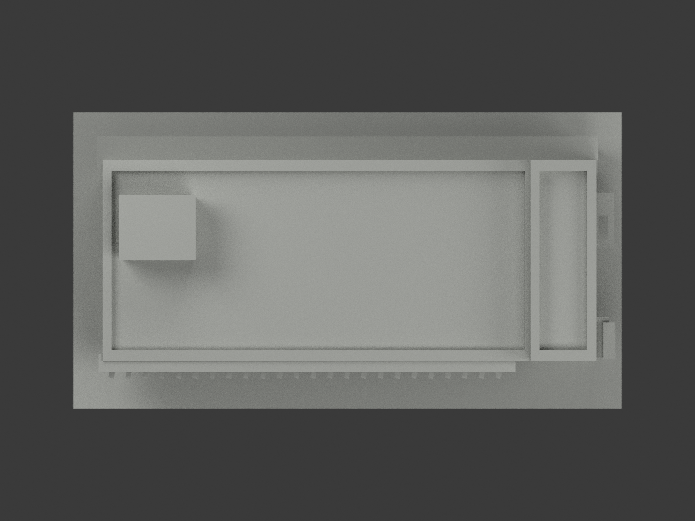
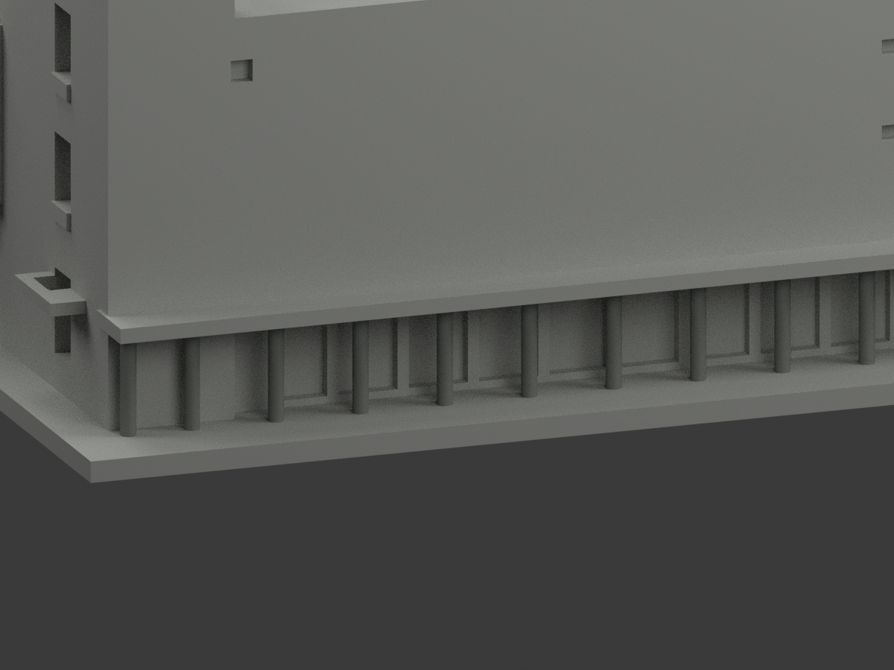
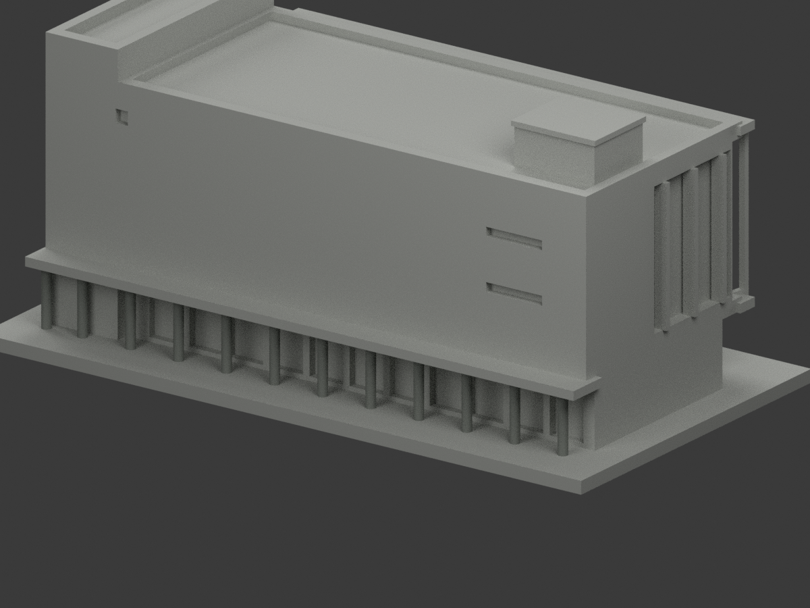
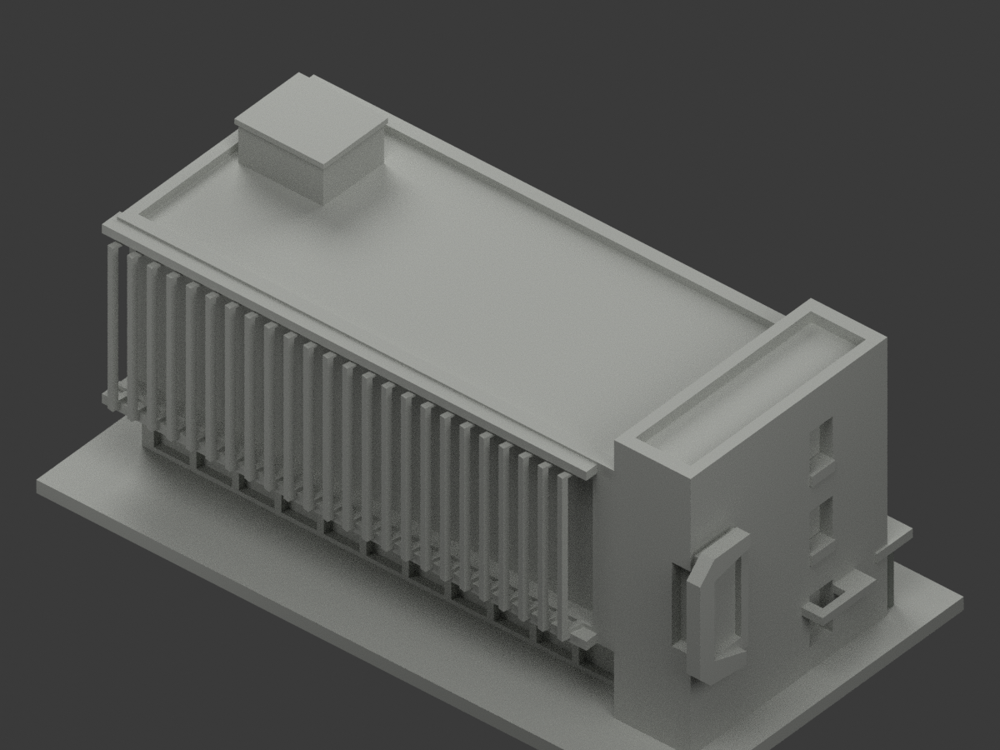

# 北教大美術館 MoNTUE｜南側十二柱內半同材質延續

## 模型預覽

| 總覽 | 背側 | 正面 |
|---|---|---|
||||
||||
||||
||||

## 本次南側十二柱內半同構件灰色延續

只將十二根既有灰柱的內向半圈288原三角延用原材料0（#858983）。原外向半圈288灰面全部保留，現576灰面、2672中性未知面；不是全館外觀配色完成。3248原三角、原點表、面序、原STL字節、座標均不變，沿用原150mm示意長度非測量比例。一個原美術館，同項count_delta=0。

原12柱中心x=[−63,−51,−39,−27,−15,−3,9,21,33,45,57,66]、y=30、半徑1.1mm、24邊形。每柱內半12弦矩形各2面，共144完整有限域288面。原名義柱高z3…18.6，但原梁z17…19.1吞去頂1.6mm，真露出域僅z3…17；不補埋入面、不染梁/頂底、不改柱間距。每域全頂點、四角、面積、零重疊及完整共面連通核對，不稱全無限平面全選，因同無限面可含別根不相連柱。解析578.9097677344、原網格578.9096806798mm²差屬float32。每柱兩端整高交界連到原灰前半，同構件內向連續推論。

本輪親看官方校園防救計畫 https://general.ntue.edu.tw/var/file/44/1044/img/606570806.pdf 第77頁（印頁2-71）兩張外觀照，灰圓柱同構件身份明確，影像雜湊與歷史來源登記完全相同。內向及陰影面同柱推論，不宣稱每一後向面都被照片證實；不採陰影變化另設材質。第78/79頁平面圖不用來證顏色。文件2023日期不是拍攝日，不保證2026現況。原PDF與照片私人保存，不入包、不公開、不作貼圖。

2672面仍中性：磚牆、窗玻璃代理、北側金屬斜遮陽片、屋頂、耳狀外框、梁板與其他面不變。原柱數/形狀/間距的規則化近似保留，不追認精確實物。正確物件名 NTUE MoNTUE partial color，既有 VERSION-2-OBJECT-NAME-ERRATUM.json 原樣保留，不回退舊誤名。所有歷史QA/source/checksum原字節保留，以下原文/舊288面數據為歷史快照。

原68採樣層、最大0.8mm開運算損失0.0008822712874171544、零超1%層等工程限制原樣保留，不升級為薄壁、耗材、切片、支撐或實體試印保證。新 qa-continuous-column 含兩份獨審、strict3MF零警告與材料往返、Blender材質與頂點編輯存檔重開、原scene重渲染精確、ZIP孤立重建、歷史保護及10圖親看。重建 python continuous-column-source/build_continuous.py，交換verify_exchange.py，Blender render_continuous.py、strip_previews.py、Blender verify_scene.py。原色盤名稱的outward是歷史標籤不改字節，本次範圍見新域。此是本地交付包，不代表已上傳。

---
## 原版歷史文件（原色數288面）

場景僅同步更新 source_mesh_sha256 以對應本次含材質指派的 color-mesh.npz，並更新 scope，明示原 288 外半灰面保留、288 內半柱面同灰推論，僅原實際露出 z=3…17 mm。原粗化圓柱、示意尺寸、其他未知側背與未實印限制保留，不以補色認證精確反射或逐面背照。其餘原屬性、全部材質定義與幾何不變，palette.json 原 bytes 完全保留，原外半描述屬歷史標籤。

本頁為現行說明；根 README.zh-TW.md 與舊 SHA256SUMS／SHA256SUMS.txt 保留歷史 bytes，完整現行校驗以 CONTINUATION-SHA256SUMS 為準。

## 前版說明與保留限制（完整歷史文字）

# 北師美術館｜南側柱列局部灰

**磚牆、北百葉、玻璃與其餘材域未完成分色。** partial_color_incomplete=true、fully_colored_exterior=false。僅既有南柱朝外面局部補色，不是全館完成，也不是空氣館入口模型。

## 材色範圍
同 ntue-montue 原項目，same-item、count_delta=0。3248原三角面、STL與build_model.py字節不變，不切面、不增字或藝術細節。原公開包無OBJ，不因原code會輸出而假稱保留。
- 僅12南柱朝外完整24gon原facet：每柱12facet、每facet2面，共288面中灰。中心x−63/−51/−39/−27/−15/−3/9/21/33/45/57/66，y30、半徑1.1。全三頂點符合有限chord plane/tangent與原高3..18.6；原Boolean自然遮到17，不人工截短。
- 其餘2960中性：柱背半／柱帽／底、混高低南磚牆、含白字東牆、未證北百葉、窗背／框、原簡化耳形、屋面／機房／階／地面。共面連通域必均一，不用normal門檻漏掉裁切片，不用中心點割色。
- 色域與中性邊界只是證據範圍，不是真實材接縫。保原加厚百葉與簡化藝術外形，補色不背書原幾何為精測。

## 來源與日期
只看官方PDF物理頁77南、東兩張建築外觀，不使用內部平面或安全資料。拍攝日未知；2023-10-25填表日不是拍攝日，原README2017/2020來源也不證本兩照日期，不聲稱2026現況。
照片與PDF僅私人參考，不公開、不貼圖；未確認CC或再散布授權，不保證商用。HEX為名義灰色族，非校準色票。正式GO覆蓋先期review-only字句，但不免除builder QA。

## 格式與列印
[原STL](model.stl) · [逐面材色3MF](appearance.3mf) · [Blender](scene.blend)
原150×81mm展示底座，照片近似非測量比例。STL無色，3MF／Blender有真逐面材。兩材標籤不是驗證兩色／四色耗材切片，未實際列印，無切片路徑。

## 重建與 QA
原build_model.py → colorize_model.py → export_appearance.py → validate_color.py；Blender render_color.py／verify_color_scene.py。完整隔離原build＋color重建、原bytes／全三角multiset、閉合正體積、3MF逐面材、scene重開、十圖1200×900與圖文hash核對。原依賴版本隔離使用，不改原碼。程序不替代人工來源檢核。
原README／previews／validation／renderer保留歷程，不冒充本次新QA，沒有刪檔。

## English scope
Partial only:288 complete outward original24gon column faces mediumgray;2960 unverified faces neutral. Original3248triangles and bytes unchanged;no originalOBJ. Twelve columns full originalheight3..18.6,naturally Boolean-clipped at17,not artificially cropped. No normals-only selection, new geometry, lettering or textures. Capturedateunknown;2023documentdate is not camera date. Not currentcondition certification, not testprinted or validatedfilament slicing.

## 版本 2 名稱勘誤

3MF 與 Blender 物件顯示名稱統一更正為「NTUE MoNTUE partial color」，並同步匯出、渲染與驗證程式的名稱。場景重新開啟與保存後，除物件名稱及非渲染執行期記錄外，網格、材質、變換、相機、燈光與字幕語義完全相同；場景檔案雜湊因此更新。原 STL、材色陣列與十張預覽位元不變，未重新渲染。原有局部補色及未試印限制不變。
