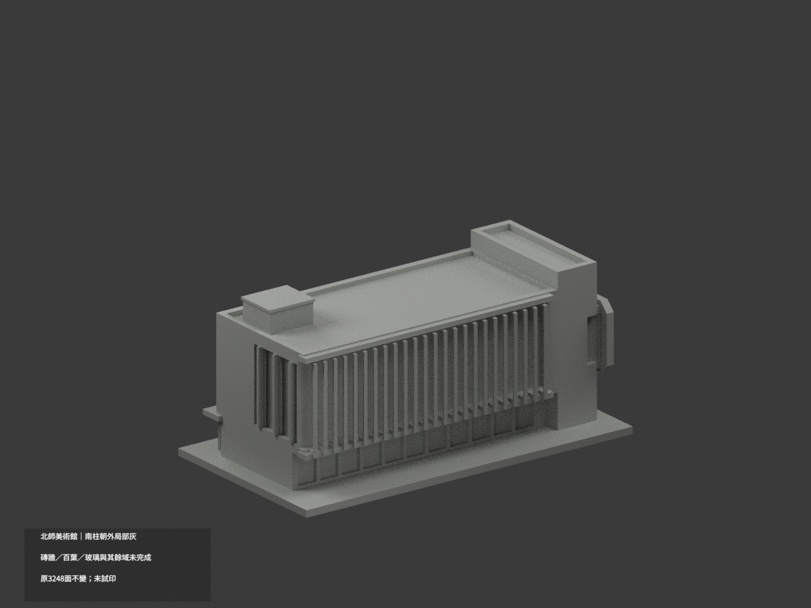
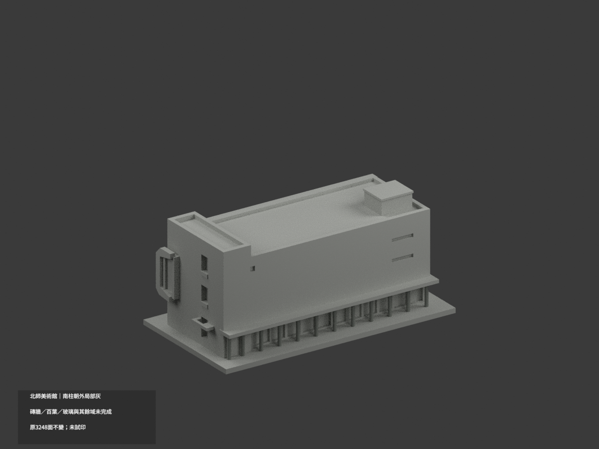
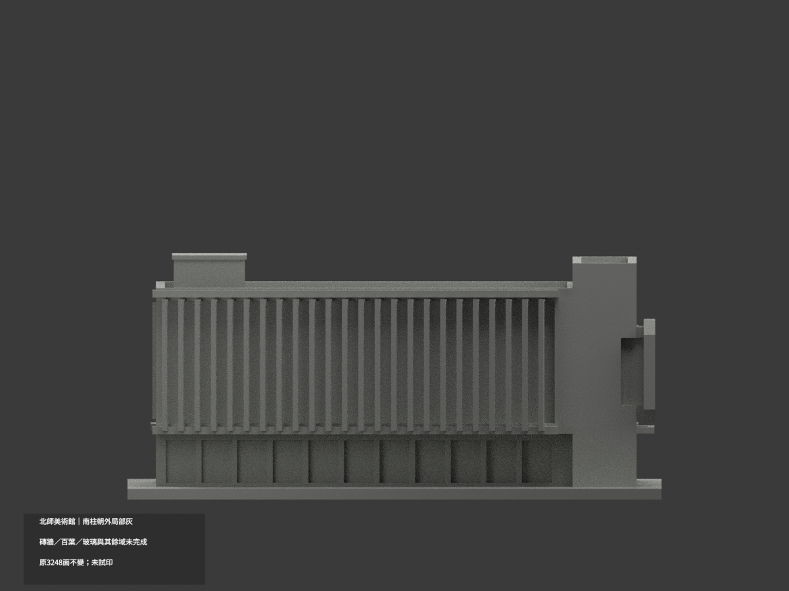
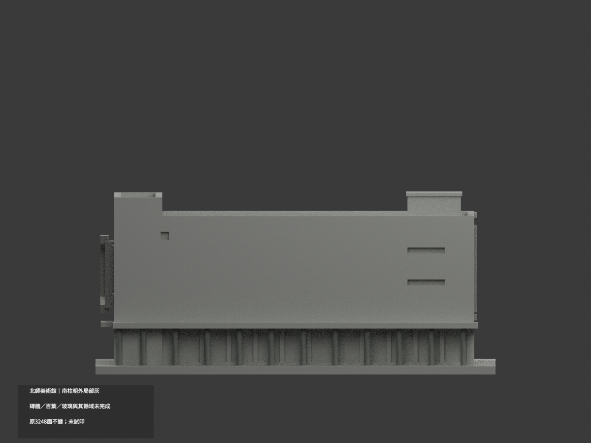
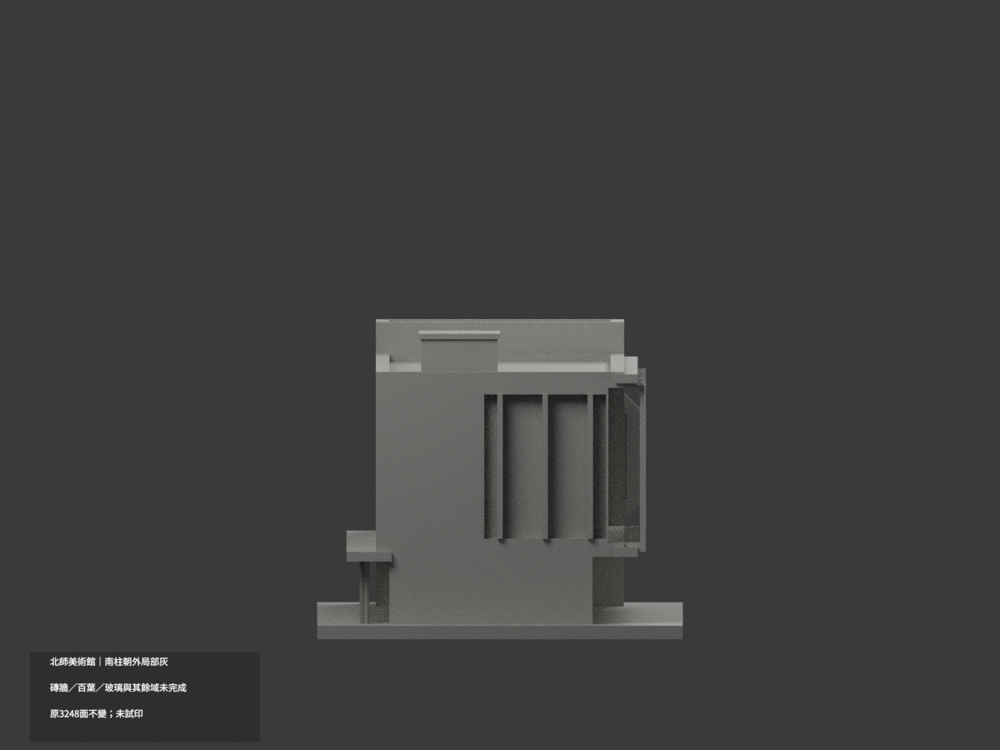
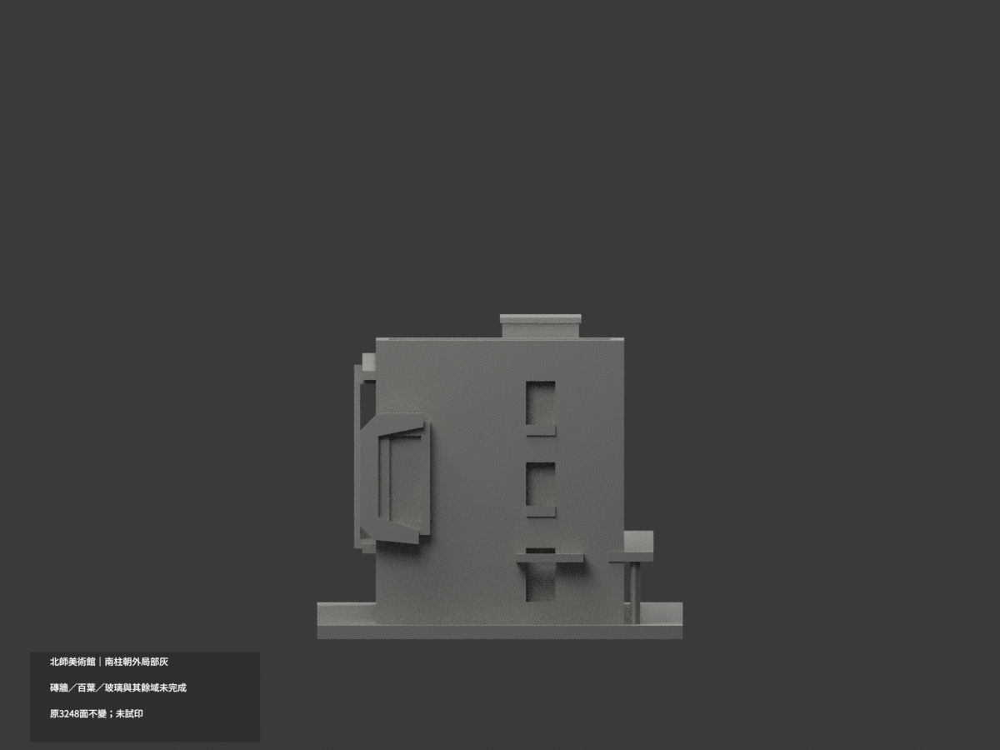
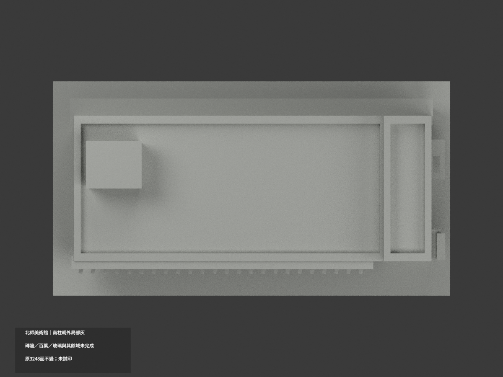
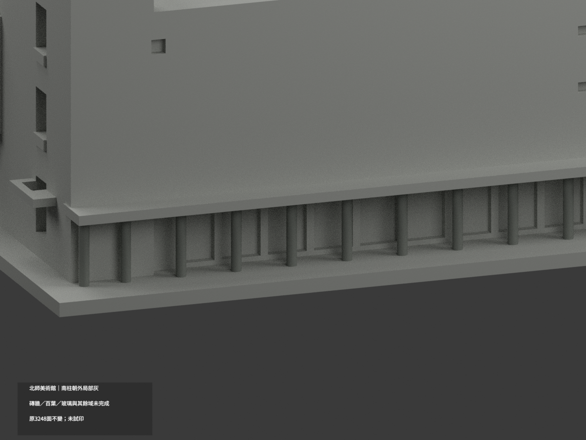
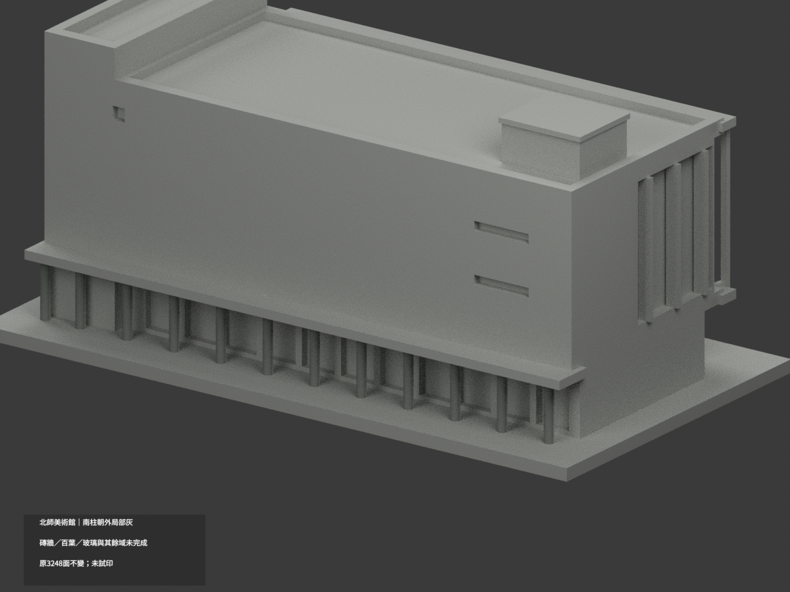
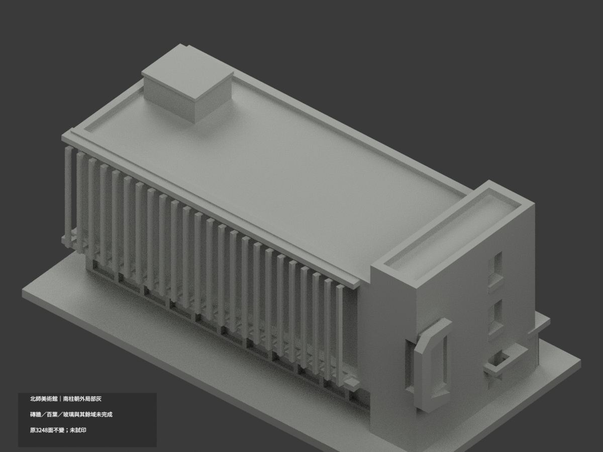

# 北師美術館｜南側柱列局部灰

**磚牆、北百葉、玻璃與其餘材域未完成分色。** partial_color_incomplete=true、fully_colored_exterior=false。僅既有南柱朝外面局部補色，不是全館完成，也不是空氣館入口模型。

| 總覽 | 背側 | 正面 |
|---|---|---|
||||
||||
||||
||||

## 材色範圍
同 ntue-montue 原項目，same-item、count_delta=0。3248原三角面、STL與build_model.py字節不變，不切面、不增字或藝術細節。原公開包無OBJ，不因原code會輸出而假稱保留。
- 僅12南柱朝外完整24gon原facet：每柱12facet、每facet2面，共288面中灰。中心x−63/−51/−39/−27/−15/−3/9/21/33/45/57/66，y30、半徑1.1。全三頂點符合有限chord plane/tangent與原高3..18.6；原Boolean自然遮到17，不人工截短。
- 其餘2960中性：柱背半／柱帽／底、混高低南磚牆、含白字東牆、未證北百葉、窗背／框、原簡化耳形、屋面／機房／階／地面。共面連通域必均一，不用normal門檻漏掉裁切片，不用中心點割色。
- 色域與中性邊界只是證據範圍，不是真實材接縫。保原加厚百葉與簡化藝術外形，補色不背書原幾何為精測。

## 來源與日期
只看官方PDF物理頁77南、東兩張建築外觀，不使用內部平面或安全資料。拍攝日未知；2023-10-25填表日不是拍攝日，原README2017/2020來源也不證本兩照日期，不聲稱2026現況。
照片與PDF僅私人參考，不公開、不貼圖；未確認CC或再散布授權，不保證商用。HEX為名義灰色族，非校準色票。正式GO覆蓋先期review-only字句，但不免除builder QA。

## 格式與列印
[原STL](model.stl) · [逐面材色3MF](appearance.3mf) · [Blender](scene.blend)
原150×81mm展示底座，照片近似非測量比例。STL無色，3MF／Blender有真逐面材。兩材標籤不是驗證兩色／四色耗材切片，未實際列印，無切片路徑。

## 重建與 QA
原build_model.py → colorize_model.py → export_appearance.py → validate_color.py；Blender render_color.py／verify_color_scene.py。完整隔離原build＋color重建、原bytes／全三角multiset、閉合正體積、3MF逐面材、scene重開、十圖1200×900與圖文hash核對。原依賴版本隔離使用，不改原碼。程序不替代人工來源檢核。
原README／previews／validation／renderer保留歷程，不冒充本次新QA，沒有刪檔。

## English scope
Partial only:288 complete outward original24gon column faces mediumgray;2960 unverified faces neutral. Original3248triangles and bytes unchanged;no originalOBJ. Twelve columns full originalheight3..18.6,naturally Boolean-clipped at17,not artificially cropped. No normals-only selection, new geometry, lettering or textures. Capturedateunknown;2023documentdate is not camera date. Not currentcondition certification, not testprinted or validatedfilament slicing.

## 版本 2 名稱勘誤

3MF 與 Blender 物件顯示名稱統一更正為「NTUE MoNTUE partial color」，並同步匯出、渲染與驗證程式的名稱。場景重新開啟與保存後，除物件名稱及非渲染執行期記錄外，網格、材質、變換、相機、燈光與字幕語義完全相同；場景檔案雜湊因此更新。原 STL、材色陣列與十張預覽位元不變，未重新渲染。原有局部補色及未試印限制不變。
