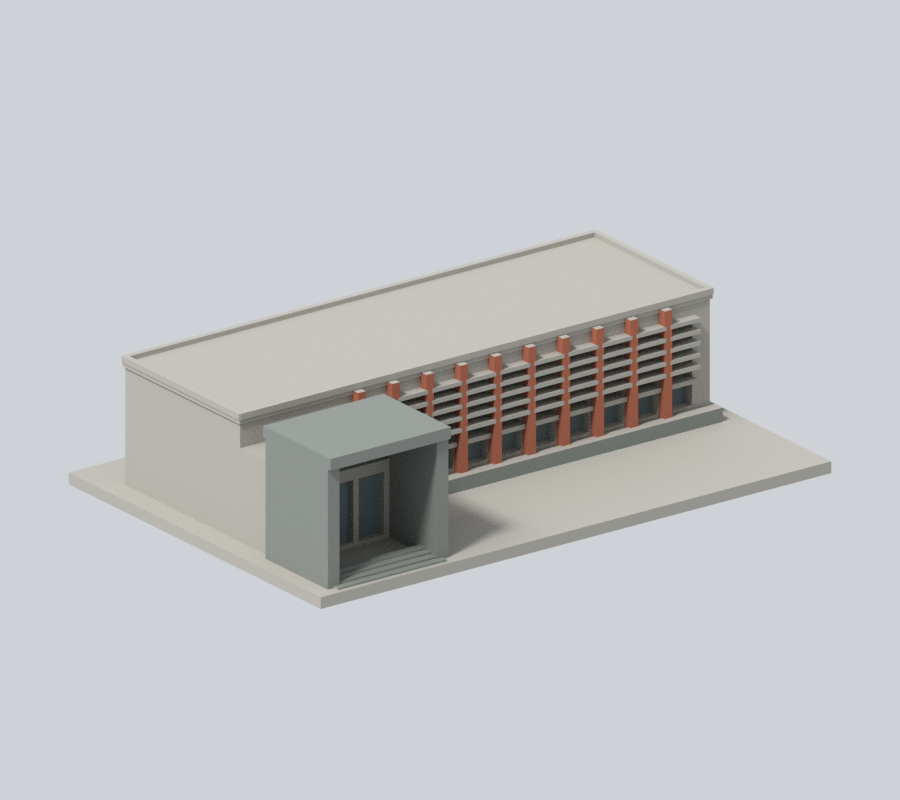
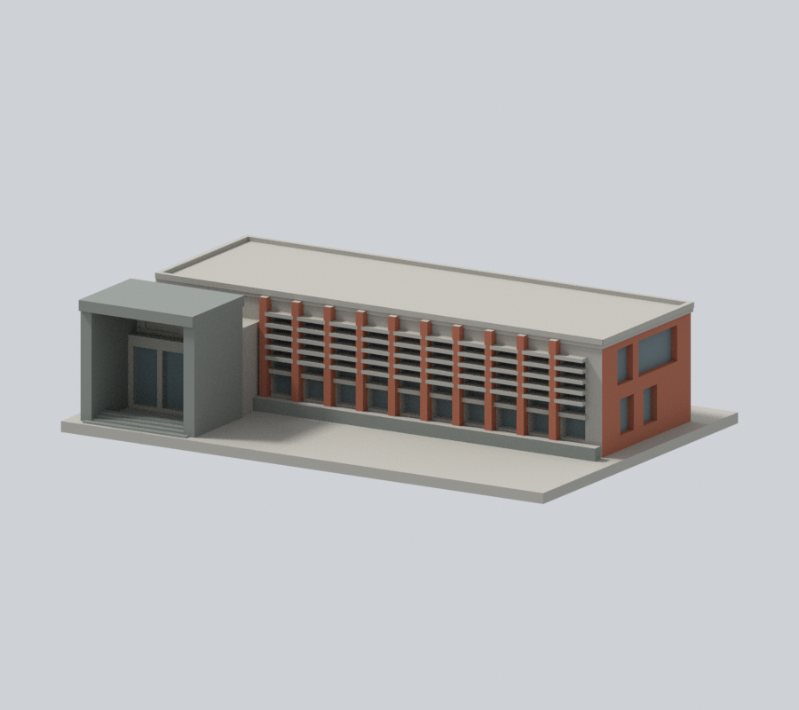
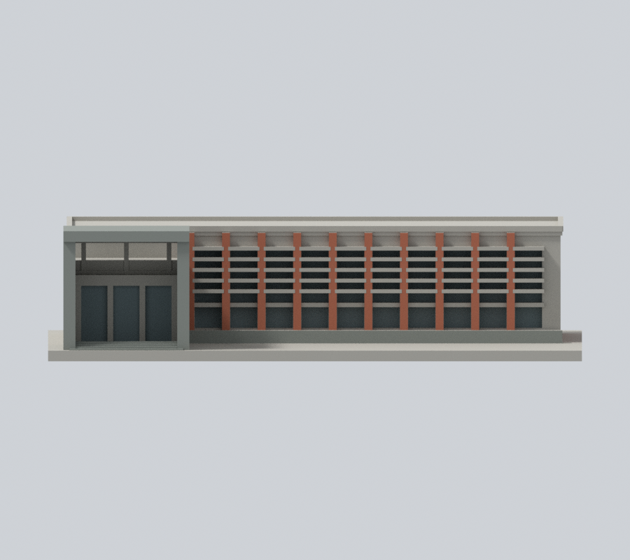
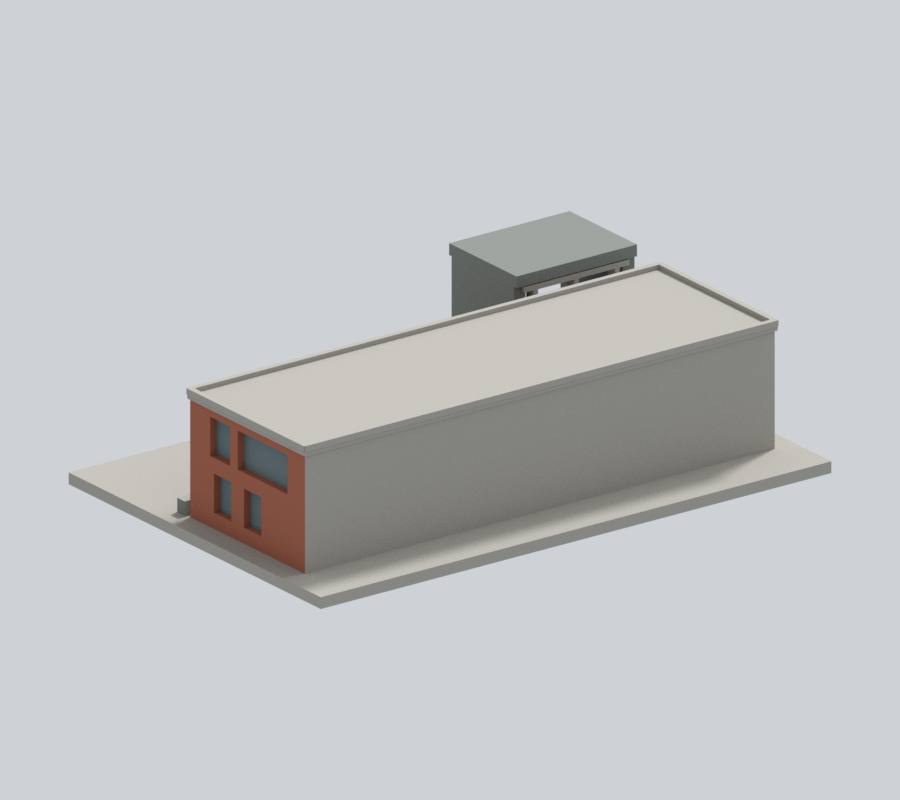
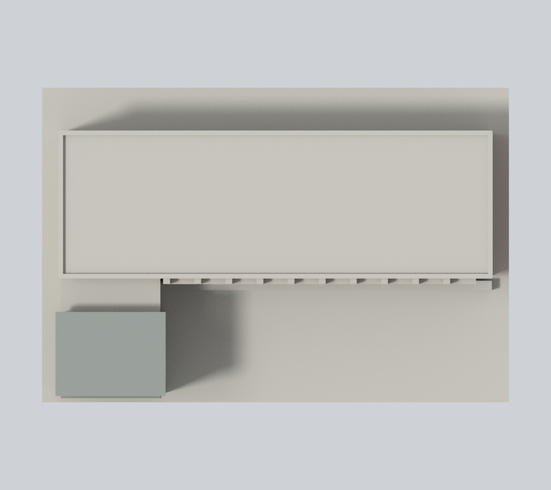

# 國立臺北教育大學｜泳健館

## 模型預覽

臺北校區，自行以Python實體布林建立的外觀近似模型。沒有下載第三方3D模型；不是測繪、施工圖或館內重建。

### 原構件完整返面補色

保留原十道磚柱、右端外牆、真窗背及灰入口框／花臺彩色面，再為64個完整原始三角面補色：右端四窗的磚色返面、入口灰框後端與頂板頂／底／後面、花臺右端。同構件未見部分明列延續推估。**五道混材遮陽、缺少真實窗／綠牆分界的大側背面、一般正牆與主屋頂仍中性，不是整館復原。**

| 正斜視 | 右前斜視 | 正立面 |
| :---: | :---: | :---: |
|  |  |  |
| 背向 | 上視 | 外觀檔案 |
|  |  | [3MF](appearance.3mf) · [Blender](appearance.blend) |

[左側](appearance/left.png) · [右側](appearance/right.png) · [原版同相機正斜視](appearance-review-v2/original-front.png) · [原版同相機背向](appearance-review-v2/original-rear.png)。七張新版與兩張原版對照皆為900×800無字真網格渲染。

[來源與限制](APPEARANCE.md)。原七張模型圖仍保留檔案；原幾何與列印警告不變。

## 證據與範圍

依官方正側實拍及L型平面建立整體量體近似；外側背面缺獨立完整照片。

保留L型入口配置、入口大型灰框挑空、長列磚柱、兩段高低窗帶、厚化水平遮陽、端牆窄寬不同的窗組與階梯。遮陽百葉密度大幅簡化成可列印水平帶；窗格只保留主要分組。未見背面素面，屋頂僅保留照片可辨識的平頂邊線，沒有臆補設備。

入口為真實開放凹室：兩側牆包住門廊，頂板下留空，玻璃面退至後方。平面只支持L型配置，不提供足以校準門廊深度的測繪數據；19毫米深、28.6毫米淨寬、30.5毫米頂板下淨高均為本模型近似尺度，由兩張實拍估定並以原STL射線證實，不是實際建築尺寸。長側依可辨識實拍保留10根突出紅磚主柱，最右端寬磚牆另計；百葉細框不作主柱。

[原STL射線證據](portal-ray-proof.json) · [可重跑射線檢查](check_portal_geometry.py)。檢查直接遍歷原STL三角形，不修補、不封截面；入口沒有臆造貫穿背面的通道。

官方文件日期2023年10月25日，實拍攝影日未載。資料更新日不視為拍攝日；這些來源不能保證2026全部現況。完整來源頁碼與URL見 [sources.json](sources.json)。原照片與PDF只留私人核對，不隨公開包散布。

## 交付檔

- [model.stl](model.stl)：毫米，含底座最長150毫米，每件獨立比例
- [scene.blend](scene.blend)：由交付STL匯入的可編修網格
- [build_model.py](build_model.py) 與 [requirements.txt](requirements.txt)：參數重建來源，執行 python build_model.py
- [render_preview.py](render_preview.py)：以Blender讀取實際STL渲染；執行 blender -b -t 2 -P render_preview.py

## 列印與檢查限制

底座朝下，勿直接把不同館的比例拼為同一校園。挑簷、入口框、百葉及柱廊可能需要支撐；粗化的片、柱、框仍有拆支撐損壞風險。沒有實體試印或Cura/Prusa工具路徑實測；不保證免支撐或保證可印。

[validation.json](validation.json) 驗證原STL法向／繞序、正體積、水密、每邊兩面、vertex link單環、單一連通表面、無分離內腔殼、最長尺寸，以及獨立重建SHA和Blend幾何一致。

[contour-validity-check.json](contour-validity-check.json) 使用固定z偏移0.071毫米，每0.2毫米檢驗原STL閉合degree2輪廓、個別及合成Polygon有效，不修補失效輪廓後算成功。

[thin-feature-check.json](thin-feature-check.json) 使用canonical fail-closed v3每1毫米抽樣0.8毫米opening輔助篩檢；這不是全面最小壁厚或切片器模擬。

驗證命令：python validate_model.py；python check_contour_validity.py；python check_thin_features.py。三者須exit0且所有檢查為真才可凍結；獨立審核通過前不可發布。

原appearance-review保留為前版歷史。本版以appearance-review-v2、appearance-freeze.json與模型SHA256SUMS綁定；校級checksum未改，待授權發布時整合。

[逐點逐面驗證](appearance-review-v2/model-verification.json) · [完整面界審核](appearance-review-v2/boundary-continuity-audit.json) · [來源判讀](appearance-review-v2/source-register.json) · [乾淨重建](appearance-review-v2/clean-rebuild-equality.json)。

## 2026-11-13 局部材色修正

本次僅四道原入口階的踏面與前立面，共8個完整連通共面域20面，由未知材色延用既有近似灰族；原4材值及其餘3754面不變。灰族不代表階梯和入口框牆同石種或校準色值。原階數、尺寸和位置保持粗略模型，不擴至階側、門前廣場、基座或其他未知部位。

本段更新上述原版本的局部材色範圍；原APPEARANCE與歷史審核的數量、範圍依其原版本解讀。幾何、原STL／scene、鎖定預覽與七張原生視圖的相機和照明不改。不是全館復色、測繪、校準材質或2026現況認證；照片日期不確定，不由文件日期推定拍攝日。原工程、薄件與支撐限制仍有效，未實體試印或完成切片工具路徑驗證。

本次公開交付只包含模型、材質、必要重建腳本、預覽與必要說明／校驗；來源原照片、比較圖和完整研究審核紀錄不隨包發布。當前產物範圍見[校驗說明](CHECKSUM-SCOPE.md)。
