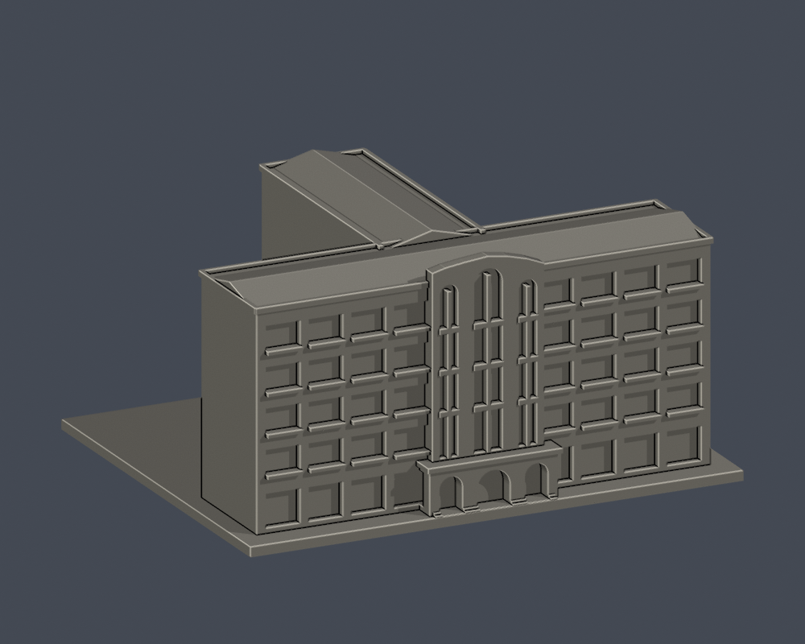
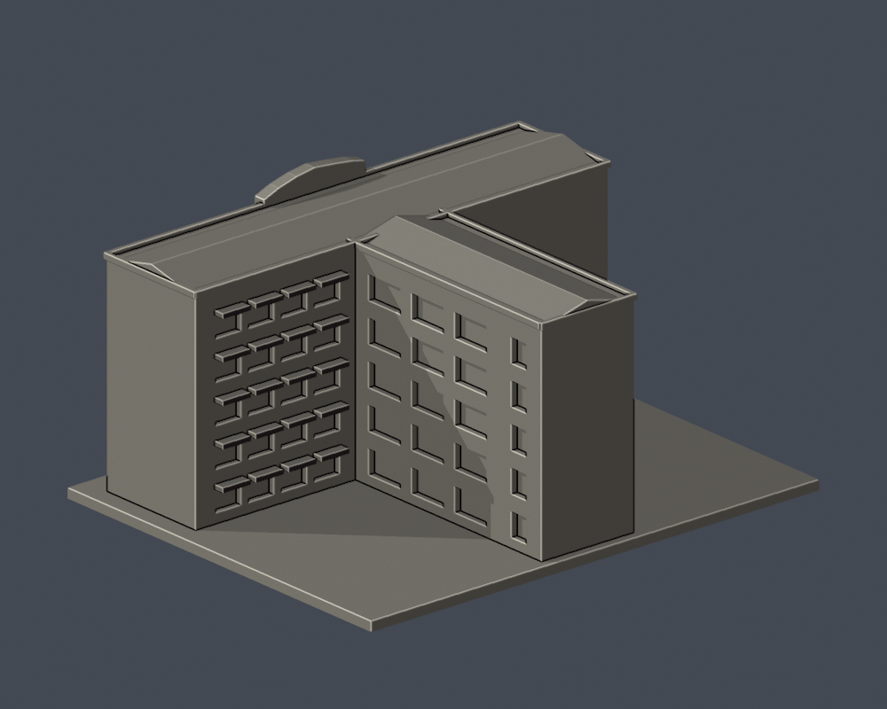
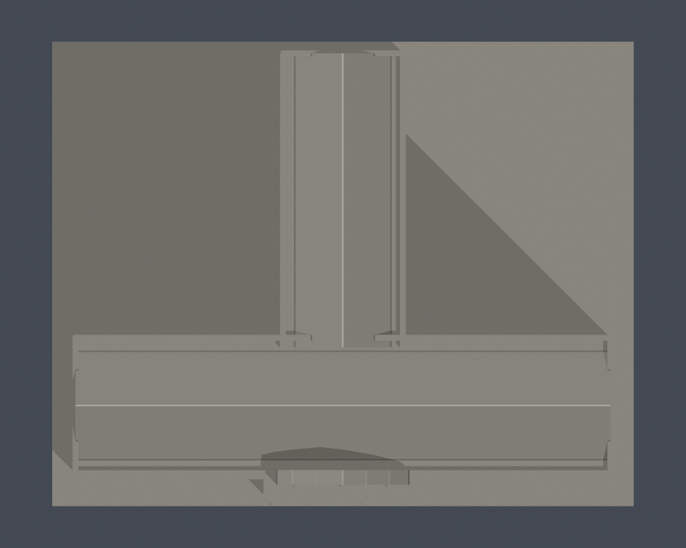
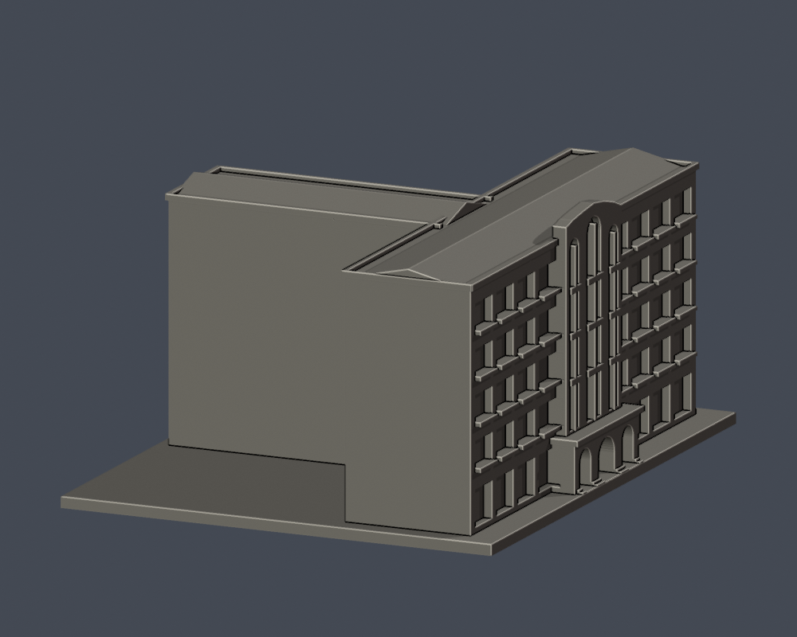
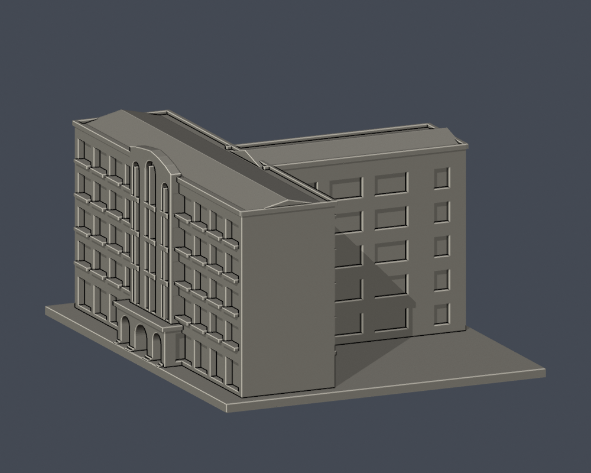

# 國立臺北教育大學｜科學館

## 2026-11-18 限定補色版

內院 20 處遮陽盒正前緣的 40 個原三角，深褐代理。本次不增加套數、不改原始 STL 幾何，未補部位不代表實景材色。未實體試印。

[彩色 3MF](model-colored.3mf) · [可編輯 Blend](scene.blend) · [原 STL](model.stl) · [本版 3MF 相容性查核](3MF-COMPATIBILITY-QA.json) · [原建模與場景查核（歷史）](independent-verification.json) · [公開版清單](COLOR-RELEASE-MANIFEST.json) · [SHA256SUMS](SHA256SUMS)

| 現版模型預覽 | 現版模型預覽 | 現版模型預覽 |
| :---: | :---: | :---: |
|  前斜視／正面 |  後斜視 |  立面 |
|  頂視 |  左側 |  右側 |

3MF 交付版僅補一個物件預設材質索引，嚴格 SDK 可讀取並在私有副本改色存回重開；原逐面色值、網格、Blender 與預覽不變。[公開相容化程式](source/normalize_3mf_compat.py)可重做此格式步驟。舊查核僅為建模檔案歷史，本版嚴格互通以新版相容性查核為準。

上級索引原代表圖保持原檔；新版彩色渲染請以上表為準。新色適用範圍及試印限制如下。下方舊版本導覽及資料只為歷史保存，舊面數、舊預覽與舊驗證不代表現版；以本章下載與公開版清單為準。

工作區中斷後，從固定GitHub基底 `8f90ae2478f00cce6832a07de537f7d333f6dbc0` 新下載、新查證、重製；不是原完成包的位元恢復。

## 範圍
僅既有20個內院遮陽盒的完整前矩形，共40三角面，合計260.400187 mm²，補深褐代理色 `#57484A`。每面9.3×1.4mm，y=-13.1，x中心25/36/47/58，z起點12.6/24.6/36.6/48.6/60.6，都是模型毫米，不是真實量測。側、頂、底面、窗框、玻璃及另一翼排除。原實心粗盒只是遮陽帶近似，不是照片中真正葉片幾何；不把照片每條葉片重建進本次網格。

官方災害防救計畫PDF實際第17頁（印頁2-11）為本次色族核對。文件日期與調查日期不是照片日期；色值是未校正代理，不是實測色、塗料規格或2026現況保證。原始PDF與圖只作私人查證，不隨公開候選包散布。

## 保留
原STL位元不變，2124頂點/4244三角面。原場景相機、世界、既有材質保留，只新增遮陽前緣材質並指派40面；孤立原材質設fake-user避免另存丟失。其餘暖石色只是原有未證實預覽色，不表示全棟外觀已完成。3MF原預覽色等價轉為8-bit sRGB #D8D1C2。

原屋頂與女兒牆未改，不由本次補色宣稱屋頂實測。本基底儲存庫未提供OBJ，雖原builder含OBJ輸出程式，本次不新增或冒稱已有OBJ。

## 使用與限制
`scene.blend`可編輯，`model-colored.3mf`為逐面兩色外觀交換，不是分割多料列印實體；`model.stl`無顏色。`face-colors.json`與`domain.json`記錄限定面域。六視圖在previews。`build_model.py`保留原幾何建構程式，不會自動產生本次顏色；完整重建腳本與驗證記錄保存在私人備份。

未做GUI切片、實體試印或支撐驗證。數位流形檢查不等於可直接免支撐列印。原模型說明另見original-model-notes.md，歷史驗收不等於本版發布核准。

## 新版檢核限制
獨立驗證確認原相機、世界、原材質節點及其餘可安全讀取場景RNA一致。Blender 4.3.2讀取UV Sculpt懸空工具指標會崩潰，該工具設定排除；runtime依賴圖及session欄位也排除，不宣稱全場景位元相同。詳見independent-verification.json。

## 歷史版導覽與說明

## 模型預覽

| 模型預覽 | 模型預覽 | 模型預覽 |
| :---: | :---: | :---: |
| 實際STL正面  | 實際STL背面  |  |

臺北校區。自行使用Python實體布林建立的外觀／量體近似模型；沒有下載第三方3D模型，非施工圖、測繪或館內重建。

## 證據與範圍

依官方正面、內院兩翼實拍及1–2F的T形平面建立整體量體近似。保留三個不同寬高的長拱窗區、地面三拱入口、正面四排上層窗加地面窗、內院五排可見窗及遮陽帶。長拱窗的窗格、百葉與玻璃分格為加粗近似，不把細窗框當結構柱。T形長翼外端及未見外側留素面；內院相反半翼由平面延伸量體但保持素面，不鏡射複製窗群。官方照片頁備註記載111–112年加設防水斜屋頂，本模型以低坡雙脊覆蓋T形量體；坡度、脊線方向與匯接形狀仍缺屋頂照片，明列為近似，不臆造設備。

官方文件日期2023年10月25日，實拍攝影日未載；文件更新日不是拍攝日，無法保證2026全部現況。來源、實際PDF頁碼及限制見 [sources.json](sources.json)。原照片／PDF只作私人核對，不隨公開包散布。

## 交付

- [model.stl](model.stl)：毫米，含底座最長150毫米，各件獨立比例
- [scene.blend](scene.blend)：由實際STL匯入的可編修網格
- [build_model.py](build_model.py) 與 [requirements.txt](requirements.txt)：自行建模參數來源；python build_model.py
- [render_preview.py](render_preview.py)：讀取原STL渲染；blender -b -t 2 -P render_preview.py

[正立面](previews/elevation.png) · [側面](previews/side.png) · [俯視及院落](previews/top.png)

| 模型預覽 | 模型預覽 | 模型預覽 |
| :---: | :---: | :---: |
| 正立面  | 側面  | 俯視及院落  |

## 列印與QA限制

底座朝下。各件比例獨立，勿直接拼為同比例校園。入口頂板、半圓陽臺、玻璃曲面懸挑、雨遮及柱廊可能需要支撐，拆支撐仍可能傷細框。沒有實體試印、Cura／Prusa工具路徑驗證，不保證免支撐或保證可印。模型深度、柱距及高度不是實際建築尺寸。

[validation.json](validation.json) 檢原STL水密、正體積、繞序、每邊兩面、vertex link、單表面實體、無分離內腔殼、150毫米限制、重建SHA與Blend一致。[contour-validity-check.json](contour-validity-check.json) 每0.2毫米以0.071偏移逐層檢閉合及個別／組合Polygon有效，不修補後算成功。[thin-feature-check.json](thin-feature-check.json) 採canonical fail-closed v3每1毫米0.8毫米opening參考篩檢，不等於全面最小壁厚或切片模擬。

重跑：python validate_model.py；python check_contour_validity.py；python check_thin_features.py。

外觀已覆核，本件為作者凍結版本；須經獨立幾何審核通過後由唯一發布者發布。
