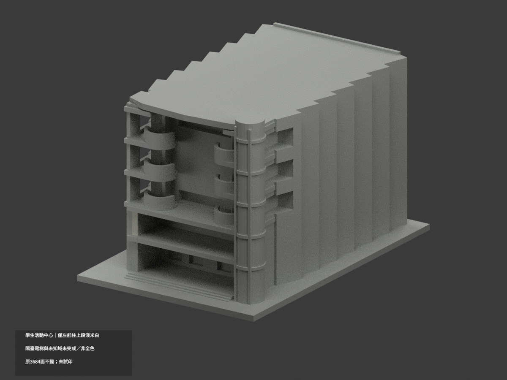
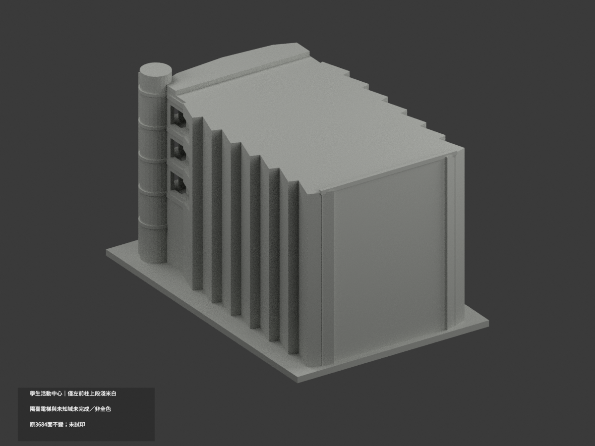
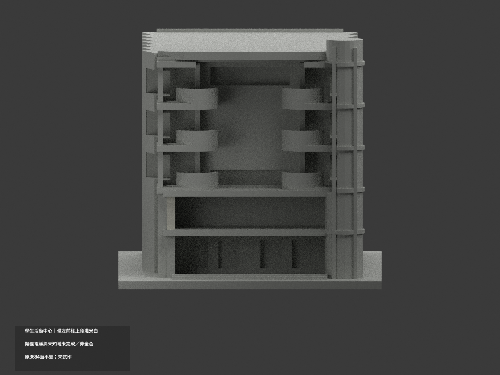
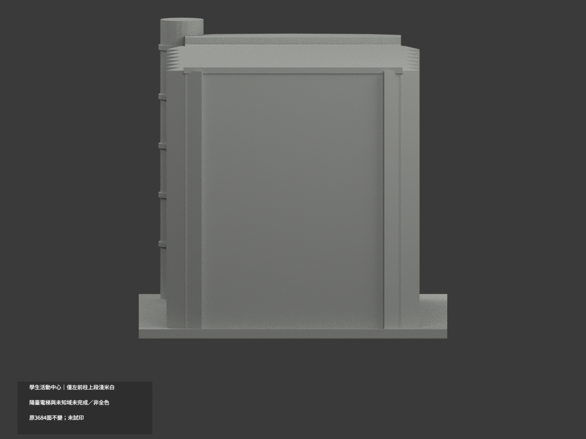
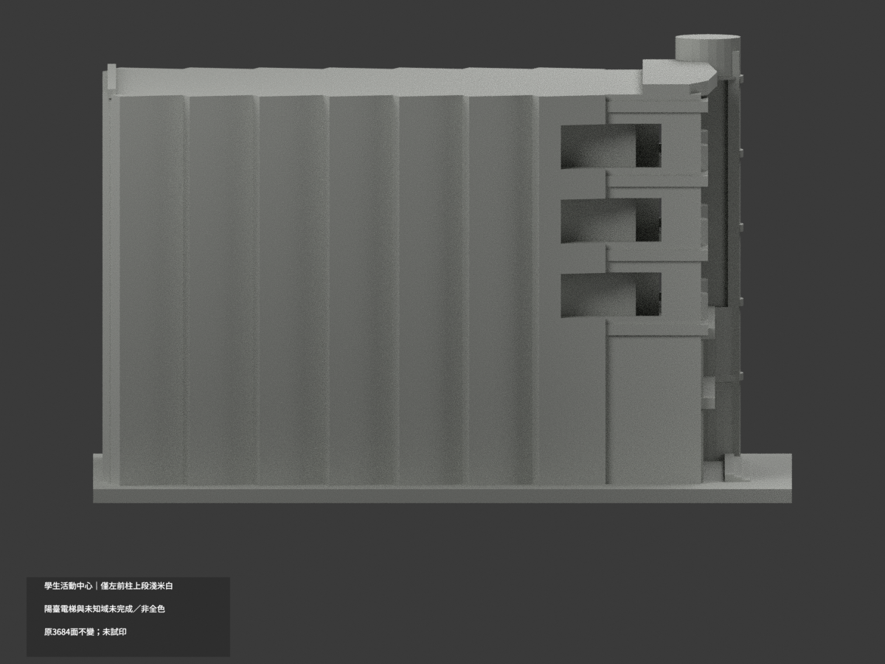
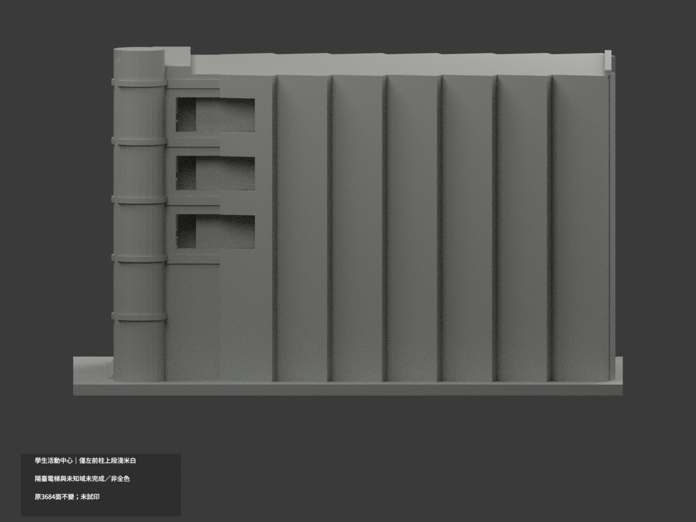
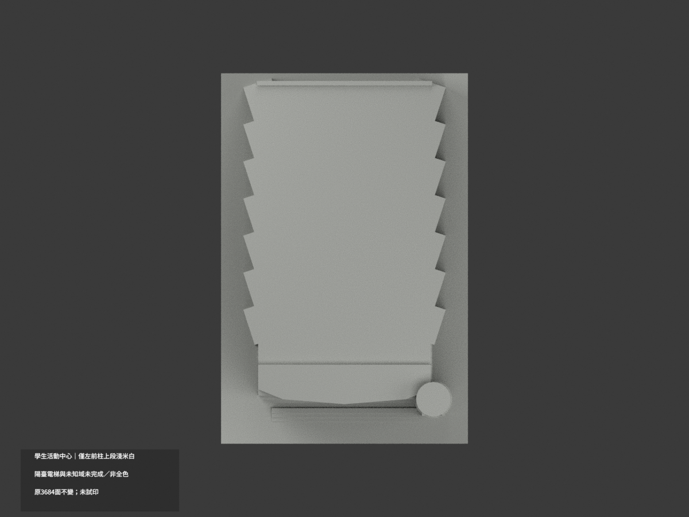
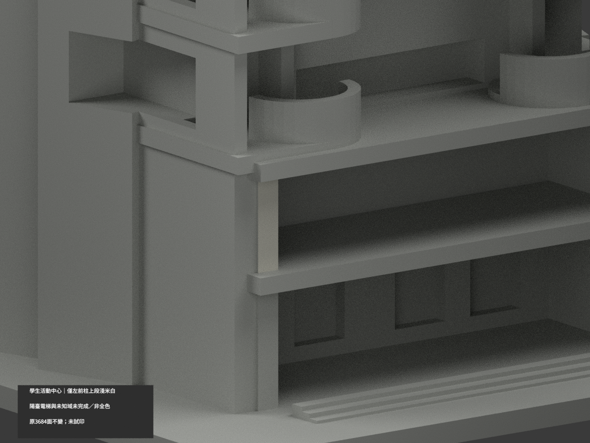
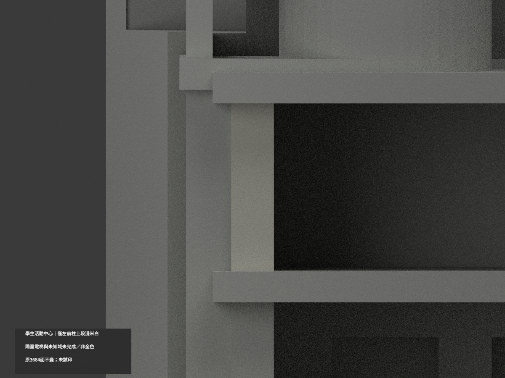
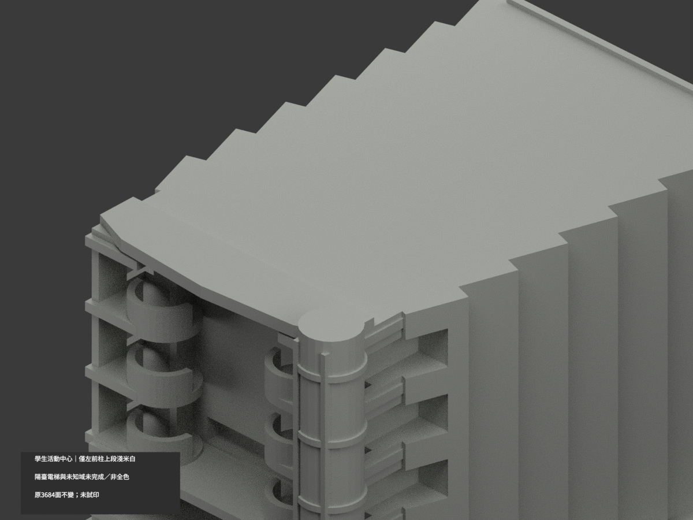

# 北教學生活動中心｜左前柱上段局部淺米白

**局部補色未完成：只左前柱兩樓板間完整前面2原三角淺米白；陽臺電梯與未知域未完成／非全色。** `partial_color_incomplete=true`、`fully_colored_exterior=false`。同項 `ntue-student-center`／`count_delta=0`，臺北校區。保留原單館外觀近似，不是2026現況測繪或全館完成補色。

| 前斜視 | 後斜視 | 正面 |
|---|---|---|
|  |  |  |
|  |  |  |
|  |  |  |
|  | | |

## 材色範圍

只y−56、x−31.6..−28.4、z21.3..34的左前柱完整前面2三角淺米白，其他3682中性。先枚舉完整y−56全平面，再由共邊連通核此面獨立閉合，有限全頂點核不是任切柱。原樓板z19..21.3與34..36.3向前突出，遮住柱面，兩上下界是真正原構件邊，不是人工漆界。全共面連通域材色一致，原3684三角/頂點不改，不盲套IDs或面心切色。

下段兩柱跨灰石腳界而原無分面全中性；右上柱有紅牌/電梯遮擋不鏡射左柱。上弧檐混暗灰帶與淡面、半圓陽臺磚腹和白灰邊無原對應界，均中性。電梯原不透明可列印proxy混玻璃/金屬，不整藍綠。主牆、側鋸齒灣、屋頂、樓板鼻端/底、窗背、地台與未知後部中性。中性色不等於實景灰；資料界線不是實際材質接縫。

原短正面、長側鋸齒量體、開放前廊、半圓陽臺及外加電梯近似全保留，不新增細窗格/牌字或以本次色審追認幾何精度。

## 來源、日期與權利

親看官方PDF實頁52、53兩外觀照片，左前柱第一與第二流通樓板間淡米結構面連續，側照支持上柱與下灰腳分離。只外觀照，未用page53-image1平面或安全配置。2023文件日期非攝影日，capture未知，不宣2026現況。來源hash及獨審見COLOR-SOURCE-REGISTER，URL沿原sources.json。照片私人保存，不公開貼圖，未見CC不推商用。HEX為名義展示色族非測量色票。

## 檔案與 QA

原STL/build字節與3684三角保持。appearance.3mf兩展示材、scene.blend真面材、color-mesh.npz同原三角。Immutable原包無OBJ；原程式在private隔離重建生成OBJ，不冒原件存在。原README.md保留ORIGINAL-MONOCHROME-README.md；原無README.zh-TW.md。舊previews/QA留單色歷程，不替代本次QA。

依原requirements隔離build+color，3MF完整三角/實面材/封閉正體積、Blender重開/10張1200×900綁定核；shapely2.1.2私有target不改共享環境，重建保留不刪。未實際列印，兩展示材不是已驗四色切片；薄構件支撐另核。

## English limitations

Partial only:one complete upper-left front pier component y=-56,x[-31.6,-28.4],z[21.3,34],2palecream triangles/3682neutral. Original projecting slabs define actual upper/lower edges. Entire-plane/shared-edge component checked before finite all-vertex bounds;no centroid cut or new faces. Lower piers mixed withgrayfeet,right plaque/lift-obscured pier,balconybrick/edges,curvedcornice,liftproxy,windows,roofs and other walls neutral. Original3684triangles/STL/build unchanged,count_delta0. NoimmutableOBJ;privateisolated buildergeneratedOBJ only. OfficialPDF52/53 exterior photos viewed,not interior/plan/security content.2023document not capture;no2026current or originalgeometryaccuracy endorsement. No public source photos/textures/rights inference. Not testprinted or validated multicolor slicing.
