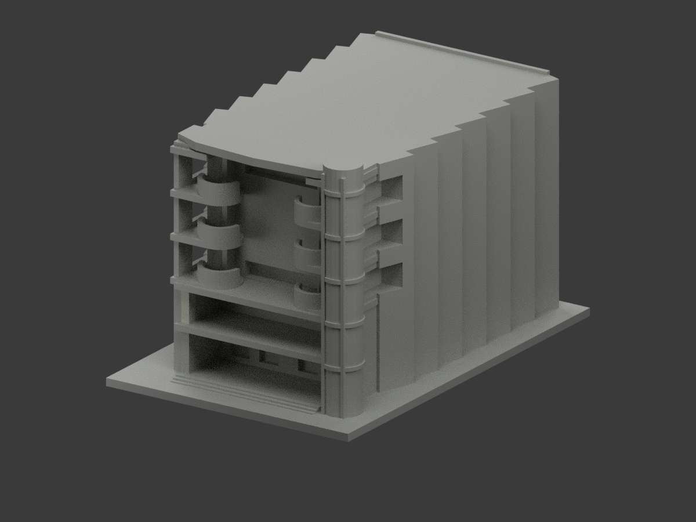
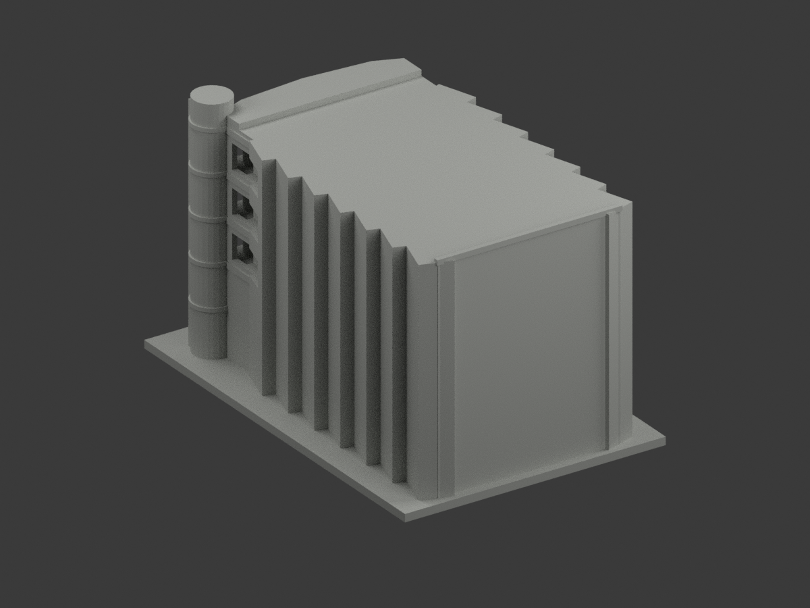
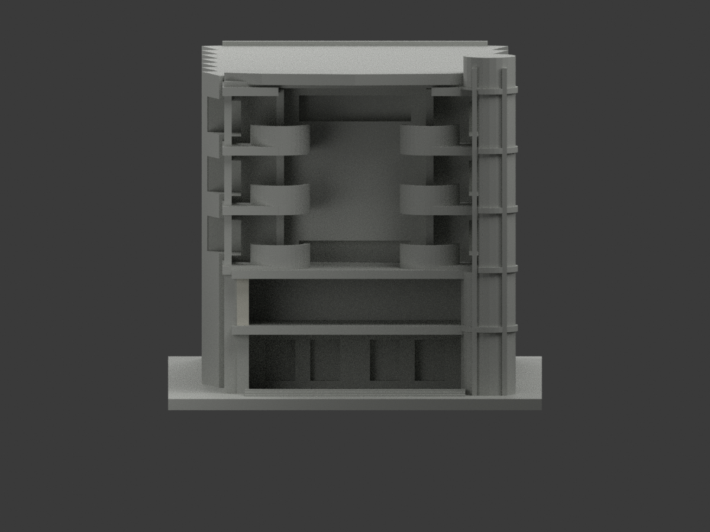
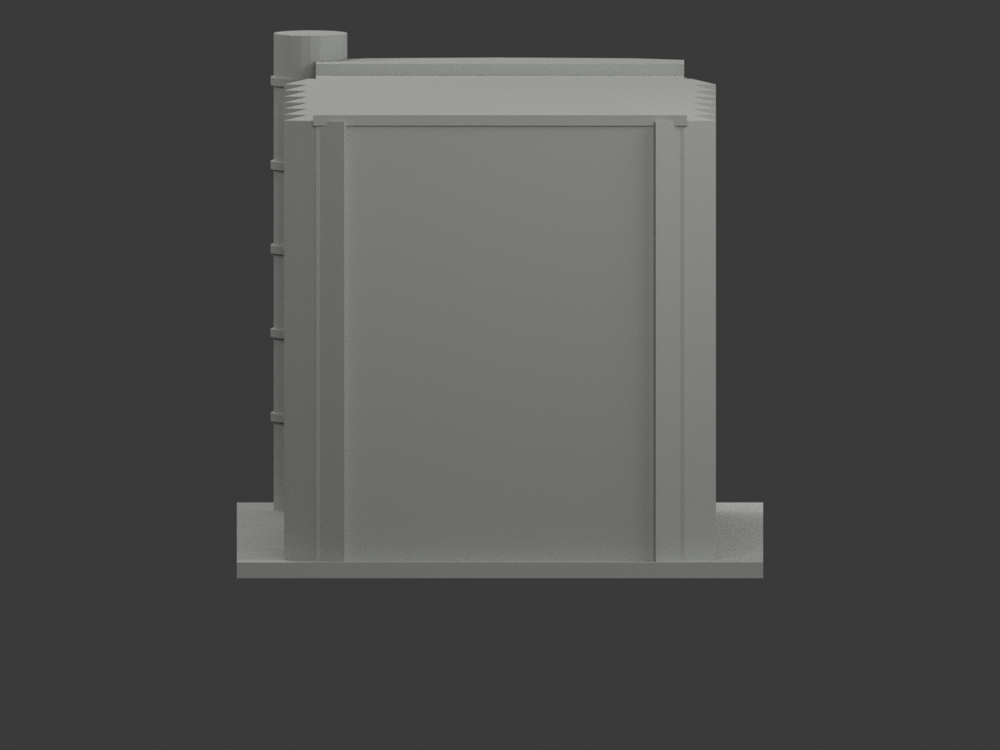
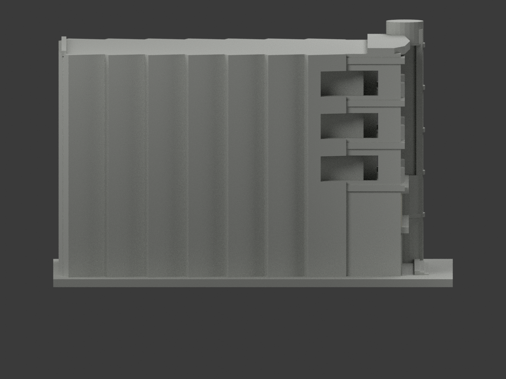
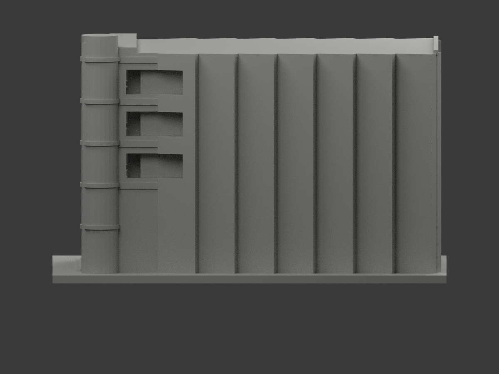
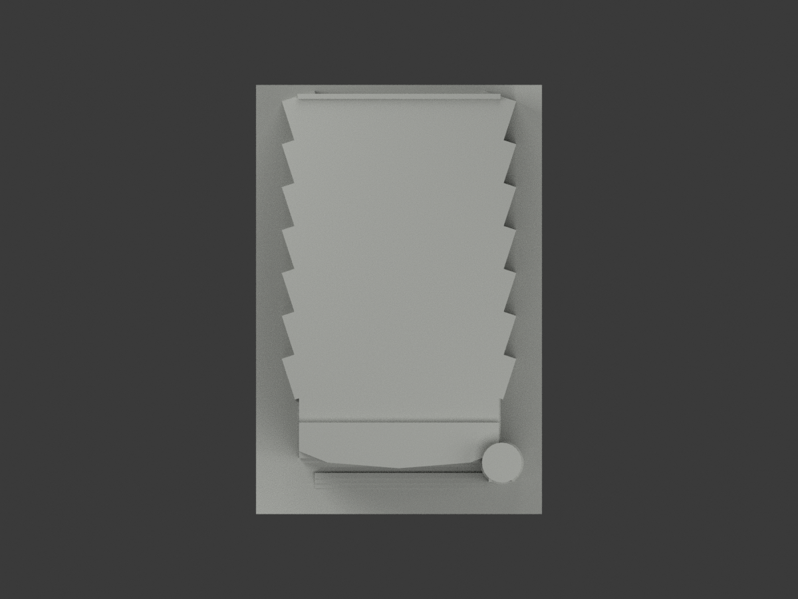
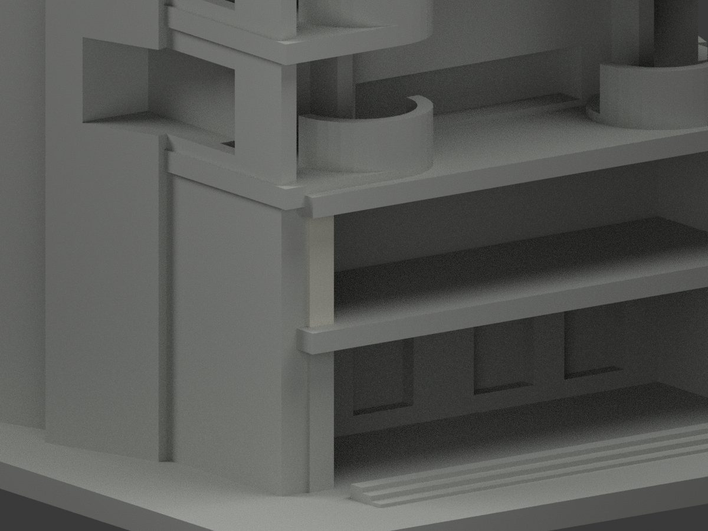
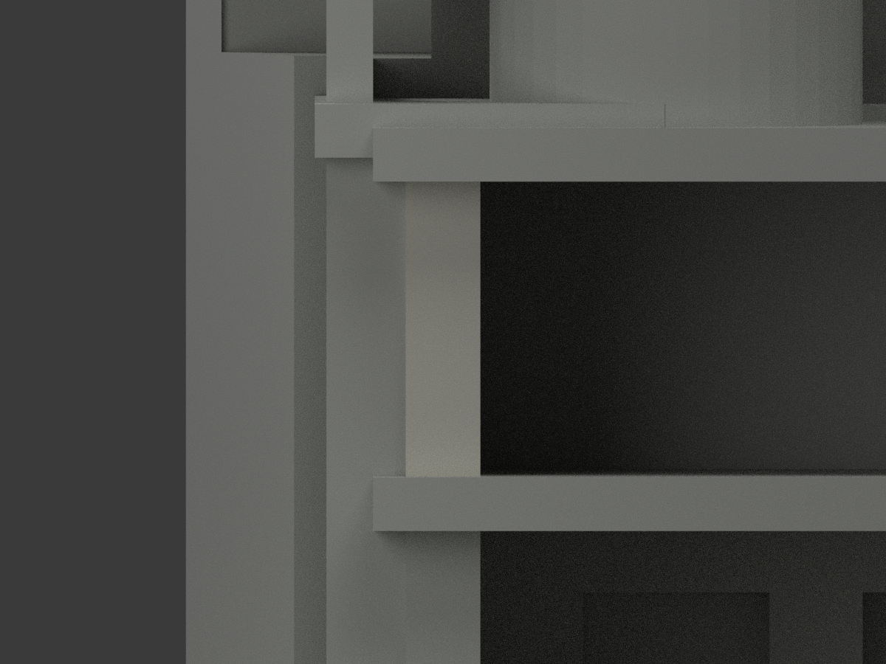
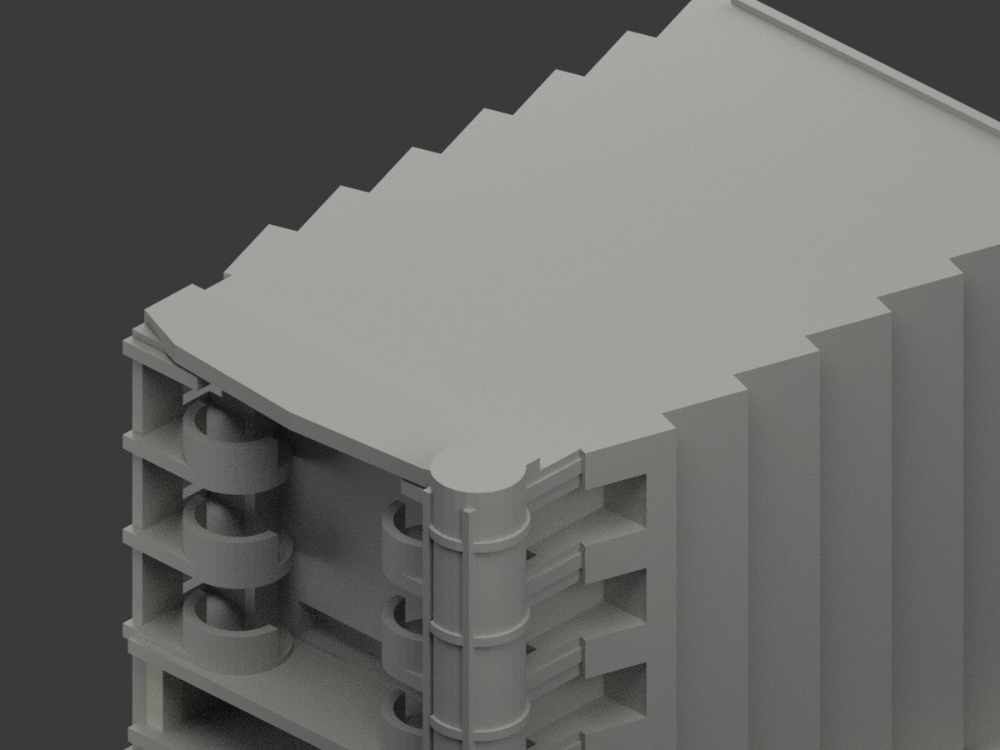

# 北教大學生活動中心｜左上入口柱側返同材質延續

## 模型預覽

| 前斜視 | 後斜視 | 正面 |
|---|---|---|
|  |  |  |
|  |  |  |
|  |  |  |
|  | | |

## 本次左上入口柱完整露出側返延色

只將左上原奶白柱的3個完整露出側返矩形、6個原三角，延用原材料0（#D1D0C5）。原正前2色面820/823全部保留，現8奶白面、3676中性未知面；不是全棟外觀配色完成。3684原三角、原點表、面序、STL字節與座標不變，沿用原150mm示意尺寸而非測量。一個既有模型，同項 count_delta=0。

原柱為x−31.6…−28.4、y−56…−52的方柱近似；只取兩樓板之間z21.3…34。左側露出y−56…−55.5深0.5mm、內側深4mm，後側x−28.5…−28.4露出0.1mm。原主牆與柱Boolean接觸埋入區不補造、不移牆，不將x−28.5/y−55.5牆面塗白。每域全部三頂點、四角、完整共面連通與解析面積核對，非形心篩選；總解析58.4200000000、原網格58.4200083542mm²差為原float32。後0.1mm窄露面經新增內側的連續共邊連到同柱，不是直接鄰原白前面。頂底、樓板、柱下段與其他構件不變；照片柱造型與原方柱近似的差異保留，不因補色追認幾何。

親看官方校園防救計畫 https://general.ntue.edu.tw/var/file/44/1044/img/606570806.pdf 第52、53頁的正面／側面外觀照，擷取影像雜湊與原來源登記一致；第53頁平面圖不作顏色證據。可見同左上柱奶白表皮，陰內側與窄背面明示同柱同材推論，不稱背照證實。文件2023-10-25與PDF元資料2023-10-26不是拍攝日，不保證2026現況。原名義色族非校準材質；原PDF與照片私人保留、不入包、不公開、不作紋理。

下柱灰石基腳、右柱紅牌與電梯重疊、弧簷灰/白帶、磚陽臺、玻璃代理等混材域均維持中性HOLD，不擴白。所有原QA/source/checksum字節保留，以下原文與舊2面數字屬歷史快照。本輪只做外觀延續；原94採樣層、最大0.8mm開運算損失0.0009130592734792984、零超1%層的工程記錄保持原限制，不是薄壁或耗材驗證，未切片、支撐／實印測試。

新 qa-continuous-column 含獨立域二審／輸出補核、材料幾何保護、strict3MF零警告及編輯往返、Blender材質與點編輯存檔重開、重渲染精確、ZIP孤立重建及10圖親看。重建 python continuous-column-source/build_continuous.py，交換verify_exchange.py，Blender render_continuous.py、strip_previews.py、Blender verify_scene.py。原色盤名稱保留字節，其front描述是舊標籤，本次範圍以新說明和域檔為準。此為本地交付，不代表已上傳。

---
## 原版歷史文件（原色數2面）

場景僅同步更新 source_mesh_sha256 以對應本次含材質指派的 color-mesh.npz，並更新 scope，明示原 2 個前面保留、6 個左上柱露出側返面同奶白推論，窄背片經內側返面相鄰。原方柱與實景造型差異、150 mm 示意尺寸、其他未知側背與混材域 HOLD、未實印等限制保留，並非背照獨立證實或2026現況。其餘原屬性、全部材質定義與幾何不變，palette.json 原 bytes 完全保留；原 front 名稱只是歷史標籤。

本頁為現行說明；根 README.zh-TW.md 與舊 SHA256SUMS／SHA256SUMS.txt 保留歷史 bytes，完整現行校驗以 CONTINUATION-SHA256SUMS 為準。

## 前版說明與保留限制（完整歷史文字）

# 北教學生活動中心｜左前柱上段局部淺米白

**局部補色未完成：只左前柱兩樓板間完整前面2原三角淺米白；陽臺電梯與未知域未完成／非全色。** `partial_color_incomplete=true`、`fully_colored_exterior=false`。同項 `ntue-student-center`／`count_delta=0`，臺北校區。保留原單館外觀近似，不是2026現況測繪或全館完成補色。

## 材色範圍

只y−56、x−31.6..−28.4、z21.3..34的左前柱完整前面2三角淺米白，其他3682中性。先枚舉完整y−56全平面，再由共邊連通核此面獨立閉合，有限全頂點核不是任切柱。原樓板z19..21.3與34..36.3向前突出，遮住柱面，兩上下界是真正原構件邊，不是人工漆界。全共面連通域材色一致，原3684三角/頂點不改，不盲套IDs或面心切色。

下段兩柱跨灰石腳界而原無分面全中性；右上柱有紅牌/電梯遮擋不鏡射左柱。上弧檐混暗灰帶與淡面、半圓陽臺磚腹和白灰邊無原對應界，均中性。電梯原不透明可列印proxy混玻璃/金屬，不整藍綠。主牆、側鋸齒灣、屋頂、樓板鼻端/底、窗背、地台與未知後部中性。中性色不等於實景灰；資料界線不是實際材質接縫。

原短正面、長側鋸齒量體、開放前廊、半圓陽臺及外加電梯近似全保留，不新增細窗格/牌字或以本次色審追認幾何精度。

## 來源、日期與權利

親看官方PDF實頁52、53兩外觀照片，左前柱第一與第二流通樓板間淡米結構面連續，側照支持上柱與下灰腳分離。只外觀照，未用page53-image1平面或安全配置。2023文件日期非攝影日，capture未知，不宣2026現況。來源hash及獨審見COLOR-SOURCE-REGISTER，URL沿原sources.json。照片私人保存，不公開貼圖，未見CC不推商用。HEX為名義展示色族非測量色票。

## 檔案與 QA

原STL/build字節與3684三角保持。appearance.3mf兩展示材、scene.blend真面材、color-mesh.npz同原三角。Immutable原包無OBJ；原程式在private隔離重建生成OBJ，不冒原件存在。原README.md保留ORIGINAL-MONOCHROME-README.md；原無README.zh-TW.md。舊previews/QA留單色歷程，不替代本次QA。

依原requirements隔離build+color，3MF完整三角/實面材/封閉正體積、Blender重開/10張1200×900綁定核；shapely2.1.2私有target不改共享環境，重建保留不刪。未實際列印，兩展示材不是已驗四色切片；薄構件支撐另核。

## English limitations

Partial only:one complete upper-left front pier component y=-56,x[-31.6,-28.4],z[21.3,34],2palecream triangles/3682neutral. Original projecting slabs define actual upper/lower edges. Entire-plane/shared-edge component checked before finite all-vertex bounds;no centroid cut or new faces. Lower piers mixed withgrayfeet,right plaque/lift-obscured pier,balconybrick/edges,curvedcornice,liftproxy,windows,roofs and other walls neutral. Original3684triangles/STL/build unchanged,count_delta0. NoimmutableOBJ;privateisolated buildergeneratedOBJ only. OfficialPDF52/53 exterior photos viewed,not interior/plan/security content.2023document not capture;no2026current or originalgeometryaccuracy endorsement. No public source photos/textures/rights inference. Not testprinted or validated multicolor slicing.
