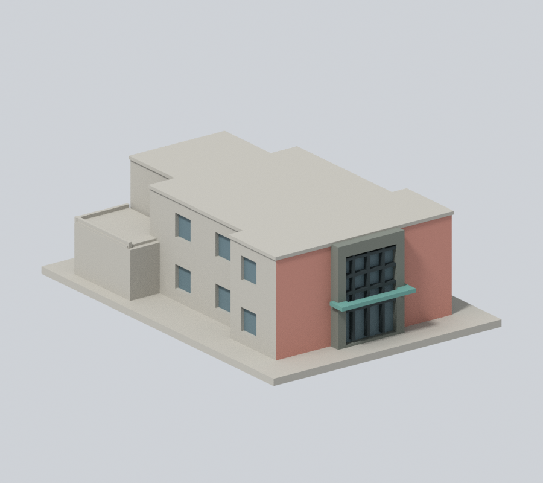
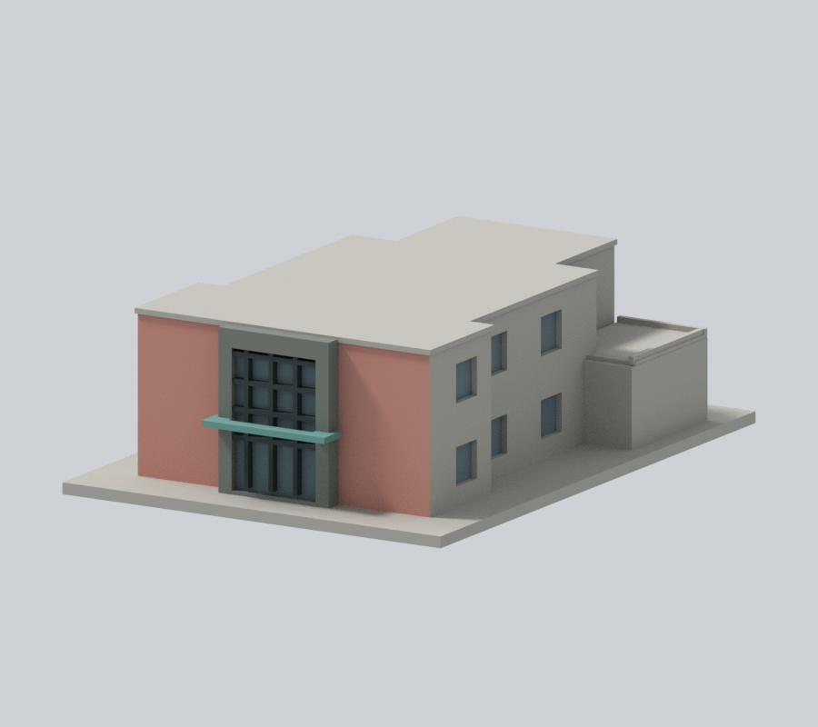
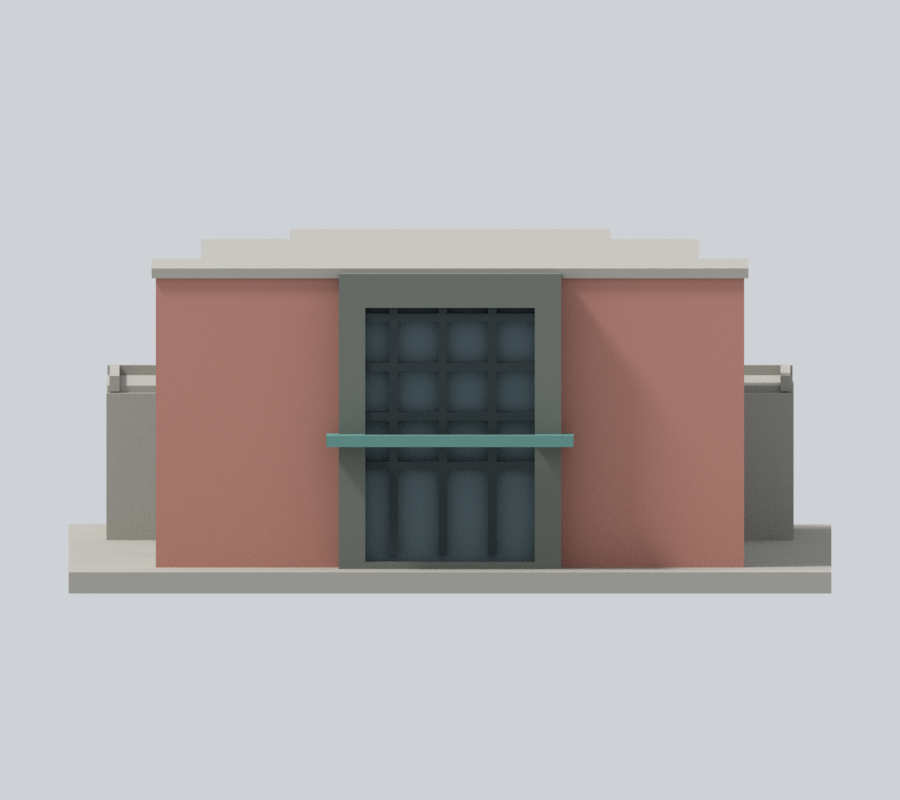
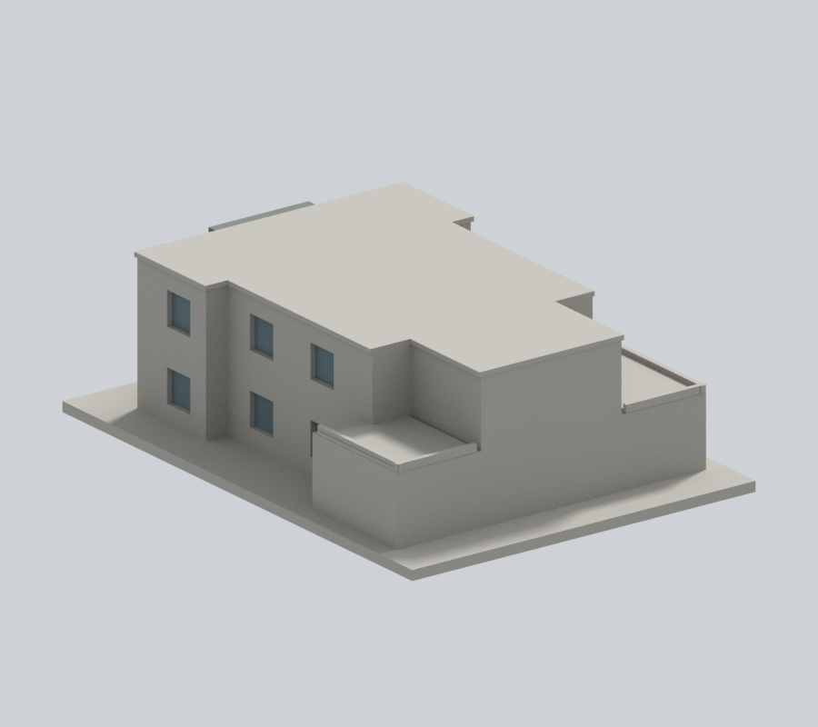
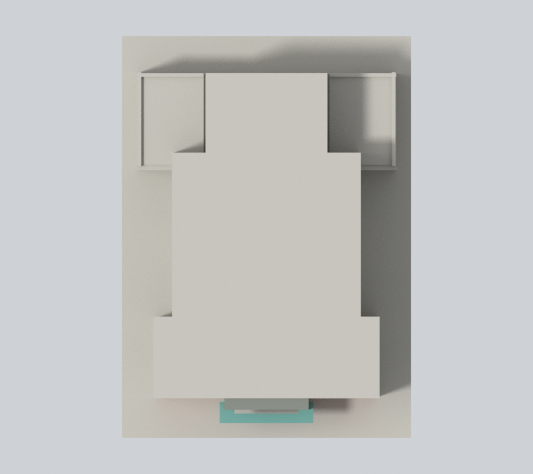

# 國立臺北教育大學｜文薈樓

## 模型預覽

臺北校區。自行以公開照片和平面資料建立的外觀近似模型；不是下載第三方3D模型、測繪成果或建築施工圖。

### 正面保留、入口構件及側窗凹背補色（v2）

保留原正面顏色與全部幾何，本版將192個原中性面延伸為同構件材質：入口灰石窗台／頂回折／框頂18面、原深灰窗格回折130面、綠雨棚底面及背面20面、12處原側窗完整凹背24面。隱藏回折色為相鄰構件連續性推估。**側牆粉／橄欖灰材質交界沒有對應網格邊界，側後牆、露台、主屋頂／壓頂及底座共500面仍留中性；不是整棟驗色完成。**

| 正斜視 | 來源角度 | 正立面 |
| :---: | :---: | :---: |
|  |  |  |
| 背向 | 上視 | 外觀檔案 |
|  |  | [3MF](appearance.3mf) · [Blender](appearance.blend) |

[左側檢查](appearance/left.png) · [右側檢查](appearance/right.png) · [同相機原正面](appearance-review-v2/original-front.png) · [同相機原背面](appearance-review-v2/original-rear.png)

[本版面域與外觀審核](appearance-review-v2/color-continuity-review.json)。[來源與範圍](APPEARANCE.md)。原四張模型圖保留檔案、不再放於 README；原幾何及列印警告不變。

## 範圍與來源時點

依平面與正側照片自建整體量體；未知背面不加窗陣。

玻璃分格為可列印的加粗近似，不能當成逐條窗框測繪。保留入口深框、突出雨遮、上下玻璃分格，平面中段收窄、後側低層露台與中央上層量體。平面上的開放露台不是內院。樓高、屋面與未見背面細節為近似；側窗位置按照片及平面大致配置。

官方防災計畫為2023年10月25日版本，實拍攝影日期未載。來源頁更新日不視為攝影日期。大禮堂另參考原檔EXIF標示2026年8月22日的四面照片；不能由此保證其他館舍2026年的外觀。

原照片、原PDF及照片對照只用於私人QA，不隨公開包散布。來源精確URL與支持特徵見 [sources.json](sources.json)。

## 模型檔案

- [model.stl](model.stl)：實際交付網格，毫米單位，含底座最長150毫米
- [scene.blend](scene.blend)：由相同STL匯入的可編修網格，參數建模來源為 [build_model.py](build_model.py)
- [requirements.txt](requirements.txt)：Python依賴；執行 python build_model.py 可重建
- [render_preview.py](render_preview.py)：用 Blender 實際讀取交付STL渲染，非示意效果圖

## 列印與驗證

底座朝下。每館獨立縮放，不能直接拼為同一比例校園。建議先在自己的切片器檢查；拱頂、雨遮、百葉與屋簷的懸伸可能需要支撐。長圓窗框、拱邊與窗格屬細件，拆支撐時容易損傷。沒有實體試印，亦未聲稱Cura或Prusa的實際工具路徑驗證、不用支撐或保證可印。

[validation.json](validation.json) 檢查原始STL水密、原法向與繞序、正體積、每邊兩面、vertex link單環、單一連通表面、無分離內殼、尺寸、獨立重建SHA及Blend幾何一致。

[contour-validity-check.json](contour-validity-check.json) 逐0.2毫米、固定z偏移0.071毫米檢查閉合與每個/合成Polygon有效性；不允許repair後算通過。[thin-feature-check.json](thin-feature-check.json) 是canonical fail-closed v3的0.8毫米參考opening輔助篩檢，採1毫米抽樣，不等於全面最小壁厚或切片工具路徑。

驗證命令：python validate_model.py；python check_contour_validity.py；python check_thin_features.py。需先以 blender -b -t 2 -P render_preview.py 建立scene.blend。

本版逐點逐面、材質值與乾淨重建結果見 appearance-review-v2。原 appearance-review 作為 v1 歷史保留，不代表本版重測結果。發布狀態由實際遠端提交與讀回確認，不以本機凍結代替。
