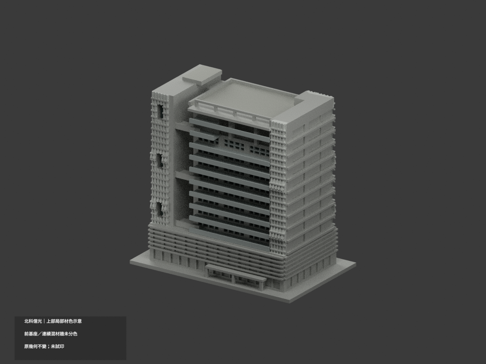
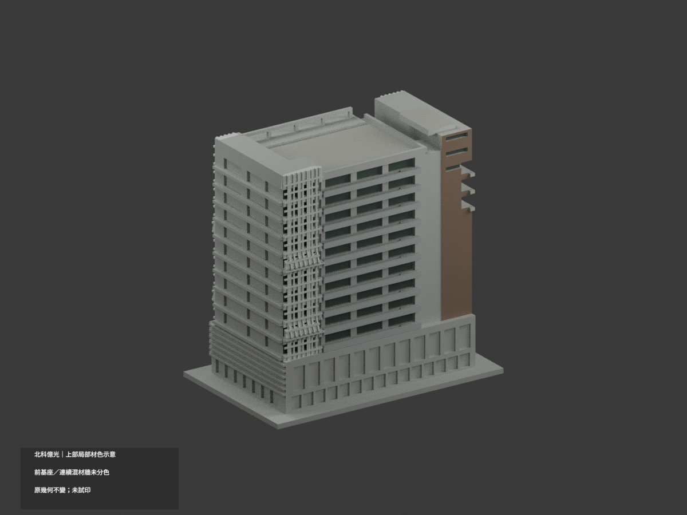
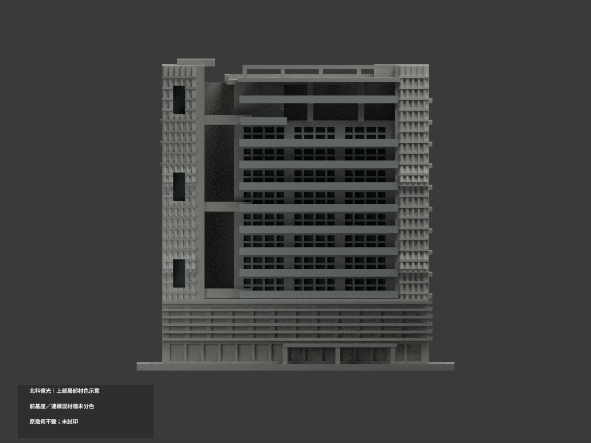
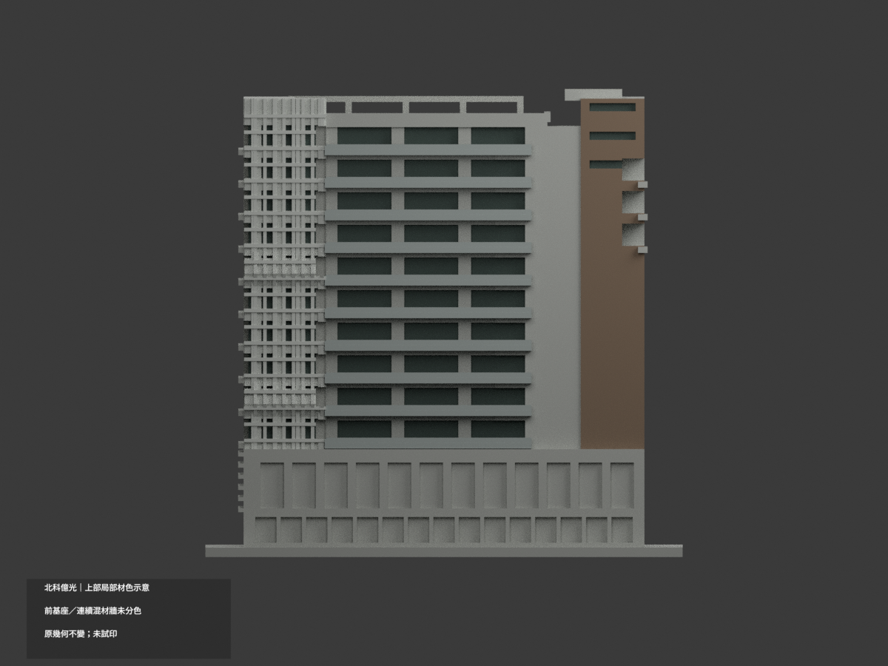
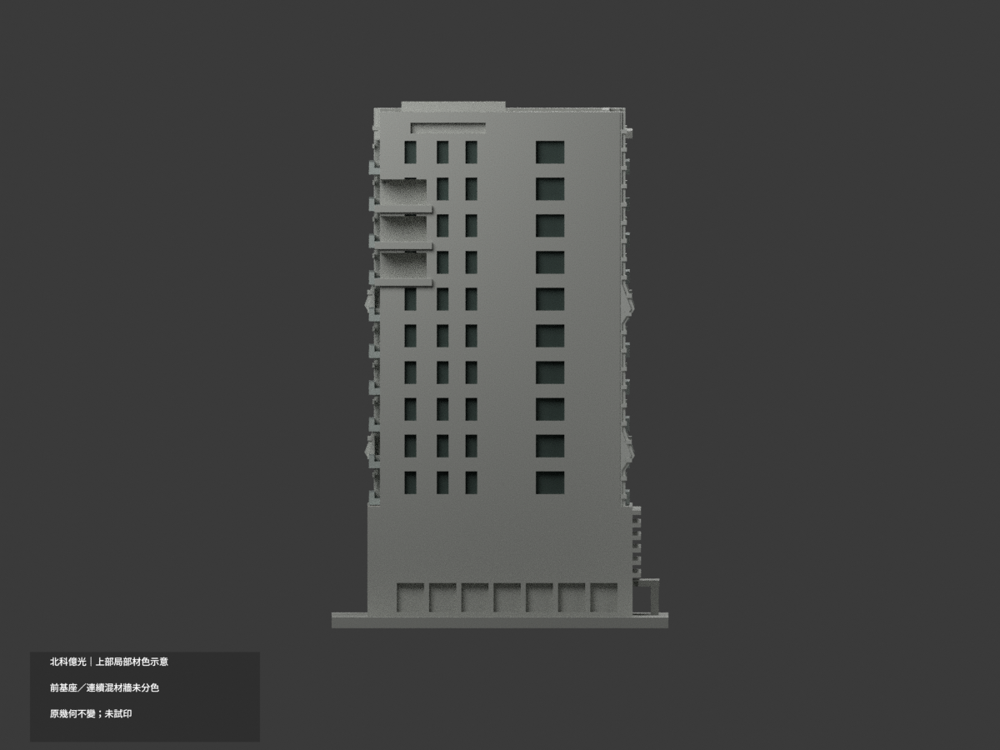
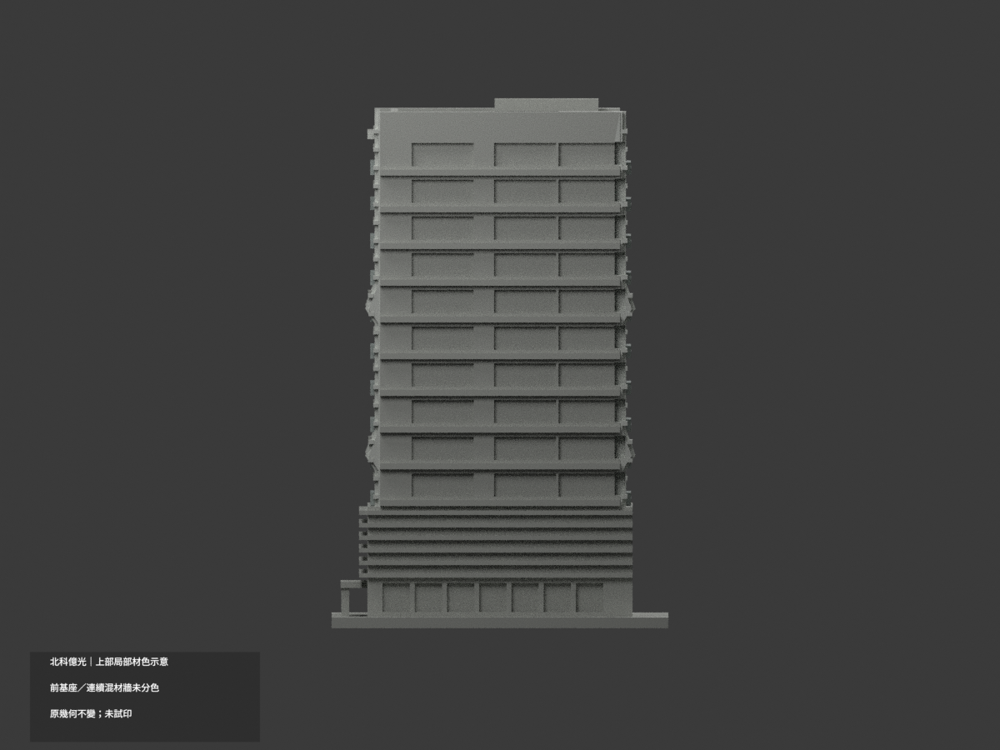
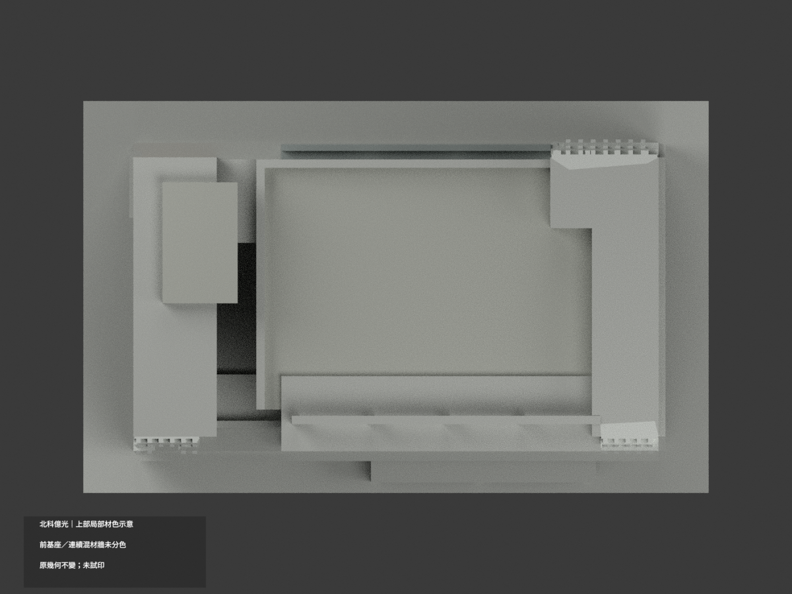
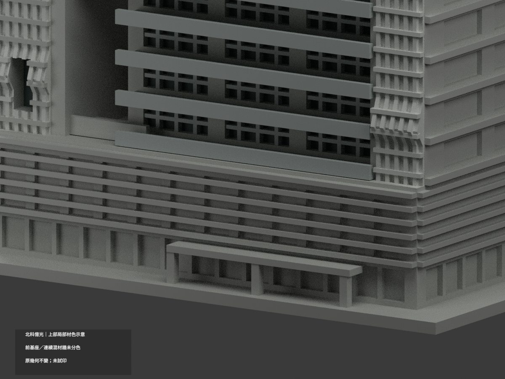
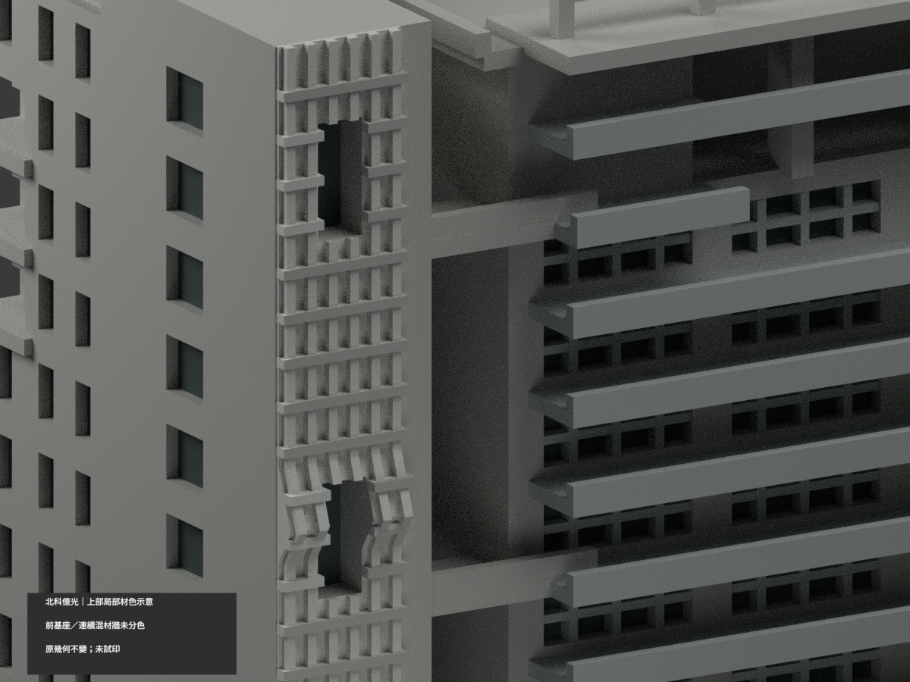
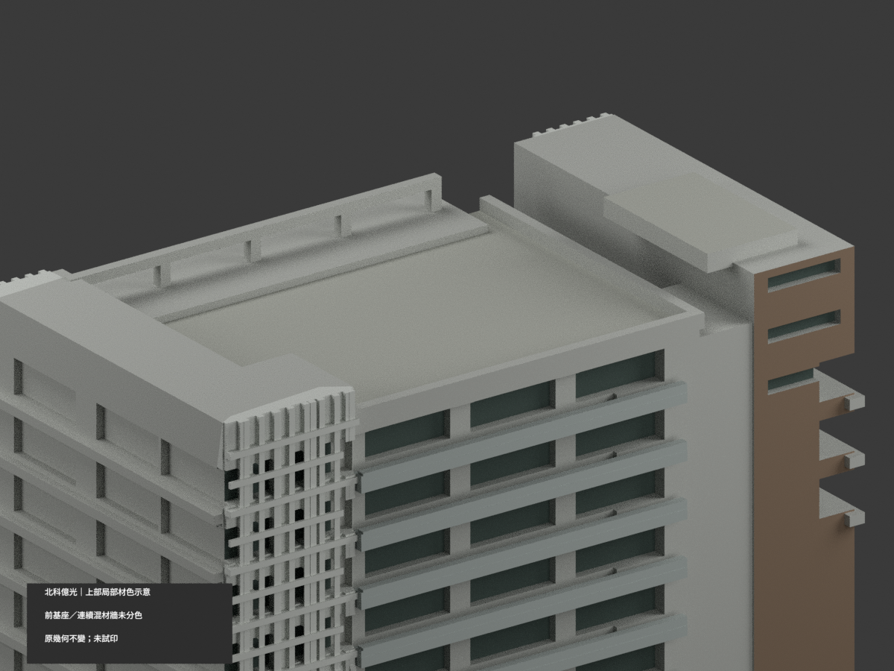

# 北科大億光大樓｜有據上部局部材色示意

| 正前 | 後方 | 正面 |
|---|---|---|
||||
||||
||||
||||

## 材色範圍

**前基座與連續混材牆分色未完成。** `partial_color_incomplete=true`、`fully_colored_exterior=false`；僅有據上部局部材色，不計作全棟完成。same-item `ntut-everlight`、count_delta=0。

保留 **22312 個原三角面、原頂點與 STL／OBJ／build_model.py 位元組**，原 uniform scale 為 150/extents.max，原程式底座寬 150、最頂 146.7、深 94，且全部元件未超出 150 寬，原最大外徑 150，故 uniform scale = 150/150 = 1；再與匯出 150 mm 外徑交核。不新增、切分面、改柱位或修正原近似幾何。

官照支持灰褐核心、白灰折屏、灰結構板與離散灰綠窗陰影。但西面 x=-63 與未證低層連為同一大平面，**整個平面中性，不能只把上方三角染棕產生假斜楔**；棕色只放在獨立上部核心北返面。前入口、雨庇及前／右基座遮陽全部中性，PDF 反向照片不作前面材色證據。

已有上部折屏和細梃採淺灰，窗只染原凹背，不整個陽臺填成玻璃。屋頂實照有植栽與設備，原簡化露台只採灰色，不畫綠屋頂、不加植栽機具、字樣或網格貼圖。未知部位中性。

## 日期與來源限制

兩官照與校務計畫圖 14.12 上方實景均未確認拍攝日期；暖夕光與晴日明暗差僅用近似色族，HEX 並非校準色票。PDF 實頁 231／印頁 223 的下方新建教研二期效果圖完全排除。未使用取用失敗的 Commons 照片；不宣稱 2026 完整現況、精確材料測繪或原幾何已獲實景重新驗證。

## 使用與重建

`scene.blend` 是彩材場景，`appearance.3mf` 是原三角面基本材質對照。`color-mesh.npz`、`palette.json`、`appearance-materials.json` 保留面域與材質標籤。STL 本身沒有顏色；原 OBJ、原程式與 `ORIGINAL-MONOCHROME-README.md`、`previews/` 舊單色圖全保留，不當作本色版驗證。

`python colorize_model.py` → `python export_appearance.py` → `python validate_color.py`。原幾何由 `build_model.py` 重建；`blender -b -t 6 --python-exit-code 1 --python render_color.py`，另以 `verify_color_scene.py` 重新開啟查核。

**未實際列印**；六種材質標籤不是已配置或實測的四色／多色列印工作。原細部列印風險未因分色解除。

## 權利

原照／PDF 未確認 CC 或再散布授權，僅私人參照，不隨模型公開、不貼圖、不保證商用；原模型授權不涵蓋來源照片。來源已私人備份，原檔與歷程全保留。來源詳 `COLOR-SOURCE-REGISTER.json`。幾何、格式、隔離重建、十視角與人工視覺分開驗證；未證部分明示未完成。
