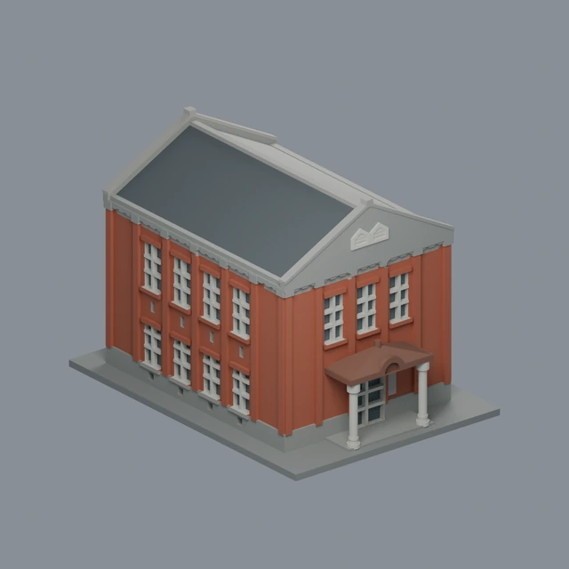
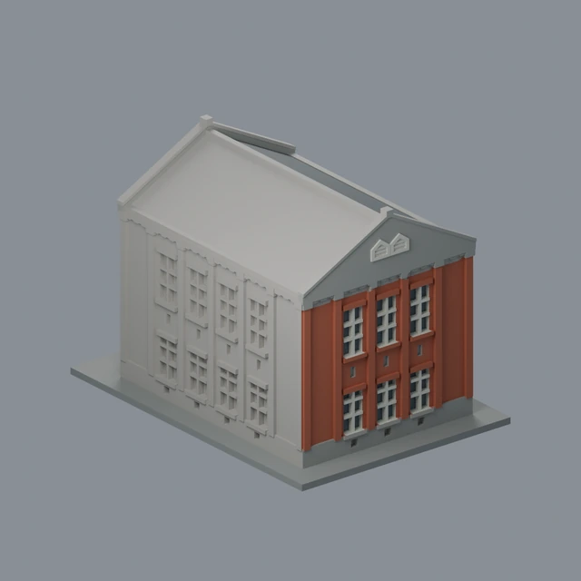
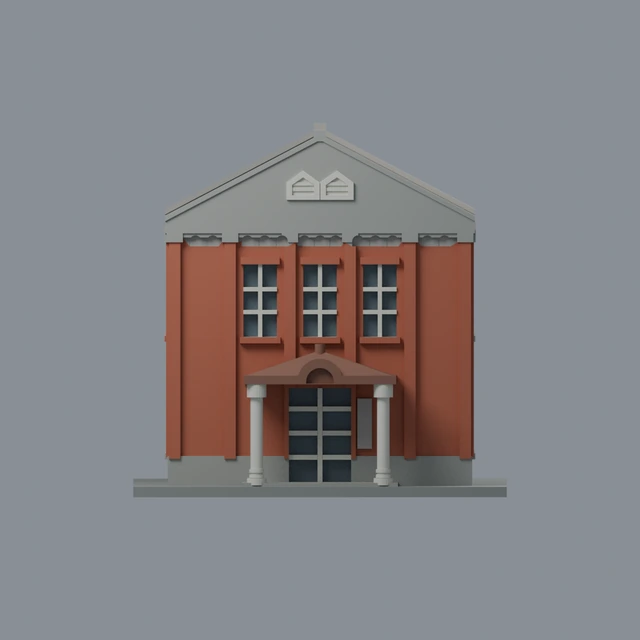
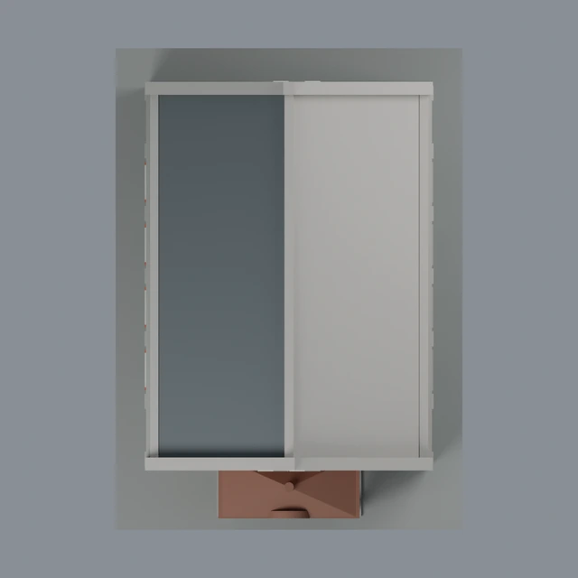

# 臺北工業學校紅樓｜現版四視角

## 模型預覽

| 正面斜視 | 背面斜視 | 正立面 |
| :---: | :---: | :---: |
|  |  |  |
|  | | |

由現版八材質 Blender 依原相機重繪，大圖為無損 WebP。沿用既有東入口、西端與可辨識的長側配色，另一長側及未知屋坡維持中性。沒有新增材質，不以此代表現況。

[現版 Blender](../appearance/scene.blend) · [現版彩色 3MF](../appearance/ntut-appearance.3mf) · [原 STL](../model.stl) · [模型及技術資料](../README.md) · [原外觀證據](../appearance/README.md) · [渲染證據](render-proof.json) · [展示校驗](SHA256SUMS)
