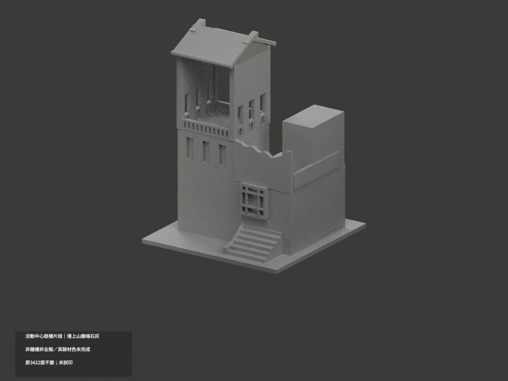
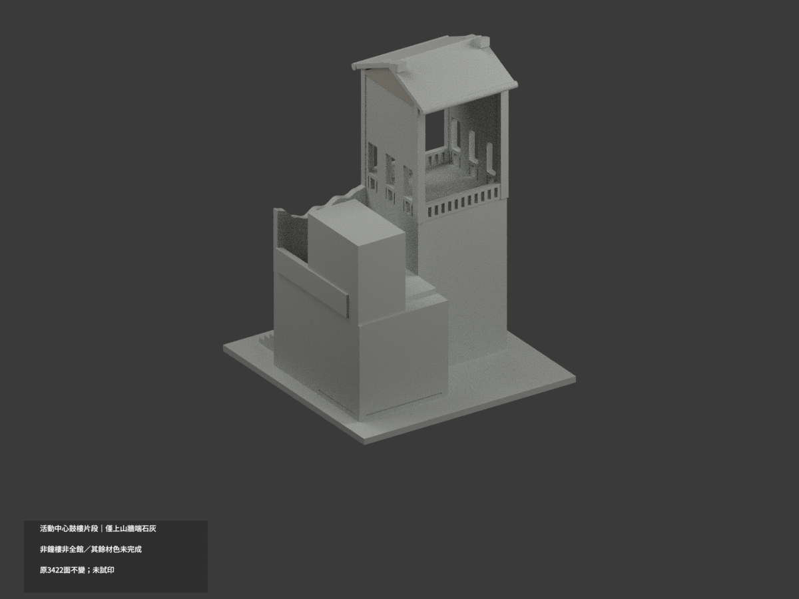
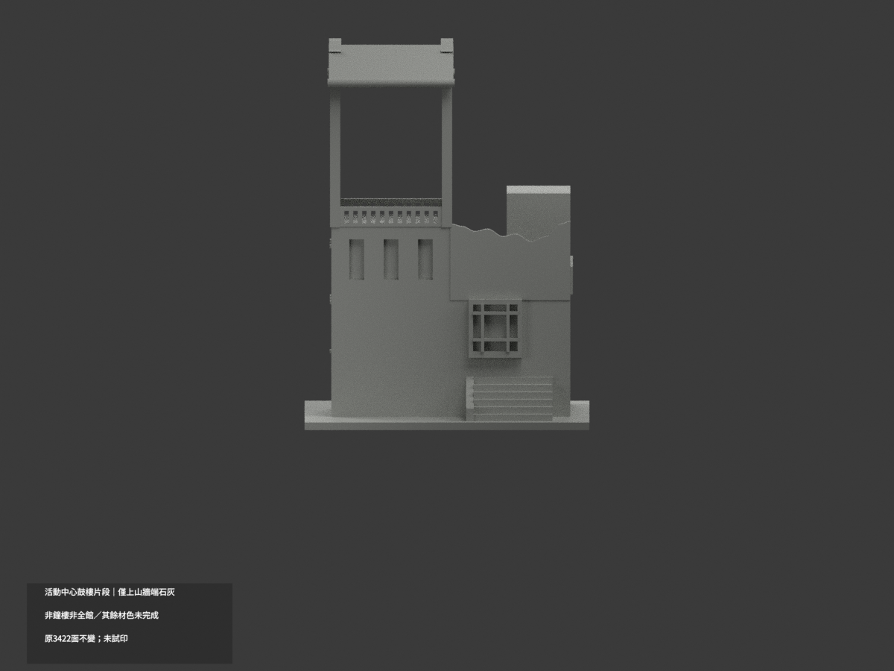
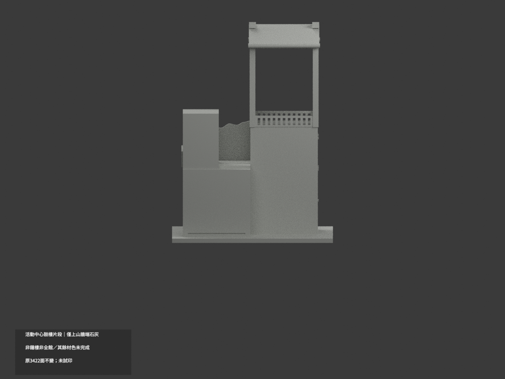
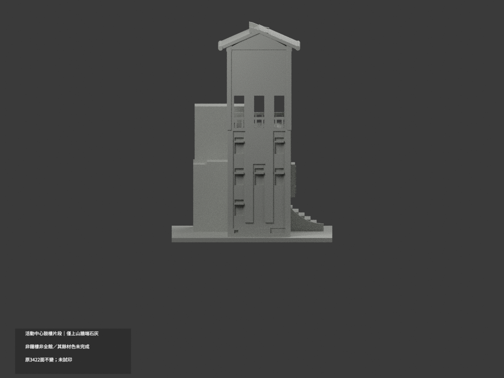
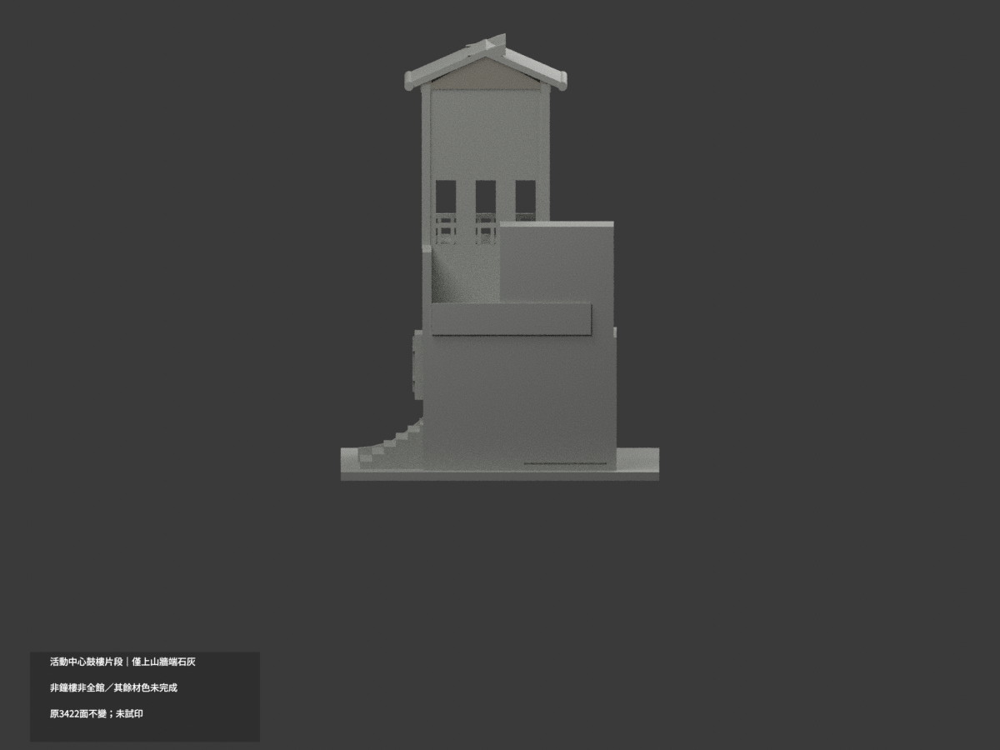
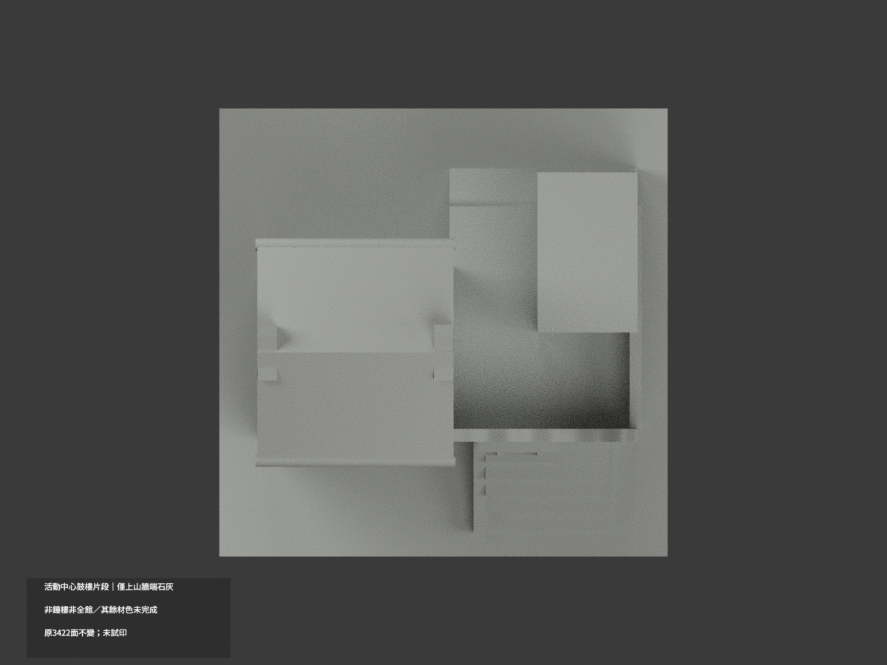
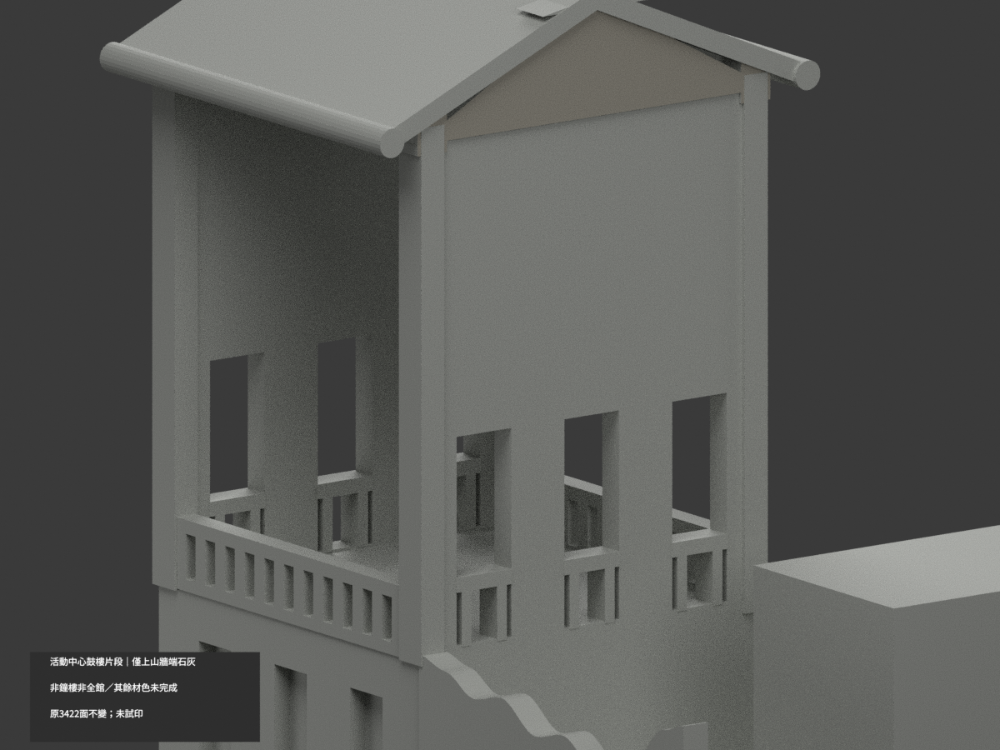
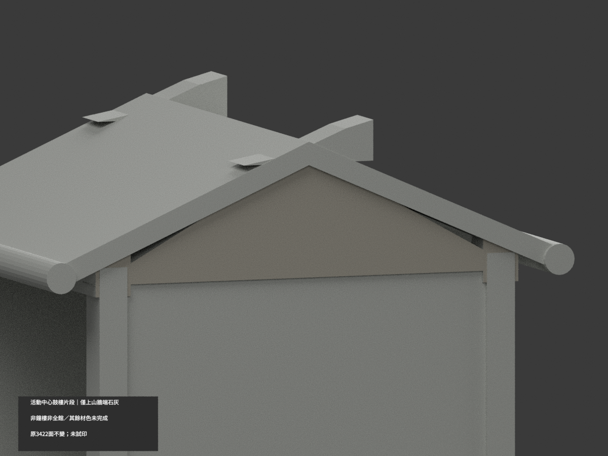
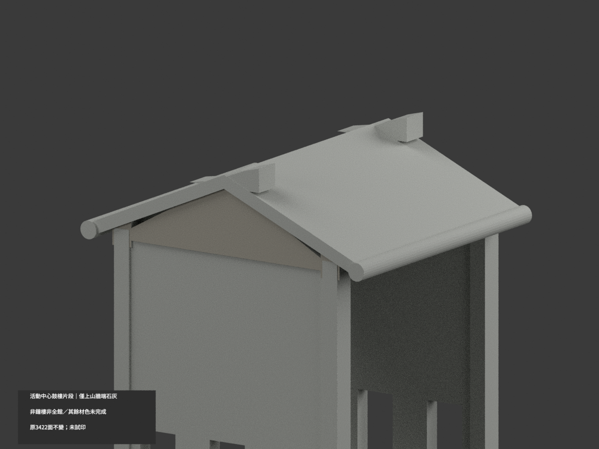

# 活動中心鼓樓局部｜突出上山牆端面石灰色

**局部補色未完成：只突出上山牆端33原面石灰；主三孔屏、磚灰混牆、屋皮與其餘面尚未分色。** partial_color_incomplete=true、fully_colored_exterior=false。同項 tnua-activity-drum-tower-section／count_delta=0，國立臺北藝術大學關渡校本部。英文身份 TNUA Activity Drum Tower Section partial color。

**僅活動中心鼓樓局部，不是鐘樓、完整活動中心、池塘或廣場。保留原相反角度外觀近似與人工截斷。**

| 前斜視 | 後斜視 | 正面 |
|---|---|---|
|  |  |  |
|  |  |  |
|  |  |  |
|  | | |

## 材色範圍

全原x1.9無限plane三頂點0.0001mm枚舉，33面分為完整共享邊連通7/19/7域。Boolean實際延至z132.800003，不能裁到134；y−28..18與z132.8..145.6只是結果界限，不作人工截色。33名義石灰色、3389中性，原3422三角不變。全原共面連通域一致，無normal閾值漏小面、無centroid或亮度切三角。

照片可證三孔樓廊之上灰石三角屏外面，並非斜屋皮；只原突出平面，不是精確石紋。主x1.5三孔屏83面延到z52，另5面低後域皆中性，不裁樓廊上半。全高前y−27混下磚上灰、相鄰曲牆混基座皆中性；斜屋上底、捲檐/飾物、階梯/擋牆字樣人遮、玻璃框欄、x2柱、反山牆/背截面/支撐全部中性。中性不是實景灰，資料範圍不是實材接縫。

## 來源日期與原始限制

2018照片原EXIF 2018:02:19 15:05:27 無時區，僅相機元資料不保證鐘準或換算UTC。2018文章不是另一精確拍攝證據，不稱2024或2026現況。原幾何由異期不同角度近似；補色不追認測繪，不新增鼓或填補未知內部。初接收錯folder/alias已更正，只同一正確slug，不是第二模型；更正歷程私人保存。來源照片只私人研究，不公開貼圖，不推定商用權利。

## 檔案與 QA

原STL/build與3422三角座標拓撲/字節保留；immutable23件無OBJ，原builder會輸出OBJ但隔離產物只私存，不冒稱原repo有OBJ。原README另存ORIGINAL-MONOCHROME-README.md，單色圖/QA歷史保留。appearance.3mf兩展示材與scene.blend真面材同原幾何；export/validate/render/verify及真3MF/scene精確身份 TNUA Activity Drum Tower Section partial color。精確依賴隔離build+color、閉合正體積/3MF座標面材/Blender重開/10張1200×900檢核；保留重建不刪，未試印或驗多料切片，STL本身無色。

## English limitations

TNUA Activity Drum Tower Section partial color. Local drumtower segment only,notbelltower/wholeactivitybuilding/pond/plaza. Entire originalx1.9 plane33faces inthree complete7/19/7 sharededgecomponents,includingBoolean down toz132.8. Nominalstonegray33/neutral3389;original3422triangles/STL/buildunchanged,noimmutableOBJ,count_delta0. Mainx1.5screen extendsbelowgallery andremainsneutral;roofs/soffits/eaves/ornaments,brickgraymixedwalls,windows/rails/stairs/returns/cutendsneutral. RawEXIF2018:02:19 15:05:27 hasnotimezone orcertifiedclock,no2026survey. Intakealias notasecondmodel. Originalgeometricapproximation notrevalidated,no publicphotos/textures,not testprinted.
