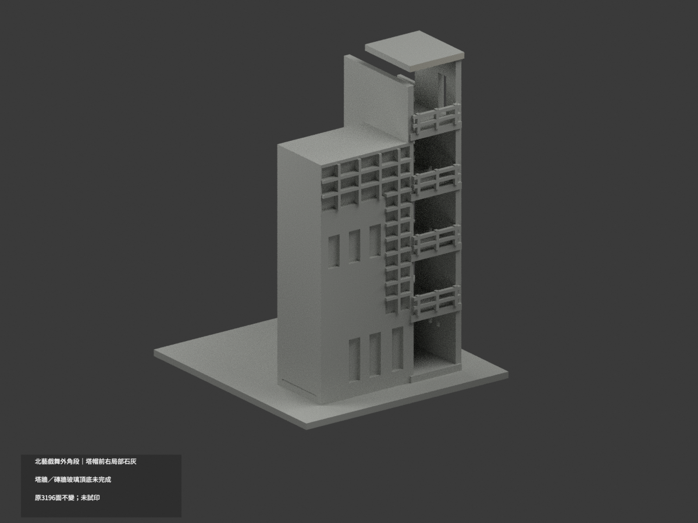
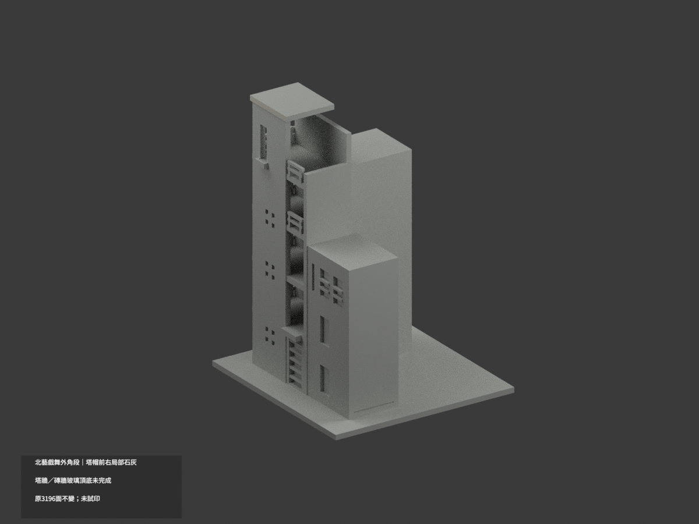
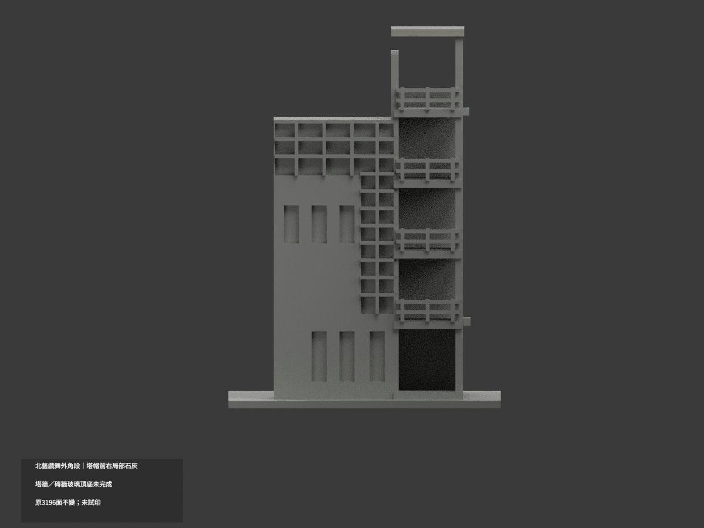
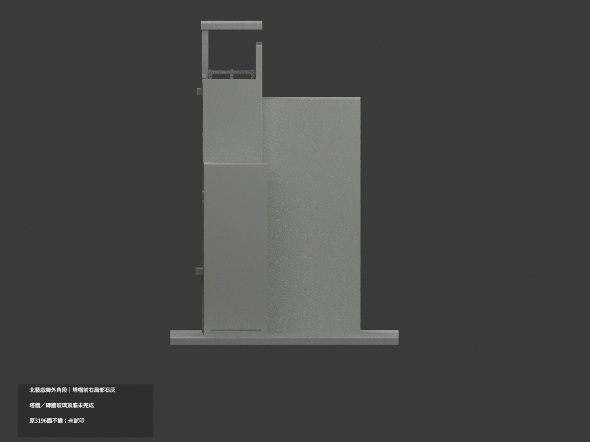
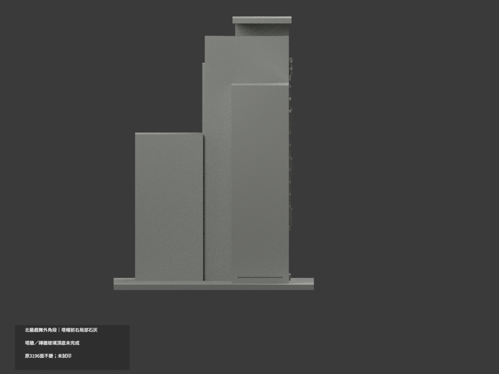
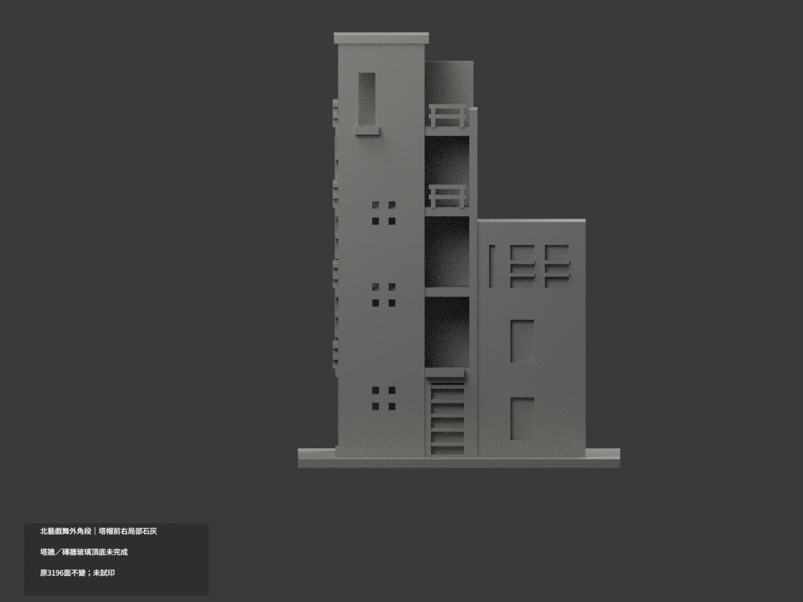
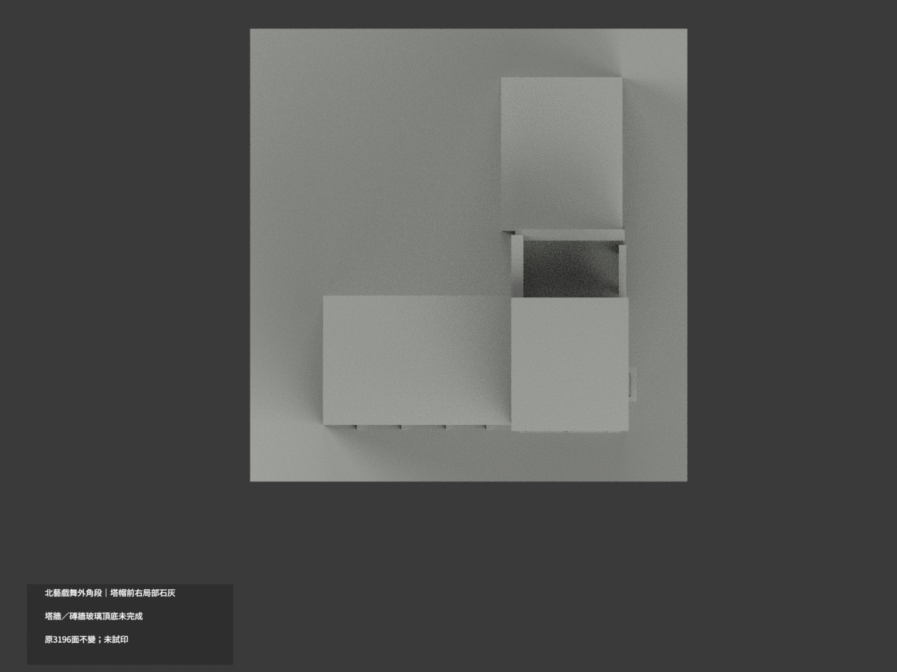
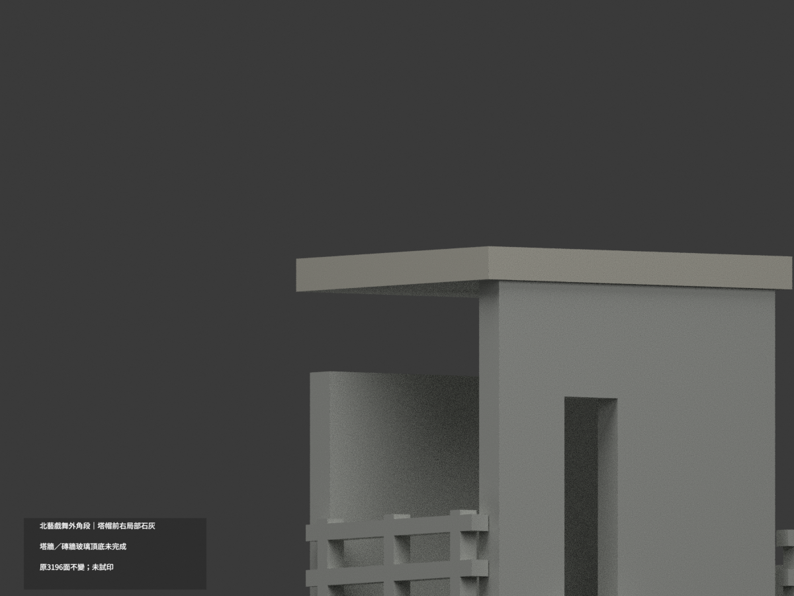
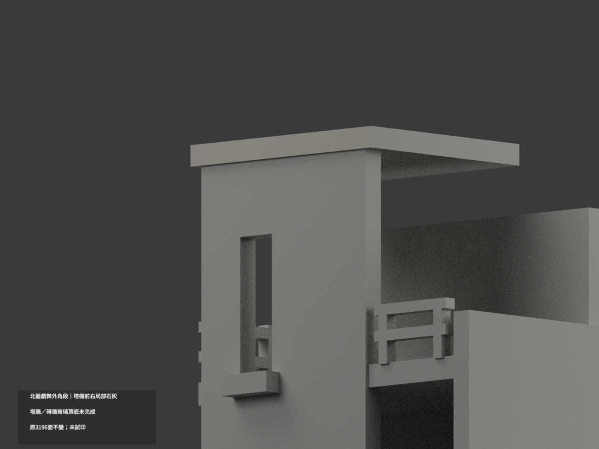
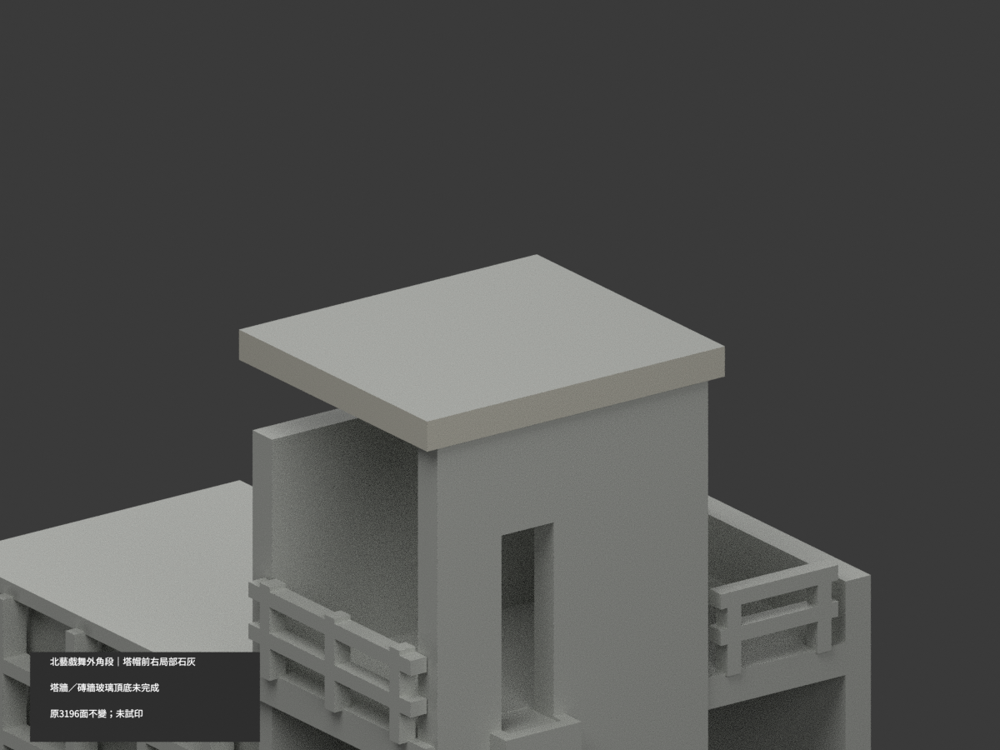

# 北藝戲舞教學外角段｜塔帽前右局部淺石灰

**塔牆、磚牆與玻璃等材域未完成分色。** partial_color_incomplete=true、fully_colored_exterior=false。僅塔帽兩完整外沿4面名義淺石灰，非全棟完整補色。

| 總覽 | 背側 | 正面 |
|---|---|---|
||||
||||
||||
||||

## 材色範圍
同 tnua-drama-dance-stair-corner-section 原項目，same-item、count_delta=0。國立臺北藝術大學關渡校本部戲劇舞蹈教學大樓外角樓梯塔暨玻璃轉角段，只含兩裁短翼，不是全教學棟、中庭或雕塑。3196原三角、STL與build_model.py原bytes不變；22原件無OBJ，不造原件。
- 原塔帽前y−23.5與右x44.5兩完整外沿，各2三角，z147.1..150；全3頂點無限plane恰等於有限矩形，無bbox裁牆、normal漏片或人工分界。
- 其他3192面中性：塔帽頂底、後及對側、全高塔牆含遮蔽下部、平台欄杆交界、通風孔背、小窗檻與有字雨棚、混灰基座磚牆、L玻璃代理反光混框、兩翼與支撐。
- 原厚化欄杆、裁切端與幾何近似不改；局部色不追認完整幾何準確，中性邊界為證據範圍不是材料接縫。不新增人物、雕塑、字或玻璃。

## 來源與日期
親看tour-020與tour-021外觀；020證完整塔帽兩可見外沿，021下部近景僅對位，不能補未拍頂面。2016文章及檔名20160229都非拍攝日證，不稱2026現況。HEX是名義淺石灰族，非校準色票。原照片私人不公開、不作紋理，未確認CC或再散布授權，不保證商用。

## 格式與列印
[原STL](model.stl) · [逐面材色3MF](appearance.3mf) · [Blender](scene.blend)
原150mm高示意模型，非測量比例。實際物件名 TNUA Drama Dance Stair Corner Section partial color，依真slug與館名獨立核。STL無色；3MF及Blender逐面分材，兩標籤非兩色或四色耗材切片驗證，未實際列印。

## 重建與 QA
原build_model.py → colorize_model.py → export_appearance.py → validate_color.py；Blender render_color.py／verify_color_scene.py。完整隔離Shapely2.1.2精確原build＋color重建、原bytes／全三角multiset、閉合正體積、3MF逐面材、scene重開、十圖1200×900與圖文hash。原README、previews、validation保留歷史，不冒充新QA，沒有刪檔。

## English scope
Partial only:4 original front and right tower-cap outer vertical faces light stone gray;3192 neutral. Each whole infinite plane equals finite all-three-vertex rectangle. Original3196 triangles and22 files retained,noOBJ. Only outer stair/glazing corner plus cropped wings, not whole complex, courtyard or sculpture. Full-height walls, mixed glazing, brick/base, cap top/underside/rear and landings remain neutral.2016 article and filename do not establish capture, no2026 claim. Original150mm-height approximation, count0, no geometry changes or tested filament slicing.
