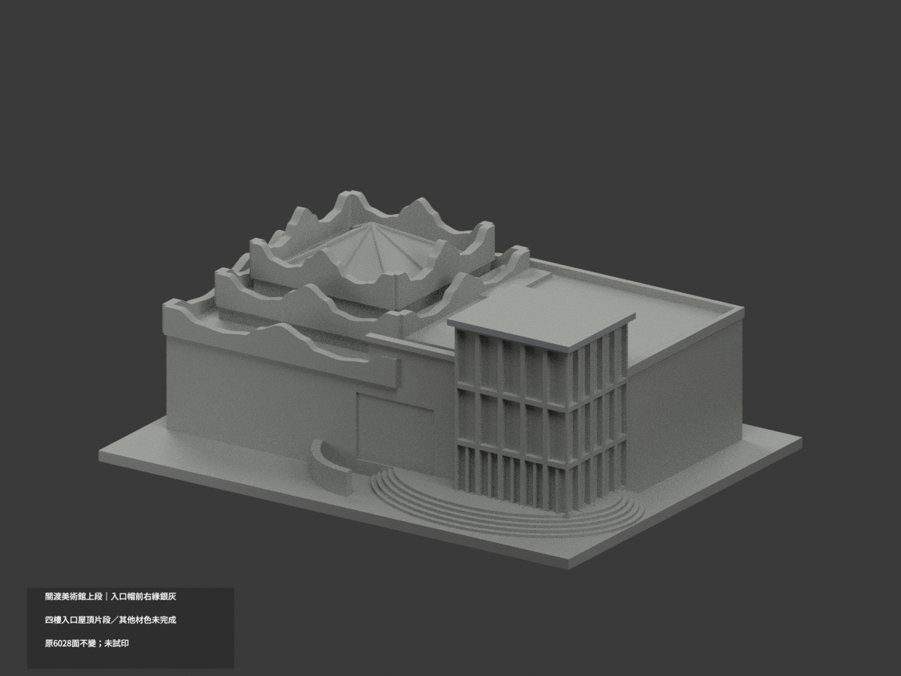
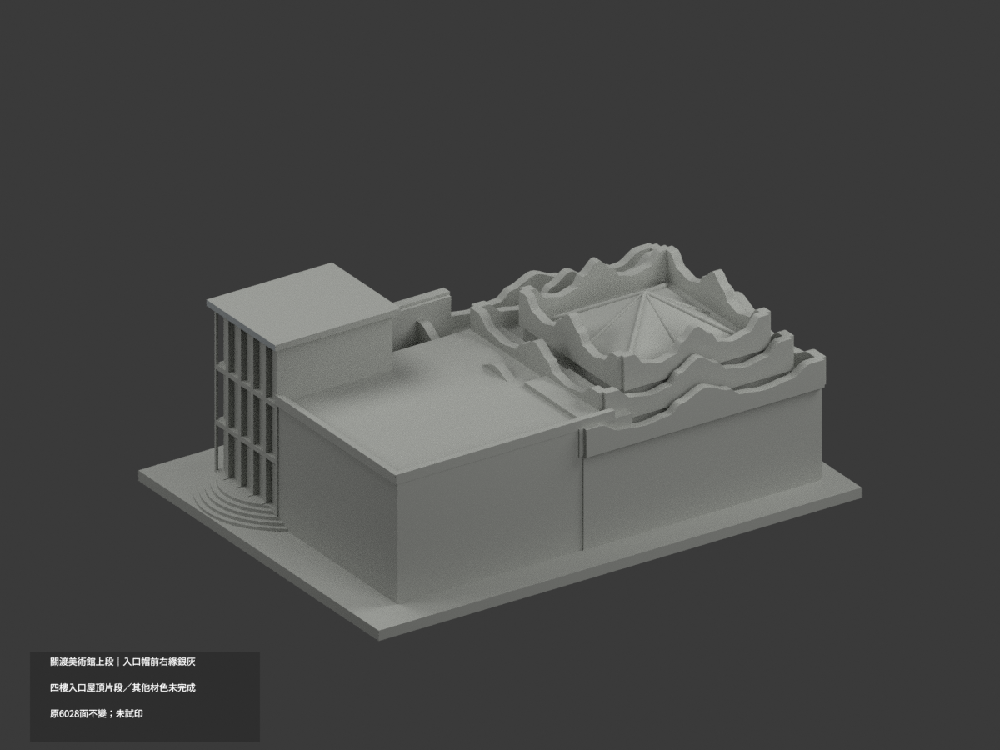
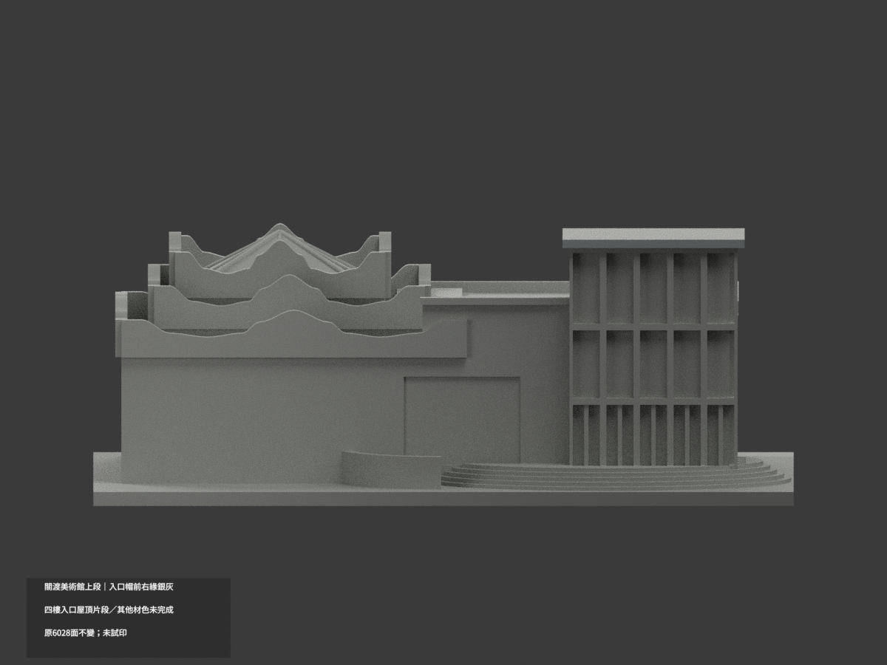
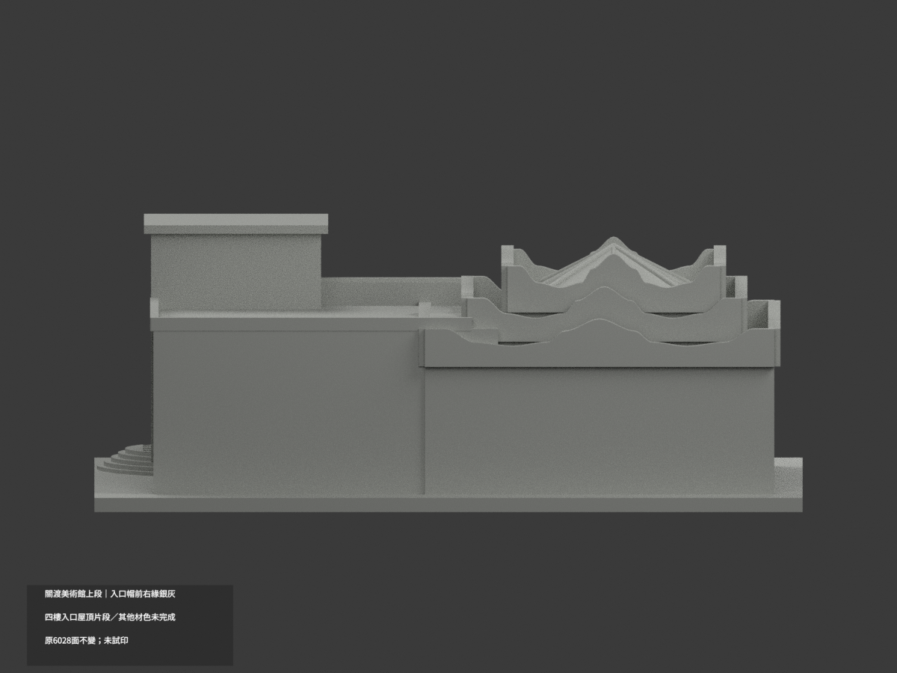
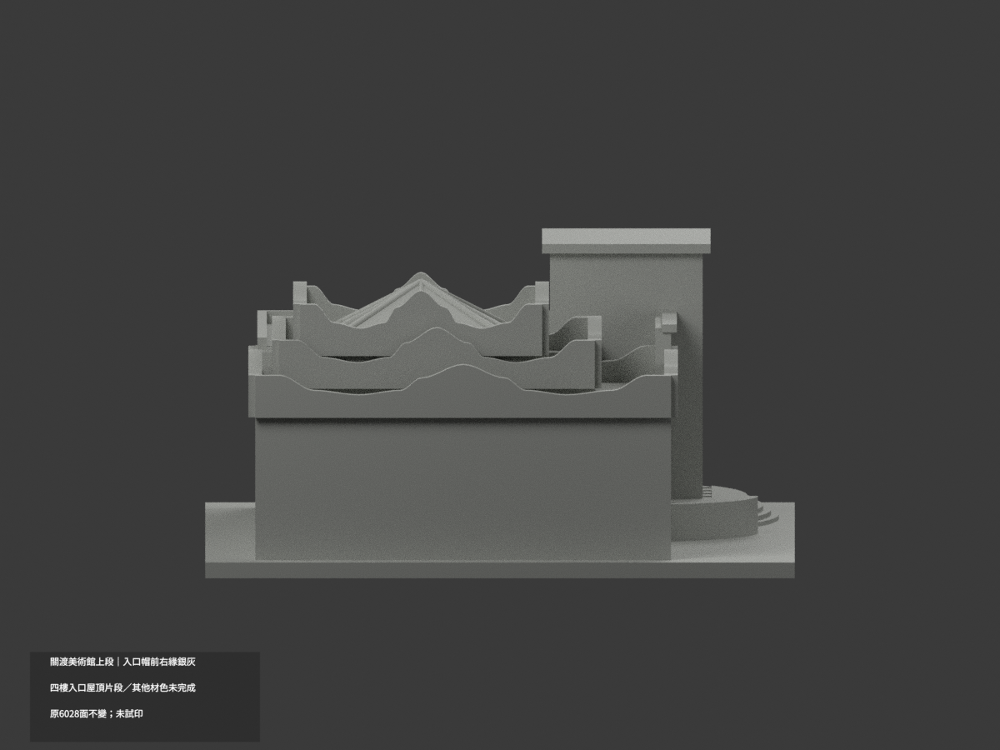
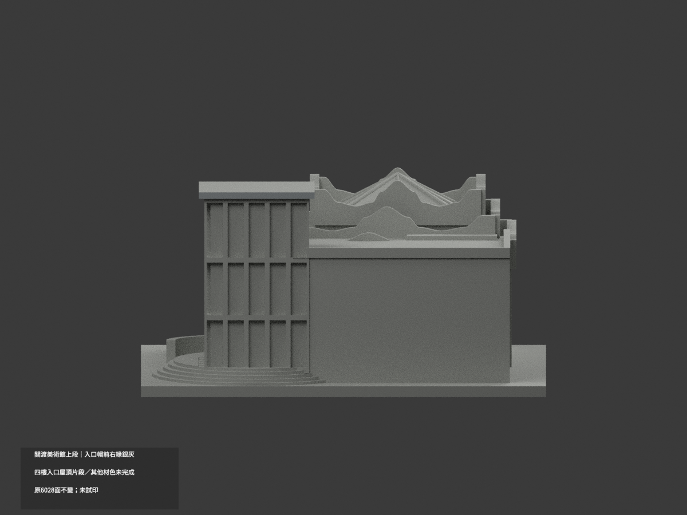
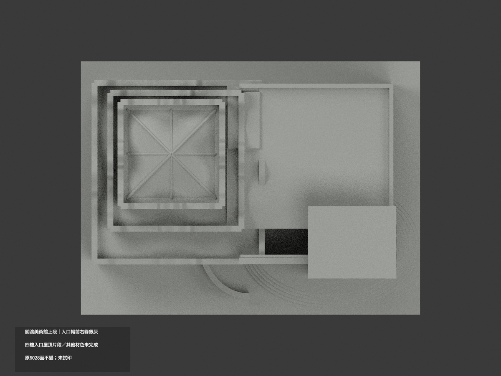
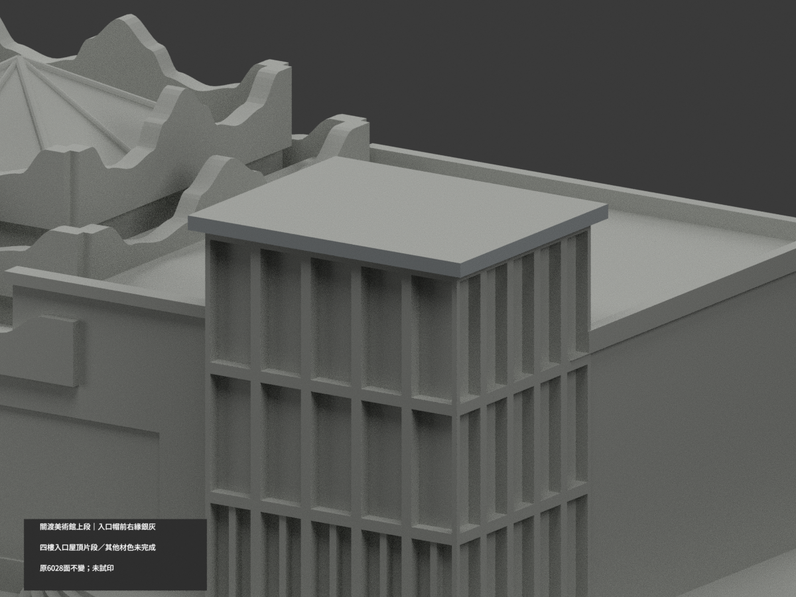
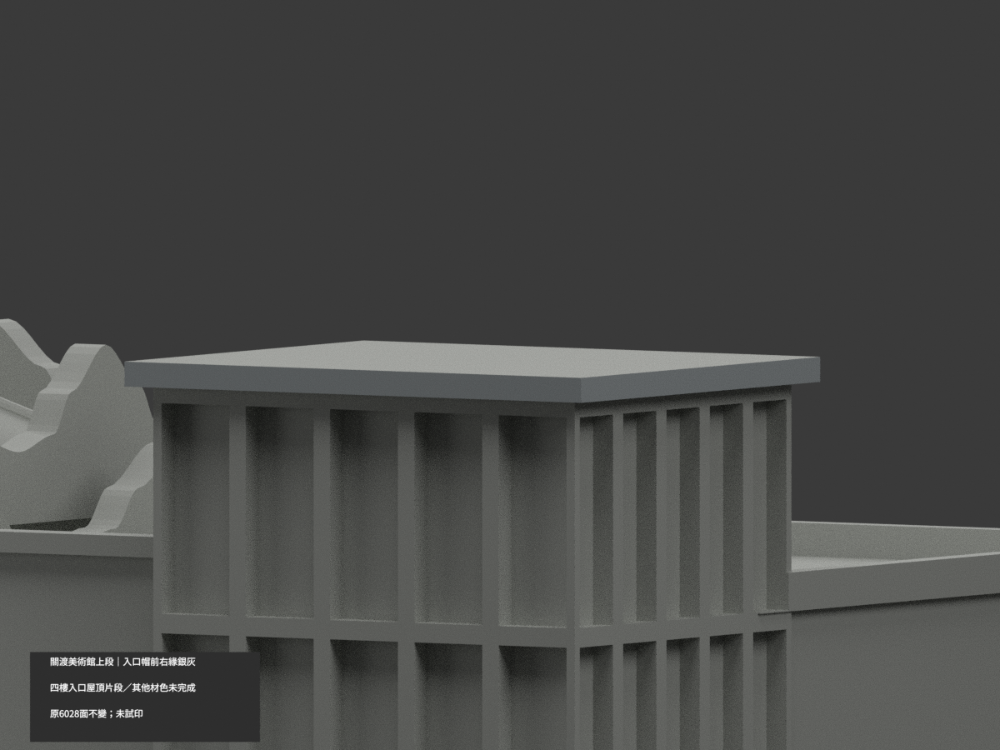
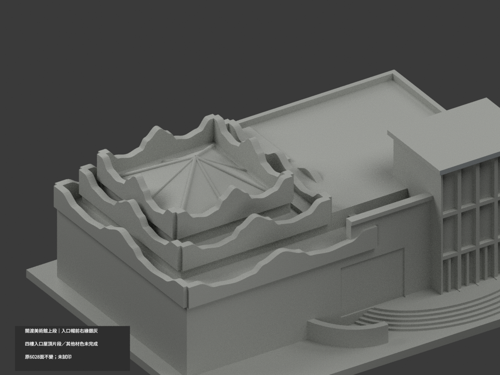

# 關渡美術館入口暨曲牆屋頂段｜入口帽前右緣局部銀灰

**局部補色未完成：只入口帽前緣與右緣4原三角銀灰；玻璃、框底裙、曲牆與其他材色未完成。** partial_color_incomplete=true、fully_colored_exterior=false。同項 tnua-kuandu-museum-upper-section／count_delta=0，國立臺北藝術大學關渡校本部。英文身份 TNUA Kuandu Museum Upper Section partial color。

**僅四樓入口層可見玻璃盒、階梯與層疊曲牆屋頂片段，不是全館；不含下坡低層或相連／相鄰研究大樓。**

| 前斜視 | 後斜視 | 正面 |
|---|---|---|
|  |  |  |
|  |  |  |
|  |  |  |
|  | | |

## 材色範圍

整原y−40與x64.5兩個無限plane分別所有三頂點0.0001mm枚舉，各2面共享完整對角線，皆原完整矩形。前緣x25.5..64.5，右緣y−40..−8，高z54.2..56，無bbox硬裁、normal篩面或亮度切三角。4面名義銀灰，其餘6024中性，原6028三角不變。全原共面連通域一致，實際域數記appearance-materials/BUILDER-DOMAIN-QA。

architect1完整可見入口頂帽前右薄邊，獨立於上皮與暗底，只兩完整域可對位。帽上、底、左後端均中性；帷幕前框原合併低裙與基座轉折，不從上半裁銀色。玻璃背含百葉/反光/內門不塗藍，左曲牆樹遮與磚嵌板布條、低弧牆黑館牌不整白/紅。階踏面、平台、天窗、後曲牆與其餘屋界全部中性。中性不是實景灰；資料範圍不是實材接縫。

## 原始範圍與日期

保持原上段截取、150mm外觀近似，曲牆/帷幕框/天窗加厚與下部人工截斷不改，不因補色追認測繪或完整美術館。原建築師頁專案證據不代表該事務所設計所有歷史外觀。拍攝日未知，URL2022/03非拍攝日，不稱2026現況。原照片只私人研究，不公開貼圖/不推定商用權利。

## 檔案與 QA

原STL/build與6028三角座標拓撲/字節保留；immutable22件無OBJ，原builder會輸出OBJ但隔離產物只私存，不冒稱原repo有OBJ。原README另存ORIGINAL-MONOCHROME-README.md，單色圖/QA歷史保留。appearance.3mf兩展示材與scene.blend真面材同原幾何；export/validate/render/verify及真3MF/scene精確身份 TNUA Kuandu Museum Upper Section partial color。精確依賴隔離build+color、閉合正體積/3MF座標面材/Blender重開/10張1200×900檢核；保留重建不刪，未試印或驗多料切片，STL本身無色。

## English limitations

TNUA Kuandu Museum Upper Section partial color. Upperfourth-floor entry/curvedroof segment only,notwholemuseum/downhillstoreys/neighboringresearchblocks. Wholeplanes y=-40 andx64.5 each2connected triangles completefront/rightcapedge z54.2..56;4silvergray/6024neutral,original6028triangles/STL/build unchanged,noimmutableOBJ,count_delta0. Mergedfrontframe/lowbase-skirt,blinds/reflections/windowbacks,roofupper/soffit/otherreturns,curvedwalls/brickbannerpanel/plaque/stairs/terraces/skylightneutral. Captureunknown,URL2022/03notcaptured,no2026survey,no historicalauthorship overclaim. Originalgeometricapproximation notrecertified,no publicphotos/textures,not testprinted.
