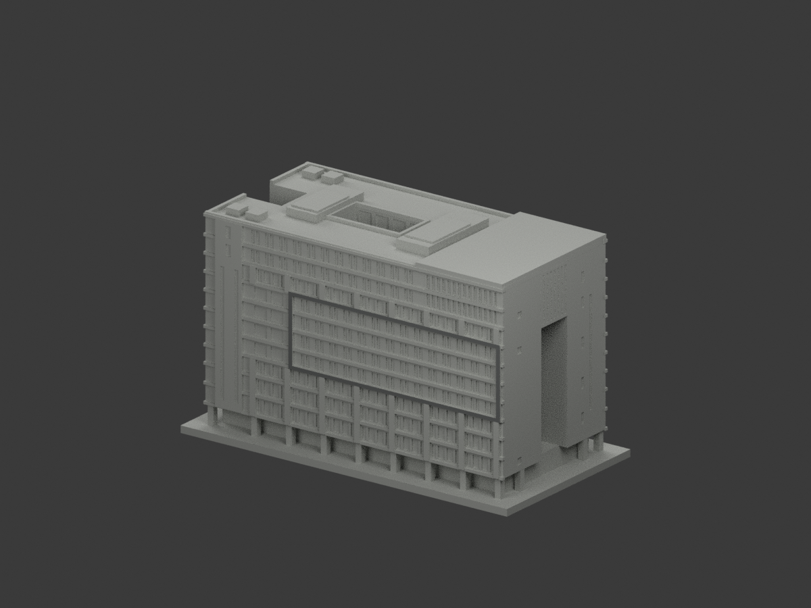
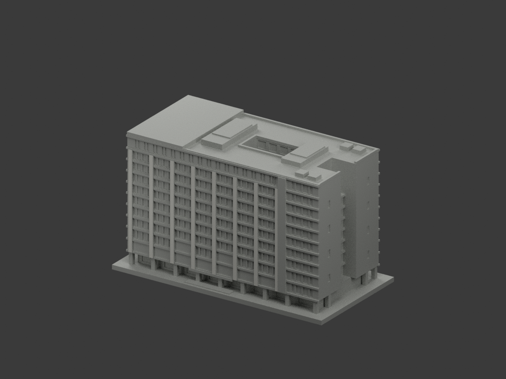
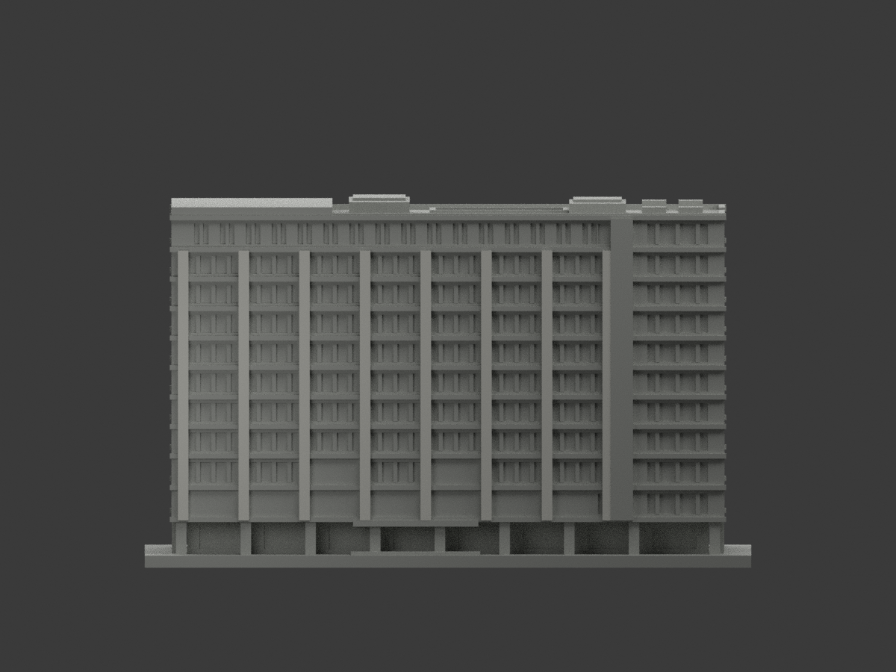
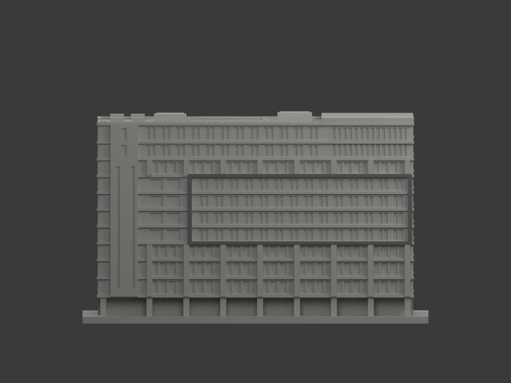
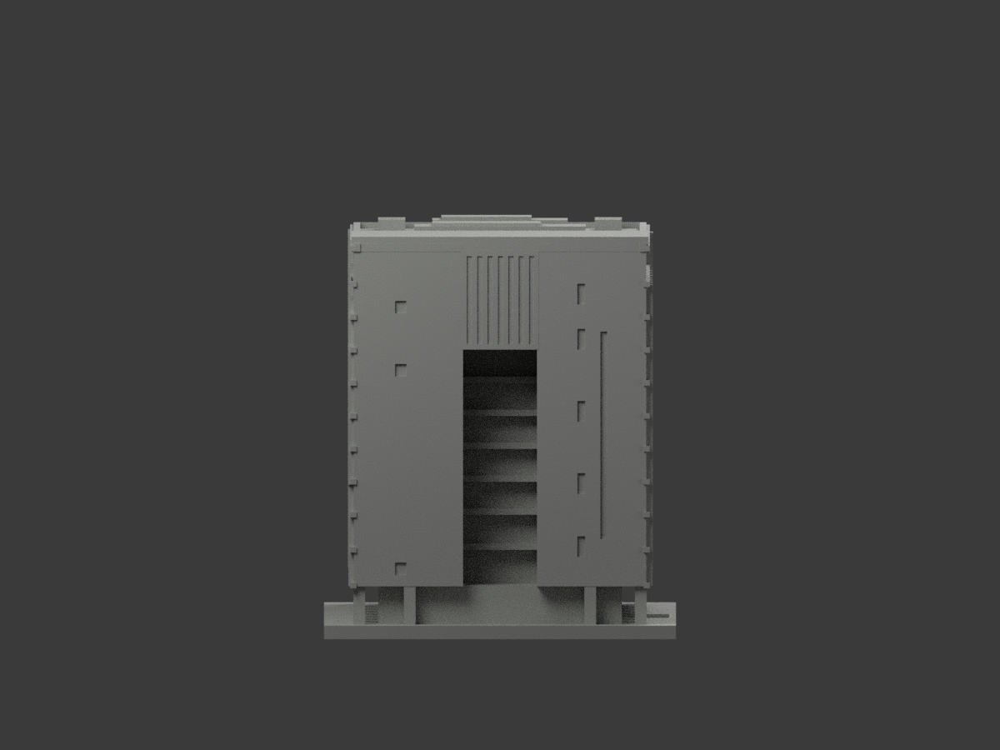
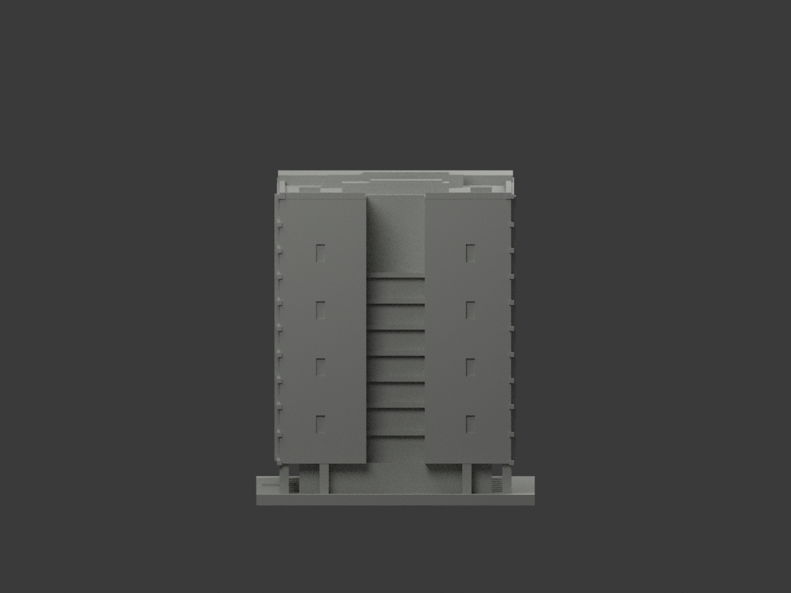
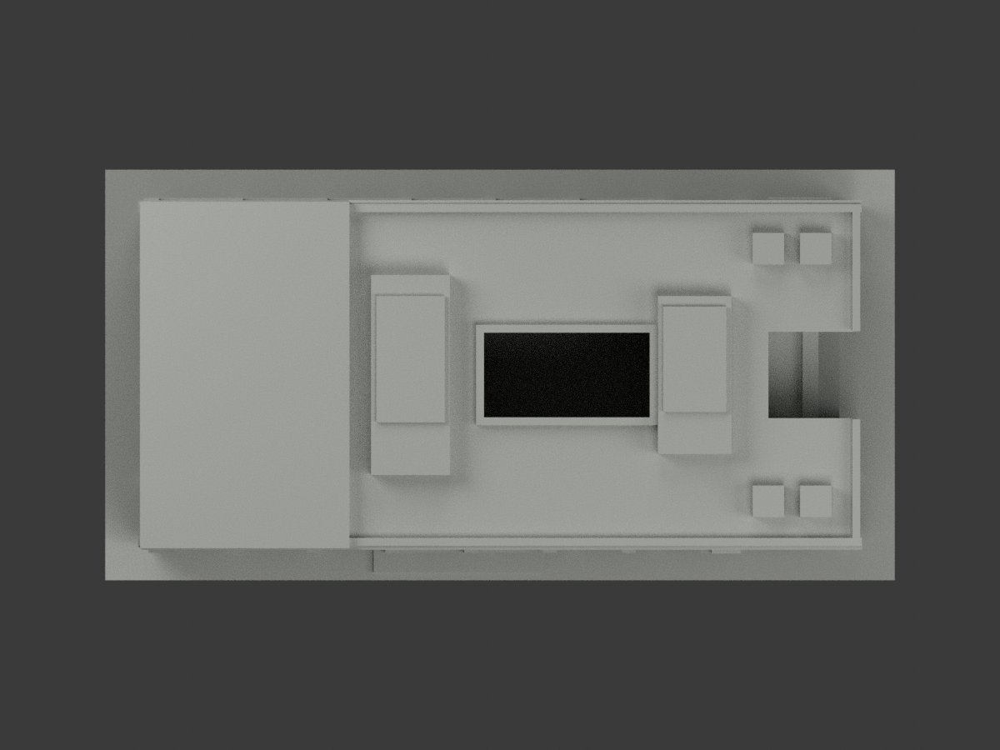
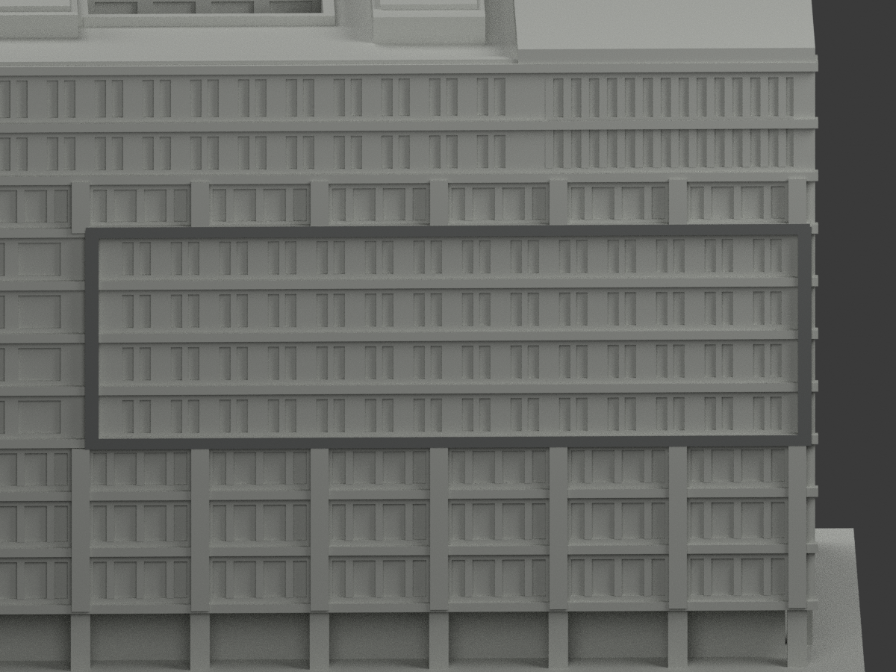
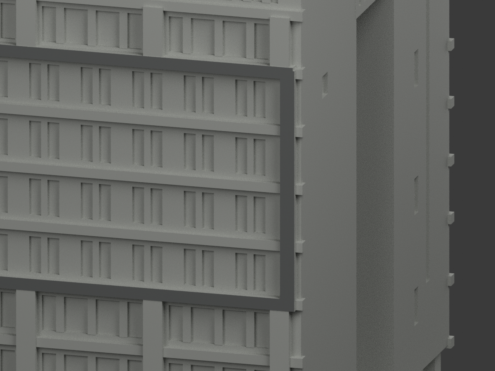
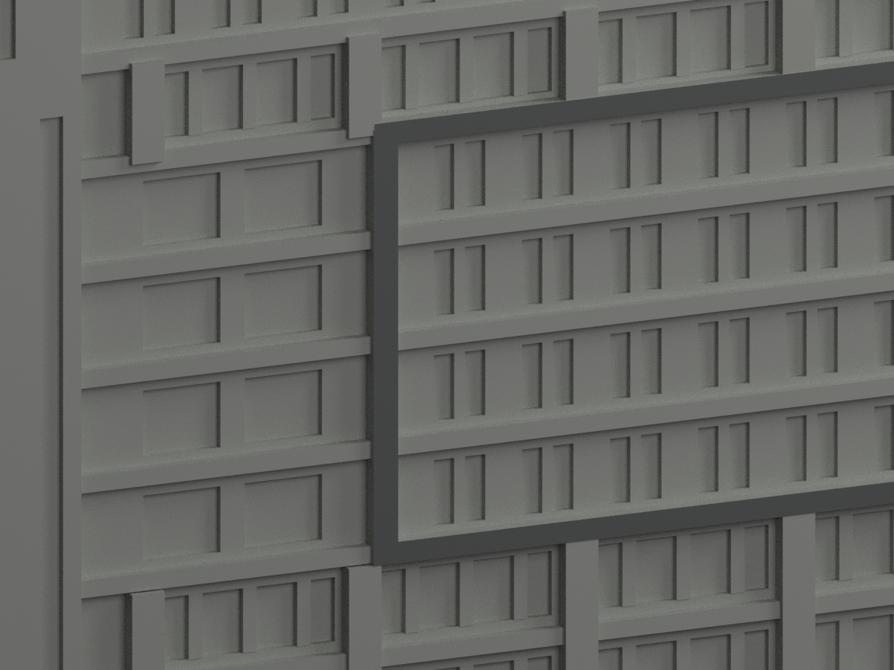

# 北護學思樓2021｜南面八凸柱正面有限淡白補色

局部補色未完成。保留原18北面中灰，新增南面八凸柱正面16原三角，共34配色、18136未知中性、18170原三角。原兩色票與所有未選索引保持，中性仍index1；新名義淡白#E0E0D9附於index2，不把北中灰鏡射到南，也不將中性普遍染白。

新查得校方操場南立面照片new-official-3(700×466)及9(865×315)顯示淺色直柱與深橫窗帶分離。原凸柱正面y=-33.8在橫帶y=-33.2前方，八個中心x[-65.5,-50.5,-35.5,-20.5,-5.5,9.5,24.5,39.5]各±1.3，z[11.5,78.3]，全頂點/法向與完整共面域驗證共16面。上部暗窗帶之間仍可辨淺色直條；部分下端樹遮採同柱有限連續推定，不宣稱每面或整高直接可見。原構件深度/尺寸近似不因配色成為測量結果，HEX未校準。

不取柱側返／頂底／背面、地面22柱、水平深帶、窗背、最高柵格、其他牆面、天井、雨棚、屋面設備。原2021身份、舊四種可讀性展示材歷程與全部aliases、工程檢核例外保持；890是跨層角損失樣本不是890柱，原22地柱及最大2.0436738%有限例外未獲新工程認證。校方文章刊登日不是照片拍攝日，不宣稱2026現況，原49.9m未分配建物的限制與2022疑鏡像照片不作定位的限制不變。

來源URL/hash見SOUTH-PILASTER-SOURCE-QA；兩照與裁切私人保存，不公開或作貼圖、不推定商用權。來源QA固定SOURCE_SCOPE_SUPPORTED_PENDING_FINAL_MODEL_REVIEW，最終獨審另檔。原文件/QA存qa/south-pilaster-previous，以下舊18面統計僅歷史，不代表本次。三展示材非已驗三料切片，未實體試印，無幾何或全域工程再認證，未發布。

## 原版說明與工程限制（原字節文字，以下統計為歷史）

# 北護學思樓2021｜北四排外框前面局部灰

**既有四材展示非實景全色；其餘未知域尚未完成分色。** partial_color_incomplete=true、fully_colored_exterior=false。僅北四排外框完整18三角名義中深灰，其他18152面中性。保留原22柱/890跨層角損有限例外，非新列印合格背書。

| 總覽 | 背側 | 正面 |
|---|---|---|
||||
||||
||||
||||

## 材色範圍
同 ntunhs-xuesi-2021 原項目，國立臺北護理健康大學石牌校區學思樓，same-item、count_delta=0。原18170三角/STL/build_model.py及30原件字節不變，immutable無OBJ。北向原模型+Y；預覽朝北，未依疑鏡像空拍重新定方位。
完整y=33.65外框plane恰18三角，四原矩形union成單共享邊連通域：兩豎x=-67/28.5,w1.8,z34..64.4及兩橫x=-19.2,w97,z34..35.5/63.3..64.8。全3頂點有限矩形聯集等於wholeplane，不人工切色。下方白柱y33.6不在域，不混染。
其餘18152面中性：框側後返、窗背/實板、南向不同柱橫帶、混灰白logo側牆、屋頂太陽能/設備、天井、地面柱/雨棚全不擴。

## 四材展示轉換
原scene四個neutral/depth/frame閱讀展示材不是原單色或已認證實景全色。新來源限定版本只18面；原scene/README公開另存 ORIGINAL-SOURCE-GAP-scene.blend／ORIGINAL-SOURCE-GAP-README.md，原render_preview.py/previews及所有原QA原bytes保留，舊深凹不解讀成黑玻璃。新色QA不追認原幾何/全模型列印品質。

## 必留原幾何及列印限制
原22根地面方柱對應890個跨層警告樣本，不是890根柱。最大角損約2.0436738%、保留97.9563262%；角損在0.41mm角鄰域，原局部法向射線最小2.5999984mm、角外殘差等全部保留原報告。這是具體位置有限例外，非全域最薄壁/零警告/工具路徑或實體試印合格。沒有修補幾何、沒有重簽原全部QA；支撐/縮放/切片仍需獨立評估。
施工履歷49.9m屬整案且未分學思與爾雅，不作本棟精確標高。2022疑鏡像航照不定東西；模型原有界比例、低層平面未全得與不同期來源限制照留。原主體11F+B2，地下不重建；含底150×78×90.5mm是示意非精測。

## 來源與日期
親看履歷PDF54下完工照、58上北向日照、59上日照；54上施工網及59下夜色排除，58下僅對位。2021承包商發表背景非逐張capture，2024archive是存檔時間非拍攝，不稱2026現況。原PDF/照片私存不公開不貼紋理、不建人，未確認CC/商用授權。

## 格式與本次QA
[原STL](model.stl) · [新逐面3MF](appearance.3mf) · [新Blender](scene.blend)
物件 NTUNHS Xuesi 2021 partial color；STL無色，3MF/scene非四色耗材切片/試印認證。原build_model.py→colorize_model.py→export_appearance.py→validate_color.py，render_color.py/verify_color_scene.py。隔離Shapely2.1.2原build+color精確重建/原bytes/全三角multiset/材域共面/3MF/scene重開/十圖1200×900/hash只驗本輪未改幾何及材色交付，不替代原有限例外或全域列印測試。

## English scope
Partial source-gap variant,not monochrome discovery:18 complete north outer-frame front triangles medium gray;18152 neutral. Original18170 triangles/30files unchanged,no originalOBJ. Four old display materials and scene/renderer/QA preserved. 22columns/890cross-layer corner-loss samples,max2.0436738percent is a retained finite local exception,not global minimum-wall or printability certification.49.9m project total not building-specific;2022mirror-suspect aerial not orientation evidence.2021publication/2024archive not verified capture or2026. Sameitem/count0,no geometry repair or physical print.
