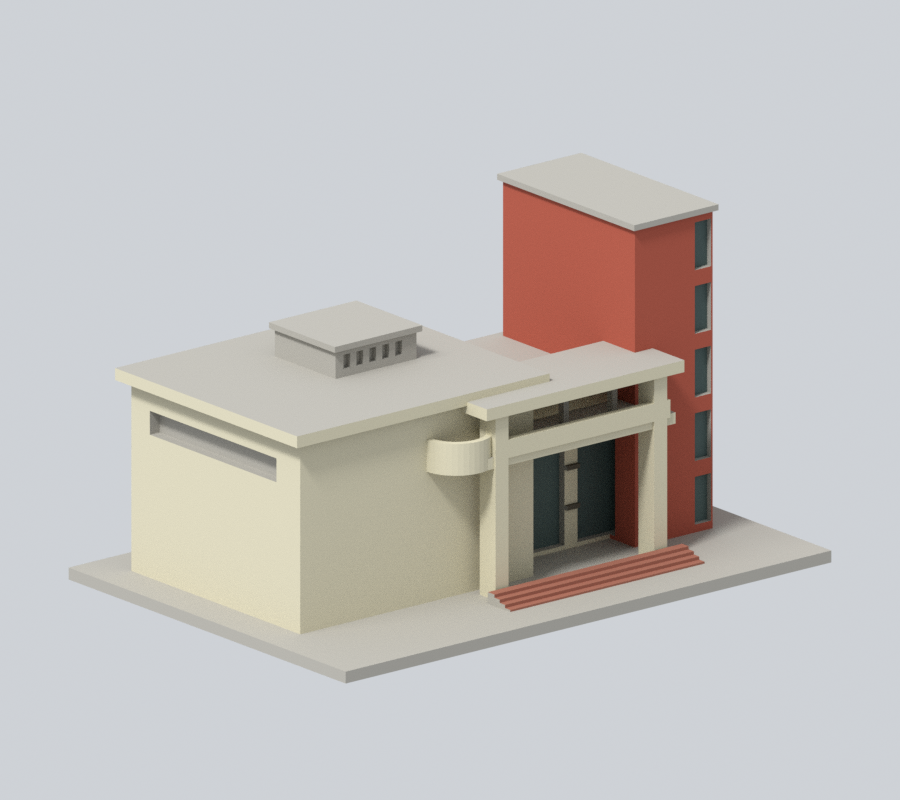
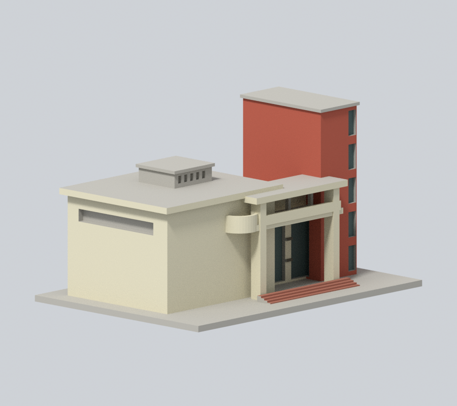
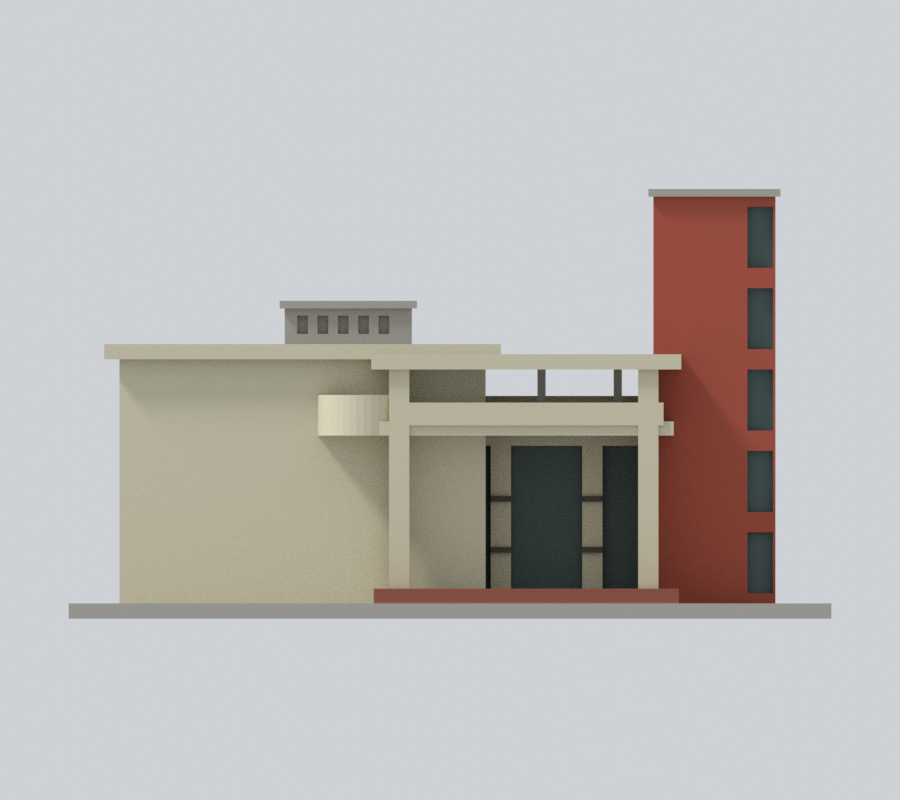
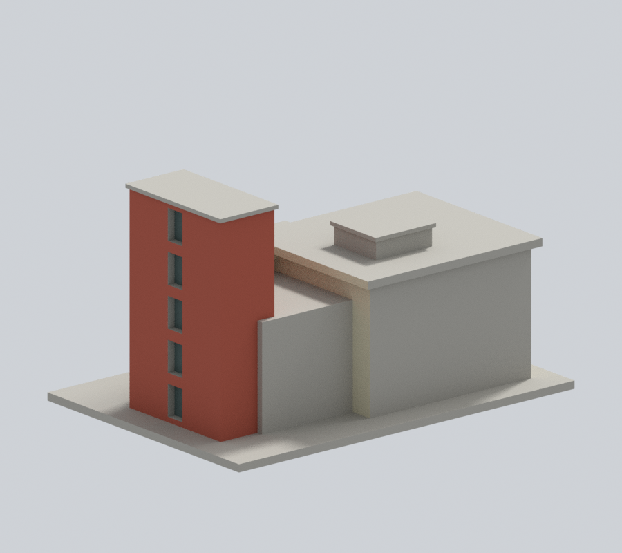
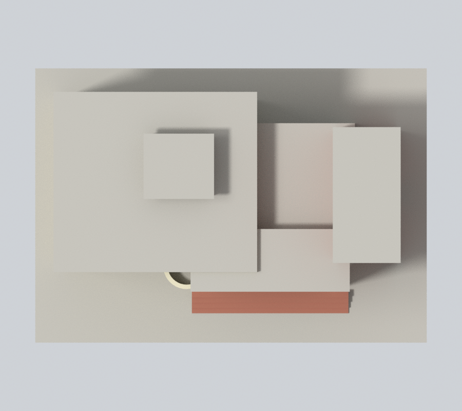
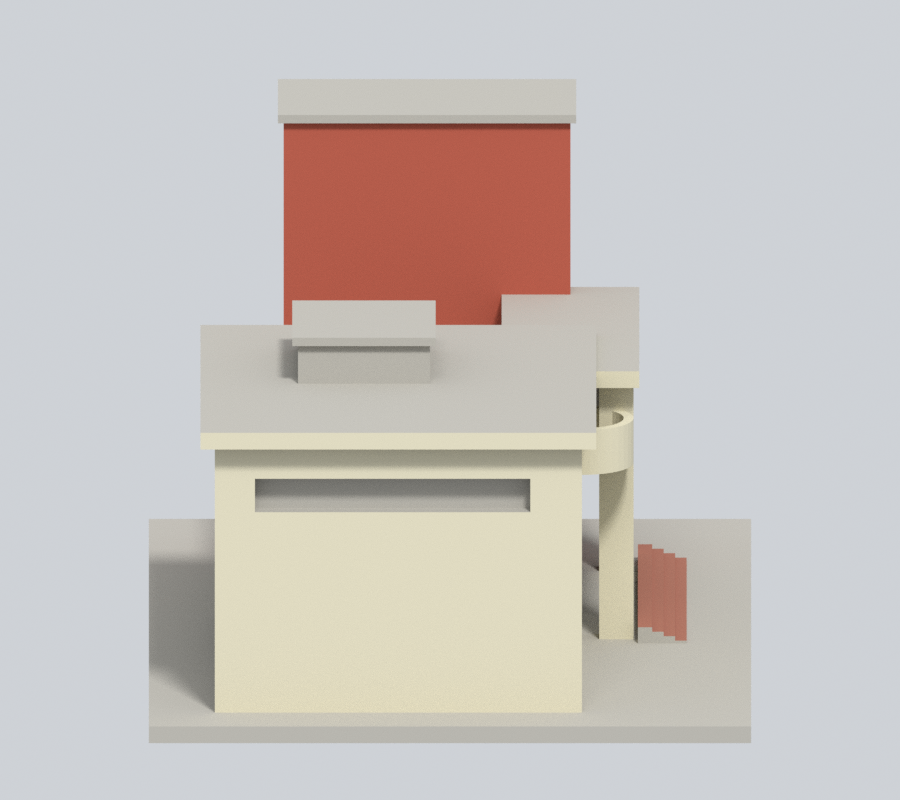
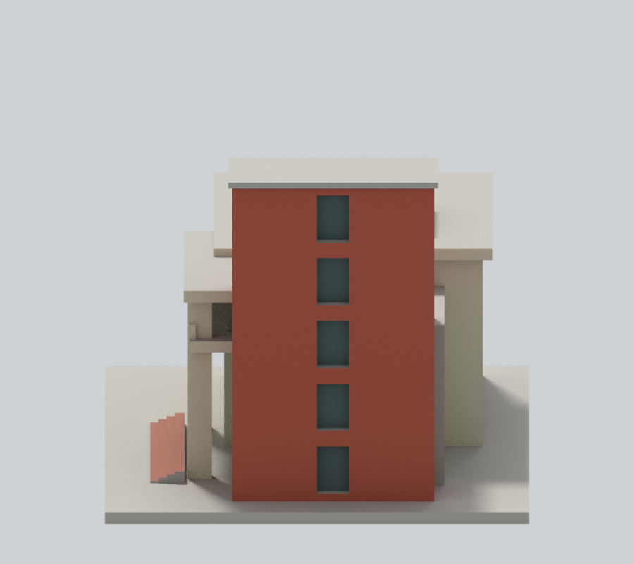

# 啟明苑入口端標段｜國立臺南大學

## 模型預覽

府城校區／啟明苑入口端，後方長向廳體未全納入。逐件獨立縮放，含底座最長150mm；非各館同一比例。尺寸：150.00 × 105.00 × 84.50 mm。

### 入口端同構件延續補色 v2

依重新查看的三張官方實照及同構件延續，新增164個原中性面：高塔其餘磚紅外牆36面、低廳與門廊／陽台米白轉折128面。原374個已上色面保持；未見範圍是推估，不是全館或2026現況復原。人工後截斷、屋頂、階梯、塔帽及未辨明窗框等478面保留中性。

| 正斜視 | 來源角度 | 正立面 |
| :---: | :---: | :---: |
|  |  |  |
| 背向 | 上視 | 新外觀下載 |
|  |  | [3MF](appearance.3mf) · [Blender](appearance.blend) |

| 左側 | 右側 | 同相機原圖 |
| :---: | :---: | :---: |
|  |  | [原正斜視](appearance-review-v2/original-front.png) · [原背向](appearance-review-v2/original-rear.png) |

[材料與來源限制](APPEARANCE.md) · [v2視覺審核](appearance-review-v2/color-continuity-review.json)。原四張模型圖保留檔案但不再於README展示；原幾何與原列印警告不變。

## 外觀與模型範圍
高磚塔、低廳量體、大玻璃入口、挑高門廊、上層深凹走廊、彎曲突出陽台、懸挑大簷及屋頂低機房。

僅入口端標段，長向廳體向後截斷；不是全館。端部深度、後截面及未見細節近似，未取得完整背面照片；側帶窗以可見外觀概括。

官方舊照片可追至2011年前更新，拍攝日期未註明。2026官方校圖仍列本建物，但不據此保證所有外觀細節皆為2026現況。 [官方主要照片](https://www.nutn.edu.tw/gac780/picture/01/p017.htm)／[來源及近似限制](sources.json)。來源照片與校圖僅私用研究，不隨模型公開；原預覽檔仍保留；此頁只展示以相同原幾何新增材料的外觀場景預覽。

## 檔案
- [STL](model.stl)／[可編輯Blender場景](scene.blend)／[Python重建](build_model.py)／[依賴](requirements.txt)
- [原STL幾何、法向與重建一致性](validation.json)
- [0.2mm逐層閉合/各輪廓/合成多邊形有效性](contour-validity-check.json)
- [0.8mm薄特徵數位篩查](thin-feature-check.json)

## 檢查與列印限制

v2已在獨立資料夾重跑原三支QA：[本輪摘要](appearance-review-v2/rerun-qa-summary.json)，全部通過；423層輪廓、85層薄特徵取樣。
原始STL通過水密、每邊兩面、頂點link單循環、正體積、原始法向與繞向、單一表面且無孤立內腔殼；獨立重建SHA與保存Blend三角形一致。檢查不以repair掩蓋錯誤。0.2mm層高的輪廓graph degree2、每個多邊形與合成多邊形有效。

0.8mm XY薄特徵篩查以canonical shared-edge內插，每1mm高度取樣；0層開運算面積損失超過1%，包含尖角、簷口等，不能當作噴嘴路徑可印證明。這些是數位QA，沒有真正切片器驗證或實體試印。建議底座朝下、0.4mm噴嘴與0.2mm層高作切片起點；門廊/陽台/屋簷/窗洞上沿需逐一檢視橋接、局部支撐與移除空間；不保證免支撐。細窗格與欄板孔在小比例下有列印限制。

## 重建
Python 3.12安裝requirements.txt後執行build_model.py。Blender背景執行render_preview.py取得scene.blend與actual-STL預覽。依次執行validate_model.py、check_contour_validity.py、check_thin_features.py，全部exit0且validation.json的checks全true才可交付。

STL SHA-256：018cfe0b9836d70c3952acacf7644c61ad75feddf1b1aa2490bdca1ba13e4409

[校區圖鑑](../../README.md)／[學校](../../../README.md)

## 2026-11-13 局部材色修正

本次僅原入口4級踏面與前立面，共8個完整域16面，由未知改為近似紅褐（#9E6958）；原5材值及其餘1000面不變。紅褐僅階梯家族近似，不代表與塔牆同磚產品或校準色。級數、厚深與位置維持既有粗代理，階側、基座和未建坡道不擴色；仍是入口端局部模型。

本段更新上述原版本的局部材色範圍；原APPEARANCE與歷史審核的數量、範圍依其原版本解讀。幾何、原STL／scene、鎖定預覽與七張原生視圖的相機和照明不改。不是全館復色、測繪、校準材質或2026現況認證；照片日期不確定，不由文件日期推定拍攝日。原工程、薄件與支撐限制仍有效，未實體試印或完成切片工具路徑驗證。

本次公開交付只包含模型、材質、必要重建腳本、預覽與必要說明／校驗；來源原照片、比較圖和完整研究審核紀錄不隨包發布。當前產物範圍見[校驗說明](CHECKSUM-SCOPE.md)。
