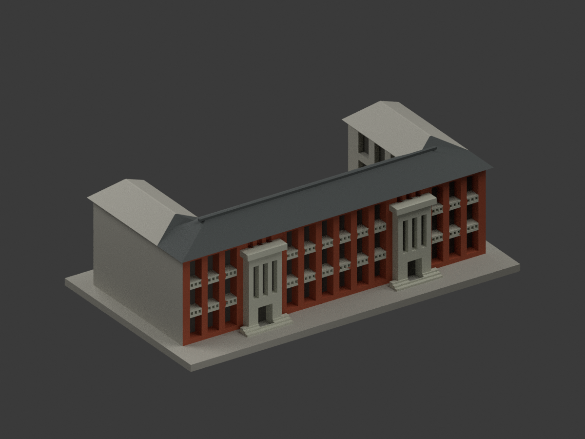
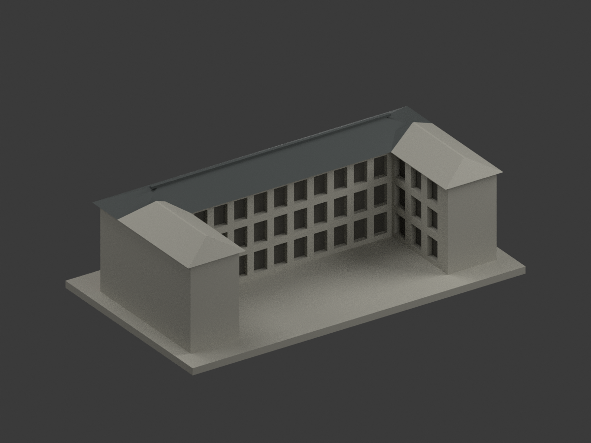
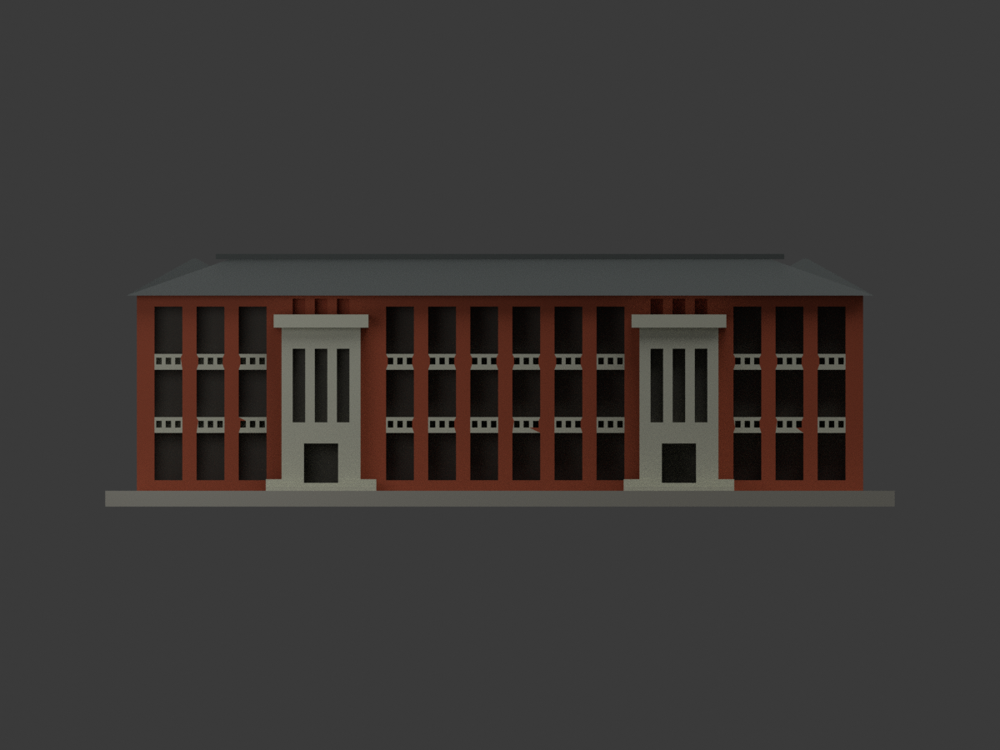
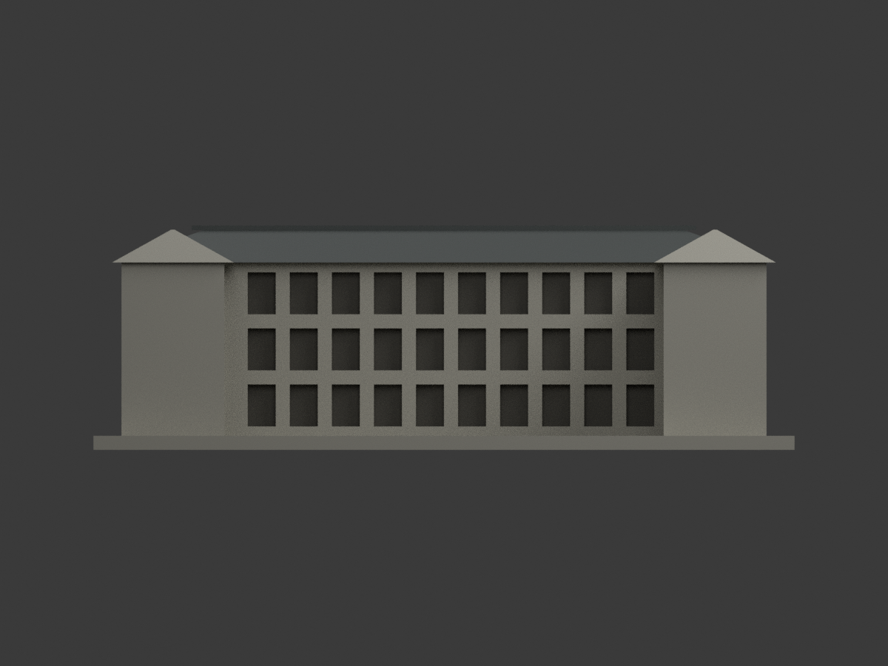
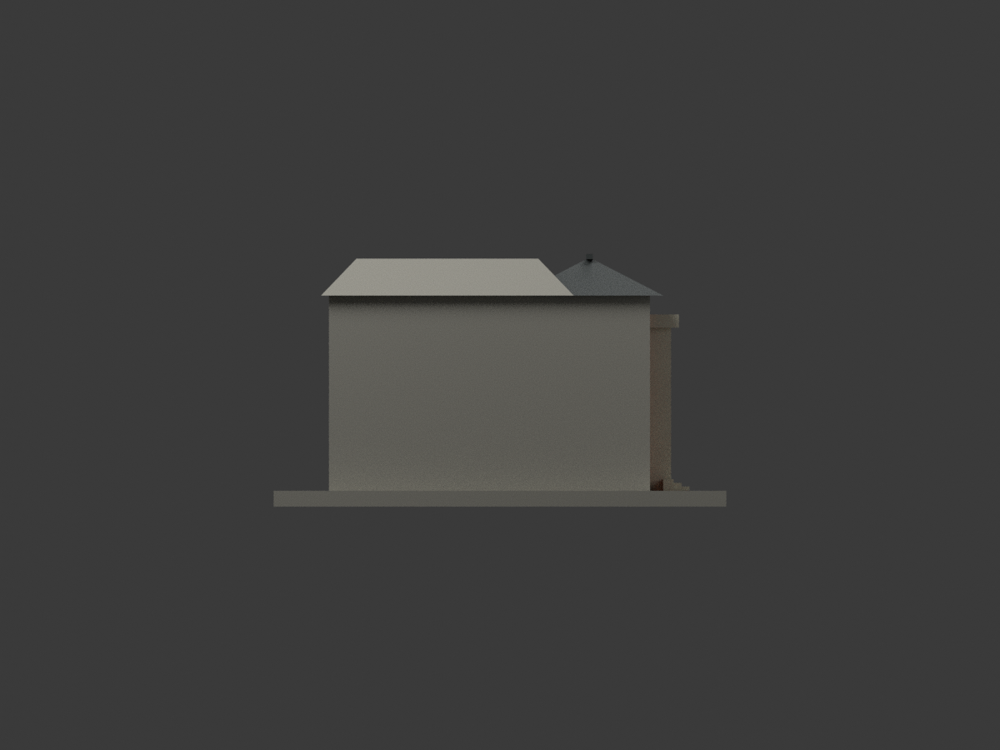
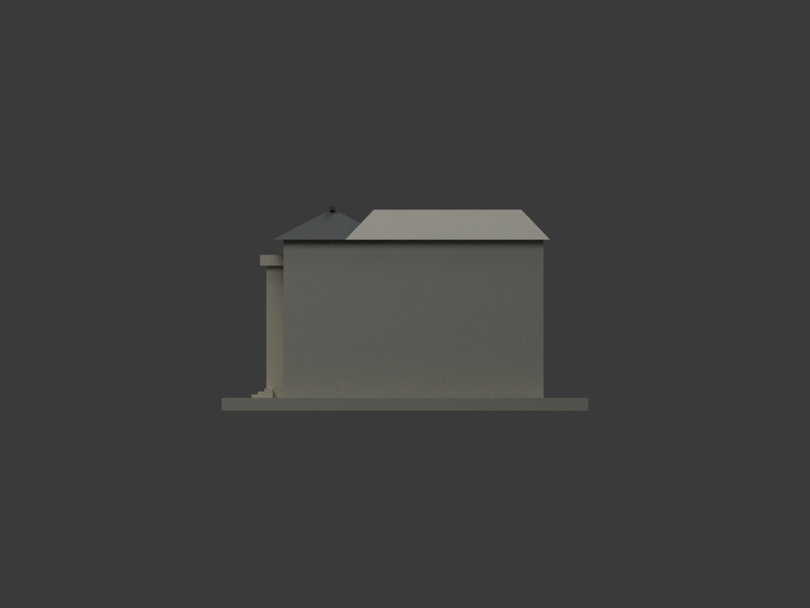
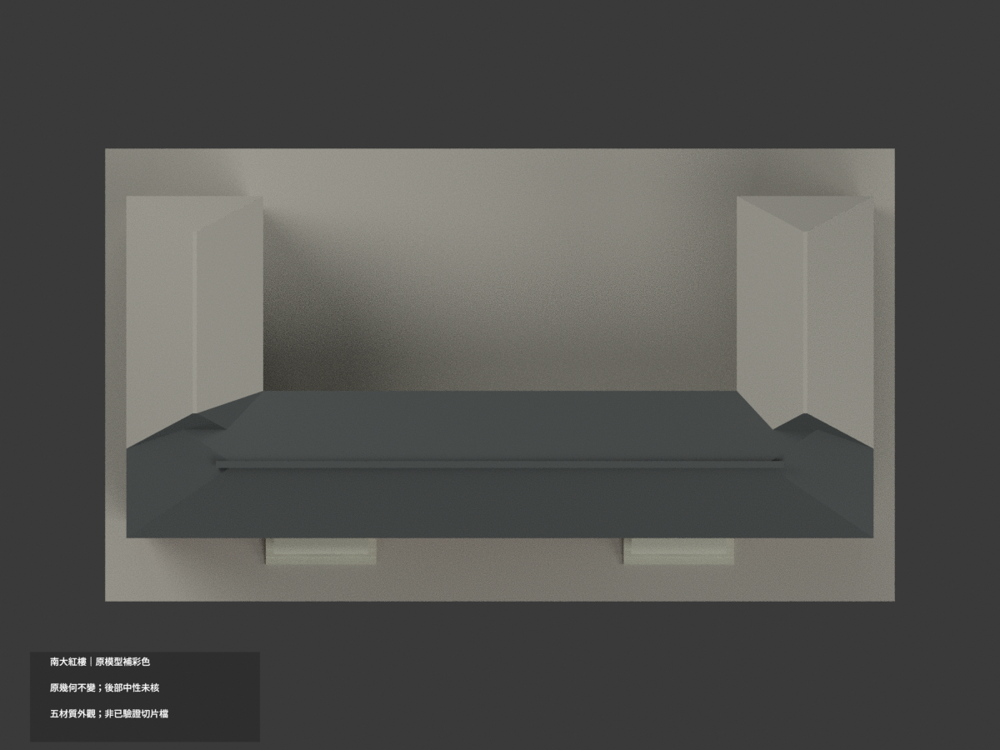
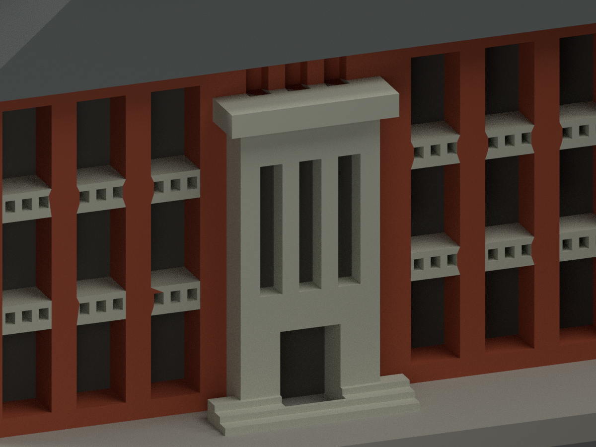
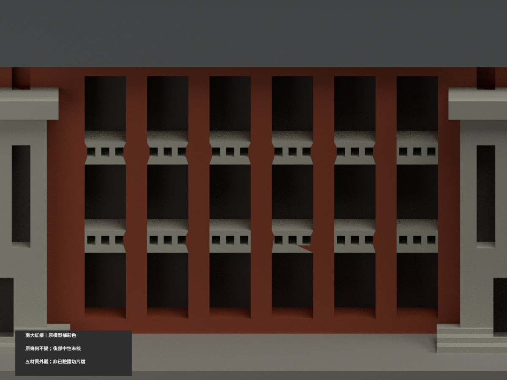
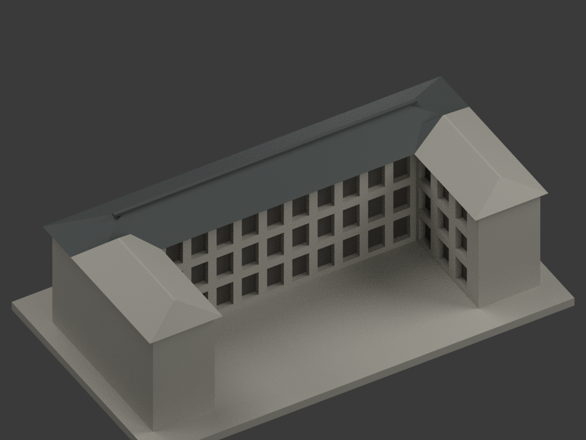

# 國立臺南大學紅樓｜同項目彩色更新

## 彩色模型預覽

**原幾何不變：150 × 86 × 48 mm、3142 三角面，原 STL 與建模程式位元組保留；count_delta = 0。** 本次只為既有近似模型補材質，不是重新測繪或增加建築套數。官方舊風情照片未標拍攝日，來源頁更新日不等照片日期；不主張 2026 即時現況或原始漆色復原。

| 整體 | 內院反向 | 正向 |
|---|---|---|
|  |  |  |
|  |  |  |
|  |  |  |
|  |  |  |

## 材質範圍與限制

- 主樓照片可見斜瓦皮及屋脊採深灰，**不是因「紅樓」之名染紅瓦**。後翼屋皮未全見，保持中性未核，不冒稱全屋頂均已核色。
- 主正面既有牆腹與廊柱近似紅橘磚；兩突出入口框／帽／階、各 bay 內欄板及小孔周面近似淺灰米。**灰欄板不跨過連續紅磚柱腹**，不是整條水平牆一律塗灰。
- 官方廊道照片明示半戶外開廊。原模型的廊洞是有背底的淺凹，深灰僅示意陰影與深度，**不是藍玻璃、黑漆或完整空間復原**。不新增未建的窗扇、玻璃、磚縫、球飾或標字。
- **內院照片有顯著紅磚與灰框架交錯，但原大平面缺乏相應灰柱／梁的獨立三角邊界**。本次內院大牆面保中性、真凹底保深灰陰影，不以全紅冒充實景、不切幾何或畫任意跨面灰帶。內院中性色不是照片證明的真漆；完整材色框架尚未表現。正面原有可穩定對應的欄板／洞緣另行分色。
- 未見外端、後端、後翼屋皮及展示底座保持中性色；中性不等於現地灰漆。HEX 為照片色族展示近似，非儀器色票或修復工程漆號。

## 彩色檔與列印

[appearance.3mf](appearance.3mf) 為毫米單位五個基本材質逐面指派；[appearance-materials.json](appearance-materials.json) 列材料與面數。[scene.blend](scene.blend) 為原三角網格的實際彩色場景。[model.stl](model.stl) 保持原檔，**STL 本身不含顏色**。原遠端包未有 OBJ，本次不宣稱已保存原 OBJ；原建模程式重新執行可另輸出 OBJ。

五材質外觀 **不等於已驗證四色耗材切片檔**；切片器材質匯入、耗材對應、換色、支撐及實際列印皆未驗證，本件**未實際列印**。彩色渲染不提升原幾何尺寸或可列印性主張。

## 可重現與 QA

依原 requirements 安裝後：`python build_model.py`、`python colorize_model.py`、`python export_appearance.py`；`blender -b -P render_color.py` 產生十張新圖與場景；`python validate_color.py`、`blender -b -P verify_color_scene.py` 查原 STL、逐三角座標、3MF 材質、隔離重建及場景重開。隔離資料保留，不自動刪除。

本次證據為 COLOR-ASSIGNMENT-QA、COLOR-FORMAT-GEOMETRY-QA、SCENE-QA、FRAMING-QA、SOURCE-VISUAL-QA 及 DELIVERY-QA。舊 `previews/`、`validation.json`、薄壁／截面結果皆留存作原單色歷程，不能當本次材色或四色實印證明；舊 render_preview.py 會產生單色，請勿誤覆彩色場景。

## 色彩來源與權利

實看校方舊南大風情[正面039](https://www.nutn.edu.tw/gac780/picture/01/p039.htm)、[內院006](https://www.nutn.edu.tw/gac780/picture/01/p006.htm)、[廊道008](https://www.nutn.edu.tw/gac780/picture/01/p008.htm)。照片日期未註，個別攝影者未在所讀頁明列；008遠景另一棟未採為本樓證據。

原照片、原頁及裁圖只私人研究，不隨模型公開、不作紋理貼圖；未見個別 CC 授權，不因官方公開可看便宣稱商用或再授權權利。模型授權不含第三方照片或建築設計權利，也不保證商業使用。詳 COLOR-SOURCE-REGISTER.json。

## 原模型說明與限制（繼續有效）

# 紅樓｜國立臺南大學

現行彩色模型預覽見本頁上方；舊單色 `previews/` 檔案僅保留為歷史紀錄，不在 README 展示。

府城校區／紅樓，含兩端後翼的公開外觀近似。逐件獨立縮放，含底座最長150mm；非各館同一比例。尺寸：150.00 × 86.00 × 48.00 mm。

[歷史單色 STL 頂視（下載）](previews/top.png)

## 外觀與模型範圍
三層長翼、兩座高直框入口、陡度較低的四坡屋頂、兩端後翼、開放後院、深凹廊窗與欄板小孔。

依照片與校圖估算外廓，非實測；後院兩翼長度、未知外側與後端窗序簡化，照片未證實的裝飾不添加。

官方舊照片可追至2011年前更新，拍攝日期未註明。2026官方校圖仍列本建物，但不據此保證所有外觀細節皆為2026現況。 [官方主要照片](https://www.nutn.edu.tw/gac780/picture/01/p039.htm)／[來源及近似限制](sources.json)。來源照片與校圖僅私用研究，不隨模型公開；此處預覽均由實際交付STL渲染。

## 檔案
- [STL](model.stl)／[可編輯Blender場景](scene.blend)／[Python重建](build_model.py)／[依賴](requirements.txt)
- [原STL幾何、法向與重建一致性](validation.json)
- [0.2mm逐層閉合/各輪廓/合成多邊形有效性](contour-validity-check.json)
- [0.8mm薄特徵數位篩查](thin-feature-check.json)

## 檢查與列印限制
原始STL通過水密、每邊兩面、頂點link單循環、正體積、原始法向與繞向、單一表面且無孤立內腔殼；獨立重建SHA與保存Blend三角形一致。檢查不以repair掩蓋錯誤。0.2mm層高的輪廓graph degree2、每個多邊形與合成多邊形有效。

0.8mm XY薄特徵篩查以canonical shared-edge內插，每1mm高度取樣；4層開運算面積損失超過1%，包含尖角、簷口等，不能當作噴嘴路徑可印證明。這些是數位QA，沒有真正切片器驗證或實體試印。建議底座朝下、0.4mm噴嘴與0.2mm層高作切片起點；門廊/陽台/屋簷/窗洞上沿需逐一檢視橋接、局部支撐與移除空間；不保證免支撐。細窗格與欄板孔在小比例下有列印限制。

## 重建
Python 3.12安裝requirements.txt後執行build_model.py。Blender背景執行render_preview.py取得scene.blend與actual-STL預覽。依次執行validate_model.py、check_contour_validity.py、check_thin_features.py，全部exit0且validation.json的checks全true才可交付。

STL SHA-256：15f50381efbbf8980a172a7fe4a0a78132118206175ce463b826e497ecdf0394

[校區圖鑑](../../README.md)／[學校](../../../README.md)
