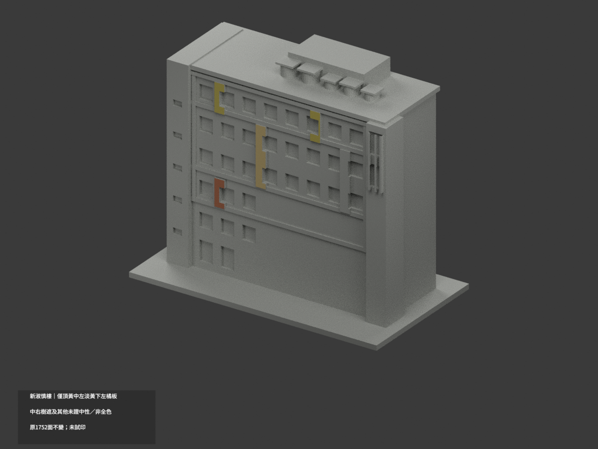
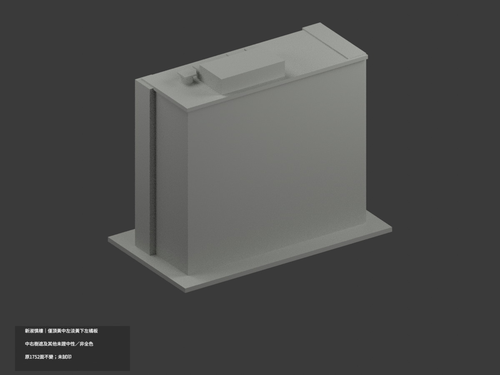
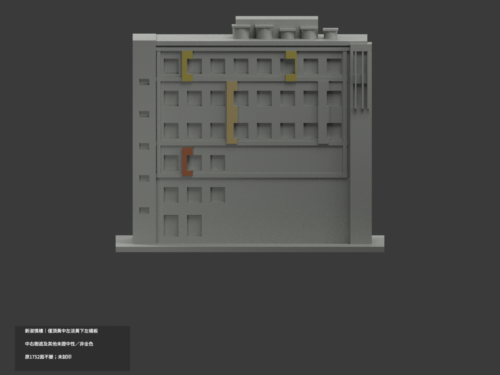
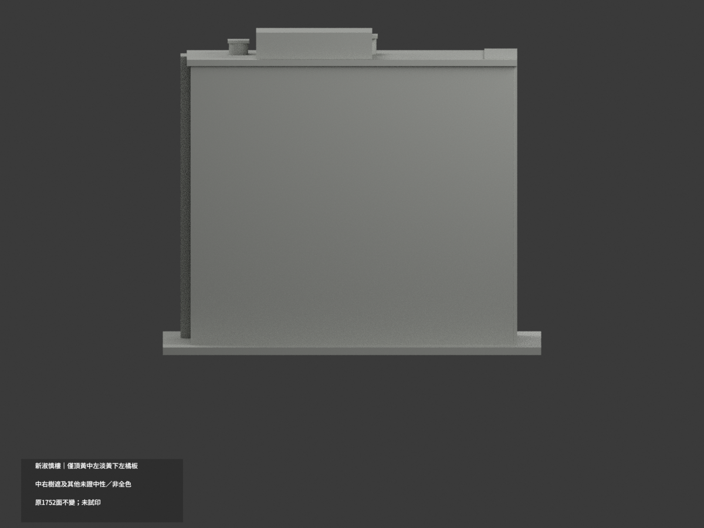
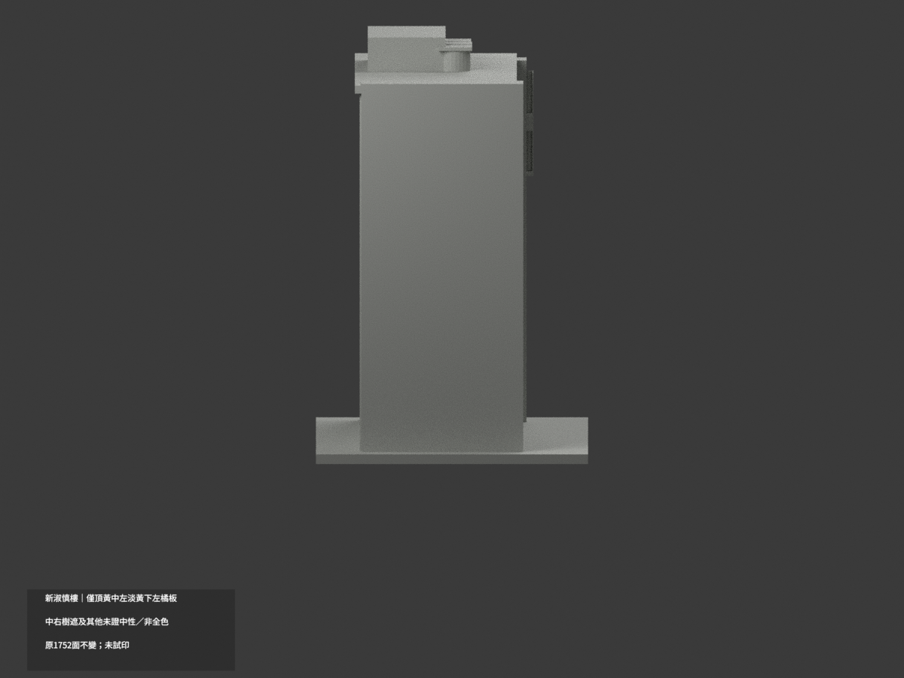
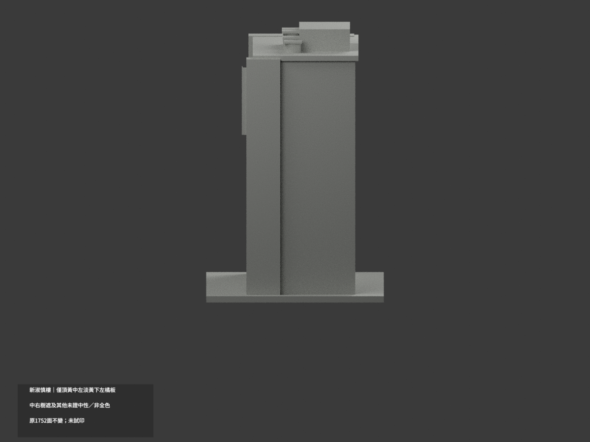
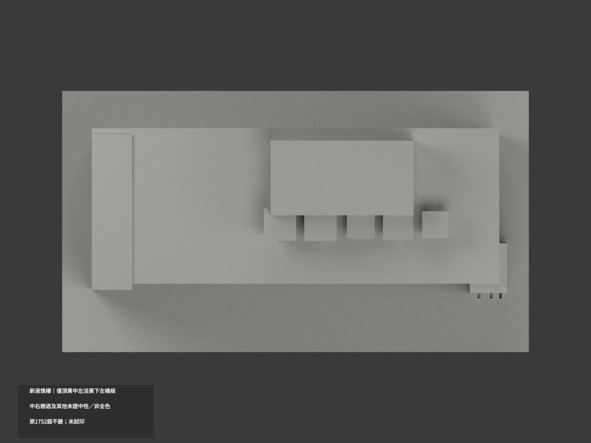
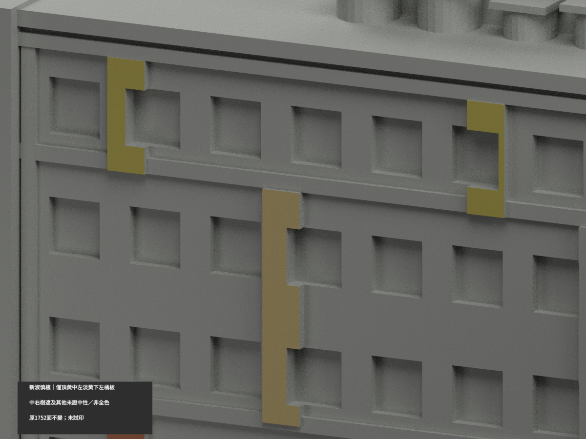
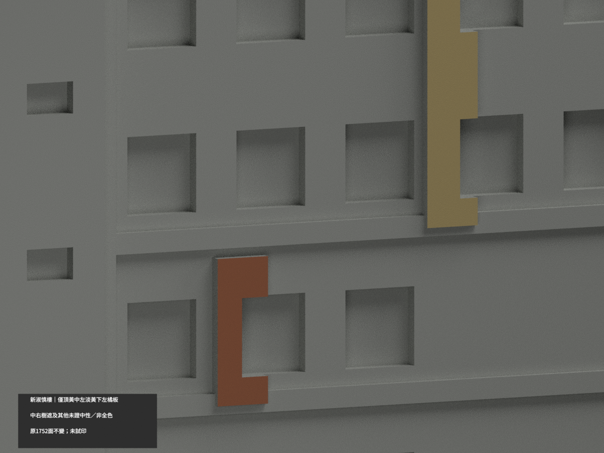
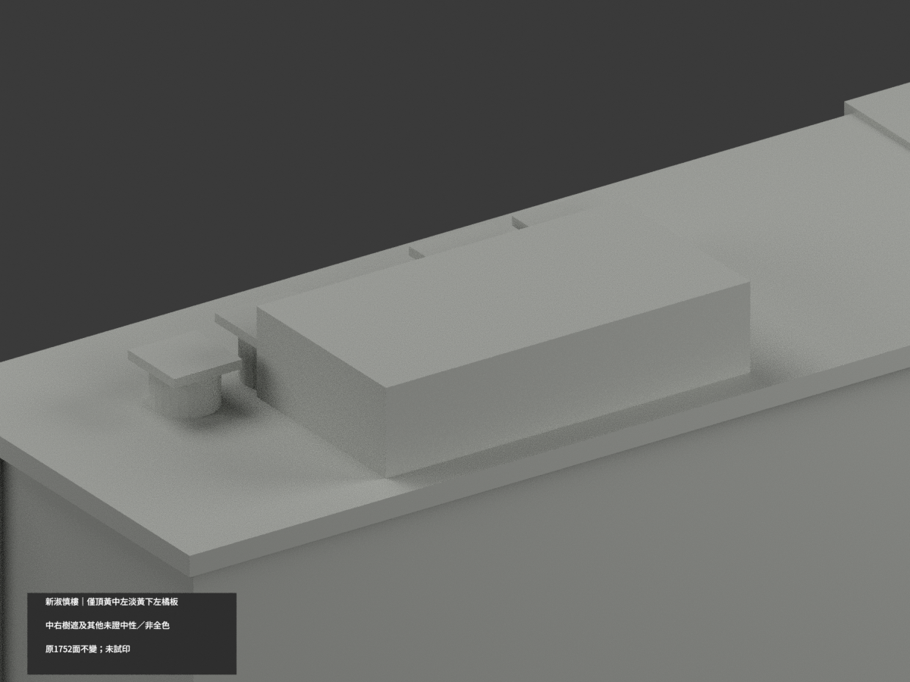

# 新淑慎樓｜僅頂黃／中左淡黃／下左橘板局部補色

**局部補色未完成：只頂黃12／中左淡黃10／下左橘6原面；中右樹遮及其他未證中性。非全色或2026現況。** `partial_color_incomplete=true`、`fully_colored_exterior=false`。同項 `nutn-shushen-new`／`count_delta=0`，府城校區；只新淑慎不含鄰舊棟。20261103為處理日期非拍攝日。

| 前斜視 | 後斜視 | 正面 |
|---|---|---|
|  |  |  |
|  |  |  |
|  |  |  |
|  | | |

## 材色範圍

只原 y−19.9 四有限前浮板域：頂左 x−38..−32／頂右20..26，z94..111，各6三角名義黃；中左x−13..−7、z59..94，10三角淡赭黃；下左x−38..−32、z41..57，6三角橘。原窗Boolean切去的缺口原樣，選所有存活全三頂點在域內的完整原三角，不假補成照片平板，不新增切面或面心截色。共面連通域全同材，1724面中性。

中右原板下部樹遮，整塊中性，不只染樹上半。全高左灰牆及主壁跨遮蔽基座／側面不擴灰；原白橫帶/返邊/板厚側背/窗背/玻璃/樓梯格背全中性。水罐正面金屬不證整圓周背頂，整罐及帽中性；屋/突出機房/背/基座/其餘全部中性。**中性不等於實景灰證明，來源覆蓋界線不是實材接縫。**

原1752三角、STL/build字節與尺寸不變；不以補色追認原近似開窗重疊或現況精測。

## 來源、日期與權利

校方永續頁成功1477×1108實景 `official-shushen.jpg` 已親看；先前503技術失敗不是已讀證據，以這次成功實檔hash為準。照片capture未知，網頁年份/識別碼及取用日不是拍攝或2026現況證明。URL/hash見source register，HEX為色族近似非測色。原照私人保留，不公開/不貼圖；未見CC不沿repo license推商用。

## 檔案與 QA

`appearance.3mf`四展示材，`scene.blend`真面材，`color-mesh.npz`原三角索引；原STL無色及build保字節；immutable原包無OBJ，原碼雖可產出OBJ，不冒稱原OBJ存在或保留，隔離產物僅私存。原README另存`ORIGINAL-MONOCHROME-README.md`/`.zh-TW.md`，舊previews/QA保單色歷程不是新色審。

依requirements執行colorize/export/validate，Blender執行render_color.py/verify_color_scene.py。原build+color全隔離重建保留不刪；3MF/STL三角同一／封閉正體積／重開scene／10張1200×900見QA，父另終審。**未實際列印。** 四展示材不代表已驗四色實際切片、材料/支撐須另核。

## English limitations

Partial only: whole original y−19.9 notched relief fronts,top yellow6+6,middleleft paleochre10,lowerleft terracotta6;1724neutral. WindowBoolean contours retained, no repair or triangle cut. Whole tree-obscured middleright panel neutral, not just hidden lower portion. All gray/white mainwalls, returns, panel thickness, windowbacks/stairproxy, tanks entirecircumferences,roof/rear unknownneutral. Unknowncapture date; webpage year not current-condition evidence.1752originaltriangles/STL/build bytes unchanged/count_delta0;immutable package has noOBJ despite original code exportingOBJ; isolatedgeneratedOBJ privately retained,new Shushen only not adjacent older blocks; color does not authenticate original geometry. Photo private,nottexture; nominal palette not calibration; not test-printed or validated four-filament project.
