# 國立臺南藝術大學 官田校區

本輪核准的外觀近似模型套件；全校尚未完成。套件可能包含相連群組、局部或歷史外觀，件數不等於完整建築棟數。未正式切片、未生成經驗證G-code、未實體試印。各件警示、來源年代、背面簡化及支撐需求請讀詳頁。只公開來源URL，不散布原照片或PDF。

| 建築／模型 | 建築／模型 | 建築／模型 |
|---|---|---|
| [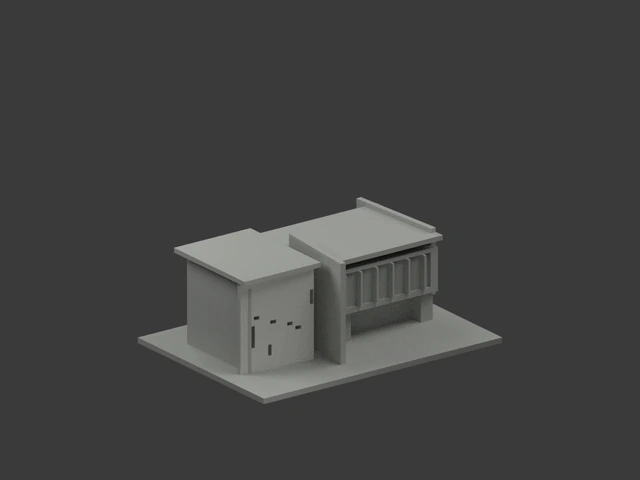](buildings/tnnua-antiquities-conservation/README.zh-TW.md) [國立臺南藝術大學｜古物維護研究大樓](buildings/tnnua-antiquities-conservation/README.zh-TW.md) [資料夾](buildings/tnnua-antiquities-conservation) [局部材色3MF](buildings/tnnua-antiquities-conservation/appearance.3mf) · [範圍與限制](buildings/tnnua-antiquities-conservation/README.md) | [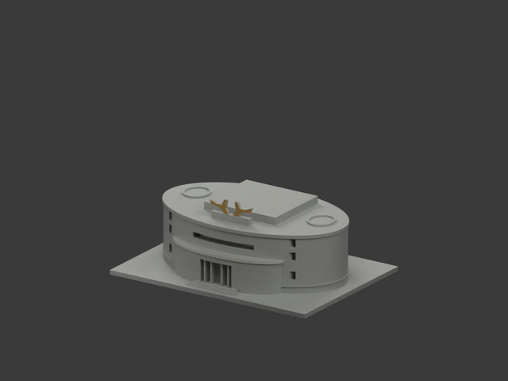](buildings/tnnua-library-information/README.zh-TW.md) [國立臺南藝術大學｜圖書資訊大樓](buildings/tnnua-library-information/README.zh-TW.md) [資料夾](buildings/tnnua-library-information) [局部材色3MF](buildings/tnnua-library-information/appearance.3mf) · [範圍與限制](buildings/tnnua-library-information/README.md) | [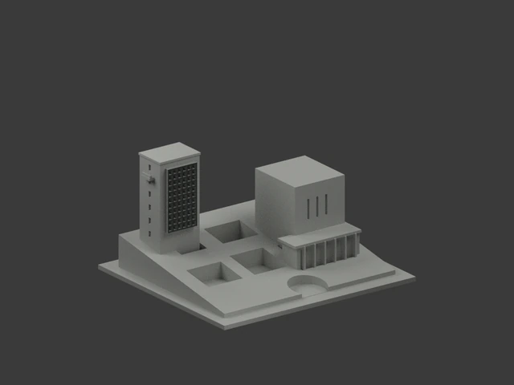](buildings/tnnua-sound-image/README.zh-TW.md) [國立臺南藝術大學｜音像大樓](buildings/tnnua-sound-image/README.zh-TW.md) [資料夾](buildings/tnnua-sound-image) [局部材色3MF](buildings/tnnua-sound-image/appearance.3mf) · [範圍與限制](buildings/tnnua-sound-image/README.md) |
| [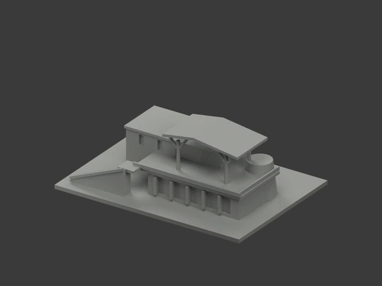](buildings/tnnua-campus-life-hall/README.zh-TW.md) [生活機能館](buildings/tnnua-campus-life-hall/README.zh-TW.md) [資料夾](buildings/tnnua-campus-life-hall) [局部材色3MF](buildings/tnnua-campus-life-hall/appearance.3mf) · [範圍與限制](buildings/tnnua-campus-life-hall/README.md) | [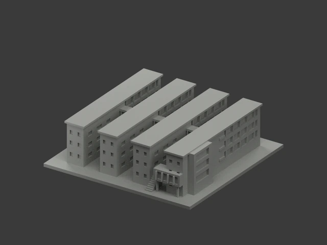](buildings/tnnua-music-complex/README.zh-TW.md) [音樂系館A–D與第三、四宿舍相連樓群](buildings/tnnua-music-complex/README.zh-TW.md) [資料夾](buildings/tnnua-music-complex) [局部材色3MF](buildings/tnnua-music-complex/appearance.3mf) · [範圍與限制](buildings/tnnua-music-complex/README.md) | [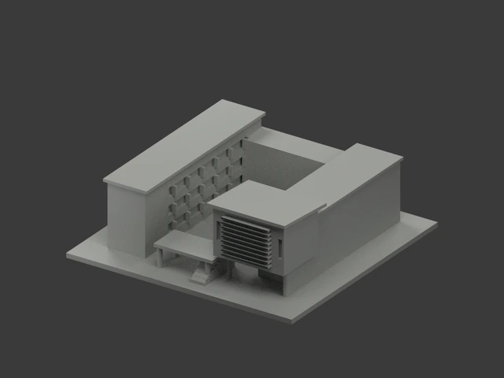](buildings/tnnua-chinese-music/README.zh-TW.md) [國樂系館](buildings/tnnua-chinese-music/README.zh-TW.md) [資料夾](buildings/tnnua-chinese-music) [局部材色3MF](buildings/tnnua-chinese-music/appearance.3mf) · [範圍與限制](buildings/tnnua-chinese-music/README.md) |
| [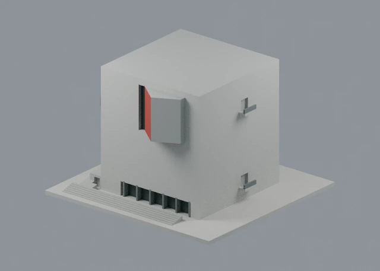](buildings/tnnua-han-pao-teh-museum/README.md) [漢寶德紀念館](buildings/tnnua-han-pao-teh-museum/README.md) [資料夾](buildings/tnnua-han-pao-teh-museum) | [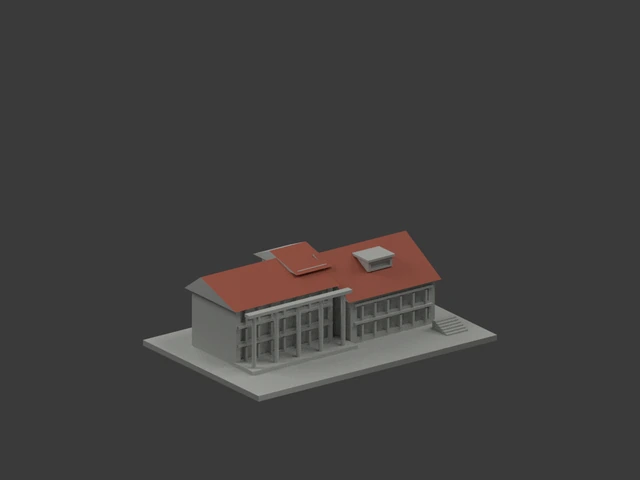](buildings/tnnua-south-lake-restaurant/README.zh-TW.md) [南湖餐廳](buildings/tnnua-south-lake-restaurant/README.zh-TW.md) [資料夾](buildings/tnnua-south-lake-restaurant) [局部材色3MF](buildings/tnnua-south-lake-restaurant/appearance.3mf) · [範圍與限制](buildings/tnnua-south-lake-restaurant/README.md) | [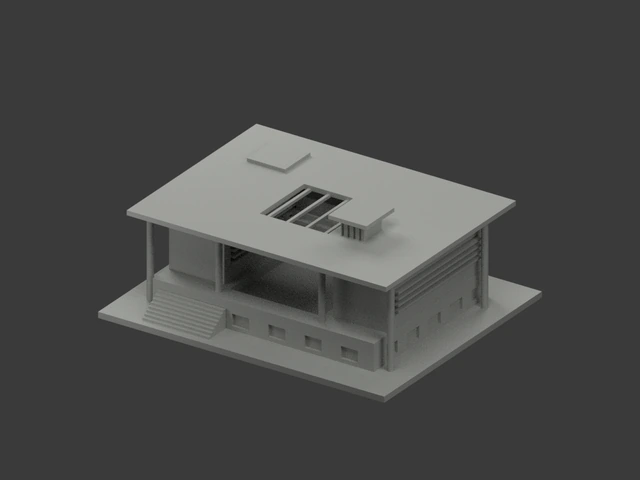](buildings/tnnua-architecture-institute/README.zh-TW.md) [建築藝術研究所（加藤教學大樓）](buildings/tnnua-architecture-institute/README.zh-TW.md) [資料夾](buildings/tnnua-architecture-institute) [局部材色3MF](buildings/tnnua-architecture-institute/appearance.3mf) · [範圍與限制](buildings/tnnua-architecture-institute/README.md) |
| [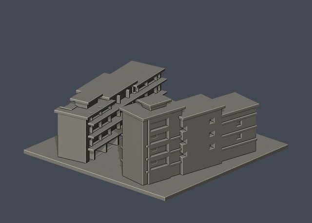](buildings/tnnua-fifth-student-dormitory/README.md) [第五學生宿舍（北校區宿舍群）](buildings/tnnua-fifth-student-dormitory/README.md) [資料夾](buildings/tnnua-fifth-student-dormitory) | [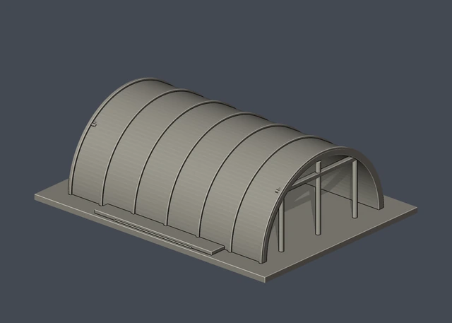](buildings/tnnua-interbreeding-arched-shed/README.md) [建築繁殖場弧頂工作棚（校方影像版本）](buildings/tnnua-interbreeding-arched-shed/README.md) [資料夾](buildings/tnnua-interbreeding-arched-shed) | [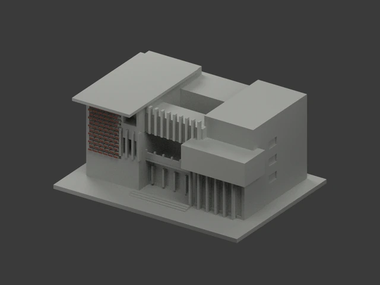](buildings/tnnua-art-history-cultural-heritage/README.zh-TW.md) [藝術史與文化資產學系館](buildings/tnnua-art-history-cultural-heritage/README.zh-TW.md) [資料夾](buildings/tnnua-art-history-cultural-heritage) [局部材色3MF](buildings/tnnua-art-history-cultural-heritage/appearance.3mf) · [範圍與限制](buildings/tnnua-art-history-cultural-heritage/README.md) |
| [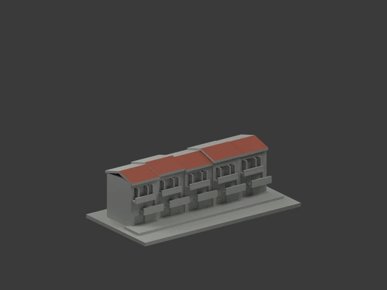](buildings/tnnua-faculty-housing-visible-row/README.zh-TW.md) [職務宿舍沿溪屋帶局部簡化模型](buildings/tnnua-faculty-housing-visible-row/README.zh-TW.md) [資料夾](buildings/tnnua-faculty-housing-visible-row) [局部材色3MF](buildings/tnnua-faculty-housing-visible-row/appearance.3mf) · [範圍與限制](buildings/tnnua-faculty-housing-visible-row/README.md) | [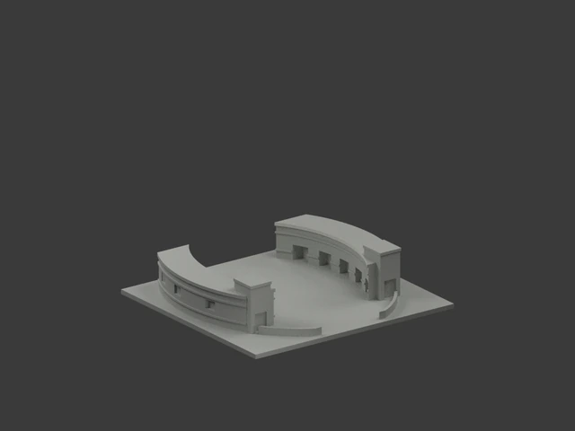](buildings/tnnua-north-south-galleries-curved/README.zh-TW.md) [南北畫廊（曲率修正版）](buildings/tnnua-north-south-galleries-curved/README.zh-TW.md) [資料夾](buildings/tnnua-north-south-galleries-curved) [局部材色3MF](buildings/tnnua-north-south-galleries-curved/appearance.3mf) · [範圍與限制](buildings/tnnua-north-south-galleries-curved/README.md) |  |

漢寶德紀念館已整合[立面配置修訂 v2 與外梯門板補色](buildings/tnnua-han-pao-teh-museum/facade-layout-v2/README.md)：外梯及門洞轉至左側並修正升向，雙陽臺及門洞移到右鄰面，七材質與現行 WebP 預覽同步。修訂 STL 重新檢測仍有 11 層薄特徵警示；原 QA 保留，未 FFF／實印驗證。仍為原 14 包，不增加校數或包數。
