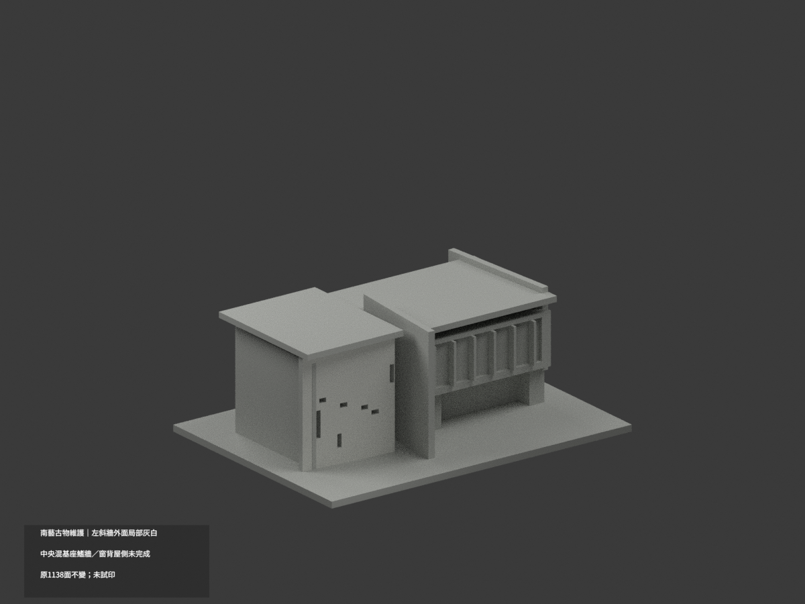
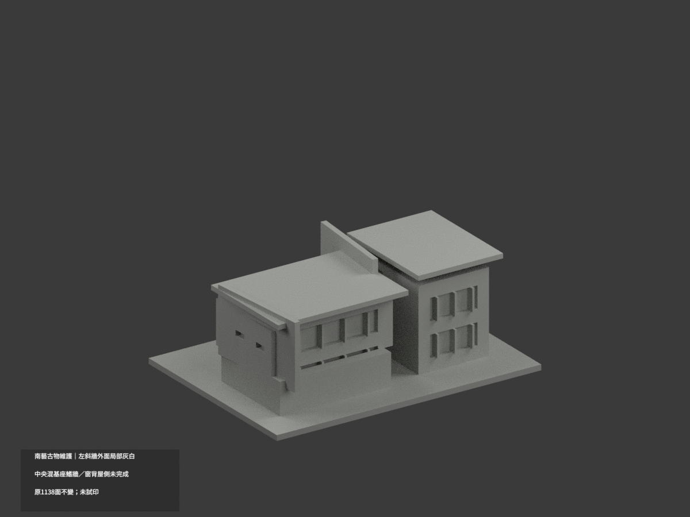
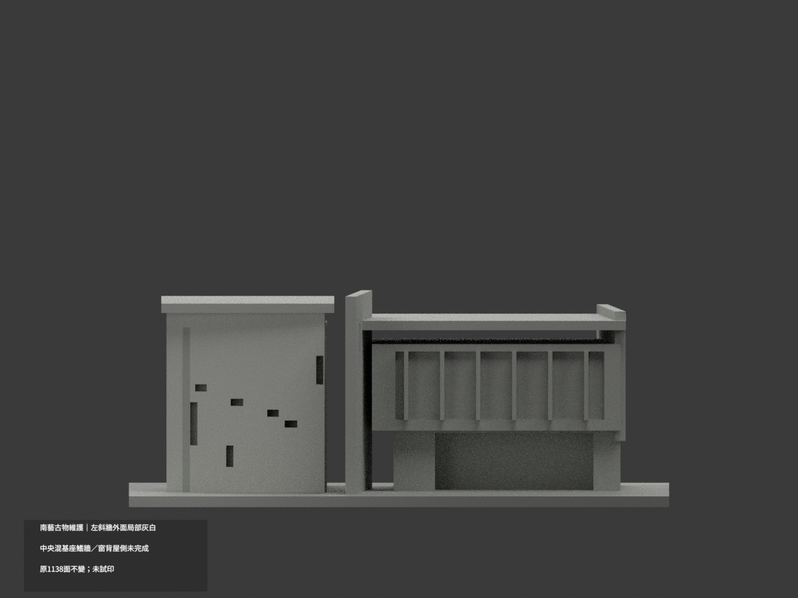
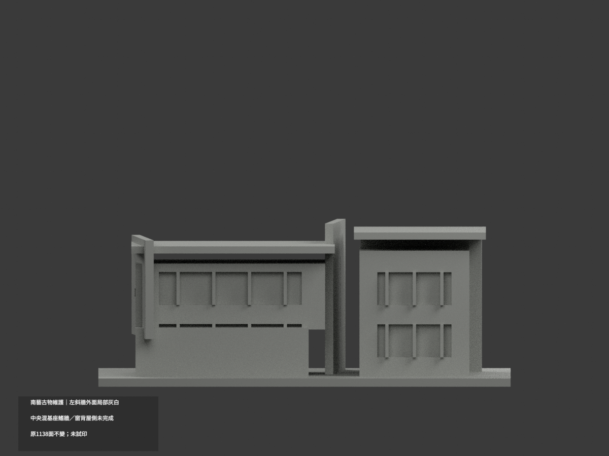
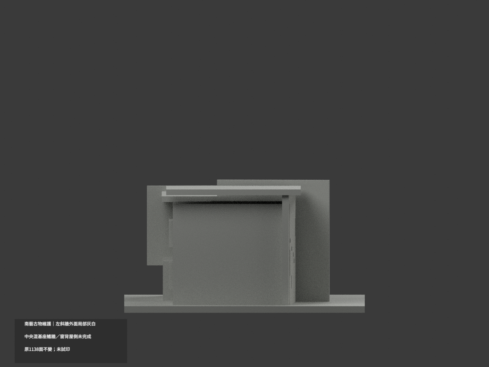
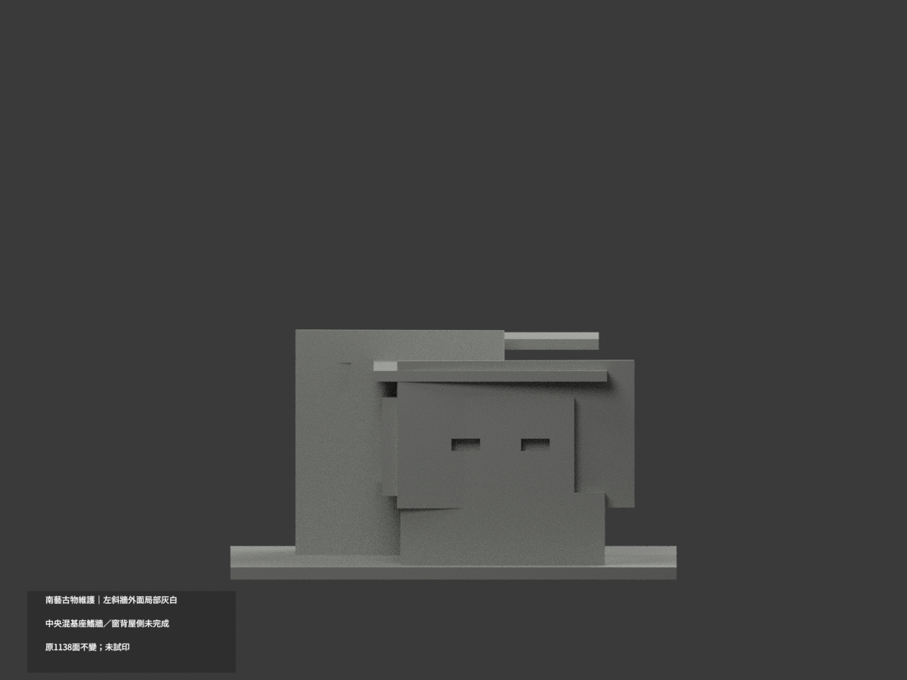
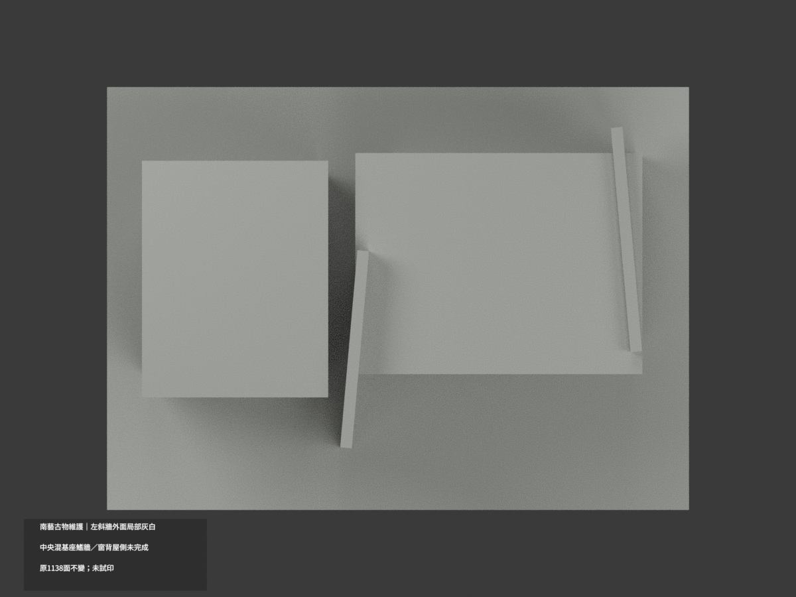
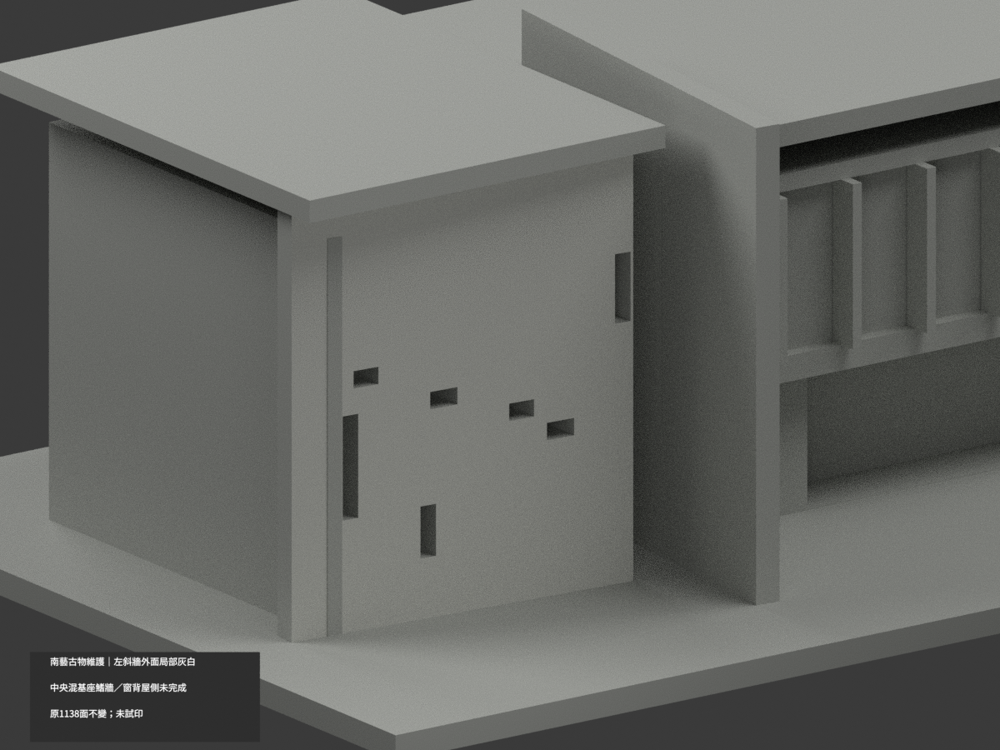
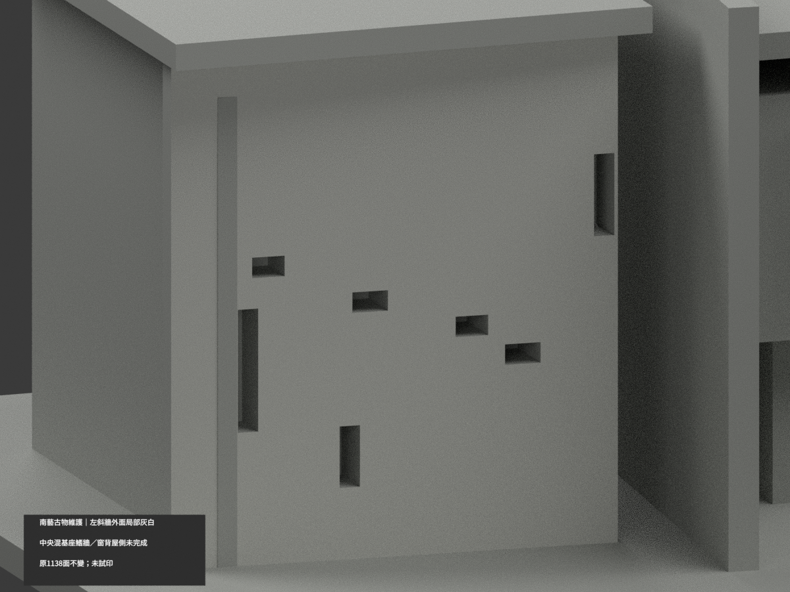
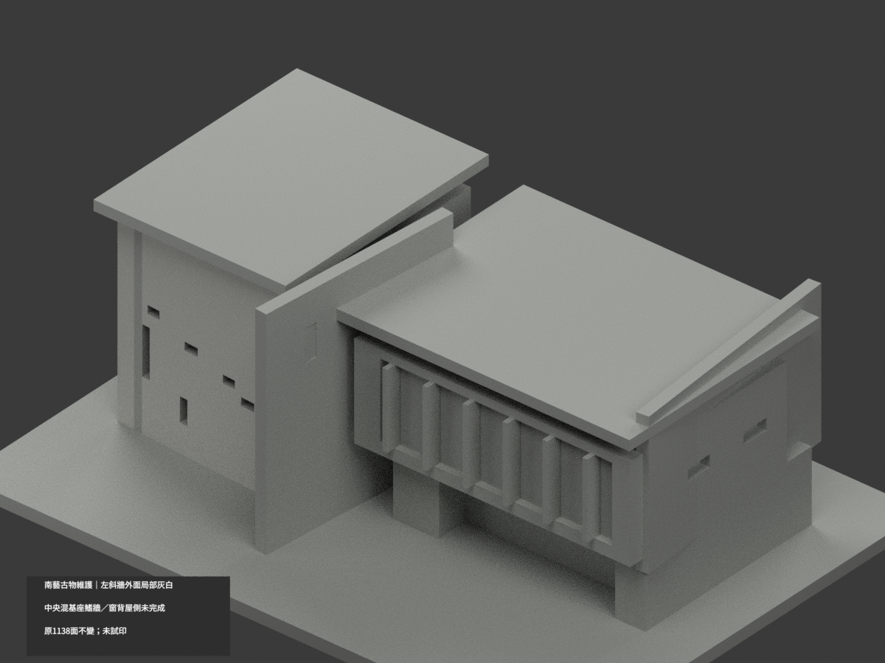

# 南藝古物維護｜左斜牆外面局部灰白

**中央混基座鰭牆、窗背、屋側等未完成分色。** `partial_color_incomplete=true`、`fully_colored_exterior=false`。僅左獨立斜牆48原面，非全色重建。

| 總覽 | 背側 | 正面 |
|---|---|---|
||||
||||
||||
||||

## 材色範圍
同 `tnnua-antiquities-conservation` 原項目，same-item、count_delta=0。**1138原三角面、STL與build_model.py字節不變**，不切面／新增幾何；原公開包無OBJ，不假稱保留。
- 左側不規則槽窗獨立板由原−4度旋轉建立；反轉回局部座標後 y′−24.5、x′−63..−19、z3..54，完整外面48原三角淺灰白。每頂點須在原有限面，不以bbox或法線任選三角。
- 其餘1090面中性：該板槽內／厚側／頂／背，中央−5度高鰭牆及連續深基座混域、右斜端面、粗窗背／梃／支承、兩屋皮、後部與基地。
- 全315共面連通域均一，0候選撤色；不把中央混深基座整牆塗白，也不按高度畫假材界。樹影不是材料邊界。
- 材色／中性界是來源與原拓撲範圍，非真實材接縫；補色不追認原近似造型、窗孔或側後精度。

## 來源／日期與權利
兩張官方已建外觀實照實看，拍攝日期未知。3D透視不作色證，不稱2026現況精測。
原照私有保存，不公開／貼圖；未確認CC／再散布授權，不保證商用。HEX是名義灰白色族，不是校準色票。
最終來源GO僅有界放行，不是發布核准，也不免除建模QA；繼承notformal字句屬先期review。

## 格式與列印
[原STL](model.stl) · [逐面材色3MF](appearance.3mf) · [Blender](scene.blend)
150×109mm原展示底座，照片近似非精測比例。STL無色；3MF與Blender真逐面材。兩材標籤非驗證兩色／四色耗材切片；**未實際列印**，無切片路徑。

## 重建與 QA
原 `build_model.py` → `colorize_model.py` → `export_appearance.py` → `validate_color.py`；Blender `render_color.py`／`verify_color_scene.py`。
原字節／三角multiset、閉合正體積、3MF逐面材、完整隔離原build＋color重建、scene重開、十圖1200×900與圖文hash核對；程序不取代來源人工審核。
原README、單色previews／render／validation保留歷程，不冒充新QA，無刪檔。

## English scope
Partial color only:48 original outward faces of the independent leftminus4degree wall palegraywhite. All1090 remaining triangles neutral, especially centralfin mixed withdarkbase, windows, roof/rear and wallthickness. Original1138 triangles unchanged; no original OBJ in immutable package. Two builtphotos captureunknown;3Dperspective excluded fromcolor evidence. Not testprinted or a validated filamentjob.
